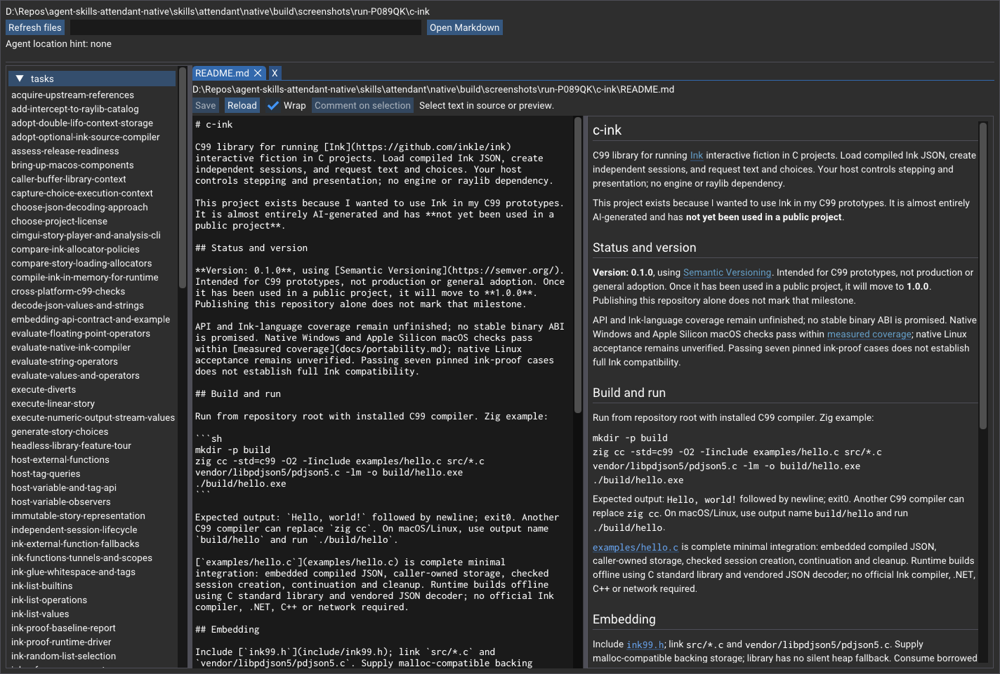
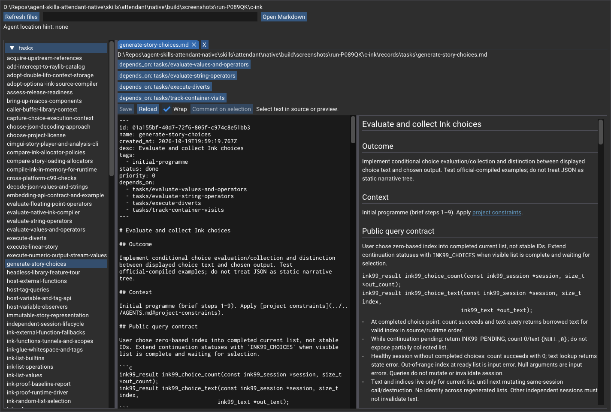
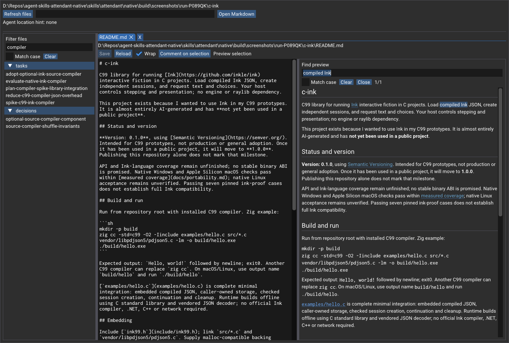

# Native Attendant

Browse and edit Markdown, manage structured records, and share selected passages with an agent. Source and rendered preview stay side by side. Markdown files remain authoritative; Attendant's SQLite index is disposable.

Native CLI and desktop GUI target Windows x64 and macOS arm64. No Node.js runtime required. CLI works without GUI dependencies.

## Screenshots

Windows GUI with c-ink workspace data, shared with permission.

### Markdown source and preview



### Task records and dependencies



### File filtering and preview search



## Build and run

Run from this directory with installed tools. Examples use Windows Git Bash; omit `.exe` on macOS. Choose Zig or replace `zig` with `cjit` for application builds. See [required tools and platform setup](../references/build.md#required-tools).

### Command line

CLI dependencies are vendored; build needs no network:

```sh
bash build.sh zig
build/attendant-zig.exe --help
build/attendant-zig.exe schema --project /path/to/project
build/attendant-zig.exe search --project /path/to/project --query "story choices"
```

For a new project or collection, follow [setup guide](../references/collections.md). For queries, updates and feedback, see [command reference](../references/commands.md).

### Desktop workspace

First GUI setup explicitly downloads pinned dependencies. Later builds can verify them offline; see [GUI build guide](../references/build.md#gui-dependencies-and-application).

```sh
bash tools/native-tool.sh prepare
bash tools/build-gui-stack.sh
bash build-gui.sh zig
build/gui/attendant-gui-zig.exe --project /path/to/project \
  --assets "$PWD/build/deps/richmd/assets" --file README.md
```

Keep native library beside executable and supply assets path. `--file` is optional. Do not rebuild binaries used by a running viewer; use a fresh build variant as described in build guide.

## Use the workspace

- Select a collection record or root Markdown file from sidebar. Type a project-relative or absolute path and press Enter or **Open Markdown**, or drop local Markdown files onto the window. These files open as tabs without changing sidebar discovery. Use **Refresh files** after discovered files change.
- Edit source on left; read rendered body on right. Follow dependency and local Markdown links. **Save** or Ctrl+S writes source. Reload and close prompt before discarding dirty work; far-right tab-bar **X** closes all tabs.
- **Wrap** toggles soft source wrapping without changing file. Drag vertical dividers to resize panes.
- Ctrl+F searches last-focused sidebar, source or preview. Sidebar filters names/paths; source includes unsaved text; preview searches visible text. Enter/F3 selects next document match; Shift reverses direction. **Match case** changes case handling. Escape closes document search; sidebar Escape clears and hides filter.
- Select source or preview text, then **Comment on selection**. Add comment and send; dirty source requires **Save & Send**. If queueing fails after save, file stays saved and error says feedback was not queued.
- Agents can queue tab activation with `--open PATH` for an existing viewer. Outside files must already be open or belong to a configured collection. Agent reveal shows a location hint; choose **Go** to navigate. Agents can also inspect current selection or explicitly show find results. [Agent GUI and IPC guide](../SKILL.md#gui-workspace).

## Data safety and limits

- Automatic navigation includes non-dot root Markdown and configured collection files only, not other subfolders. Explicit file opening remains available. Shared navigation capacity is 4096 documents; incomplete results show a warning.
- `schema`, `query` and `search` can correct mechanical metadata issues and report changes. Use `doctor` for read-only diagnosis or `validate --no-correct` to preview corrections. GUI reads do not prepare SQLite.
- Batch writes are atomic per file, not across whole batch. Inspect reported completed writes before retrying a failure. [Source types, write behavior and query limits](../references/data-contract.md).
- Preview selections may have context but no exact source range. Do not treat context-only feedback as a precise edit anchor.
- Renderer failure can lose unsaved edits and comment drafts. Migration/import, Git integration and coordinated concurrent writers are not supported.
- macOS IPC is same-user, not application authentication or desktop isolation. Other same-user processes can inspect selections. Recent usability/root-only/cleanup changes have not been revalidated on macOS.

## Development references

[Builds and checks](../references/build.md) · [Test contracts](tests/README.md) · [GUI internals](apps/gui/README.md) · [Dependency pins and licenses](vendor/README.md)
