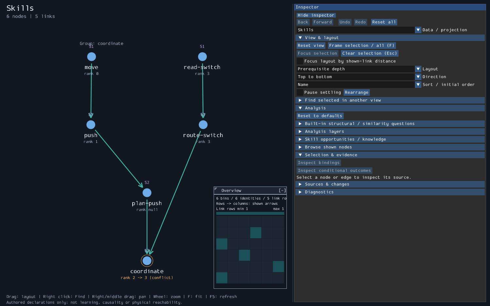
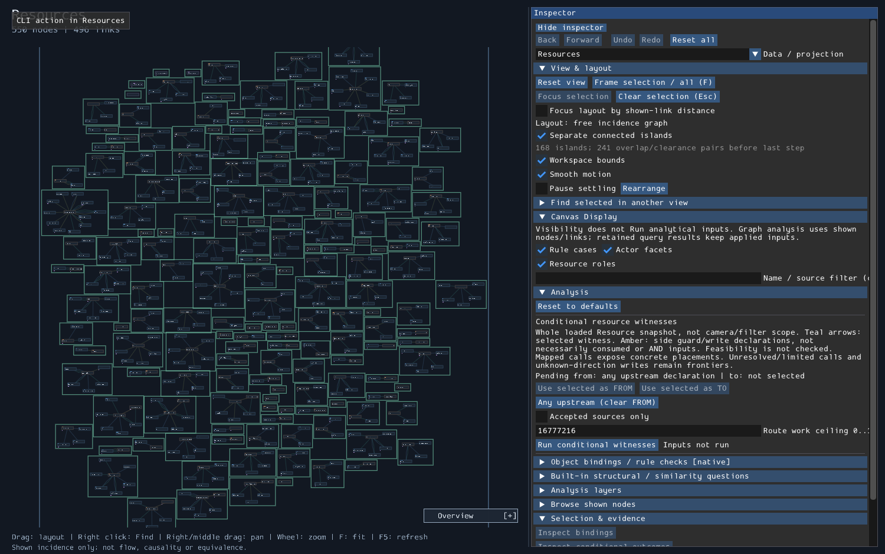
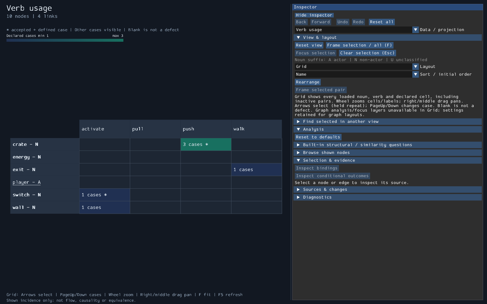
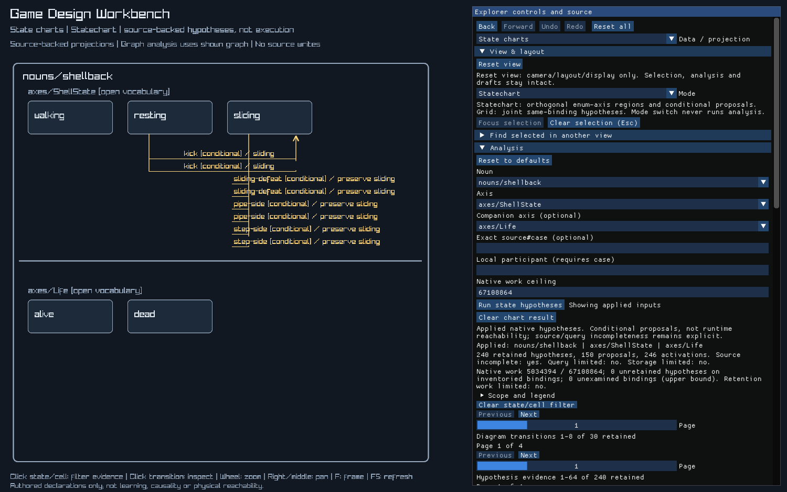

# Game Design Workbench

Design, analyze, and explore a game through a shared Markdown model. Use it to study an existing game, reason about a game in development, or work out the rules of a game that exists only on paper. Start with one question and model only what you need to answer it.

For example: What changes when an object is already occupied? Which encounters let players practise a skill before they need it? What has to happen before a resource becomes usable? The Workbench helps you trace answers to specific design records and see where those records leave the answer open.

## What you work with

- **Design records** hold intent, rules, skills, challenges, resources, and evidence. Markdown is the source of truth. [Attendant](../attendant/SKILL.md) manages collection setup, queries, validation, and authorized edits.
- **Explorer** is a desktop viewer for browsing grids, graphs, state charts, and their source evidence. Switch views when a different relationship matters, not to make a different copy of the design.
- **Native CLI** runs source-backed analysis without opening the viewer. Use it for repeatable questions, JSON output, or comparisons across explicit assumptions. Agents can also inspect a running Explorer, [adjust its inspector](native/ipc.md#read-and-patch-the-active-inspector), or [offer a Go / Dismiss hint](native/ipc.md#guide-the-user-in-explorer) to show the user where to look.
- **Framework guides** give you optional lenses for design review. Pick one that fits the question, such as skill atoms for learning sequences or MDA for tracing intended experience. [Browse frameworks](frameworks/index.md).

## Explore a design

### Follow skill prerequisites

Use **Skills** to see which skills build on others. Switch to **Challenges** to see where each route lets players practise those skills before a challenge demands them.

*Crate Puzzle: planning a push and routing a crate to a switch are both prerequisites for coordination. The graph flags that Coordinate's authored rank comes before one of its prerequisites.*

### Separate resource islands

Use **Resources** to inspect declared costs, production, and conversions. Turn on **Separate connected islands** to see which groups are connected in the loaded model. An island shows shared declarations, not a feasible resource flow.

*Little Plumber Guy NES: the Resources view outlines each connected island so separate clusters are visible at a glance.*

### See what can interact

Start with **Verb usage** to see which actions have cases for which objects. Select a cell to read the cases instead of inferring behavior from the count. Use **Noun interactions** when the question is which objects participate together, regardless of verb. A blank cell means no declaration was retained for that pair. It does not mean the interaction is impossible or should be added.

*Crate Puzzle: pushing a crate has three declared cases, not three active outcomes.*

### Ask what changes under a condition

Use **Actors** to start from a participant, **Effects** to start from an outcome and look for contributing declarations, or **State charts** to inspect conditional transitions for one object. Follow a result to its case, guards, and side effects before deciding what it means for the design.

*An earlier Explorer capture of the Statechart view: a kick can propose a state change, while other cases preserve the current state. Arrows show conditional declarations, not a run of the game.*

Use **MDA** to connect mechanics to intended dynamics and experience. Follow links back to the source before treating any chain as an explanation.

[Find the right view or command for your question](native/README.md).

## Get started

1. Load the [Game Design Workbench skill](SKILL.md) in your agent. For setup, record queries, or changes to authoritative Markdown, install and load [Attendant](../attendant/SKILL.md) too.
2. **Use your own game:** start with existing notes or write a short [concept](workflows/concept.md). Follow [setup](workflows/setup.md) when you need managed collections, and the [model guide](workflows/model.md) when you add records. Partial models are useful; do not fill gaps with guesses.
3. **Try a worked example first:** [Crate Puzzle](examples/crate-puzzle/README.md) walks through interactions and learning routes. [Forge Chain](examples/forge-chain/README.md) isolates resource conversion. [Little Plumber Guy NES](examples/little-plumber-guy-nes/README.md) models a larger, familiar design. These are examples, not templates for what your game must contain.
4. Build the [native CLI or desktop Explorer](native/build.md) when you need analysis. The [command quickstart](native/cli.md) and [Explorer guide](native/explorer.md) show how to pass your actual collection folders. Windows and Apple Silicon macOS have bounded build and runtime checks; see [build and check details](native/build.md).

## Work with the results

Use [inspection](workflows/inspect.md) to trace a finding, [capture](workflows/capture.md) to record facts and alternatives, and [review](workflows/review.md) to apply a selected lens. Use [emotional experience](workflows/emotional-experience.md) to describe what play should feel like, [control tuning](workflows/tune-controls.md) to compare configuration values, or an [experiment](workflows/experiment.md) when the question needs measurement. [Source notes](references/README.md) and the bundled Schell card data work offline; optional source links provide further reading.

**A result describes the model you loaded, not the game in motion.** A prerequisite link does not prove learning. A resource path does not prove that a player can use it. An intended emotion is not a measured response. Keep declarations, hypotheses, and observations distinct. Native analysis never writes the source; even edits to ranks and prerequisites in Explorer are [draft proposals](native/explorer.md#draft-editing-and-json-handoff).
