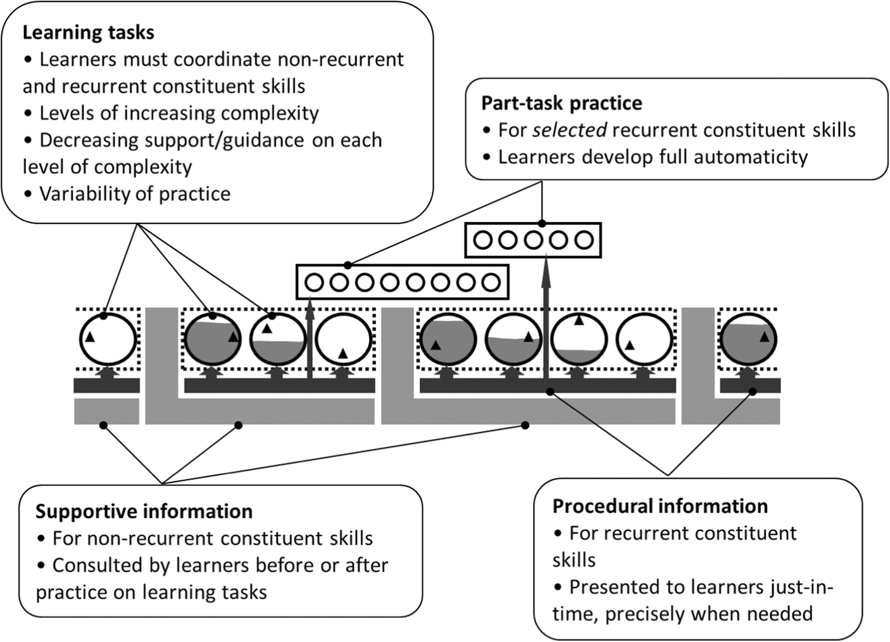

# Cognitive Architecture and Instructional Design: 20 Years Later — local conversion

- Authors: John Sweller, Jeroen J. G. van Merriënboer, Fred Paas.
- Published online: 22 January 2019. *Educational Psychology Review*, 31, 261–292.
- Original: https://doi.org/10.1007/s10648-019-09465-5
- Publisher PDF: https://link.springer.com/content/pdf/10.1007/s10648-019-09465-5.pdf
- Access date: 2026-10-21 (local session date).
- Source type: peer-reviewed author research review; not a new single experiment.
- Reuse: © The Author(s) 2019, [Creative Commons Attribution 4.0 International](https://creativecommons.org/licenses/by/4.0/). License appears in source's Open Access statement below.
- Method: publisher PDF downloaded with curl; converted locally through Docling Serve CPU v1.30.0, OCR disabled, no image export, asynchronous conversion. No remote OCR or LLM enrichment.
- Changes: PDF layout converted to Markdown; this provenance header added. Text not editorially corrected. Table 1 row/column associations are degraded; consult [original online PDF](https://link.springer.com/content/pdf/10.1007/s10648-019-09465-5.pdf) for tables and page layout. PDF binary is no longer retained locally. Figure 1 later supplemented with original publisher PNG on 2026-10-21; see acquisition record. Other image placeholders do not reference missing files. Full main prose, license statement, and bibliography retained; conversion is not a facsimile or independently validated transcription.
- See [acquisition record](../README.md) and [independent reading notes](../sweller-2019-reading-notes.md).

---

## REVIEW ARTICLE

<!-- image -->

## Cognitive Architecture and Instructional Design: 20 Years Later

John Sweller 1 &amp; Jeroen J. G. van Merriënboer 2 &amp; Fred Paas 3,4

Published online: 22 January 2019

# The Author(s) 2019

## Abstract

Cognitive load theory was introduced in the 1980s as an instructional design theory based on several uncontroversial aspects of human cognitive architecture. Our knowledge of many of the characteristics of working memory, long-term memory and the relations between them had been well-established for many decades prior to the introduction of the theory. Curiously, this knowledge had had a limited impact on the field of instructional design with most instructional design recommendations proceeding as though working memory and long-term memory did not exist. In contrast, cognitive load theory emphasised that all novel information first is processed by a capacity and duration limited working memory and then stored in an unlimited long-term memory for later use. Once information is stored in long-term memory, the capacity and duration limits of working memory disappear transforming our ability to function. By the late 1990s, sufficient data had been collected using the theory to warrant an extended analysis resulting in the publication of Sweller et al. ( Educational Psychology Review, 10 , 251 -296, 1998). Extensive further theoretical and empirical work have been carried out since that time and this paper is an attempt to summarise the last 20 years of cognitive load theory and to sketch directions for future research.

Keywords Cognitive load theory . Theoretical developments . Instructional advances

## Introduction

Cognitive load theory aims to explain how the information processing load induced by learning tasks can affect students ' ability to process new information and to construct knowledge in long-term memory. Its basic premise is that human cognitive processing is heavily constrained by our limited working memory which can only process a limited number of information elements at a time. Cognitive load is increased when unnecessary demands are imposed on the cognitive system. If cognitive load becomes too high, it hampers learning and transfer. Such demands include inadequate instructional methods to educate students about a subject as well as unnecessary distractions of the environment. Cognitive load may also be increased by processes that are germane to learning, such as instructional methods that emphasise subject information that is intrinsically complex. In order to promote learning and transfer, cognitive load is best managed in such a way that cognitive processing irrelevant to learning is minimised and cognitive processing germane to learning is optimised, always within the limits of available cognitive capacity (van Merriënboer et al. 2006).

* John Sweller j.sweller@unsw.edu.au

1 School of Education, University of New South Wales, Sydney, Australia

2 School of Health Professions Education, Maastricht University, Maastricht, The Netherlands

3 Department of Psychology, Education and Child Studies, Erasmus University Rotterdam, Rotterdam, The Netherlands

4 School of Education/Early Start, University of Wollongong, Wollongong, Australia

<!-- image -->

The roots of cognitive load theory can be traced back to 1982 (Sweller and Levine 1982), but a first full description of the theory was given in the 1988 article Cognitive Load During Problem Solving: Effects on Learning (Sweller 1988). In the next decade, many cognitive load effects and associated instructional methods were investigated by a small group of researchers located at the University of New South Wales, Australia, and the University of Twente, the Netherlands. This close collaboration led to an updated description of cognitive load theory that was published in the 1998 article Cognitive Architecture and Instructional Design (Sweller et al. 1998). After 1998, cognitive load theory quickly became one of the most popular theories in the field of educational psychology and instructional design, with researchers from across the globe contributing to its further development. The 1998 article became one of the most cited articles in the educational field with currently over 5000 citations in Google Scholar. The main aim of this follow-up article is to reflect on the evolution of cognitive load theory over the past 20 years, taking the 1998 article as a starting point and a description of future directions as the end point.

The structure of this article is as follows. The second section following this introduction provides a short history of cognitive load theory, first discussing the human cognitive architecture as presented in the 1998 article and then describing the categories of cognitive load followed by the seven cognitive load effects discussed in that article. The third section discusses the major developments in cognitive load theory between 1998 and 2018: first, the strengthening of its theoretical basis by grounding it in evolutionary psychology; second, its extension to the level of course and curriculum design in the four-component instructional design (4C/ID) model; third, introducing a series of new cognitive load effects including socalled compound effects; and fourth, introducing new methods for measuring the different categories of cognitive load. The fourth section discusses future developments of cognitive load theory, in particular, cognitive load in relation to resource depletion; self-regulated learning; emotions, stress and uncertainty and, finally, human movement. The fifth and final section provides some general conclusions.

## Short History of Cognitive Load Theory

The 1998 article Cognitive Architecture and Instructional Design discussed human cognitive architecture including an outline of cognitive load theory and its general principles, a description of seven cognitive load effects generated by the theory and issues associated with measuring cognitive load. Below, we will briefly revisit the human cognitive architecture and the original cognitive load effects described in the 1998 article; measurement issues will be discussed in the ' Measuring Cognitive Load ' section.

<!-- image -->

## Human Cognitive Architecture Used in 1998

The cognitive architecture used in 1998 reflected our knowledge of human cognition at that time. The basic components of that architecture, working memory, long-term memory and the relations between them were well-known, although the intricate, critical relations between working and long-term memory seemed novel to at least some readers who doubted that working memory functioned differently depending on whether the source of the information was the external environment or long-term memory. In addition, the instructional implications derived from that cognitive architecture were largely unknown.

The capacity and duration limits of working memory have been known at least since Miller (1956) and Peterson and Peterson (1959), although the fact that these limits effectively applied only to novel, not familiar information, seemed more implicit rather than explicit in most treatments. The limitations of working memory when dealing with novel information were absent in most instructional recommendations. These recommendations, especially with regard to the use of instructional problem solving, proceeded as though the characteristics of working memory were an irrelevant consideration. Indeed, most instructional recommendations made no mention of working memory.

Long-term memory was, of course, equally well-known in the literature. Nevertheless, it played almost no role in instructional recommendations perhaps because it may have been associated with rote learning. While rote learning obviously required the storage of information in long-term memory, there seemed to be an assumption that long-term memory played a minimal or no role in learning with understanding. Our emphasis on the central role of long-term memory when learning with understanding and in general skill formation was an unusual aspect of cognitive load theory. That emphasis derived from the critical work of De Groot (1965) whose original work on chess expertise was published in 1946. His finding that chess skill could be entirely explained by remembered chessboard configurations and the best moves for each configuration placed longterm memory indelibly as the central factor in problem-solving skill. This presence had heretofore been largely absent. Again, despite the ramifications of this finding for instructional design, few if any instructional recommendations placed any emphasis on the role of long-term memory.

While working and long-term memory were well-known, the important relations between them were much less emphasised. Working memory was limited in capacity and duration when dealing with novel information but these limitations effectively disappeared when working memory dealt with information transferred from long-term memory. A ready availability of large amounts of organised information from long-term memory results in working memory effectively having no known limits when dealing with such information. Ericsson and Kintsch (1995) in their theory of long-term working memory, reflected this point. Expertise, reliant on information held in long-term memory, transforms our ability to process information in working memory and transforms us, reflecting the transformational consequences of education on individuals and societies. It follows that the major function of instruction is to allow learners to accumulate critical information in long-term memory. Because it is novel, that information must be presented in a manner that takes into account the limitations of working memory when dealing with novel information. These processes provided the cognitive architecture that led to the instructional implications of cognitive load theory in 1998.

## Categories of Cognitive Load

In 1998, we discussed three categories of cognitive load: intrinsic, extraneous and germane. Intrinsic cognitive load referred to the complexity of the information being processed and was related to the concept of element interactivity. Because of the characteristics of human cognitive architecture described above, determining the complexity of information processed by humans is difficult. Most measures of informational complexity refer purely to the characteristics of the information. Such measures are inadequate when referring to information being processed by humans because of the relations between working and long-term memory discussed above. Information that has been organised and stored in long-term memory has very different characteristics for humans than the same information prior to it being stored. For readers of this paper, the English word ' characteristics ' and its Roman letters are processed easily and unconsciously as a single element retrieved from long-term memory. For someone learning to read English, the written word must be processed in working memory as multiple, interacting elements because the written word has not yet been stored as a single element in long-term memory. Complexity or element interactivity depends on a combination of both the nature of the information and the knowledge of the person processing the information. For someone learning to read English, interpreting the multiple squiggles that constitute the word ' characteristics ' may constitute a very high element interactivity task that overwhelms working memory. For an expert, the same squiggles may constitute only a single element that imposes a minimal cognitive load due to minimal element interactivity. Accordingly, intrinsic cognitive load is determined by both the complexity of the information and the knowledge of the person processing that information. Given these characteristics of the human cognitive system, measures that ignore knowledge when determining complexity are largely useless. Based on this analysis, intrinsic cognitive load only can be changed by changing what needs to be learned or changing the expertise of the learner.

<!-- image -->

Extraneous cognitive load is not determined by the intrinsic complexity of the information but rather, how the information is presented and what the learner is required to do by the instructional procedure. Unlike intrinsic cognitive load, it can be changed by changing instructional procedures. In 1998, it was assumed that element interactivity only was relevant to intrinsic cognitive load. Subsequently, it became apparent that it equally determines extraneous cognitive load (Sweller 2010). Effective instructional procedures reduce element interactivity while ineffective ones increase element interactivity. The vast bulk of the instructional effects reported below are due to variations in extraneous cognitive load.

Germane cognitive load was defined as the cognitive load required to learn, which refers to the working memory resources that are devoted to dealing with intrinsic cognitive load rather than extraneous cognitive load. The more resources that must be devoted to dealing with extraneous cognitive load the less will be available for dealing with intrinsic cognitive load and so less will be learned. In that sense, intrinsic and germane cognitive load are closely intertwined.

This characterisation of germane cognitive load is a departure from the 1998 paper. In that paper we assumed that germane cognitive load contributed to total cognitive load by substituting for extraneous load. Currently, we assume that rather than contributing to the total load, germane cognitive load redistributes working memory resources from extraneous activities to activities directly relevant to learning by dealing with information intrinsic to the learning task. The need for this alteration arose from the issue that if germane cognitive load simply replaced extraneous load when extraneous load was reduced, then there should be no change in total load following a reduction in extraneous load. Numerous empirical studies indicated a reduction in load following a reduction in extraneous load. The current formulation eliminates this problem by assuming that germane cognitive load has a redistributive function from extraneous to intrinsic aspects of the task rather than imposing a load in its own right.

## Instructional Effects Reported in 1998

In the 1998 article, seven cognitive load effects were reported (see the upper part of Table 1). All of these effects with the exception of the variability effect were due to a reduction in element interactivity associated with a decrease in extraneous cognitive load. The variability effect is due to alterations in intrinsic cognitive load. These effects were based on multiple, overlapping experiments carried out in several research centres around the globe and using a variety of materials and a variety of populations. Yet, many of these experiments did not attempt to directly measure comparative cognitive load; rather, cognitive load theory was used to generate instructional techniques and if these techniques produced the expected effects on learning outcomes they were assumed to strengthen the theory. Below, we will briefly describe each of the original effects but we will not attempt to discuss the research body that is available for each effect; for several effects, extensive review studies have been published elsewhere.

Goal-Free Effect The goal-free effect is also called the reduced goal specificity effect or no goal effect. It is the oldest effect studied in the context of cognitive load theory (Sweller and Levine 1982). It started from the observation that conventional problems (e.g. A car is uniformly accelerated from rest for 1 min. Its final velocity is 2 km/min. How far has it travelled? ) are typically solved by means-ends analysis, a process that is exceptionally expensive of working memory capacity because the learner must hold and process in working memory, the current problem state, the goal state, relations between them, problem-solving operators that could reduce differences and any sub-goals. When conventional problems are replaced by goal-free problems (e.g. A car is uniformly accelerated from rest for 1 min. Its final velocity is 2 km/min. Calculate the value of as many variables as you can ), learners are no longer able to extract differences between a current problem state and a goal state simply because no goal state is provided. They will now consider each problem state encountered and find any problem-solving operator that can be applied; once an operator has been applied, a new problem state has been generated and the process can be repeated. Whereas means-ends analysis bears little relation to knowledge construction processes, goal-free problem solving greatly reduces cognitive load and provides precisely the combination of low load and focus on solutions that is required for knowledge construction.

Worked Example Effect Like goal-free problems, worked examples aim to reduce the cognitive load caused by conventional problems and to facilitate knowledge construction. Worked examples provide a full problem solution that learners must carefully study. The worked example effect was first reported by Sweller and Cooper (1985) in the domain of algebra. In contrast to conventional problems, worked examples focus the learners ' attention on problem states and associated operators (i.e. solution steps), enabling them to induce generalised solutions. Thus, studying worked examples may facilitate knowledge construction and transfer performance more than actually solving the equivalent problems. Later research has distinguished between product-oriented worked-out examples that only provide a solution to some problem, process-oriented examples that show the process of finding the solution (e.g. van Gog et al. 2008) and modelling examples that show a human model who is generating the solution (e.g. Hoogerheide et al. 2014). Although there is very strong empirical evidence for the worked example effect, there are also important constraints: Worked examples are less effective for high-expertise learners and the design of good worked examples is difficult, for example, because they should not require the learner to mentally integrate different sources of information (see the split-attention effect below) or combine redundant information (see the redundancy effect below). A review of studies on learning from examples is provided by Renkl (2013).

<!-- image -->

Table 1 Timeline of major cognitive load effects before and after 1998

| Description                         | Replace conventional tasks with goal-free tasks that provide learners with a non-specific goal. Replace conventional tasks with worked examples that provide learners with a solution they must carefully study. Replace conventional tasks with completion tasks that provide learners with a partial solution they must complete. Replace multiple sources of information, distributed either in space (spatial split attention) or time (temporal split attention), with one integrated source of information. Replace multiple sources of information that are self-contained (i.e. they can be understood on their own) with one source of information. Cognitive load effects that are found for high element interactivity materials are typically not found for low element interactivity materials. Actually, cognitive load theory is only relevant for complex learning. Replace a series of tasks with similar surface features with a series of tasks that differ from one another on all dimensions on which tasks differ in the real world. Replace a written explanatory text and another source of visual information (unimodal) with a spoken explanatory text and the visual source of information (multimodal). Replace separate worked examples or completion tasks with enriched ones containing prompts, asking learners to self-explain the given information.                                                                                                                                                   |
|-------------------------------------|------------------------------------------------------------------------------------------------------------------------------------------------------------------------------------------------------------------------------------------------------------------------------------------------------------------------------------------------------------------------------------------------------------------------------------------------------------------------------------------------------------------------------------------------------------------------------------------------------------------------------------------------------------------------------------------------------------------------------------------------------------------------------------------------------------------------------------------------------------------------------------------------------------------------------------------------------------------------------------------------------------------------------------------------------------------------------------------------------------------------------------------------------------------------------------------------------------------------------------------------------------------------------------------------------------------------------------------------------------------------------------------------------------------------------------------------------------------------------------------------------------------------------------------|
| First publication naming the effect | 1982 Sweller and Levine (1982). Effects of goal specificity on means-ends analysis and learning. Journal of Experimental Psychology: Learning, Memory and Cognition , 8, 463 - 474. 1985 Sweller and Cooper (1985). The use of worked examples as a substitute for problem solving in learning algebra. Cognition and Instruction , 2, 59 - 89. 1987 van Merriënboer and Krammer (1987). Instructional strategies and tactics for the design of introductory computer programming courses in high school. Instructional Science , 16, 251 - 285. 1988 Tarmizi and Sweller (1988). Guidance during mathematical problem solving. Journal of Educational Psychology , 80, 424 - 436. 1991 Chandler and Sweller (1991). Cognitive load theory and the format of instruction. Cognition and Instruction , 8, 293 - 332. effect 1994 Sweller (1994). Cognitive load theory, learning difficulty and instructional design. Learning and Instruction , 4, 295 - 312. 1994 Paas and van Merriënboer (1994a). Variability of worked examples and transfer of geometrical problem solving skills: a cognitive load approach. Journal of Educational Psychology, 86 , 122 - 133. 1995 Mousavi et al. (1995). Reducing cognitive load by mixing auditory and visual presentation modes. Journal of Educational Psychology , 87, 319 - 334. cognitive architecture and instructional design 1998 Renkl et al. (1998). Learning from worked-out examples: the effects of example variability and elicited self- explanations. Contemporary Educational |
| Effect                              | Goal-free effect Worked example Completion problem Split-attention effect Redundancy effect Compound Element Variability effect Modality effect Publication of the Self-explanation                                                                                                                                                                                                                                                                                                                                                                                                                                                                                                                                                                                                                                                                                                                                                                                                                                                                                                                                                                                                                                                                                                                                                                                                                                                                                                                                                      |

<!-- image -->

Table 1 (continued)

| Description                         | Replace conventional study of a procedure or concept to learn with imagination, where the learner is asked to imagine or mentally practice the concept or procedure. Replace a presentation of information/tasks with all interacting elements at once by initially presenting elements of information sequentially in an isolated form rather than in a fully interactive form. Cognitive load effects that are found for low expertise learners (e.g. worked example effect, goal free effect) are typically not found or even reversed for high expertise learners. Cognitive load effects that are relevant in the beginning of a longer educational program (e.g. guided problem-solving, worked examples) are no longer relevant in later stages of the program, after the learners acquired sufficient expertise. Replace individual learning tasks with collaborative tasks so that more cognitive resources become available. Cognitive load effects that are found for transient information (e.g. self-pacing effect, segmentation effect, modality effect) are typically not found for non-transient or less transient information. 45. Replace static or unrealistic visualisations with visualisations showing human movements. Cognitive load effects that are found for ill-designed instructional materials (e.g. split attention) are not found when learners are explicitly taught how to reduce the associated extraneous load.   |
|-------------------------------------|-------------------------------------------------------------------------------------------------------------------------------------------------------------------------------------------------------------------------------------------------------------------------------------------------------------------------------------------------------------------------------------------------------------------------------------------------------------------------------------------------------------------------------------------------------------------------------------------------------------------------------------------------------------------------------------------------------------------------------------------------------------------------------------------------------------------------------------------------------------------------------------------------------------------------------------------------------------------------------------------------------------------------------------------------------------------------------------------------------------------------------------------------------------------------------------------------------------------------------------------------------------------------------------------------------------------------------------------------------------------------------------------------------------------------------------------------------|
| First publication naming the effect | 2001 Cooper et al. (2001). Learning by imagining. Journal of Experimental Psychology: Applied , 7, 68 - 82. 2002 Pollock et al. (2002). Assimilating complex information. Learning and Instruction , 12, 61 - 86. effect 2003 Kalyuga et al. (2003). The expertise reversal effect, Educational Psychologist , 38(1), 23 - 31. effect 2003 Renkl and Atkinson (2003). Structuring the transition from example study to problem solving in cognitive skill acquisition: a cognitive load perspective. Educational Psychologist , 38, 15 - 22. 2009 Kirschner et al. (2009). A cognitive load approach to collaborative learning: united brains for complex tasks. Educational Psychology Review , 21, 31 - 42. effect 2011 Leahy and Sweller (2011). Cognitive load theory, modality of presentation and the transient information effect. Applied Cognitive Psychology , 25, 943 - 951. 2012 Paas and Sweller (2012). An evolutionary upgrade of cognitive load theory: using the human motor system and collaboration to support the learning of complex cognitive tasks. Educational Psychology Review , 4, effect 2012 Roodenrys et al. (2012). Managing one ' s own cognitive load when evidence of split attention is present, Applied Cognitive Psychology , 26, 878 - 886.                                                                                                                                                                     |
| Effect                              | Imagination effect Isolated elements effect Compound Expertise reversal Compound Guidance-fading Collective working memory Compound Transient information Human movement effect Compound Self-management                                                                                                                                                                                                                                                                                                                                                                                                                                                                                                                                                                                                                                                                                                                                                                                                                                                                                                                                                                                                                                                                                                                                                                                                                                              |

<!-- image -->

Completion Problem Effect A potential disadvantage of worked examples is that they do not force learners to carefully study them. Therefore, van Merriënboer and Krammer (1987) suggested the use of completion problems in the field of introductory computer programming. Such problems provide a given state, a goal state, and a partial solution that must be completed by the learners. In the field of computer programming, this means that the learners receive incomplete computer programs that need to be finished. Although fully worked examples do not explicitly induced learners to study them, learners must carefully study and understand the partial worked examples provided in completion problems because they otherwise will not be able to complete the solution correctly. Completion problems may also be seen as a bridge between worked examples and conventional problems: worked examples are completion problems with a complete solution and conventional problems are completion problems with a partial solution. When designing a course, these differing solution levels allow commencement with completion problems that provide almost complete solutions and gradually work to completion problems for which all or most of the solution must be generated by the learners. This strategy became known as the ' completion strategy ' (van Merriënboer and Krammer 1990) and can be seen as a forerunner of the guidance-fading effect that will be described below.

Split-Attention Effect The split-attention effect stems from research on worked examples and was first reported by Tarmizi and Sweller (1988). For instance, a worked example in the domain of geometry might consist of a diagram and its associated solution statements. The diagram alone reveals nothing about the solution to the problem and the statements, in turn, are unintelligible for the learners until they have been integrated with the diagram. Learners must mentally integrate the two sources of information in order to understand the solution, a process that yields a high cognitive load and hampers learning. This split-attention effect can be prevented by physically integrating the diagram and the solution statements, making mental integration superfluous and reinstating the positive effects of worked examples. The splitattention effect not only relates to the spatial organisation of information sources but also to their temporal organisation. Mayer and Anderson (1992) found that animation and associated narration need to be temporally coordinated in order to decrease cognitive load and facilitate learning. A recent review of the split-attention effect is provided by Ayres and Sweller (2014).

Redundancy Effect While the split-attention effect grew out of the worked example effect, the redundancy effect, in turn, grew out of the split-attention effect. Split attention occurs when learners are confronted with two complementary sources of information, which cannot stand on their own but must be integrated before they can be understood. But what happens when the two sources of information are self-contained and can be understood without reference to each other? Chandler and Sweller (1991) used a diagram demonstrating the flow of blood in the heart, lungs and rest of the body together with statements that described this flow of blood in text. Thus, the diagram and the statements contained the same information and were fully redundant. It was found that only presenting the diagram was superior to presenting both sources of information together. This redundancy effect is due to the fact that effortful processing is required from the learners to eventually discover that the information from the two sources is identical. This finding is important and counter-intuitive based on the assumption that providing the same information twice can do no harm or is even beneficial. Inspection of the literature shows that the redundancy effect has been discovered, forgotten and rediscovered over many decades: As early as 1937, Miller reported that young children learning to read nouns made more progress if the words were presented alone rather than in conjunction with similar pictures.

<!-- image -->

Modality Effect All cognitive load effects discussed in the 1998 article assumed that working memory capacity is fixed for a given individual in the sense that the number of elements that could be dealt with was unalterable, with the modality effect as an exception. The modality effect is based on the assumption that working memory can be subdivided into partially independent processors, one dealing with verbal materials based on an auditory working memory and one dealing with diagrammatic/pictorial information based on a visual working memory (e.g. Baddeley 1992). Consequently, effective working memory capacity can be increased by using both visual and auditory working memory rather than either processor alone. Mousavi et al. (1995) were the first to test the modality effect in geometry learning; they presented a diagram either with integrated written text (i.e. visual) or with auditory, spoken text and they hypothesised that the combination with spoken text would be most effective due to the modality effect. They indeed found the modality effect that has since been replicated in many other experiments. The modality effect has important implications for how to deal with split-attention effects: if split attention occurs, presenting the written information in an auditory mode may be equally or even more effective than physically integrating it in the diagram. Ginns (2005a) provided a meta-analysis of the modality effect that is still worth reading.

Variability Effect Variability over problem situations is generally expected to encourage learners to construct more general knowledge, because it increases the probability that similar features can be identified and that relevant features can be distinguished from irrelevant ones. In other words, increases in variability increase intrinsic cognitive load allowing more to be learned provided there is sufficient working memory resources to handle the increase. Several studies showed that variability not only increased cognitive load during practice but also increased transfer of learning. Initially, the variability effect seemed to contradict all earlier reported cognitive load effects, because it combines an increase rather than a decrease of cognitive load with higher learning outcomes. In the domain of geometrical problem solving, Paas and van Merriënboer (1994a) were the first to describe the variability effect in the context of cognitive load theory: They hypothesised that high variability would have a positive effect on learning and transfer in situations in which cognitive load was low (i.e. learning from worked examples), because in such situations the total cognitive load would stay within limits, irrespective of the fact that variability increased intrinsic cognitive load. In contrast, they predicted that high variability would have a negative effect on learning and transfer in situations in which cognitive load was already high (i.e. learning by solving conventional problems), because the total cognitive load would then overburden learners ' working memory. Indeed, the expected interaction between problem format (worked examples, conventional problems) and variability (low, high) was found. Based on this and similar findings, a distinction was introduced between load that is caused by ' extraneous ' processes not productive for learning and load that is caused by ' germane ' processes and productive for learning. When instruction is designed, it should first decrease extraneous cognitive load, but as a new implication, instructional designs that are effective in decreasing extraneous cognitive load may become even more effective if they increase germane cognitive load, provided that total cognitive load stays within limits. As will be described in the ' Developments in Cognitive Load Theory 1998 -2018 ' section, this opened up the way for measuring different types of cognitive load and identifying new effects that explicitly aimed at increasing germane processing.

<!-- image -->

## Developments in Cognitive Load Theory 1998 -2018

There have been major developments in cognitive load theory over the last 20 years. First, its theoretical basis has been strengthened by laying a strong foundation for human cognitive architecture in evolutionary psychology. Second, four-component instructional design (4C/ID) has been developed as a twin theory focussing on the design of educational programs of longer duration (courses or whole curricula). Third, research yielded a series of new cognitive load effects, including the so-called compound effects, that is, effects that alter the characteristics of other, simple cognitive load effects. Fourth and finally, new instruments have been developed to measure different types of cognitive load. We will begin by considering theoretical developments based on evolutionary psychology.

## Human Cognitive Architecture Seen Through the Prism of Evolutionary Psychology

While our 1998 version of human cognitive architecture, with its emphasis on the intricate relations between working memory and long-term memory, provided a critical aspect of how we learn, think and solve problems, the continual advances in our knowledge of human cognition indicated a need to expand that earlier conceptualisation. Much of that expansion revolved around evolutionary psychology which provided an impetus for that work.

Based on Geary ' s distinction between biologically primary and secondary knowledge (Geary 2008, 2012; Geary and Berch 2016), evolutionary educational psychology allows us to categorise information in instructionally meaningful ways that now are central to cognitive load theory (Sweller 2016a). Biologically primary knowledge is knowledge that we have evolved to acquire over countless generations. That category of knowledge tends to be critically important to humans providing, as examples, knowledge that allows us to listen and speak, recognise faces, engage in basic social functions, solve unfamiliar problems, transfer previously acquired knowledge to novel situations, make plans for future events that may or may not happen, or regulate our thought processes to correspond to our current environment. Humans must learn to engage in these very complex cognitive activities but because of their importance, we have evolved to acquire the necessary skills effortlessly and automatically. Consequently, they cannot be taught to most people.

Biologically primary knowledge is modular with little relation between the cognitive processes associated with one skill and another (Geary 2008, 2012). Each skill is likely to have evolved in different evolutionary epochs requiring very different cognitive processes. Our ability to regulate our thought processes to correspond to our current environment is likely to have evolved before we became modern humans as did our tendency to use gestures to communicate, while our ability to organise our lips, tongue, breath and voice to speak is likely to have evolved far more recently.

Avery large number of biologically primary skills are generic-cognitive in nature such as general problem-solving skills or even our ability to construct knowledge (Sweller 2015,

<!-- image -->

2016b; Tricot and Sweller 2014). A generic-cognitive skill is a basic cognitive skill that we have evolved to acquire instinctively because it is indispensable to a very wide range of cognitive functions. Generic-cognitive skills tend to be more concerned with how we learn, think and solve problems rather than the specific subject matter itself. Over the last few decades, many educationalists, correctly realising the importance of such skills, have advocated that they be taught. Such campaigns tend to fail, not because the skills are unimportant but because they are of such importance to humans that we have evolved to acquire them automatically without instruction. The enormous emphasis on teaching general problem-skills last century provides an example. Evidence for the effectiveness of teaching generic-cognitive skills requires randomised, controlled trials using far transfer tests. Far transfer is required because the rationale of generic-cognitive skills is that they will enhance performance over a wide range of areas and, of course, it is essential to ensure that any performance improvement is not due to domain-specific knowledge.

It should be noted that while the acquisition of biologically primary skills tends to occur automatically and unconsciously without explicit teaching, it does not follow that use of the skills occurs unconsciously in every context. For example, we learn to speak our native language unconsciously without explicit effort but may require considerable effort to find appropriate words with appropriate meanings in any given situation. We need to learn how to use biologically primary knowledge in specific domains, which leads to biologically secondary knowledge.

Biologically secondary knowledge is knowledge we need because our culture has determined that it is important. Examples of biologically secondary information can be found in almost all topics taught in education and training contexts. Educational institutions were invented because of our need for people to acquire knowledge of biologically secondary information.

We have evolved to acquire secondary knowledge but it is acquired very differently to primary knowledge. Except insofar as it is related to primary knowledge, secondary knowledge is not modular but rather, is part of a single, unified system. Because it is a unified system, there are considerable similarities in acquiring biologically secondary knowledge irrespective of the domain under consideration. All secondary knowledge tends to require conscious effort on the part of the learner and explicit instruction on the part of an instructor. It is rarely acquired automatically. The distinction between the two processes can be exemplified by the distinction between learning to listen and learning to read. As indicated above, we learn to listen automatically, without tuition. Most people do not learn to read automatically. Despite reading and writing having been invented thousands of years ago, few people learned to read and write until the advent of modern education very recently.

In contrast to the generic-cognitive skills associated with most biologically primary knowledge, biologically secondary knowledge is heavily domain-specific (Sweller 2015, 2016b; Tricot and Sweller 2014). We have evolved to learn how to solve a variety of problems using generic-cognitive skills. We have not specifically evolved to learn how to read and write a particular word in English or Chinese, or that the best first move when solving a problem such as ( a + b) / c = d , solve for a , is to multiply both sides by the denominator on the left side. These domain-specific, biologically secondary skills need to be explicitly taught (Kirschner et al. 2006; Sweller et al. 2007) and actively learned.

Most educationists intuitively understand that generic-cognitive skills are far more important to human functioning than domain-specific skills and this understanding has led to a substantial emphasis on generic-cognitive skills. Nevertheless, there is an increasing recognition that while domain-specific skills are eminently teachable, purely generic-cognitive skills are not teachable and attempts to teach them lead to dead-ends (Sala and Gobet 2017). The previous emphasis on generic-cognitive skills is due to a failure to realise the distinction between biologically primary and secondary knowledge (Tricot and Sweller 2014). An accent on teaching generic-cognitive skills was, of course, present in 1998 with the popularity of teaching generic problem-solving skills. The 1998 paper was partially a reaction to that accent. That phase has passed but other generic-cognitive skills have replaced that emphasis with, as indicated by Sala and Gobet, no greater success. Furthermore, despite about a century of effort, there is little evidence from far transfer studies, that generic-cognitive skills which transcend domain-specific areas can be taught. The ' natural ' , minimal guidance procedures used to acquire biologically primary, generic-cognitive skills are inappropriate for the acquisition of biologically secondary, domain-specific skills that tend not to be acquired easily, unconsciously and automatically.

<!-- image -->

The data summarised by Sala and Gobet (2017) provide a major justification for the post 1998 inclusion of evolutionary psychology into cognitive load theory. Of course, none of the above eliminates the possibility of new data becoming available indicating the possibility of teaching purely generic-cognitive skills leading to far transfer effects. Should a substantial body of such data become available, further modifications to cognitive load theory would be required.

We should not conclude from the above argument that biologically primary knowledge and generic-cognitive skills are irrelevant to instructional issues. While we doubt that attempts to teach biologically primary, generic-cognitive skills will be successful, they can be used to assist in teaching biologically secondary, domain-specific skills (Paas and Sweller 2012). For example, students may know how to randomly generate problem solution moves without being instructed in the procedures to do so, but may not be aware of the domain-specific conditions where the technique might be effective. Pointing out to students that a genericcognitive skill should be used on a particular class of specific problems can be instructionally effective (Youssef-Shalala et al. 2014). Furthermore, it is important to note that teaching anything involves a combination of primary and secondary skills with the secondary skill being the only part that is learned. For example, medical doctors are taught how to effectively communicate in an emergency team using the SBAR method, always reporting on the situation, background, assessment and recommendations (Beckett and Kipnis 2009). Obviously, the SBAR method can be taught because doctors are able to speak with each other. But, although it makes no sense to teach doctors how to speak with each other in a generic sense because this is primary knowledge, teaching them the specific SBAR method is secondary knowledge and might have a very positive effect on team communication in emergency situations.

The cognitive architecture required to process biologically secondary information consists of biologically primary processes that provide a base for cognitive load theory. Together, the processes mimic the information processing procedures of biological evolution (Sweller and Sweller 2006) and can be described as constituting a natural information processing system. They can be described by five basic, biologically primary principles. These principles provide the cognitive architecture that underlies the instructional procedures of cognitive load theory.

The Information Store Principle Natural information processing systems such as human cognition require a large store of information in order to function in our complex natural world. Long-term memory provides that structure in human cognition. We do not need to teach people how to store or organise information in long-term memory indicating its biologically primary function. Long-term memory was explicitly articulated in the 1998 paper.

<!-- image -->

The Borrowing and Reorganising Principle The vast bulk of information stored in long-term memory comes from other people. Humans are intensely social with powerfully evolved procedures for obtaining information from others and for providing information to others. Because it is a biologically primary skill, we automatically assume that we will provide and receive information from others during our lives. This principle was to some extent assumed in the 1998 paper, although it was not explicitly stated. Cognitive load theory with its emphasis on explicit instruction places prominence on this principle.

The Randomness as Genesis Principle While most of the information stored in long-term memory is obtained from others, if no one is available from whom to borrow the information, it will need to be generated. Novel information is generated using a random generate and test procedure during problem solving. The procedure only is used when information is unavailable from one ' s own or someone else ' s long-term memory. When problem solvers do not have information indicating which moves should be made at a given point, they have no choice other than to randomly generate a move and test it for effectiveness with effective moves retained and ineffective ones jettisoned. Again, this procedure does not require instruction because it is biologically primary.

The Narrow Limits of Change Principle When dealing with human cognition, this principle refers to the severe limitations of working memory when processing novel information. This principle has always been central to cognitive load theory and was clearly articulated as such in 1998. A basic assumption of the principle has been that for any given individual, general working memory capacity is fixed. With recent evidence that working memory depletion occurs after cognitive effort and recovers after rest (Chen et al. 2018), that assumption must be modified to allow such capacity variations. (This issue is discussed further in the ' Future Directions ' section.)

The Environmental Organising and Linking Principle While working memory is limited when processing novel information, there are no known limits when familiar, organised information from long-term memory is processed. Once information is stored in long-term memory, environmental cues can be used to generate actions appropriate to that environment. In this manner, the previous principles can be used to construct knowledge in long-term memory that can be used to govern action that is appropriate to the environment. The impetus to use previously organised and stored information in this fashion is biologically primary and does not require tuition. This principle was heavily emphasised in the 1998 version of cognitive load theory.

This cognitive architecture, with its emphasis on the importance of explicit instruction when dealing with the biologically secondary, domain-specific content that is characteristic of most educational programs, provides a base for cognitive load theory and an explanation for its success in generating novel instructional procedures. Instruction should be explicit because we have evolved to learn directly from other people via the borrowing and reorganising principle. In line with the narrow limits of change principle, it needs to be organised in a manner that reduces working memory load because working memory load primarily occurs when processing novel, domain-specific information. Obtaining information from others using the borrowing and reorganising principle reduces working memory load compared to generating information ourselves using the randomness as genesis principle. Once information has been obtained and stored in long-term memory via the information store principle, the limitations of working memory disappear and the information can be transferred back to working memory using the environmental organising and linking principle to generate appropriate action. By devising instruction to accord with this cognitive architecture, we can expect learning to be enhanced. Of course, the ultimate test is empirical and is provided by the cognitive load effects.

<!-- image -->

## 4C/ID and Cognitive Load

Cognitive load theory provides evidence-informed principles that can be applied to the design of instructional messages or relatively short instructional units, such as lessons, written materials consisting of text and pictures, and educational multimedia (instructional animations, videos, simulations, games). It shares several of its principles with mental workload models, which focus on workplace performance rather than learning and instructional design (e.g. Wickens 2008), and with the cognitive theory of multimedia learning, which has an exclusive focus on the design of multimedia materials (CTML; Mayer 2014). A closely related model that is based on precisely the same cognitive architecture as cognitive load theory and that has been developed fully in parallel is four-component instructional design (4C/ID). The 4C/ID model provides an important extension to cognitive load theory because it focuses on the design of educational programs of longer duration (e.g. courses or whole curricula).

The first description of 4C/ID appeared in 1992 (van Merriënboer et al. 1992) and the book Training Complex Cognitive Skills , which provided the first complete description of the 4C/ID model, appeared in the same period as the 1998 cognitive load article (van Merriënboer 1997). The 4C/ID model exclusively deals with complex learning, which is characterised by high element interactivity in a learning process that is often aimed at the development of complex skills or professional competencies. A first basic assumption of 4C/ID is that complex skills include ' recurrent ' constituent skills, which are consistent over tasks and situations and can be developed into routines, as well as ' non-recurrent ' constituent skills, which rely on problem solving, reasoning and decision-making (van Merriënboer 2013). A second basic assumption is that courses or programs aimed at the development of complex skills can always be built from four components: (1) learning tasks, (2) supportive information, (3) procedural information and (4) part-task practice (see Fig. 1).

Learning tasks (indicated by the big circles in Fig. 1) are preferably based on real-life tasks and by performing these tasks learners acquire both non-recurrent and recurrent constituent skills and learn to coordinate them. In order to manage intrinsic cognitive load, learning tasks are first organised according to levels of increasing complexity (indicated by dotted boxes around series of learning tasks in Fig. 1); thus, learners start to work on simple learning tasks but the more expertise they acquire the more complex the tasks they work on (i.e. a spiral curriculum). Second, in order to manage extraneous cognitive load, learner support and guidance gradually decrease at each level of complexity (indicated by the diminishing filling of the circles at each level of complexity in Fig. 1); thus, learners first receive a lot of support and guidance but support/guidance gradually decreases until learners can perform the learning tasks at a particular level of complexity without support/guidance -only then, they continue to work on more complex learning tasks for which they initially receive a lot of support/guidance again, after which the whole process repeats itself. The 4C/ID model describes several approaches to fading-guidance but the completion strategy, from studying worked examples via completion tasks to conventional tasks, is a particularly important one. Third, in order to stimulate germane processing, all learning tasks in a course or program show high variability of practice (indicated by the triangles at different positions in the learning tasks), stimulating learners to compare and contrast tasks with each other.

<!-- image -->

Fig. 1 A schematic outline of an educational program built from the four components (adapted from van Merriënboer and Kirschner 2018a)

Supportive information (indicated by the L-shapes in Fig. 1) helps learners learn to perform the non-recurrent aspects of learning tasks (i.e. problem-solving, reasoning, decision-making). It explains how the domain is organised (often called ' the theory ' ) and how tasks in the domain can be systematically approached; it is connected to levels of complexity because for performing more complex tasks, learners need more, or more elaborated, supportive information. It provides a bridge between what learners already know and what they need to know to successfully carry out the learning tasks. Both the work on the learning tasks and the study of supportive information aim at knowledge construction (through, in order, inductive learning and elaboration). Because supportive information typically has high element interactivity, it is preferable not to present it to learners while they are working on the learning tasks. Simultaneously performing a task and studying the supportive information would almost certainly cause cognitive overload. Instead, supportive information is best presented before learners start working on a learning task, or, at least apart from working on a learning task. In this way, learners can construct knowledge structures in long-term memory that can subsequently be activated in working memory and be further restructured and tuned during task performance. Retrieving the already constructed cognitive structures is expected to be less cognitively demanding than activating the externally presented complex information in working memory during task performance.

<!-- image -->

Procedural information (indicated by the black beam with upward pointing arrows in Fig. 1) and part-task practice (indicated by the series of small circles in Fig. 1) help learners learn to perform the recurrent aspects of learning tasks -they aim at knowledge automation. Procedural information consists of ' how-to instructions ' and corrective feedback and typically has much lower element interactivity than supportive information. From a cognitive load perspective, it is best presented just-in-time, precisely when learners need it during their work on the learning tasks, because the formation of cognitive rules (one subprocess of automation) requires that relevant information is active in working memory during task performance so that it can be embedded in those rules. That is, for example, the case when teachers give stepby-step instructions to learners during practice, acting as an ' assistant looking over the learners ' shoulder ' . Finally, part-task practice of selected recurrent task aspects may further strengthen cognitive rules (another subprocess of automation). In general, an over-reliance on part-task practice is not helpful for complex learning but fully automating basic or critical recurrent constituent skills (e.g. the multiplication tables in primary education, operating medical instruments in a health professions program) may decrease the cognitive load associated with performing the whole learning tasks and so free up processing resources for performing and learning non-recurrent task aspects. The 4C/ID model has been developed in parallel with cognitive load theory and its latest version is described in the book Ten Steps to Complex Learning (van Merriënboer and Kirschner 2018a; for a short description of the model, see van Merriënboer and Kirschner 2018b).

## Instructional Effects Described After 1998

This section will describe the most important cognitive load effects that have been studied and reported between 1998 and 2018. Eight new effects are listed in the bottom part of Table 1. We will, however, begin this section by discussing the element interactivity effect, an effect already known before 1998 but not presented as a cognitive load effect in the 1998 article. The reason for not previously listing the element interactivity effect is that it is not a ' simple ' effect but a so-called compound effect , which is an effect that alters the characteristics of other cognitive load effects. In the 1998 article, only simple effects were reported. Compound effects frequently indicate the limits of other cognitive load effects. Four of the eight new effects (excluding the element interactivity effect) discussed below are also classified as compound effects and are discussed first. This may be seen as an indication of a maturing theory, because such a theory not only includes simple effects but also higher-order effects that limit the reach of simpler effects.

Element Interactivity Effect This effect was already known in 1998 but as a compound effect, it was not classed as a cognitive load effect (see Sweller 1994). It occurs when effects that can be obtained using high element interactivity information disappear or reverse using low element interactivity material. Element interactivity can be altered either by altering levels of expertise as occurs when demonstrating the expertise reversal effect (see description below) or by changing the material to incorporate either higher or lower levels of element interactivity. Examples of changed instructional advantages due to changing information that learners must process from high to low element interactivity may be found in Chen et al. (2015, 2016, 2017). They obtained a conventional worked example effect using high element interactivity mathematical material in which students had to learn to solve problems. In contrast, low element interactivity material in which students had to learn mathematical definitions yielded a reverse worked example effect. Students who were required to generate an appropriate response learned more than students who were shown the correct response.

<!-- image -->

Expertise Reversal Effect The expertise reversal effect is, in essence, a variant of the more general element interactivity effect (Chen et al. 2017). The pre-1998 cognitive load effects can be obtained using novice learners processing high element interactivity information. With increases in expertise, element interactivity decreases due to the environmental organising and linking principle. Concepts and procedures that consisted of multiple elements can, with increases in expertise, be stored in long-term memory as a single element that is transferred to working memory for use in appropriate environments. Instructional procedures designed for novices dealing with multiple, interacting elements can be counterproductive as expertise increases and the interacting elements become embedded in knowledge structures held in longterm memory. As a consequence, with increasing expertise, the above effects first decrease in size, then disappear, and can eventually reverse (Kalyuga et al. 2003, 2012). For example, worked examples benefit novices. With increasing knowledge, practice at solving problems becomes increasingly important rather than having negative effects.

Guidance-Fading Effect The guidance-fading effect is another compound effect that is closely related to the element interactivity and expertise reversal effects and for which the redundancy effect is central too. For novices, additional information or particular activities such as studying worked examples may be essential. With increases in expertise, these same activities may become redundant and impose an unnecessary cognitive load. Past a certain point, studying worked examples may be counterproductive and they should be faded out and replaced by problems. This general principle is particularly important for educational programs of longer duration, in which learners gradually acquire more expertise in the domain; it indicates, for instance, that instructional methods for first-year students need to be different from instructional methods for third-year students, simply because third-year students have much more knowledge of the domain. Whereas the element interactivity effect pertains to low element interactivity versus high element interactivity materials, and the expertise reversal effect pertains to low expertise learners and high expertise learners, the guidance-fading effects thus pertains to the beginning of a longer educational program versus the end this program. A forerunner of the guidance-fading effect is the completion strategy, where the educational program starts with providing worked examples, followed by completion problems for which the learners must complete increasingly larger parts of the solution and ending with conventional problems (van Merriënboer and Krammer 1990). Renkl (2012), Renkl and Atkinson 2003) and van Merriënboer and Kirschner (2018a) discuss other examples of the guidancefading effect.

Transient Information Effect Transient information is information that is presented to learners but disappears after a few seconds, for example, in spoken text or in instructional video or animation (Leahy and Sweller 2011). For non-transient information (e.g. a written text with pictures), all information is available to the learner at the same time and may be revisited when needed; for transient information, it may be necessary for the learner to actively retain information in working memory for later processing which increases extraneous cognitive load and so reduces learning. To overcome these negative effects, a number of compensatory strategies are available such as self-pacing or segmentation. The self-pacing effect was reported by Mayer and Chandler (2001), who found that it was beneficial to give learners control over the pace of an instructional animation, probably because it helps them deal with the transient nature of this information. The segmentation effect was reported by Spanjers et al. (2011), who found that segmented animations (i.e. segmented in parts with pauses in between) were more efficient than continuous animations for novice learners, but not for learners with higher levels of prior knowledge. As a final example, Leahy and Sweller (2011, 2016) reported an interaction effect of transient information on the modality effect: short pieces of audiovisual information were more effective than visual information only (i.e. traditional modality effect), but longer pieces of audio-visual information were less effective than visual information only because of the abundance of transient information in the longer, auditory piece.

<!-- image -->

Self-Management Effect One of the most recent effects, the self-management effect, is based on the assumption that students can be taught to apply CLT principles themselves to manage their owncognitive load. Ideally, students should only have access to materials that have been designed with a consideration of cognitive load. However, in reality, the Internet enables information to be created and shared by anyone, which makes it more likely that students will be confronted with low-quality learning materials that have not been designed with any consideration of cognitive load. It can be hypothesised that students who are taught to apply CLT principles themselves to manage their own cognitive load (self-management of cognitive load) are better equipped to deal with these badly designed materials than students who are only exposed to an education system of consistent, well-structured learning materials based on CLT principles.

Until now, the self-management effect has only been studied with split-attention learning materials. Typically, studies investigating the self-management effect compare three experimental conditions and consist of two phases (see Roodenrys et al. 2012; Sithole et al. 2017). In the first phase, students in two experimental conditions study multimedia learning materials in a split-attention format. In the self-management condition, students are instructed how to selfmanage their cognitive load, for example, by reorganising text and diagrams. In the third, physically integrated condition, students learn from the same materials in an instructormanaged physically integrated format. In the second phase, students in all three conditions are presented with the same split-attention learning materials in another domain. The most important finding demonstrating the self-management effect is reflected in superior performance of the students in the self-management condition on recall and transfer tests.

Self-Explanation Effect The self-explanation effect was demonstrated independently of cognitive load theory (Chi et al. 1989) but can be explained by the theory. It stems from the worked example effect and in the context of cognitive load theory was first described by Renkl et al. (1998). As indicated above, learners will not always be inclined to carefully study worked examples and may only briefly scan them before trying to solve conventional problems. In this case, worked examples will not yield positive effects on learning. Variability of practice might help learners to process the examples more deeply, because variation stimulates them to compare and contrast the different examples. But this will only work when more than one example is presented and when the total load, which increases due to the germane processing, remains within the capacity limits of working memory. Alternatively, when only one example is available, one might provide the learner with self-explanation prompts that elicit sophisticated self-explanations from the learners. Several studies showed that worked examples combined with self-explanation prompts can be superior to worked examples without self-explanation prompts, provided that total cognitive load does not exceed available capacity.

<!-- image -->

Imagination Effect It has been known for some time that when learners are asked to mentally rehearse a motor task, learning is improved (Sackett 1934). Furthermore, the extent to which improvement occurs depends on the extent to which the motor task has cognitive components (Ginns 2005b). These findings provided the initial source of the imagination effect that occurs when learners asked to imagine or mentally rehearse a concept or process learn more than learners asked to study equivalent instructional material. For example, learners may be asked to study the problem-solving moves of a worked example as opposed to turning away and imagining those moves. Many such experiments have been conducted within a cognitive load theory framework. In order for an imagination effect to occur, learners must be able to imagine the relevant concepts or procedures. They must be able to process the information in working memory. Novices in a given area may be unable to adequately process high element interactivity information because of working memory limits when dealing with novel information. For such learners, imagination may be difficult or impossible and so studying the information results in enhanced learning compared to imagining the same information. With increased knowledge, working memory limits expand and so imagining the material becomes increasingly feasible because it can be more readily processed in working memory. Once information can be adequately imagined, imagination instructions are superior to study instructions (Cooper et al. 2001). Until that point, study instructions are superior to imagination instructions.

Isolated Elements Effect Some very high element interactivity information vastly exceeds working memory limits when dealing with novel information and so cannot be processed in working memory. Since such complex information can be learned, the question of which processes are used was raised (Pollock et al. 2002). Pollock et al. hypothesised that perhaps individual elements were learned first without learning the interactions between them. Once the individual elements are stored in long-term memory, it may be feasible to subsequently integrate the elements by learning the interactions between them. If so, a sequence of only presenting the individual elements to learners followed by all of the information including both the individual elements and their interactions would be superior to presenting all of the information twice. Results supported this hypothesis. Learners presented all of the information twice were unable to process it properly on either occasion due to an excessive working memory load. In contrast, learners only presented the isolated elements could easily process them and store them in long-term memory. When subsequently presented the fully integrated information, they only needed to learn how to integrate the individual elements and so more readily assimilated the entire, high element interactivity information. A similar effect is provided by simple-to-complex sequencing, where learners first practice simple, low element interactivity versions of a task and only later increasingly more complex versions of this task (van Merriënboer et al. 2003; van Merriënboer and Sweller 2005, 2010).

Collective Working Memory Effect The collective working memory effect was first described by Kirschner et al. (2009; see also 2011), who argued that collaborative learners can be considered as a single information processing system consisting of multiple, limited working memories which can create a larger, more effective, collective working space. In collaborative learning, it is not necessary that all group members possess all necessary knowledge, or process all available information alone and at the same time, when faced with a gap in their knowledge they can fill that gap from knowledge provided by other members of the group (borrowing). As long as there is communication and coordination between the group members, the information elements within the task and the associated cognitive load caused by the intrinsic nature of the task can be divided across a larger reservoir of cognitive capacity. However, communication and coordination require group members to invest an additional cognitive effort (i.e. transaction costs), an effort that individuals do not have to exert.

<!-- image -->

Kirschner et al. (2011) showed that the efficiency of group versus individual learning from tasks imposing a high or low cognitive load was affected by the trade-off between the benefits of dividing information processing among group members and the transaction costs. More specifically, they found an interaction effect, indicating that learning from tasks imposing a high cognitive load led to more efficient collaborative learning, and learning from tasks imposing a low cognitive load, resulted in more efficient individual learning. For learning tasks imposing a high load, individual learners did not have sufficient processing capacity to successfully process the information. For collaborative learners, the benefits of distributing the cognitive load among each other proved to be higher than the transaction costs. Consequently, learners were able to devote the freed cognitive capacity to activities that fostered learning. For learning tasks imposing a low cognitive load, learners working either individually or collaboratively had sufficient cognitive capacity to process all information by themselves. Hence, inter-individual communication and coordination of information were unnecessary and resulted in transaction costs that were higher than the benefits of distributing the cognitive load across group members during the collaborative learning process. Consequently, when cognitive load was low, qualitative differences in constructed knowledge materialised in higher learning efficiency for those who learned individually than for those who learned collaboratively.

Human Movement Effect Whereas the transient information effect has been used to explain why students generally learn less from dynamic than from static visualisations, the human movement effect holds that it is better to use animation rather than statics to teach cognitive tasks involving human movement. The effect originated from unexpected findings of CLT research, which indicated superior learning outcomes of transient visualisation formats over non-transient formats (e.g. Ayres et al. 2009; Wong et al. 2009). What these studies had in common was that they used animations and statics to teach human motor skills (e.g. paper folding, knot tying). Paas and Sweller (2012) used Geary ' s (2008) concept of biologically primary knowledge to explain that humans have evolved the ability to learn from observing others engage in action and copy it effortlessly. Therefore, asking learners to observe an animation in order to learn a motor skill may not place an excessive burden on working memory resources. This idea was confirmed by a meta-analysis of Höffler and Leutner (2007), who showed that superior learning (the largest effect size) was found when the animations were highly realistic and procedural-motor knowledge was involved. Van Gog et al. (2009) have suggested that the human movement effect reflects the finding of neuroscience research that the same cortical circuits that are involved in executing an action oneself also automatically respond to observing someone else executing the same action (i.e. mirror neuron system; Rizzolatti and Craighero 2004).

## Measuring Cognitive Load

Since the publication of the 1998 article, there has been an ongoing research effort to examine issues related to the measurement of cognitive load. Therefore, one would expect that in the past 20 years substantial progress has been made regarding these issues. Here, we evaluate this progress and present a concise overview of three major developments regarding the measurement of cognitive load. This evaluation is based on previous reviews of cognitive load measurement, such as the ones presented in the theoretical articles of Paas et al. (2003, 2008); and van Gog and Paas (2008). In addition, it takes account of a recent reconceptualisation of germane cognitive load as referring to the actual working memory resources devoted to dealing with intrinsic cognitive load (Sweller et al. 2011). As a result of this reconceptualisation, only intrinsic and extraneous cognitive load are distinguished as basic categories of cognitive load.

<!-- image -->

The first important development is related to the further specification of the subjective measurement technique that was originally introduced by Paas (1992) to provide an overall measure of cognitive load. Although this measure has been extensively and successfully used showing good psychometric properties, some researchers remain sceptical about its capacity to measure cognitive load, even when comparisons with physiological measurement techniques have shown that the subjective rating scale is just as valid and reliable and easier to use as objective techniques (e.g. Szulewski et al. 2018). The main advantages of the subjective technique over physiological techniques are its sensitivity and its simplicity. In contrast to physiological measurement techniques, the subjective rating scale is sensitive to small differences in invested mental effort and task difficulty. Whereas the simplicity of the subjective rating scale is considered its major strength, because it can be easily used in research and practice, it is also considered by many as its major weakness. Due to its simplicity, it provides an overall measure of cognitive load (i.e. intrinsic plus extraneous load) and therefore cannot easily be used to differentiate between the different types of cognitive load. This has resulted in a search for techniques that can be used to differentiate between the different types of cognitive load as well as a search for ' objective ' measurement techniques that can be used as an online measure of cognitive load. Before these two research developments are discussed in more detail, we first will discuss the ongoing further specification of the subjective rating scale technique.

Paas et al. (2003) and van Gog and Paas (2008) have noted that the subjective rating scale is used in many different ways than originally suggested by Paas and van Merriënboer (1994a, 1994b). Among other differences, researchers have used different verbal labels (i.e. ' task difficulty ' instead of ' invested mental effort ' ), used fewer categories (e.g. 5 or 7 instead of 9) and used only one measurement after all learning or test tasks, instead of an average of multiple measurements after each learning and test task. Whereas the first two examples would require more research into the psychometric properties of the adapted rating scales, the latter example has been further investigated by Gog et al. (2012) and Schmeck et al. (2015). They compared the original way of measuring load using an average score based on multiple measurement after each learning and test task to an adapted approach using only one measurement after the learning phase and one after the test phase. The question was whether this would lead to a different estimate of the magnitude of cognitive load. Results showed that the one measure after the instruction or test phase was always higher than the average of multiple measurements during the learning or test phase. Although the exact reason for the difference is not clear, the higher single score after the learning or test phase could be suggestive for depletion of working memory resources (Chen et al. 2018).

There are still a lot of questions that need to be answered in future research with regard to the optimal use of the subjective ratings scale. What is the effect of time on task on perception of invested mental effort or task difficulty? What are the effects of age and gender on the ratings? Do we need to present participants with a baseline before they start to rate? More research is needed to answer these and other questions and further specify the conditions for effective use of the rating scale.

<!-- image -->

The second development is related to extending the subjective technique by designing questionnaires that can differentiate between the different types of cognitive load. Whereas several researchers have tried to measure only changes in one specific type of cognitive load (e.g. Ayres 2006), others have investigated methods to measure the different types of cognitive load (e.g. Cierniak et al. 2009). One notable development was described by Leppink et al. (2013, 2014), who investigated the usefulness of a new psychometric instrument in which the different types of cognitive load were represented by multiple indicators. The authors concluded that the results of both studies provided support for the assumption that intrinsic and extraneous cognitive load can be differentiated using their 10-item psychometric instrument. Although it is clear that more empirical evidence is needed, for example, by using different questions and looking at different domains, the results so far are promising regarding the instrument ' s capability of distinguishing between different types of cognitive load.

The third development is related to the ongoing efforts to find more objective measures of cognitive load. To this end, cognitive load researchers have been using secondary task techniques and physiological measures of cognitive load. Based on the assumption of a limited working memory capacity, secondary task techniques use performance on a secondary task as an indicator of cognitive load imposed by a primary task. It is assumed that low or high performance on the secondary task are indicative of high and low cognitive load imposed by the primary task. A recent example of a secondary task technique is the rhythm method developed by Park and Brünken (2015), which consists of a rhythmic foot-tapping secondary task. Korbach et al. (2017) showed that this technique was sensitive to hypothesised differences in cognitive load between a mental animation group, a seductive detail group and a control group. However, secondary task techniques have been criticised for their intrusiveness (i.e. imposing an extra cognitive load that may interfere with the primary task; Paas et al. 2003) and inability to differentiate between different types of cognitive load.

Physiological techniques are based on the assumption that changes in cognitive functioning are reflected by physiological variables. Whereas several researchers have proposed to use neuroimaging techniques, such as functional magnetic resonance imaging (fMRI; e.g. Whelan 2007), a technique that has actually been used in cognitive load research is electroencephalography (EEG; Antonenko and Niederhauser 2010; Antonenko et al. 2010). Using a hypertext-based learning environment, Antonenko and Niederhauser (2010) showed that several aspects of the EEG reflected hypothesised differences in cognitive load. A more frequently used technique for measuring cognitive load is based on eye-tracking variables, such as pupil dilation, blink rate, fixation time and saccades. For example, van Gerven et al. (2004) showed that pupil dilation is positively correlated with cognitive load in young adults, but not in old adults. Although, it has become increasingly easy to use physiological measures due to the development of mobile measuring devices, much more research is needed into these techniques and their potential to measure cognitive load.

## Future Directions

Since its inception, cognitive load theory has undergone continuous theoretical development as new data have become available. Theoretical developments in turn have generated further data in a constant process. Currently, there is every indication of that spiral continuing and providing a sign-post to future developments. This section will discuss future directions that extend cognitive load theory with constructs taken from other theories, such as resource depletion; self-regulated learning; stress, emotions and uncertainty; and human movement.

<!-- image -->

## Working Memory Resource Depletion

One new line of research is derived from recent work of Chen et al. (2018), who proposed a possible extension of CLT based on the working memory resource depletion hypothesis. This hypothesis holds that working memory resources become depleted after a period of sustained cognitive exertion resulting in a reduced capacity to commit further resources. Previous research has found both general and specific depletion effects. With regard to general depletion effects, Schmeichel (2007) showed that engaging in self-control tasks can lower performance on subsequent working memory tests. With regard to specific depletion effects, Healey et al. (2011) showed that depletion effects only occurred when there was a match between the to-be-ignored stimuli in the first task and the to-be-remembered stimuli in the working memory task.

Working memory resource depletion under some conditions may be linked to ego depletion, although it needs to be noted that many studies on ego depletion bear little relation to working memory. For example, it is unlikely that avoiding sweets while on a diet has the same working memory implications as learning mathematics. The vast differences in ego depletion tasks possibly contributes to doubts concerning the effects of ego depletion (see Etherton et al. 2018, and Dang 2018, for conflicting meta-analyses). Considered from a cognitive load theory perspective, most studies on ego depletion do not include learning and only some of the literature used tasks that are likely to have imposed a heavy working memory load. For those tasks, if extensive cognitive effort during learning can substantially deplete working memory resources, that factor may be important when designing instruction.

A possible extension of cognitive load theory with the instructional design implications of working memory resource depletion after extensive cognitive effort investment in learning tasks, provided the rationale for the study of Chen et al. (2018). They indicated that the resource depletion hypothesis could provide an explanation of the spacing effect that occurs when spaced presentation of information with spacing between presentation or practice episodes is superior to the same information processed for the same length of time in massed form without spacing between episodes. Chen et al. obtained the spacing effect using mathematics learning along with data indicating that massed presentations resulted in a reduced working memory capacity compared to spaced presentations. Massed practice may reduce working memory resources while spaced practice may allow resources to recover.

The spacing effect is arguably the oldest known psychology-generated instructional effect but there has never been agreement concerning its causes. If confirmed by subsequent work, Chen et al. ' s (2018) findings may allow cognitive load theory to be used as a theoretical explanation of the effect.

By confirming the working memory resource depletion hypothesis for learning tasks using the spacing effect as a vehicle, Chen et al. (2018) argued that the assumption of cognitive load theory that the content of long-term memory provides the only major determinant of working memory characteristics may be untenable. An implicit assumption of cognitive load theory, based on the narrow limits of change principle, has been that working memory capacity is relatively constant for a given individual with the only major factor influencing capacity being the content of long-term memory. As indicated by the environmental organising and linking principle, the limitations of working memory when dealing with novel information can be eliminated if the same information has been stored in long-term memory. High element interactivity information, once organised and stored in long-term memory can be easily and rapidly transferred in large quantities to working memory imposing a minimal working memory load.

<!-- image -->

The results of the Chen et al. (2018) study suggest that working memory capacity can be variable depending not just on previous information stored via the information store, the borrowing and reorganising, and the randomness as genesis principles, but also on working memory resource depletion due to cognitive effort. Consequently, a fixed working memory assumption needs to be discarded in favour of a working memory depletion assumption following cognitive effort. It is believed that this change will have considerable consequences and result in a considerable extension of cognitive load theory.

## Cognitive Load Theory and Self-Regulated Learning

A second new line of research relates cognitive load theory to self-regulated learning. Both cognitive load theory and models of self-regulated learning, which deal with learners ' monitoring and control of their learning processes, may be seen as particularly important perspectives for supporting lifelong learners in an information-rich, complex and fast-changing society (van Merriënboer and Sluijsmans 2009). Both theoretical frameworks already pay attention to learners ' regulation decisions, such as the allocation of cognitive resources (cf. the selfmanagement effect, where learners apply cognitive load principles themselves in order to decrease cognitive load) and the selection of study activities. In the context of cognitive load theory, Paas et al. (2005) introduced ' task involvement ' as a measure of resource allocation: it is high when learners show relatively high performance combined with high invested mental effort ( ' no pain, no gain ' ); it is low when learners show relatively low performance in combination with low invested mental effort. In addition, task selection has been used in a series of experiments (e.g. Nugteren et al. 2018) as an indicator of regulation accuracy: when learners are asked to select their own learning tasks for study, measures of performance and invested mental effort can be used to draw conclusions on their quality of task selection (i.e. do learners select tasks that are either too difficult or too easy for them?). In the context of selfregulated learning, the allocation of study time is typically used as a measure of resource allocation and for the selection of study activities, judgements of learning and restudy decisions ( ' which part of the text do you want to restudy in order to improve your understanding? ' ) in combination with performance measures serve as an indicator of regulation accuracy. Future research might profit from combining these different measures of resource allocation and regulation accuracy.

A general finding is that learners are not good in regulating their learning (Bjork et al. 2013). The question is then whether it can be taught. On the one hand, the self-regulation of learning processes will largely rely on primary knowledge and might thus be impossible to teach. On the other hand, all learning involves a combination of primary and secondary knowledge and the secondary knowledge component certainly is teachable. Higher-level regulation processes such as reducing the negative effects of split attention by applying cognitive load principles oneself (cf. self-management effect), selecting suitable learning tasks (cf. self-directed learning) and selecting relevant learning resources (cf. information literacy) may rely on a mix of primary and secondary knowledge and thus -at least partly -be teachable. De Bruin and van Merriënboer (2017) suggested the use of Koriat ' s cue-utilisation framework (1997) as a bridge between cognitive load theory and models of self-regulated learning and as a basis for doing research on teaching self-regulation. The idea is that students use cues to inform them about their learning and future performance and, moreover, that they are inclined to use invalid cues. For example, students often use ' ease of processing ' as a cue for understanding and future performance: if a text is easily read, students typically judge their understanding of the text and their performance on a future test as high. Yet, a much more valid cue would be the ability to generate keywords some time after reading the text. Similarly, a learner who is solving a conventional problem using means-ends-analysis may use the high cognitive load as an invalid cue for learning ( ' this cost me a lot of effort so I must have learned a lot ' ). Yet, a much more valid cue for germane processing would be the ability to explain the generated solution to a peer student. Teachers might then give prompts to students that help them learn to use more valid cues for regulating their learning (e.g. ' Can you generate keywords for this text about one hour after reading it? ' ; ' Can you explain the solution that you just generated for this problem to your peer? ' ).

<!-- image -->

Notwithstanding these possibilities, as is typical of biologically primary knowledge, currently, there is virtually no evidence that self-regulation is teachable as a domain-general procedure that will improve performance on far transfer tasks (Sweller and Paas 2017). Such findings are essential for this area to remain viable but there is little evidence of such results from any area (Sala and Gobet 2017).

## Emotions, Stress and Uncertainty

A third research line is based on a new model of cognitive load that aims to identify the environment-related causal factors of cognitive load (Choi et al. 2014). The new model distinguishes three types of effects of the physical learning environment on cognitive load and learning: Cognitive effects (e.g. uncertainty), physiological effects (e.g. stress) and affective effects (e.g. emotions; but note that the different effects on learning may be closely intertwined; Evans and Stecker 2004). The basic assumption is that stress, emotions and uncertainty may restrict the capacity of working memory by competing with task-relevant processes; thus, they increase cognitive load, hamper learning and decrease transfer (Moran 2016). There has been a considerable amount of research on this phenomenon, but the basic premise of the great majority of this research is that learning is best supported by preventing states that might negatively affect learning (e.g. Plass and Kaplan 2016). This might be true in general education, but in vocational and professional education, emotions, stress and uncertainty are often an integral part of performing professional tasks. For example, nurses must learn to handle negative emotions when caring for patients who are in the last phase of their life; security officers must learn to deal with stress in high-risk violence situations, and medical doctors must learn to face uncertainty when fast decision-making is required on the basis of incomplete patient information. In such cases, it is unproductive to prevent emotions, stress and uncertainty during training; on the contrary, educational programs must be carefully designed in such a way that learners develop professional competencies enabling them to perform professional tasks up to the standards, including the ability to deal with emotions, stress and uncertainty and to maintain overall wellbeing.

If emotions, stress and uncertainty are seen as undesirable states for learning, one might say that they cause extraneous load that should be decreased by preventing these states. But if emotion, stress and uncertainty are seen as an integral element of the task that must be learned, they contribute to intrinsic cognitive load and must be dealt with in another way. Then, future research should contribute to identifying instructional interventions that help learners deal more effectively with stress, emotions and uncertainty. For example, imagination or mental practice prior to performing the task may be expected to lower intrinsic load during actual task performance, counterbalancing the high load resulting from stress, emotions or uncertainty and so improving learning and the ability to deal with stress, emotions or uncertainty for future tasks (Arora et al. 2011). Novice learners, however, will not yet be able to imagine the processes that are required for successful task performance in a vivid way (Ginns 2005b). For them, imagination will probably not work but, as an example, collaboration might possibly increase effective working memory capacity because of the collective working memory effect and so counteract the high load resulting from stress, emotions or uncertainty.

<!-- image -->

## Human Movement

A fourth new research line builds on the human movement effect. This effect has been used to explain why animations are more effective than statics when cognitive tasks involving human movement are taught. Although research into the human movement effect has mainly focused on learning by observing movement, recent research suggests that similar effects on cognitive load and learning may be obtained as a result of making movements during learning. There is ample evidence that making movements, such as gestures and tracing, can affect available working memory resources and cognitive load. It has been shown that making gestures can be used for cognitive offloading of information during problem-solving, leading to a reduction in working memory load (Wagner-Cook et al. 2012; Goldin-Meadow et al. 2001; Ping and Goldin-Meadow 2010; Risko and Gilbert 2016). With regard to tracing, Hu et al. (2015) showed that students who traced angle relationships with their index finger when studying paper-based worked examples in geometry showed higher learning outcomes than students who only studied the examples. Similarly, in a study with a group of primary-school children who studied worked examples on an iPad either by tracing temperature graphs with their index finger or without such tracing, Agostinho et al. (2015) found higher transfer performance in the tracing group.

Together with the cognitive load theory view that biologically primary information, such as human movement, is at most marginally affected by working memory limitations (Paas and Sweller 2012), the theoretical framework of grounded or embodied cognition has been used to explain the effects of movements on cognitive load and learning, by asserting that cognitive processes, including information processing and learning, are inextricably linked with sensory and motor functions within the environment, including gestures and other human movements (Barsalou 1999). Research supporting the embodied cognition view shows that observing or making gestures leads to richer encoding and therefore richer cognitive representations. Interestingly, the involvement of the more basic motor system seems to reduce load on working memory during instruction (e.g. Goldin-Meadow et al. 2001), which means that this richer encoding is less cognitively demanding and which confirms the evolutionary account of cognitive load theory.

From the research, it is clear that motor information may constitute an additional modality that can also occupy WM ' s limited resources. As it seems difficult to firmly reconcile the cognitive effects of human movement with the working memory model adopted by cognitive load theory, it can be argued that human movement may constitute an additional modality that should be considered within existing WM models. This argument is substantiated in the integrated distributed attention model of working memory proposed by Sepp et al. (this issue). It is believed that a single working memory system that can integrate multiple sources of information across modalities while adjusting the distribution of attentional focus during processing may assist in explaining and supporting findings in cognitive load theory and other areas of inquiry in the future.

<!-- image -->

## Conclusions

This section ends our reflection on 20 years of research contributing to the development of cognitive load theory. Advances relate to its psychological basis, new instructional effects, its scope and measurements informing the theory. The basis for the hypothesised cognitive architecture has been strengthened by firmly grounding it in evolutionary psychology, especially by using Geary ' s distinction between primary and secondary knowledge. New instructional effects with direct practical implications for instruction have been formulated, including the self-explanation effect, the imagination effect, the isolated elements effect, the collective working memory effect and the human movement effect. In addition, the so-called compound effects have been identified; these effects indicate the limits of other cognitive load effects and we see them as being characteristic for a more mature theory. The scope of cognitive load theory has been broadened by including the physical environment as a distinct factor affecting cognitive load. Finally, new subjective and objective measurements of cognitive load have been developed, enabling researchers to make a better distinction between the different types of load.

Advances in cognitive load theory have been reflected in related theories and also set the trends for future developments. For example, the cognitive theory of multimedia learning (CTML; Mayer 2014), focusing on the design of multimedia learning materials, includes several of the newer cognitive load effects, and four-component instructional design (4C/ID; van Merriënboer and Kirschner 2018a), focusing on the design of whole-task courses and curricula, builds especially on compound effects because the learners ' growth of expertise has direct implications for selecting optimal design principles in different stages of an educational program. Future research lines open up exciting new opportunities for the further development of cognitive load theory: working memory resource depletion questions the fixed temporal character of individual cognitive resources and might have major implications for several cognitive load effects; self-management of cognitive load and other types of self-regulated learning require us to rethink the combination of primary and secondary knowledge in teaching; physical environments that evoke stress, emotions and/or uncertainty generate new questions on how to effectively deal with cognitive load, and the special role that human movement seems to play in working memory might ask for a reconsideration of human cognitive architecture in relation to instructional design.

The viability of cognitive load theory is related to its major strengths, namely, (1) it is firmly based in our -expanding -knowledge of human cognitive architecture; (2) it is under continuous development as our knowledge of human cognition advances; (3) it leads to testable hypotheses with possible negative results leading to modifications of the theory; (4) the vast bulk of the data generated by the theory is based on randomised, controlled trials; and (5) those randomised, controlled trials provide evidence for the effectiveness of instructional procedures that can be used in a wide range of educational contexts from conventional classrooms to elearning, teaching all age groups from very young to adult learners, with an enormous range of subject matter from medical education to English literature. Thanks to these strengths cognitive load theory has drastically changed over the years but is still in good shape, and as long as sound research is driving its further development, we see a bright future for it.

<!-- image -->

Cognitive load theory has always been intended to provide practical applications and the generation of new cognitive load effects provides an indicator of the success or otherwise of the theory. There are now treatments of cognitive load theory specifically designed for teachers and other educational practitioners, including professional books and reports (e.g. Centre for Educational Statistics and Evaluation 2017, 2018; Clark 2014; Young et al. 2014) and many websites, YouTube videos and other learning resources. These are intended to be accessible for people without a research background and we recommend them to anyone who wants to make his or her teaching more effective.

To conclude, we have seen important changes in cognitive load theory over the last 20 years and, given the current popularity of cognitive load theory in both educational research and the practical educational field, we expect equally important changes in the 20 years to come. In this article, we sketched some research directions that we see as promising for the further development of the theory, although we fully acknowledge that the future is unpredictable. In the 1998 article, no mention was made whatsoever of evolutionary psychology, working memory resource depletion or embodied cognition, yet, these ideas turned out to be crucial for the further development of the theory. So, let us not try to predict the future but create it by continuing to do good research.

Open Access This article is distributed under the terms of the Creative Commons Attribution 4.0 International License (http://creativecommons.org/licenses/by/4.0/), which permits unrestricted use, distribution, and reproduction in any medium, provided you give appropriate credit to the original author(s) and the source, provide a link to the Creative Commons license, and indicate if changes were made.

Publisher ' s Note Springer Nature remains neutral with regard to jurisdictional claims in published maps and institutional affiliations.

## References

- Agostinho, S., Tindall-Ford, S., Ginns, P., Howard, S. J., Leahy, W., &amp; Paas, F. (2015). Giving learning a helping hand: finger tracing of temperature graphs on an iPad. Educational Psychology Review, 27 , 427 -443.
- Antonenko, P. D., &amp; Niederhauser, S. (2010). The influence of leads on cognitive load and learning in a hypertext environment. Computers in Human Behavior, 26 , 140 -150.
- Antonenko, P. D., Paas, F., Grabner, R., &amp; van Gog, T. (2010). Using electroencephalography to measure cognitive load. Educational Psychology Review, 22 , 425 -438.
- Arora, S., Aggarwal, R., Moran, A., Sirimanna, P., Crochet, P., Darzi, A., Kneebone, R., &amp; Sevdalis, N. (2011). Mental practice: effective stress management training for novice surgeons. Journal of the American College of Surgeons, 212 , 225 -233.
- Ayres, P. (2006). Using subjective measures to detect variations of intrinsic cognitive load within problems. Learning and Instruction, 16 , 389 -400.
- Ayres, P., &amp; Sweller, J. (2014). The split-attention principle in multimedia learning. In R. E. Mayer (Ed.), The Cambridge handbook of multimedia learning (2nd ed., pp. 135 -146). New York: Cambridge University Press.
- Ayres, P., Marcus, N., Chan, C., &amp; Qian, N. (2009). Learning hand manipulative tasks: when instructional animations are superior to equivalent static representations. Computers in Human Behavior, 25 , 348 -353. Baddeley, A. (1992). Working memory. Science, 255 , 556 -559.
- Barsalou, L. W. (1999). Perceptions of perceptual symbols. Behavioral and Brain Sciences, 22 , 637 -660.
- Beckett, C. D., &amp; Kipnis, G. (2009). Collaborative communication: integrating SBAR to improve quality/patient safety outcomes. Journal for Healthcare Quality, 31 (5), 19 -28.

<!-- image -->

- Bjork, R. A., Dunlosky, J., &amp; Kornell, N. (2013). Self-regulated learning: beliefs, techniques, and illusions. Annual Review of Psychology, 64 , 417 -444.
- Centre for Education Statistics and Evaluation. (2017). Cognitive load theory: research that teachers really need to understand . Sydney: NSW Department of Education.
- Centre for Education Statistics and Evaluation. (2018). Cognitive load theory in practice . Sydney: NSW Department of Education.
- Chandler, P., &amp; Sweller, J. (1991). Cognitive load theory and the format of instruction. Cognition and Instruction, 8 , 293 -332.
- Chen, O., Kalyuga, S., &amp; Sweller, J. (2015). The worked example effect, the generation effect, and element interactivity. Journal of Educational Psychology, 107 , 689 -704.
- Chen, O., Kalyuga, S., &amp; Sweller, J. (2016). Relations between the worked example and generation effects on immediate and delayed tests. Learning and Instruction, 45 , 20 -30.
- Chen, O., Kalyuga, S., &amp; Sweller, J. (2017). The expertise reversal effect is a variant of the more general element interactivity effect. Educational Psychology Review, 29 , 393 -405.
- Chen, O., Castro-Alonso, J. C., Paas, F., &amp; Sweller, J. (2018). Extending cognitive load theory to incorporate working memory resource depletion: evidence from the spacing effect. Educational Psychology Review, 30 , 483 -501.
- Chi, M. T., Bassok, M., Lewis, M. W., Reimann, P., &amp; Glaser, R. (1989). Self-explanations: how students study and use examples in learning to solve problems. Cognitive Science, 13 , 145 -182.
- Choi, H. H., van Merriënboer, J. J. G., &amp; Paas, F. (2014). Effects of the physical environment on cognitive load and learning: towards a new model of cognitive load. Educational Psychology Review, 26 , 225 -244.
- Cierniak, G., Scheiter, K., &amp; Gerjets, P. (2009). Explaining the split-attention effect: is the reduction of extraneous cognitive load accompanied by an increase in germane cognitive load? Computers in Human Behavior, 25 , 315 -324.
- Clark, R. C. (2014). Evidence-based training methods: a guide for training professionals (2nd ed.). Alexandria: ATD Press.
- Cooper, G., Tindall-Ford, S., Chandler, P., &amp; Sweller, J. (2001). Learning by imagining. Journal of Experimental Psychology: Applied, 7 , 68 -82.
- Dang, J. (2018). An updated meta-analysis of the ego-depletion effect. Psychological Research, 82 , 645 -651.
- De Bruin, A. B. H., &amp; van Merriënboer, J. J. G. (2017). Bridging cognitive load and self-regulated learning research: a complementary approach to contemporary issues in educational research. Learning and Instruction, 51 , 1 -9.
- De Groot, A. (1965). Thought and choice in chess. The Hague: Mouton (Original work published 1946).
- Ericsson, K. A., &amp; Kintsch, W. (1995). Long-term working memory. Psychological Review, 102 , 211 -245.
- Etherton, J., Osborne, R., Stephenson, K., Grace, M., Jones, C., &amp; De Nadai, A. (2018). Bayesian analysis of multimethod ego-depletion studies favours the null hypothesis. British Journal of Social Psychology, 57 , 367 -385.
- Evans, G. W., &amp; Stecker, R. (2004). Motivational consequences of environmental stress. Journal of Environmental Psychology, 24 , 143 -165.
- Geary, D. (2008). An evolutionarily informed education science. Educational Psychologist, 43 , 179 -195.
- Geary, D. (2012). Evolutionary educational psychology. In K. Harris, S. Graham, &amp; T. Urdan (Eds.), APA educational psychology handbook (Vol. 1, pp. 597 -621). Washington, DC: American Psychological Association.
- Geary, D., &amp; Berch, D. (2016). Evolution and children ' s cognitive and academic development. In D. Geary &amp; D. Berch (Eds.), Evolutionary perspectives on child development and education (pp. 217 -249). Basel: Springer. Ginns, P. (2005a). Meta-analysis of the modality effect. Learning and Instruction, 15 , 313 -331.
- Ginns, P. (2005b). Imagining instructions: mental practice in highly cognitive domains. Australian Journal of Education, 49 , 128 -140.
- Goldin-Meadow, S., Nusbaum, H., Kelly, S. D., &amp; Wagner, S. (2001). Explaining math: gesturing lightens the load. Psychological Science, 12 , 516 -522.
- Healey, M. K., Hasher, L., &amp; Danilova, E. (2011). The stability of working memory: do previous tasks influence complex span? Journal of Experimental Psychology: General, 140 , 573 -585.
- Höffler, N., &amp; Leutner, D. (2007). Instructional animation versus static pictures: a meta-analysis. Learning and Instruction, 17 , 722 -738.
- Hoogerheide, V., Loyens, S. M. M., &amp; van Gog, T. (2014). Comparing the effects of worked examples and modeling examples on learning. Computers in Human Behavior, 41 , 80 -91.
- Hu, F., Ginns, P., &amp; Bobis, J. (2015). Getting the point: tracing worked examples enhances learning. Learning and Instruction, 35 , 85 -93.
- Kalyuga, S., Ayres, P., Chandler, P., &amp; Sweller, J. (2003). The expertise reversal effect. Educational Psychologist, 38 , 23 -31.

<!-- image -->

- Kalyuga, S., Rikers, R., &amp; Paas, F. (2012). Educational implications of expertise reversal effects in learning and performance of complex cognitive and sensorimotor skills. Educational Psychology Review, 24 , 313 -337.
- Kirschner, P. A., Sweller, J., &amp; Clark, R. (2006). Why minimal guidance during instruction does not work: an analysis of the failure of constructivist, discovery, problem-based, experiential and inquiry-based teaching. Educational Psychologist, 41 , 75 -86.
- Kirschner, F., Paas, F., &amp; Kirschner, P. A. (2009). A cognitive load approach to collaborative learning: united brains for complex tasks. Educational Psychology Review, 21 , 31 -42.
- Kirschner, F., Paas, F., &amp; Kirschner, P. A. (2011). Task complexity as a driver for collaborative learning efficiency: the collective working-memory effect. Applied Cognitive Psychology, 25 , 615 -624.
- Korbach, A., Brünken, R., &amp; Park, B. (2017). Measurement of cognitive load in multimedia learning: a comparison of different objective measures. Instructional Science, 45 , 515 -536.
- Koriat, A. (1997). Monitoring one ' s own knowledge during study: a cue-utilization approach to judgments of learning. Journal of Experimental Psychology: General, 126 , 349 -370.
- Leahy, W., &amp; Sweller, J. (2011). Cognitive load theory, modality of presentation and the transient information effect. Applied Cognitive Psychology, 25 , 943 -951.
- Leahy, W., &amp; Sweller, J. (2016). Cognitive load theory and the effects of transient information on the modality effect. Instructional Science, 44 , 107 -123.
- Leppink, J., Paas, F., van der Vleuten, C. P. M., van Gog, T., &amp; van Merriënboer, J. J. G. (2013). Development of an instrument for measuring different types of cognitive load. Behavior Research Methods, 45 , 1058 -1072.
- Leppink, J., Paas, F., van Gog, T., van der Vleuten, C. P. M., &amp; van Merriënboer, J. J. G. (2014). Effects of pairs of problems and examples on task performance and different types of cognitive load. Learning and Instruction, 30 , 32 -42.
- Mayer, R. E. (Ed.). (2014). The Cambridge handbook of multimedia learning (2nd Rev ed.). New York: Cambridge University Press.
- Mayer, R. E., &amp; Anderson, R. B. (1992). The instructive animation: helping students build connections between words and pictures in multimedia learning. Journal of Educational Psychology, 84 , 444 -452.
- Mayer, R. E., &amp; Chandler, P. (2001). When learning is just a click away: does simple user interaction foster deeper understanding of multimedia messages? Journal of Educational Psychology, 93 , 390 -397.
- Miller, W. (1937). The picture crutch in reading. Elementary English Review, 14 , 263 -264.
- Miller, G. A. (1956). The magical number seven, plus or minus two: some limits on our capacity for processing information. Psychological Review, 63 , 81 -97.
- Moran, T. P. (2016). Anxiety and working memory capacity: a meta-analysis and narrative review. Psychological Bulletin, 142 , 831 -864.
- Mousavi, S. Y., Low, R., &amp; Sweller, J. (1995). Reducing cognitive load by mixing auditory and visual presentation modes. Journal of Educational Psychology, 87 , 319 -334.
- Nugteren, M. L., Jarodzka, H., Kester, L., &amp; van Merriënboer, J. J. G. (2018). Self-regulation of secondary school students: self-assessments are inaccurate and insufficiently used for learning-task selection. Instructional Science, 46 , 357 -381.
- Paas, F. (1992). Training strategies for attaining transfer of problem-solving skill in statistics: a cognitive-load approach. Journal of Educational Psychology, 84 , 429 -434.
- Paas, F., &amp; Sweller, J. (2012). An evolutionary upgrade of cognitive load theory: using the human motor system and collaboration to support the learning of complex cognitive tasks. Educational Psychology Review, 24 , 27 -45.
- Paas, F., &amp; van Merriënboer, J. J. G. (1994a). Variability of worked examples and transfer of geometrical problem-solving skills: a cognitive-load approach. Journal of Educational Psychology, 86 , 122 -133.
- Paas, F., &amp; van Merriënboer, J. J. G. (1994b). Instructional control of cognitive load in the training of complex cognitive tasks. Educational Psychology Review, 6 , 351 -371.
- Paas, F., Tuovinen, J. E., Tabbers, H., &amp; van Gerven, P. (2003). Cognitive load measurement as a means to advance cognitive load theory. Educational Psychologist, 38 , 63 -71.
- Paas, F., Tuovinen, J. E., van Merriënboer, J. J. G., &amp; Darabi, A. A. (2005). A motivational perspective on the relation between mental effort and performance: optimizing learner involvement in instruction. Educational Technology Research and Development, 53 (3), 25 -34.
- Paas, F., Ayres, P., &amp; Pachman, M. (2008). Assessment of cognitive load in multimedia learning. In D. H. Robinson &amp; G. Schraw (Eds.), Recent innovations in educational technology that facilitate student learning (pp. 11 -35). Charlotte: Information Age Publishing.
- Park, B., &amp; Brünken, R. (2015). The rhythm method: a new method for measuring cognitive load -an experimental dual-task study. Applied Cognitive Psychology, 29 , 232 -243.
- Peterson, L., &amp; Peterson, M. J. (1959). Short-term retention of individual verbal items. Journal of Experimental Psychology, 58 , 193 -198.

<!-- image -->

- Ping, R., &amp; Goldin-Meadow, S. (2010). Gesturing saves cognitive resources when talking about nonpresent objects. Cognitive Science, 34 , 602 -619.
- Plass, J. L., &amp; Kaplan, U. (2016). Emotional design in digital media for learning. In S. Tettegah &amp; M. Gartmeier (Eds.), Emotions, technology, design, and learning (pp. 131 -162). Oxford: Elsevier.
- Pollock, E., Chandler, P., &amp; Sweller, J. (2002). Assimilating complex information. Learning and Instruction, 12 , 61 -86.
- Renkl, A. (2012). Guidance-fading effect. In N. M. Seel (Ed.), Encyclopedia of the sciences of learning (pp. 1400 -1402). Heidelberg: Springer.
- Renkl, A. (2013). Toward an instructionally oriented theory of example-based learning. Cognitive Science, 38 , 1 -37.
- Renkl, A., &amp; Atkinson, R. K. (2003). Structuring the transition from example study to problem solving in cognitive skill acquisition: a cognitive load perspective. Educational Psychologist, 38 , 15 -22.
- Renkl, A., Stark, R., Gruber, H., &amp; Mandl, H. (1998). Learning from worked-out examples: the effects of example variability and elicited self-explanations. Contemporary Educational Psychology, 32 , 90 -108.
- Risko, E. F., &amp; Gilbert, S. J. (2016). Cognitive offloading. Trends in Cognitive Sciences, 20 , 676 -688.
- Rizzolatti, G., &amp; Craighero, L. (2004). The mirror-neuron system. Annual Review of Neuroscience, 27 , 169 -192.
- Roodenrys, K., Agostinho, S., Roodenrys, S., &amp; Chandler, P. (2012). Managing one ' s own cognitive load when evidence of split attention is present. Applied Cognitive Psychology, 26 , 878 -886.
- Sackett, R. (1934). The influence of symbolic rehearsal upon the retention of a maze habit. Journal of General Psychology, 10 , 376 -398.
- Sala, G., &amp; Gobet, F. (2017). Does far transfer exist? Negative evidence from chess, music and working memory training. Current Directions in Psychological Science, 26 , 515 -520.
- Schmeck, A., Opfermann, M., van Gog, T., Paas, F., &amp; Leutner, D. (2015). Measuring cognitive load with subjective rating scales during problem solving: differences between immediate and delayed ratings. Instructional Science, 43 , 93 -114.
- Schmeichel, B. J. (2007). Attention control, memory updating, and emotion regulation temporarily reduce the capacity for executive control. Journal of Experimental Psychology: General, 136 , 241 -255.
- Sepp, S., Howard, S. J., Tindall-Ford, S., Agostinho, S., &amp; Paas, F. (this issue). Cognitive load theory and human movement: towards an integrated model of working memory. Educational Psychology Review.
- Sithole, S. T. M., Chandler, P., Abeysekera, I., &amp; Paas, F. (2017). Benefits of guided self-management of attention on learning accounting. Journal of Educational Psychology, 109 , 220 -232.
- Spanjers, I., Wouters, P., van Gog, T., &amp; van Merriënboer, J. J. G. (2011). An expertise reversal effect of segmentation in learning from animated worked-out examples. Computers in Human Behavior, 27 , 46 -52.
- Sweller, J. (1988). Cognitive load during problem solving: effects on learning. Cognitive Science, 12 , 275 -285.
- Sweller, J. (1994). Cognitive load theory, learning difficulty, and instructional design. Learning and Instruction, 4 , 295 -312.
- Sweller, J. (2010). Element interactivity and intrinsic, extraneous and germane cognitive load. Educational Psychology Review, 22 , 123 -138.
- Sweller, J. (2015). In academe, what is learned and how is it learned? Current Directions in Psychological Science, 24 , 190 -194.
- Sweller, J. (2016a). Cognitive load theory, evolutionary educational psychology, and instructional design. In D. Geary &amp; D. Berch (Eds.), Evolutionary perspectives on child development and education (pp. 291 -306). Basel: Springer.
- Sweller, J. (2016b). Working memory, long-term memory and instructional design. Journal of Applied Research in Memory and Cognition, 5 , 360 -367.
- Sweller, J., &amp; Cooper, G. A. (1985). The use of worked examples as a substitute for problem solving in learning algebra. Cognition and Instruction, 2 , 59 -89.
- Sweller, J., &amp; Levine, M. (1982). Effects of goal specificity on means-ends analysis and learning. Journal of Experimental Psychology: Learning, Memory and Cognition, 8 , 463 -474.
- Sweller, J., &amp; Paas, F. (2017). Should self-regulated learning be integrated with cognitive load theory? A commentary. Learning and Instruction, 51 , 85 -89.
- Sweller, J., &amp; Sweller, S. (2006). Natural information processing systems. Evolutionary Psychology, 4 , 434 -458.
- Sweller, J., van Merriënboer, J. J. G., &amp; Paas, F. (1998). Cognitive architecture and instructional design. Educational Psychology Review, 10 , 251 -296.
- Sweller, J., Kirschner, P., &amp; Clark, R. E. (2007). Why minimally guided teaching techniques do not work: a reply to commentaries. Educational Psychologist, 42 , 115 -121.
- Sweller, J., Ayres, P., &amp; Kalyuga, S. (2011). Intrinsic and extraneous cognitive load. In J. Sweller, P. Ayres, &amp; S. Kalyuga (Eds.), Cognitive load theory (pp. 57 -69). Basel: Springer.
- Szulewski, A., Gegenfurtner, A., Howes, D. W., Sivilotti, M. L. A., &amp; van Merriënboer, J. J. G. (2018). Measuring physician cognitive load: validity evidence for a physiologic and a psychometric tool. Advances in Health Sciences Education, 22 , 951 -968.

<!-- image -->

- Tarmizi, R., &amp; Sweller, J. (1988). Guidance during mathematical problem solving. Journal of Educational Psychology, 80 , 424 -436.
- Tricot, A., &amp; Sweller, J. (2014). Domain-specific knowledge and why teaching generic skills does not work. Educational Psychology Review, 26 , 265 -283.
- van Gerven, P. W. M., Paas, F., van Merriënboer, J. J. G., &amp; Schmidt, H. G. (2004). Memory load and the cognitive pupillary response in aging. Psychophysiology, 41 , 167 -174.
- Van Gog, T., &amp; Paas, F. (2008). Instructional efficiency: revisiting the original construct in educational research. Educational Psychologist, 43 , 16 -26.
- van Gog, T., Paas, F., &amp; van Merriënboer, J. J. G. (2008). Effects of studying sequences of process-oriented and product-oriented worked examples on troubleshooting transfer efficiency. Learning and Instruction, 18 , 211 -222.
- Van Gog, T., Paas, F., Marcus, N., Ayres, P., &amp; Sweller, J. (2009). The mirror neuron system and observational learning: implications for the effectiveness of dynamic visualizations. Educational Psychology Review, 21 , 21 -30.
- Van Gog, T., Kirschner, F., Kester, L., &amp; Paas, F. (2012). Timing and frequency of mental effort measurement: evidence in favour of repeated measures. Applied Cognitive Psychology, 26 , 827 -894.
- van Merriënboer, J. J. G. (1997). Training complex cognitive skills: a four-component instructional design model for technical training . Englewood Cliffs: Educational Technology Publications.
- van Merriënboer, J. J. G. (2013). Perspectives on problem solving and instruction. Computers and Education, 64 , 153 -160.
- van Merriënboer, J. J. G., &amp; Kirschner, P. A. (2018a). Ten steps to complex learning: a systematic approach to four-component instructional design (3rd Rev. ed.). New York: Routledge.
- van Merriënboer, J. J. G., &amp; Kirschner, P. A. (2018b). 4C/ID in the context of instructional design and the learning sciences. In F. Fisher, C. E. Hmelo-Silver, S. R. Goldman, &amp; P. Reimann (Eds.), International handbook of the learning sciences (pp. 169 -179). New York: Routledge.
- van Merriënboer, J. J. G., &amp; Krammer, H. P. M. (1987). Instructional strategies and tactics for the design of introductory computer programming courses in high school. Instructional Science, 16 , 251 -285.
- van Merriënboer, J. J. G., &amp; Krammer, H. P. M. (1990). The ' completion strategy ' in programming instruction: theoretical and empirical support. In S. Dijkstra, B. H. M. van Hout Wolters, &amp; P. C. van der Sijde (Eds.), Research on instruction: design and effects (pp. 45 -61). Englewood Cliffs: Educational Technology Publications.
- van Merriënboer, J. J. G., &amp; Sluijsmans, D. A. (2009). Toward a synthesis of cognitive load theory, fourcomponent instructional design, and self-directed learning. Educational Psychology Review, 21 , 55 -66.
- van Merriënboer, J. J. G., &amp; Sweller, J. (2005). Cognitive load theory and complex learning: recent developments and future directions. Educational Psychology Review, 17 , 147 -177.
- van Merriënboer, J. J. G., &amp; Sweller, J. (2010). Cognitive load theory in health professional education: design principles and strategies. Medical Education, 44 , 85 -93.
- van Merriënboer, J. J. G., Jelsma, O., &amp; Paas, F. (1992). Training for reflective expertise: a four-component instructional design model for complex cognitive skills. Educational Technology, Research and Development, 40 (2), 23 -43.
- van Merriënboer, J. J. G., Kirschner, P. A., &amp; Kester, L. (2003). Taking the load of a learners ' mind: instructional design for complex learning. Educational Psychologist, 38 , 5 -13.
- van Merriënboer, J. J. G., Kester, L., &amp; Paas, F. (2006). Teaching complex rather than simple tasks: balancing intrinsic and germane load to enhance transfer of learning. Applied Cognitive Psychology, 20 , 343 -352.
- Wagner-Cook, S., Yip, T. K., &amp; Goldin-Meadow, S. (2012). Gestures, but not meaningless movements, lighten working memory load when explaining. Language and Cognitive Processes, 27 , 594 -610.
- Whelan, R. R. (2007). Neuroimaging of cognitive load in instructional multimedia. Educational Research Review, 2 , 1 -12.
- Wickens, C. D. (2008). Multiple resources and mental workload. Human Factors, 50 , 449 -455.
- Wong, A., Leahy, W., Marcus, N., &amp; Sweller, J. (2009). Cognitive load theory, the transient information effect and e-learning. Learning and Instruction, 22 , 449 -457.
- Young, J. Q., van Merriënboer, J. J. G., Durning, S., &amp; ten Cate, O. (2014). Cognitive load theory: implications for medical education: AMEE Guide No. 86. Medical Teacher, 36 (5), 371 -384.
- Youssef-Shalala, A., Ayres, P., Schubert, C., &amp; Sweller, J. (2014). Using a general problem-solving strategy to promote transfer. Journal of Experimental Psychology: Applied, 20 , 215 -231.

<!-- image -->