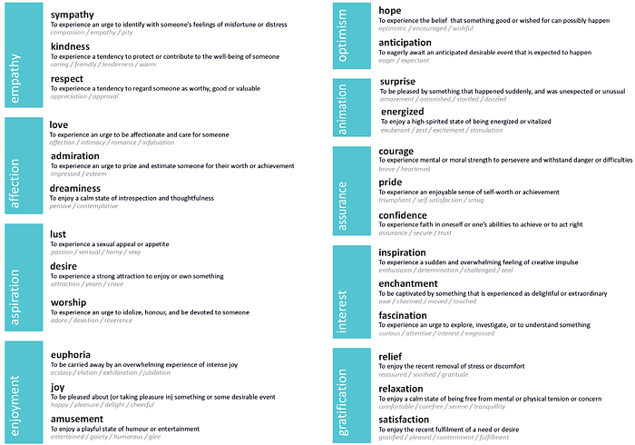

# Desmet (2012) — Faces of Product Pleasure

Source: https://ijdesign.org/index.php/IJDesign/article/view/1190/459

Local reading conversion; article-specific notice states CC BY-NC-ND 2.5 while captured site footer states CC BY 4.0. Discrepancy unresolved; modified reading copy remains local-only/not-publication-cleared. Only Figure 1 is retained locally; other figure/table links remain publisher-hosted. Original HTML and Figure 1 preserved unchanged.

1190.html

Pieter M. A. Desmet

Delft University of Technology, Faculty of Industrial Design Engineering, Delft, The Netherlands

The study of user emotions is hindered by the absence of a clear overview of what positive emotions can be experienced in human-product interactions. Existing typologies are either too concise or too comprehensive, including less than five or hundreds of positive emotions, respectively. To overcome this hindrance, this paper introduces a basic set of 25 positive emotion types that represent the general repertoire of positive human emotions. The set was developed with a componential analysis of 150 positive emotion words. A questionnaire study that explored how and when each of the 25 emotions are experienced in human-product interactions resulted in a collection of 729 example cases. On the basis of these cases, six main sources of positive emotions in human-product interactions are proposed. By providing a fine-grained yet concise vocabulary of positive emotions that people can experience in response to product design, the typology aims to facilitate both research and design activities. The implications and limitations of the set are discussed, and some future research steps are proposed.

Keywords – Emotion-Driven Design, Positive Emotions, Questionnaire Research.

Relevance to Design Practice – Positive emotions differ both in how they are evoked and in how they influence usage behaviour. Designers can use the set of 25 positive emotions to develop their emotional granularity and to specify design intentions in terms of emotional impact.

Received March 27, 2012; Accepted July 14, 2012; Published August 31, 2012.

Copyright: © 2012 Desmet. Copyright for this article is retained by the authors, with first publication rights granted to the International Journal of Design. All journal content, except where otherwise noted, is licensed under a Creative Commons Attribution-NonCommercial-NoDerivs 2.5 License. By virtue of their appearance in this open-access journal, articles are free to use, with proper attribution, in educational and other non-commercial settings.

\*Corresponding Author:[p.m.a.desmet@tudelft.nl](mailto:p.m.a.desmet@tudelft.nl).

Introduction

Products can evoke a wide range of emotions, both negative and positive. On the negative side, the complicated interface of a high-end music player might evoke irritation or dissatisfaction, while on the positive side, the same complexity might evoke fascination or pride. In terms of behavioural impact, these positive and negative emotions are fundamentally different: Whereas negative emotions stimulate individuals to reject (or withdraw from) the object of their emotion, positive emotions stimulate individuals to accept (or approach) the object (Frijda, Kuipers, & Schure, 1989). In consumer research, effects of positive emotions have been found that are in line with this general tendency: Positive emotions stimulate product purchase intentions (Pham, 1998; Bitner, 1992), repurchase intentions (Westbrook & Oliver, 1991), and product attachment (Mugge, Schoormans, & Schifferstein, 2005). In the field of ergonomics, positive emotions have been demonstrated to have additional beneficial effects during product usage. When using complex technology, positive emotions decrease usage anxiety (Picard, 1997; Helander & Tham, 2003) and contribute to the experience of usage comfort (Vink, 2005) and to general usability (Tractinsky, Shoval-Katz, & Ikar, 2000). In other words, products that evoke positive emotions are bought more often, used more often, and are more pleasurable to use. It is therefore indisputably worthwhile to design products that evoke positive emotions – products that make users feel good.

All designed technology, products, services, and systems evoke emotions, and not considering these emotions in the design process is a missed opportunity at best. To this end, design theorists have produced various approaches and frameworks that support designers in conceptualising positive product experiences. Jordan (2000) discussed four sources of product pleasure, Norman (2004) introduced three cognitive levels of pleasurable product experiences, and Desmet (2008) proposed nine sources of product appeal. In my view, a main limitation of these approaches is their focus on generalised pleasure: they do not differentiate experience beyond the basic positive-negative distinction. In reality, products can evoke a diverse palette of distinct (positive) emotions, for example, pride, contentment, admiration, desire, relief, or hope (Desmet, 2002; Desmet & Schifferstein, 2008). Although all positive, these emotions are essentially different – both in terms of the conditions that elicit them and in terms of their effects on human-product interaction. For example, whereas fascination encourages a focused interaction, joy encourages an interaction that is playful (Fredrickson & Cohn, 2008), and thus someone who is fascinated by a product will probably interact differently with it than someone who feels joyful in relation to the product.

The traditional focus on generalised pleasure in design research does injustice to this differentiated nature. An obstacle to a more nuanced study of user emotions, however, is the absence of a clear overview of what positive emotions design researchers should focus on. General emotion research does not offer much help because although it has a rich tradition in studying differences among emotions, this research is almost exclusively focused on negative emotions (Averill, 1980). The research of language scientists who study the nuances of emotion could be usable because it usually does not have this negativity bias. However, the affect taxonomies published in that domain are too extensive to be of practical use in design research, including as they do hundreds of words that do not necessarily refer to emotions. Given these considerations, the aim of this paper is to introduce a set of emotions that represents the general repertoire of positive human emotions and to propose how these emotions can be experienced in human-product interactions. By providing a fine-grained yet concise vocabulary of positive emotions that people can experience in response to product design, the typology aims to facilitate both research and design activities. The objective is to balance pragmatism and rigour: The set should be practical as a source of inspiration and a means for communication in design practice and education, and it should be built on the existing body of knowledge on emotion taxonomies and typologies in order to be a valid reference in design research.

First, existing emotion typologies are briefly reviewed. Next, the development of a set of 25 positive emotion types is reported, representing emotions that differ in terms of eliciting conditions, experiences, and manifestations. The main study presented in this paper explored how and when the 25 emotions are experienced in human-product interactions by using an online questionnaire. The implications and limitations of the set are discussed in the general discussion, and some future research steps are proposed.

Existing Emotion Typologies

Existing emotion typologies include either a mere handful or an extensive list of hundreds of words. This dichotomy can be explained with the concept of “emotion knowledge.” This is the knowledge that people use to interpret their own and other people’s emotional reactions, to predict emotions, and to share and talk about emotional reactions to past and present events (Jones & Pittman, 1982; Kelley, 1984). To clarify how emotion knowledge is organised, prototype theory is particularly useful (see Shaver, Schwartz, Kirson, & O’Connor, 1987; Fehr & Russell, 1984). Prototype theory proposes that emotions can best be seen as organised in a tree-like structure with three levels: the top (superordinate), the middle (basic), and the lowest (subordinate) level. The superordinate level represents the general distinction between pleasant and unpleasant emotions. The basic level represents emotion types such as anger, fear, joy, and surprise. The subordinate level represents finer distinctions, such as (for anger) fury, irritation, resentment, and rage. Most emotion researchers focus on the middle “basic” level because it represents the core repertoire of our emotions: They are learned first by children, during language acquisition, and they are used most often in everyday conversation in most languages. Table 1 gives an overview of some of the most referred to sets of basic emotions.

Table 1 illustrates that basic emotion sets typically include two or three positive emotions. These can be combined to give five basic positive emotions: Joy, Love, Interest, Anticipation, and Pleasant Surprise. Working with such small sets of basic emotions enables a shared research focus among academia, which supports comparisons among research initiatives. The disadvantage is that these sets are an oversimplified representation of the variety of human emotions. The emotion lexicon of most modern languages contains hundreds of emotion names (see Averill, 1975), and suggesting that all of these are mere variations of basic emotions marginalizes the richness of our emotional repertoire. Some researchers have been dissatisfied with the economy obtained with the basic emotion sets. For example, Ellsworth & Smith (1988) and Storm & Storm (1987) proposed that there is a richer variety of emotions than what is captured by the basic emotions and that more emotions should be included. In agreement with this critical stance, I propose that the small set is too rudimentary to be useful for explaining the variety of positive emotions experienced in human-product interactions. Each basic emotion encompasses various different emotions. For example, the basic emotion of joy encompasses: pride, satisfaction, relief, and inspiration. And love encompasses: sympathy, admiration, kindness, lust, and respect. These are clearly different emotions, with different eliciting conditions, different feelings, and different behavioural manifestations.

Table 1. Basic emotions.

The alternative to the basic emotion sets is to work with the extensive semantic taxonomies on the subordinate level that have been developed by language researchers. Examples are the overview of 950 words by Johnson-Laird & Oatley (1989) and the set of 196 words collected by Fehr & Russell (1984). Although comprehensive, these taxonomies have the disadvantage that they lack overview. In their aim to be complete, they also include unusual words that are scarcely used in everyday conversation (like splenetic, covet, dudgeon, and titillate in Johnson-Laird & Oatley, 1989) or that are not emotions (like vanity, wound, fervent, and fire in Johnson-Laird & Oatley, 1989). The set of 25 positive emotion types was therefore assembled to function as a practical balance between the conciseness of basic emotion sets and the comprehensiveness of semantic emotion sets.

Typology of Positive Emotions

The typology of 25 positive emotions is shown in Figure 1. The emotion types are clustered into nine general categories. Each emotion type is represented by the main emotion word, a short definition, and two to four additional emotion words that correspond with the type. For example, the emotion type “Worship” is defined as “to experience an urge to idolize, honour, and be devoted to someone,” and represented emotion words are: adore, devotion, and reverence. The typology was developed in a two-staged procedure, which is described below. The first stage was to create a long list of 150 positive emotion words, and the second was to cluster these into 25 emotion types.

Figure 1. General typology of 25 positive emotions.

Stage 1: Assembling an Overview of Positive Emotion Words

The first step in this stage was to assemble an extensive overview of emotion words that have been reported in emotion studies. To ensure completeness, emotions were compiled from 24 peer-reviewed publications (see Appendix 1). The main source was (hierarchical) typologies reported in linguistic studies of the emotion lexicon. Additional sources were emotion sets used by appraisal psychologists, and specialist typologies developed to represent emotions experienced in specific domains, such as advertising, product design, fragrances, and food consumption.

The second step was to clean up the database by removing non-emotions. Most existing typologies include words that do not refer to emotions (Ortony, Clore, & Foss, 1987). Examples are “sleepy” (in Russell, 1980), “youthful” (in Aaker, Stayman, & Vezina, 1988), and “moral” (in Batra & Holbrook, 1990). These words were identified with the principled approach that was developed by Ortony et al. (1987). They first distinguished internal from external states. External states (e.g., sexy and abandoned) were eliminated because they are not directly related to the inner life of the person of whom they are predicated. Internal states are either mental or non-mental. Non-mental states (e.g., sleepy and hungry) were eliminated because they do not refer to emotions but to physical and bodily states. In short, all words that do not fall in the category of internal mental states have been excluded from the database.

The third step was to exclude negative emotions. Virtually all reported typologies of emotion include both negative and positive emotion words, often without specifying valence. Although the difference between positive and negative emotions may seem obvious (i.e., positive emotions feel good, and negative emotions feel bad), Averill (1980) demonstrated that the distinction is less straightforward because it involves at least two additional variables. The first is the behaviour that is stimulated by the emotion: Is this behaviour evaluated positively or negatively? Smug and Schadenfreude are examples of emotions that feel pleasurable but also have a negative connotation because the associated behaviours are evaluated as unfavourable. The second variable is the consequence of the emotion, which can be either beneficial or harmful. The emotion sympathy, for example, may not feel pleasant, but is often considered to be positive because the consequence of sharing the burden is considered beneficial. Another example is courage. Although elicited by a situation that is evaluated negatively (e.g., dangerous), courage is often considered a positive emotion because it often leads to beneficial outcomes. To filter out negative emotions without excluding emotions that have positive elements, the following criterion was used: Emotions were included if they were ones accompanied by pleasant feelings and/or favourable behaviour and/or beneficial consequences.

The resulting overview included 1,434 positive emotion words. These words were homogenised by lemmatisation. For example, admire, admiration, and admiring were all reformulated to admiration (in which the most often used variant was used as the basis). After this procedure, the result of Stage 1 was a set of 385 emotion words, representing the variety of positive emotions in the English emotion lexicon, shown in Appendix 2. The numbers in Appendix 2 indicate the number of original sources that included this emotion word. Most often mentioned emotions are love, joy, cheerfulness, happiness, pride, contentment, delight, excitement, and relief.

Stage 2: Clustering Emotion Words under Emotion Types

In the second stage, clusters of emotion types were defined with the use of a semi-structured componential analysis. This analysis was focused on the 150 words that were mentioned in three or more of the original sources (see Appendix 2). In a componential analysis, the meaning of words is examined through sets of discriminating features (for examples, see Goodenough, 1956; Ortony et al., 1987). For the present analysis, three discriminating features were drawn from the componential theories of Frijda (1986), Russell (2003), Scherer (2005), and Fredrickson and Branigan (2005): (1) appraisal, (2) arousal, and (3) thought-action tendency.

Appraisal

The first feature, the underlying appraisal, is the cognitive component of the emotion. Emotions are always responses to stimuli (i.e., something happens) that have some personal relevance. This personal relevance is determined in an appraisal or sense evaluation of the extent to which the stimulus has an impact on one’s well-being (Arnold, 1960). Different emotions are evoked by different appraisals. Sadness, for example, is evoked by an appraised “irrevocable loss,” and anger is evoked by an appraised “demeaning offence against me and mine” (Lazarus, 1991, p. 122).

Arousal

The second feature is arousal, which is the bodily component of the emotion (Scherer, 2005). Arousal can best be seen as the level of physical activation associated with the emotion. Different emotions are associated with different arousal levels (Watson & Tellegen, 1985). Some emotions are active, such as surprise and euphoria, and others are calm, such as relaxation and dreaminess.

Thought-action tendency

The third feature, the thought-action tendency, is the motivational component of the emotion. Emotions come with an urge or tendency to act and think in a particular way in reaction to the situation that evokes the emotion (Frijda, 1986; Fredrickson, 1998). Different emotions stimulate different tendencies. Examples are the urge to explore in the case of fascination, the urge to flee in the case of fear, the urge to play in the case of joy, or the urge to constantly think about the other person when seriously in love (Frijda, 1986).

In the componential analysis, emotions were considered different if they are associated with (1) different appraisals, (2) different levels of arousal, or (3) different thought-action tendencies. For all 150 emotions, an overview was made of available knowledge on the three features, from the original sources, the semantic analysis of Johnson-Laird and Oatley (1989), the classifications of Ortony et al. (1988), Frijda et al. (1989), and Storm and Storm (1987), the Van Dale dictionary (2009), and the online dictionary of Merriam-Webster. The classification gradually emerged by studying these structural features. The aim of the procedure was to find a balance between granularity and economy: to minimize the variance between emotions within the classes, and to maximize the variance between the classes.

The underlying appraisal was used as the leading feature: Emotions that are evoked by similar appraisals were clustered unless there was evidence that they differ in terms of arousal or in terms of associated thought-action tendencies. For example, sympathy and compassion were clustered because they are both evoked by an appraised suffering, distress, or misfortune of another person. Moreover, both are accompanied by a tendency to share the feelings of the other person and the wish to relieve the suffering, and no proof was found that they differ in terms of arousal. Jubilation and joy have not been placed in the same cluster. They are evoked by similar appraisals (i.e., an appraised success or good fortune) but differ, however, in terms of arousal: Jubilation is associated with higher levels of arousal than joy. Confidence and assurance were clustered because their underlying appraisals are similar: Confidence is evoked by an appraised consciousness of one’s powers or of reliance on one’s circumstances, and assurance is evoked by an appraised faith in oneself or one’s abilities. Courage, however, was not clustered with confidence and assurance: Courage is evoked by an appraised mental or moral strength to venture, persevere, and withstand danger, fear, or difficulty. Contrary to confidence and assurance, courage does not require an appraised awareness of one’s powers or capacities. These considerations led to the classification of the 25 main emotion types, shown in Table 2.

Table 2. Emotion clusters representing 25 positive emotion types.

The componential approach to emotion illustrates that some emotions are more similar than others: Some emotions differ in terms of all three discriminating features, and some only in terms of one or two. For example, love and sympathy are more similar than love and pride because the first two both stimulate nurturing behaviour (thought-action tendency), whereas pride does not. Relaxation is more similar to relief than to joy because both relaxation and relief are accompanied by an experienced low level of activation (arousal). Emotions were classified into classes that are similar with regard to the three features. These classes represent emotion types, or what Ekman (1992) called emotion families. An emotion family is a set of related emotional responses that are characterized by a common theme plus variations on that theme. Within the common theme, the members of a family can show slight variations in intensity, eliciting conditions, and manifestations. The emotion type Pride, for instance, represents a family of emotions that share the “experience of an enjoyable sense of self-worth or achievement,” including self-satisfaction, smugness, and triumph. Each emotion type represents three to twelve of the 150 emotion words, see Table 2.

Stage 3: Categorising Emotion Types

The 25 positive emotion types have been clustered in nine categories: Enjoyment, Gratification, Empathy, Affection, Interest, Aspiration, Optimism, Assurance, and Animation. These categories were created using a study in which respondents rated similarity between emotion types in pairs.

Respondents

Nineteen respondents participated in the study; they represented eight nationalities (Dutch, Chinese, Italian, Indonesian, German, Norwegian, Russian, and Spanish). Ages ranged between 22 and 33 (M = 24.4; SD = 2.8), and 63.2% of the participants were female. Respondents were design students who were recruited at the university and were not paid for their contribution.

Questionnaire

All emotions in the set of 25 were paired with each other, resulting in 300 emotion pairs. A questionnaire was developed in which respondents rated the similarity of each pair. The questionnaire started with a short introduction that explained that the general aim of the study was to learn how similar various emotions are. Next, the rating procedure was explained. Each pair was rated on a four-point scale (very different; different; similar; very similar). A fifth point on the scale represented “I don’t know” and was used when the respondent was not familiar with one or both emotion words in the pair. In the introduction it was explained that emotion pairs can differ in various aspects: “Emotions can be different in terms of what causes them, how we experience them, and how they influence our behaviour.” The emotions anger, sadness, and fear were used as an example to illustrate these three aspects of emotions. Next it was explained that the study focused on positive emotions, and therefore all emotion pairs would consist of two positive emotions.

Procedure

The questionnaire was divided into six parts of 50 pairs each. Respondents were given the questionnaire over the course of six weeks, filling out one part each week. It was filled out online and individually (at a time and location decided by the respondent). The emotion pairs were shown individually on the screen; after the pair was rated, the next pair appeared. Filling out the questionnaire each week took between 20 and 30 minutes.

Results

To explore similarities and create categories, a multidimensional scaling (MDS) analysis was performed (SPSS Proxscal; see Borg & Groenen, 2005). Figure 2 shows the two-dimensional MDS solution. The distances between emotion types visualise similarity ratings: The more similar the types are, the smaller the distance between them. Surprise, for example, is more similar to Energized (small distance) than to Pride (large distance). Circles and verbal labels were added by the author to propose categories.

Emotion categories that are positioned close to each other in Figure 2 are similar because they share particular features. For example, Optimism and Aspiration are similar in the sense that they both are experienced in relation to future events and thus include some level of uncertainty, whereas Animation and Enjoyment are similar in the sense that they both involve high arousal types of pleasure.

Figure 2. Two-dimensional MDS solution with proposed emotion categories.

Main Study

The aim of the main study was to investigate whether the 25 emotions can be experienced in human-product interaction, and to explore the conditions under which people might experience these emotions in relation to products. To this end, a questionnaire was designed in which respondents reported examples of personal experiences of the given emotions in the context of product usage.

Respondents

Participating in the main study were 221 respondents, representing 22 different nationalities. Ages ranged between 18 and 65 (M = 26.2; SD = 6.9), and 52.8% of the participants were male. Respondents were recruited with posters at Delft University and through social networks, and they were not paid for their contribution. As compensation, a design book (retail price 46 euros) was awarded to 50 randomly selected participants.

Questionnaire

The questionnaire started with a short introduction that explained the general aim of the study. The first part of the study sensitized respondents to reporting emotional information. They were presented one emotion that was randomly selected from the set of 25 positive emotions. Besides the emotion word, a description was provided that explained the emotion (based on the definitions in Figure 1). This was done because it was assumed that people differ in how well they can distinguish between emotion words (see also the discussion on “emotional granularity” in the general discussion section). Providing this description ensured that all respondents had a basic understanding of what particular emotion was represented by the emotion word. Respondents first reported how often they experienced this emotion in their daily lives, recording their answer on a 5-point scale, from “never” to “very often.” Next (if the answer was not “never”), they were asked to give a typical example of a situation in which they had experienced this emotion in the last six months. They were instructed to describe the situation in as detailed a way as possible: Where and when the emotion was experienced, what happened, who and/or what was involved, and why they thought the situation made them feel this emotion. The second part of the study focused on emotions experienced in response to (using) consumer products. Before the procedure started, it was explained that the word “product” used in the questions referred to any kind of consumer product. Six collages were shown that represented a wide variety of consumer products (following the procedure of Desmet, 2002) to give an idea of the possibilities that they might consider. After looking at the collages, five randomly selected emotions were presented. For each emotion, respondents filled out a series of questions. First, they rated how often they experienced the given emotion in response to products (or using products) in their daily lives; this was done using a 5-point scale, from “never” to “very often.” Next (if the answer was not “never”), they were asked to report a personal example of when a product (or using a product) evoked this emotion. They were instructed to describe the product, the situation (where / when / what happened / who was involved, etc.), and why they thought they felt the emotion in relation to the product. Next, they were asked to report for how many types of products they thought it would be appropriate for designers to aim to evoke the given emotion, using a 5-point scale, from “for no product types” to “for all product types.” Last of all, they were asked to give examples (as many as they wanted) of products for which they thought this emotion would be appropriate.

Procedure

The questionnaire was filled out online and individually, at a time and location decided by the respondent. Filling out the questionnaire took between 20 and 30 minutes. Respondents could select one of four languages (Dutch, English, Korean, or Italian) at the start of the study: 39.3% filled out the questionnaire in Dutch; 29.3% in English, 18.9% in Korean, and 12.4% in Italian.

Results

All responses were translated into English. Results of the sensitizing part of the questionnaire are not reported in this paper. Table 3 gives an overview of the rest of the results. The second column reports the number of respondents, the third and fourth show how often the emotion was reported to be experienced in human-product interactions (on a five-point scale), the fifth and sixth columns show for how many product types the emotion was reported by respondents as appropriate as an aim to design for (on a five-point scale), and the seventh column gives the number of example cases that were reported in which the emotion was experienced.

Table 3. Degree to which people experience emotions in human-product interaction.

For each emotion, a t-test was performed (with the scale midpoint as the test value), to determine which emotions rated either significantly lower or higher (p <.05) than the scale midpoint. Those emotions are coded with a \* in the table. Emotions that were reported as experienced most often were: Joy, Satisfaction, Amusement, Relaxation, Love, Confidence, and Desire. Those that were reported as experienced least often were: Worship, Lust, Dreaminess, Relief, Euphoria, Courage, and Enchantment.

The part of the questionnaire in which respondents were asked to report a personal example of when a product (or using a product) evoked this emotion resulted in a database of 729 examples of positive product emotions. The last column of Table 3 shows that the number of cases that were reported for each emotion ranged between 20 (Relief and Lust) and 38 (Amusement, Relaxation, and Admiration). The provided cases were clustered under “sources,” according to the particular situation that was described in the human-product interaction. This was done for each emotion separately. Table 4 provides a summary of these sources. A full overview with example cases and respondent quotes is reported in Appendix 3.

Table 4. Manifestations of positive emotions in human-product interactions.

Six Sources of Emotions in Human-Product Interactions

The collected 729 examples illustrate that products can evoke emotions in various ways. Emotions are not only evoked by the product as such, but also, for example, by the activity of using the product, or by people who are involved in the interaction. The analysis revealed six basic sources of positive emotions in human-product interactions: emotions evoked by (1) the object, (2) the meaning of the object, (3) the interaction with the object, (4) the activity that is facilitated by this interaction, (5) ourselves, and (6) others involved in the interaction. Table 5 gives an overview of these sources with illustrative examples drawn from the case database in the form of respondents’ quotes.

Table 5. Six basic sources of positive emotions in human-product interactions.

(1) Object-focus

Products are objects that we perceive – see, touch, taste, hear, and feel. Because perceiving an object is an event in itself, products as such can elicit emotions. In this case, the emotion is evoked by the product’s appearance. Appearance is used here in the broad sense of the word, involving not only visual appearance but also taste, tactile quality, sound, and fragrance. An individual can, for example, love a product for its beautiful design. Or one can be curious about a novel product, fascinated by a complicated product, or feel sympathetic towards a broken-down product.

(2) Meaning-focus

Emotions can also be experienced in response to some object, person, or event that is associated with or symbolized by a product. Examples are: admiring the designer of an innovative product (in this case the object of the emotion is the designer), or loving a product because it reminds you of someone you love (in this case the object of the emotion is the loved one). Designed objects often represent or symbolise intangible values or beliefs. Some products are deliberately designed with that intention, such as spiritual and religious objects, tokens, mementos, souvenirs, keepsakes, talismans, and mascots. In other cases, products are not intentionally designed to represent values or beliefs, but acquire their symbolic value during the course of user-product interactions. Products can become symbols during their lifespan. Examples are a backpack that has been used for many journeys, a gift from a loved one, or something that was inherited from a family member.

(3) Interaction-focus

We interact with products with the purpose of fulfilling needs or achieving goals. This could be to drill a hole in a wall, to listen to music, to cook a meal, etc. The interaction (e.g., with the drill or the music player) can evoke positive emotions. In this case, the emotion is evoked by how the product responds to the user when he/she is using it. For example, the product might be easy to use or complicated and challenging. It can behave unexpectedly or predictably. This “quality of interaction” can evoke all kinds of emotions. For example, one can become energized by using a product that requires physical effort, one can experience joy when a product is unexpectedly easy to use, or one can feel pride by being able to operate a complicated product.

(4) Activity-focus

Products are used to enable or facilitate all kinds of activities. Products are instruments that are used to “get something done” in some situation. Individuals will respond emotionally to these activities because they have concerns related to the activities. The emotion is not directed toward the product, but the product does play a role because it enables the individual to engage in the activity that evokes the emotion. For example, one can be excited about making a hiking trip in the snow (which is facilitated by a warm coat), one can enjoy making drawings (which is facilitated by a pen), or one can be satisfied with a stack of clean laundry (which is facilitated by a washing machine).

In many cases, users do not have deliberate emotional intentions when using a product. In these cases, the emotions are “side-effects.” In other cases, users do have a deliberate intention to affect their emotions by using a product. Examples are computer games, massage chairs, and motorcycles. We use computer games because they amuse us, sit in massage chairs because they relax us, ride motorcycles because they excite us. Note that a special type of emotions are those that are related to anticipated usage or anticipated consequences of usage. When seeing a product, people anticipate what it will be like to use or own the product. One can therefore desire a sailboat because one anticipates that it will provide pleasurable Sunday afternoons of sailing. Or one can experience hope in response to a mobile phone because one anticipates that it will support one’s social life.

(5) Self-focus

Products are used in a social context. We use products in our interactions with other people (e.g., communication devices and gifts), and the products that we use and own are part of our social identity. We can be emotional about ourselves; our identity or behaviour is affected by owning or using products. As was proposed by Belk (1988), products are extensions of their owners, and they affect an individual’s self-perception and how he or she is perceived by others. People are emotional about who they are and how others perceive them, and thus also about the effects of their products on their identity. For example, a high-quality baby buggy enables someone to be a good parent, crayons enable someone to be a creative person, and a sports car enables someone to be free-spirited.

(6) Other-focus

In this case, the emotion is evoked by other people. Interactions with other people are influenced or facilitated by products. We are emotional about the things that people do and the things that they do to us. For example, we can admire someone for their skill in using a complicated product or solving a complex puzzle. Or, we can enjoy talking to a friend (facilitated by a phone), be surprised by a kind birthday message (facilitated by a birthday card), or be relieved when someone helps us find the way (facilitated by a foldable city map).

Discussion

The manifestations of 25 positive emotions (in Table 4) and the six basic sources of positive emotions in human-product interactions (Table 5) have been developed on the basis of self-reported data of recalled emotional experiences. This approach builds on the assumption that participants are able to fairly reliably recall emotional experiences from the past. It should be noted that recall-based procedures suffer from methodological problems, such as effects of memory. At the same time, this approach is preferred over alternatives because it offers quite a number of important advantages (for a discussion, see Wallbott & Scherer, 1989). The best available alternative would have been to measure or assess emotional responses evoked by real products. An important shortcoming of this approach is that the (frequency of) reported emotions depend on the selection of products included in the study. Thus, this approach would prevent us from gaining further insight into what emotions are experienced and how often they are experienced in real life human-product interactions. A second shortcoming is that the laboratory, and even more real-life settings, are generally fairly artificial social contexts with their own special norms and expectations. As a result, this approach would not help us in understanding the role or influence of the social context on emotions experienced in human-product interactions.

General Discussion

This paper has introduced 25 positive emotion types and six basic sources of positive emotions in user-product interactions. It was found that people can experience diverse positive emotions in response to products. Although some are experienced often (e.g., joy, satisfaction, and amusement), and others are experienced not so often (e.g., worship, lust, and dreaminess), the reported study clearly indicates that all 25 positive emotions can be experienced. We also have seen that products can evoke positive emotions in various ways. Emotions are evoked by the object, the meaning of the object, the interaction with the object, the activity that is facilitated by this interaction, ourselves, and by others involved in the interaction. These various sources of emotion represent a palette of opportunities for designers. When aiming to design a product that evokes a particular positive emotion, the designer can look beyond the object and explore opportunities to design for particular human-product interactions or for activities or human-human interactions that are facilitated or stimulated by the product. An interesting question is whether the six emotion sources also apply to negative emotions. Intuitively, it seems they would, but additional studies could reveal to what extent these six sources are also appropriate for the negative spectrum of human emotions. If so, the six sources could also be useful for analysing causes that underlie negative user responses. Moreover, it should be noted that negative emotions are not less interesting or less relevant for design than positive ones. Fokkinga and Desmet (2012) recently demonstrated how negative usage emotions can contribute to rich and meaningful experiences, illustrating that in some cases it may even be desirable to design for negative emotions. An important next step in this research is, therefore, to develop a similar typology of negative emotions.

In design research, the 25 positive emotions can be used as scale items in questionnaires that measure positive emotions evoked by existing or new products or user-product interactions. The diversity within the set offers an opportunity to formulate an “emotional fingerprint” for a brand, service, or product, which specifies the intended emotional response of users or consumers. Such an emotional fingerprint can help to improve the emotional consistency of a design. For example, Desmet & Schifferstein (2012) described a design case in which the aim was to optimize the emotional consistency of a fabric conditioner product. The client had recently redesigned the product packaging, and wanted to develop a fragrance that, in terms of emotional impact, fit with the package design. A study in which the emotional responses to the new package design were measured, revealed that the new design evoked significantly higher levels of inspiration than the previous design. On the basis of this result, inspiration was selected as the emotional fingerprint of the product and as the target emotion for developing an appropriate fragrance. Several fragrance alternatives were developed, and the one that was found to evoke the highest levels of inspiration was selected. Besides in such quantitative applications, the set of emotion types can also be used in qualitative studies to help respondents in specifying a specific emotion they experience. For this purpose, a sheet with the 25 emotion types (similar to Figure 1 or 2) could be used as an informal resource during the interview, and respondents could point out the emotion(s) that they experience or have experienced.

Why should we invest time and energy in specifying target emotions or emotional intentions in design processes? The main reason is that different emotions have been shown to have different effects on behaviour. According to the “broaden and build” theory, introduced by Fredrickson (2003), positive emotions are characterised by distinct and specific behavioural effects: Joy creates the urge to play and be playful in the broadest sense of the word, encompassing not only physical and social play, but also intellectual and artistic play (Fredrickson, 1998). Fascination creates the urge to explore, which is aimed at increasing knowledge of the target of interest (Silvia, 2005). Contentment prompts individuals to savour their current life circumstances and recent successes (Lyubomirsky, Sheldon, & Schkade, 2005). It is to be expected that these general behavioural effects also influence human-product interactions. A next step in this research is therefore to increase our understanding of what specific effects different positive emotions have on human-product interaction. Resulting insights can help designers to select target emotions as a means for stimulating intended or appropriate usage behaviour.

Besides being potentially useful as a resource in design research, the set of 25 positive emotion types could also be used as an aid for design students to develop their emotional granularity. Emotional granularity is the ability to characterize one’s emotional state with specificity, using discrete emotion labels rather than referring to global feeling states. People with a developed emotional granularity have the ability to characterize complex emotional responses (Tugade, Fredrickson, & Feldman Barrett, 2004). In preparing this manuscript, a pilot study was conducted in which 20 master’s-level design students were asked to write down as many positive emotions as they could in ten minutes. The results indicated substantial differences in emotional granularity among the students: Some were able to produce lists of up to 20 emotions, whereas others were not able to produce more than three. Moreover, almost half of the reported words did not actually refer to distinct emotions, but instead to only the positive nature of the emotion (e.g., good, fine, pleasant, up, great, and nice), or to expressions or behaviour (e.g., smiling, laughing, getting goose bumps), which is in line with the findings of Storm and Storm (1987). This indicates that it is important to be aware of the fact that not all design students have a developed emotional granularity, and thus will not be able to have an explicit notion of what emotion to design for. We are currently exploring how tools can be developed for training the emotional granularity of designers. For example, we are developing short movie clips that feature people who are interacting with everyday products for each of the 25 emotions, and we are developing a collection of images that express the different emotions. These kinds of tools can also be used to stimulate creativity. In an explorative workshop, design students were given a design brief and a stack of cards, each card representing one of the 25 emotions. They were instructed to pick one card and to create design ideas for the represented emotion. As soon as they felt that they could not generate any more ideas for an emotion, they picked another card and continued generating ideas for that emotion. In an open discussion after the workshop, the students mentioned that the set of cards stimulated their creative process because different emotions pointed them towards different solution directions. Although preliminary, this result stimulates us to continue exploring how the emotion types can be used to stimulate creativity in design processes.

Note that some of the words in the typology are not only used to describe emotions in daily conversation, but also to describe moods or interpersonal traits. The words energized, relaxation, and dreaminess, for example, are often used to refer to moods. Moods are diffuse states that usually do not have clear antecedents, are not directed at a particular object, and can last for hours or days (Fogras, 1992; Tellegen, 1985). The words courage, confidence, and kindness are often used to describe interpersonal traits. These words are nonetheless in place in the typology because in the context of product experience, they are used to describe emotional responses: feeling energized or confident in response to (or because of) a product. Moreover, emotion is only one aspect of user experience. Other kinds of experiences, such as aesthetic experience and experience of meaning (see Desmet & Hekkert, 2007), are also relevant and should be taken into consideration during the design process. Future research can explore the possibilities of incorporating these other experiences in design-oriented research. Note, however, that although emotion may represent only one aspect of user experience, it is a pivotal one. Contrary to what is sometimes assumed, emotions are not only experienced in response to the aesthetics or cultural meaning of design. Instead, all aspects of (using) products can evoke emotions, and thus emotion-driven design requires a holistic design approach in which the designer gives form to an envisioned meaningful user-product relationship – stimulating hope, pride, inspiration, amusement, admiration, or any of the other 20 positive emotions.

Acknowledgements

This research was supported by the MAGW VIDI, grant number 452-10-011, of The Netherlands Organization for Scientific Research (N.W.O.) awarded to P.M.A. Desmet. Jay Yoon is acknowledged for his indispensable contribution to assembling the long emotions list, developing the questionnaire, recruiting respondents, organising data, and translating the questionnaire and research data. Ilaria Scarpellini was responsible for the Italian part of the study, translating the questionnaire, recruiting Italian-speaking respondents and translating the Italian data. I thank copyeditor Sarah Brooks for her appreciated contribution, and Deger Ozkaramanli for her valuable suggestions on an earlier version of this manuscript.

References

1. Aaker, D. A., Stayman, D. M., & Vezina, R. (1988). Identifying feelings elicited by advertising. Psychology & Marketing, 5(1), 1-16.
2. Arnold, M. B. (1960). Emotion and personality (Vol. 1): Psychological aspects. New York, NY: Colombia University Press.
3. Averill, J. R. (1975). A semantic atlas of emotion concepts. JSAS catalogue of selected documents in psychology, 5(330), 1-64.
4. Averill, J. R. (1980). On the paucity of positive emotions. In K. R. Blankstein, P. Pliner, & J. Polivy (Eds.), Advances in the study of communication and affect (Vol. 6, pp. 7-45). New York, NY: Plenum.
5. Batra, R., & Holbrook, M. B. (1990). Developing a typology of affective responses to advertising. Psychology & Marketing, 7(1), 11-25.
6. Belk, R. W. (1988). Possessions and the extended self. The Journal of Consumer Research, 15(2), 139-168.
7. Bitner, M. J. (1992). Servicescapes: The impact of physical surroundings on customers and employees. Journal of Marketing, 56(2), 57-71.
8. Borg, I., & Groenen, P. (2005). Modern multidimensional scaling: Theory and applications (2nd ed.). New York, NY: Springer-Verlag.
9. Clore, G. L., & Ortony, A. (1988). The semantics of the affective lexicon. In V. Hamilton, G. H. Bower & N. H. Frijda (Eds.), Cognitive perspectives on emotion and motivation (pp. 367-397). Dordrecht, the Netherlands: Kluwer Academic Publishers.
10. Clore, G. L., Ortony, A., & Foss, M. A. (1987). The psychological foundations of the affective lexicon. Journal of Personality and Social Psychology, 53(4), 751-766.
11. Derbaix, C., & Pham, M. T. (1991). Affective reactions to consumption situations – A pilot investigation. Journal of Economic Psychology, 12(2), 325-355.
12. Desmet, P. M. A. (2002). Designing emotions. Delft, the Netherlands: Delft University of Technology.
13. Desmet, P. M. A. (2006). A typology of fragrance emotions. In D. S. Fellows (Ed.), ESOMAR world research papers (pp. 309-320). Amsterdam, the Netherlands: Esomar.
14. Desmet, P. M. A. (2008). Product emotion. In H. N. J. Schifferstein, & P. Hekkert (Eds.), Product experience (pp. 379-397). Amsterdam, the Netherlands: Elsevier.
15. Desmet, P. M. A., & Hekkert, P. (2007). Framework of product experience. International Journal of Design, 1(1), 57-66.
16. Desmet, P. M. A., & Schifferstein, H. N. J. (2008). Sources of positive and negative emotions in food experience. Appetite, 50(2-3), 290-301.
17. Desmet, P. M. A., & Schifferstein, H. N. J. (2012). Emotion research as input for product design. In J. Beckley, D. Paredes, & K. Lopetcharat (Eds.), Product innovation toolbox: A field guide to consumer understanding and research (pp. 149-175). Hoboken, NJ: John Wiley & Sons.
18. Ekman, P. (1973). Cross-cultural studies of facial expression. In P. Ekman (Ed.), Darwin and facial expression; A century of research in review (pp. 169-222). Los Altos, CA: Malor Books.
19. Ekman, P. (1992). Facial expressions of emotions. Psychological Review, 99(3), 550-553.
20. Ellsworth, P. C., & Smith, C. A. (1988). Shades of joy: Patterns of appraisal differentiating pleasant emotions. Cognition and Emotion, 2(4), 301-331.
21. Epstein, S. (1984). Controversial issues in emotion theory. Review of Personality & Social Psychology, 5, 64-88.
22. Fehr, B., & Russell, J. A. (1984). Concept of emotion viewed from a prototype perspective. Journal of Experimental Psychology-General, 113(3), 464-486.
23. Fokkinga, S. F., & Desmet, P. M. A. (2012). Darker shades of joy: The role of negative emotion in rich product experiences. Design Issues, 28(4), 42-56.
24. Forgas, J. P. (1992). Affect in social judgments and decisions: A multiprocess model. Advances in Experimental Social Psychology, 25, 227-275.
25. Fredrickson, B. L. (1998). What good are positive emotions? Review of General Psychology, 2(3), 300-319.
26. Fredrickson, B. L. (2003). The value of positive emotions. American Scientist, 91(4), 330-335.
27. Fredrickson, B. L., & Branigan, C. (2005). Positive emotions broaden thought-action repertoires: Evidence for the broaden-and-build model. Cognition and Emotion, 19(3), 313-332.
28. Fredrickson, B. L., & Cohn, M. A. (2008). Positive emotions. In M. Lewis, J. M. Haviland-Jones, & L. F. Barrett (Eds.), Handbook of emotions (3rd ed., pp. 777-798). New York, NY: Guilford.
29. Frijda, N. H. (1986). The emotions. Cambridge, MA: Cambridge University Press.
30. Frijda, N. H., Kuipers, P., & Schure, E. T. (1989). Relations among emotion, appraisal, and emotional action readiness. Journal of Personality and Social Psychology, 57(2), 212-228.
31. Frijda, N. H., Markam, S., Sato, K., & Wiers, R. (1995). Emotions and emotion words. In J. A. Russell, A. S. R. Manstead, J. C. Wellenkamp, & J. M. Fernandez-Dols (Eds.), Everyday conceptions of emotions: An introduction to the psychology, anthropology and linguistics of emotion (pp. 121-143). Dordrecht, the Netherlands: Kluwer.
32. Goodenough, W. H. (1956). Componential analysis and the study of meaning. Language 32(1), 195-216.
33. Helander, M., & Tham, M. P. (2003) Hedonomics: Affective human factors design. Ergonomics, 46(13/14), 1269-1272.
34. Izard, C. E. (1977). Human emotions. New York, NY: Plenum.
35. Johnson-Laird, P. N., & Oatley, K. (1989). The language of emotions: An analysis of a semantic field. Cognition and Emotion, 3(2), 81-123.
36. Jones, E. E., & Pittman, T. S. (1982). Toward a general theory of strategic self-presentation. In J. Suls (Ed.), Psychological perspectives on the self (pp. 231-262). Hillsdale, NJ: Erlbaum.
37. Jordan, P. W. (2000). Designing pleasurable products. London: Taylor & Francis.
38. Kelley, H. H. (1984). Affect in interpersonal relations. In P. Shaver (Ed.), Review of personality and social psychology (pp. 89-115). Beverly Hills, CA: Sage.
39. Lazarus, R. S. (1991). Emotion and adaptation. Oxford, UK: Oxford University Press.
40. Lyubomirsky, S., Sheldon, K. M., & Schkade, D. A. (2005). Pursuing happiness: The architecture of sustainable change. Review of General Psychology, 9(2), 111-132.
41. Morgan, R., & Heise, D. (1988). Structure of emotions. Social Psychology Quarterly, 51(1), 19-31.
42. Mugge, R., Schoormans, J. P. L., & Schifferstein, H. N. J. (2005). Design strategies to postpone consumers’ product replacement. The value of a strong person-product relationship. The Design Journal, 8(2), 38-48.
43. Norman, D. A. (2004). Emotional design. New York, NY: Basic Books.
44. Oatley, K., & Johnson-Laird, P. N. (1987). Towards a cognitive theory of emotions. Cognition and Emotion, 1(1), 29-50.
45. Ortony, A., Clore, G. L., & Collins, A. (1988). The cognitive structure of emotions. Cambridge: Cambridge University Press.
46. Ortony, A., Clore, G. L., & Foss, M. A. (1987). The referential structure of the affective lexicon. Cognitive Science, 11(3), 341-364.
47. Pham, M. T. (1998). Representativeness, relevance, and the use of feelings in decision making. Journal of Consumer Research, 25(2), 144-159.
48. Picard, R. W. (1997). Affective computing. Cambridge, MA: MIT Press.
49. Plutchik, R. (1980). Emotion: A psychobioevolutionary synthesis. New York, NY: Harper & Row.
50. Richins, M. L. (1997). Measuring emotions in the consumption experience. Journal of Consumer Research, 24(2), 127-146.
51. Roseman, I. J., Spindel, M. S., & Jose, P. E. (1990). Appraisals of emotion-eliciting events: Testing a theory of discrete emotions. Journal of Personality and Social Psychology, 59(5), 899-915.
52. Russell, J. A. (1980). A circumplex model of affect. Journal of Personality and Social Psychology, 39(6), 1161-1178.
53. Russell, J. A. (2003). Core affect and the psychological construction of emotion. Psychological Review, 110(1), 145-172.
54. Scherer, K.R. (2005). What are emotions? And how can they be measured? Social Science Information, 44(4), 695-729.
55. Schimmack, U., & Reisenzein, R. (1997). Cognitive processes involved in similarity judgments of emotions. Journal of Personality and Social Psychology, 73(4), 645-661.
56. Shaver, P., Schwartz, J., Kirson, D., & O’Connor, C. (1987). Emotion knowledge: Further exploration of a prototype approach. Journal of Personality and Social Psychology, 52(6), 1061-1086.
57. Shields, S. A. (1984). Distinguishing between emotion and nonemotion: Judgments about experience. Motivation and Emotion, 8(4), 355-369.
58. Silvia, P. J. (2005). Cognitive appraisals and interest in visual art: Exploring an appraisal theory of aesthetic emotions. Empirical Studies of the Arts, 23, 119-133.
59. Storm, C., & Jones, C. (1996). Aspects of meaning in words related to happiness. Cognition and Emotion, 10(3), 279-302.
60. Storm, C., & Storm, T. (1987). A taxonomic study of the vocabulary of emotions. Journal of Personality and Social Psychology, 53(4), 805-816.
61. Storm, C., & Storm, T. (2005). The English lexicon of interpersonal affect: Love, etc. Cognition and Emotion, 19(3), 333-356.
62. Tellegen, A. (1985). Structures of mood and personality and their relevance to assessing anxiety, with an emphasis on self-report. In A. H. Tuma & J. Maser (Eds.), Anxiety and the anxiety disorders (pp. 681-706). Hillsdale, NJ: Erlbaum.
63. Tomkins, S. S. (1984). Affect theory. In K. R. Scherer & P. Ekman (Eds.), Approaches to emotion (pp. 163-196). Hillsdale, NJ: Erlbaum.
64. Tractinsky, N., Shoval-Katz, A., & Ikar, D. (2000). What is beautiful is usable. Interacting with Computers, 13(2), 127-145.
65. Tugade, M. M., Fredrickson, B. L., & Feldman Barrett, L. (2004). Psychological resilience and positive emotional granularity: Examining the benefits of positive emotions on coping and health. Journal of Personality, 72( 6), 1161-1190.
66. Van Dale (2009). Van Dale Grote Woordenboeken, version 5.0. Utrecht, the Netherlands: Van Dale Publishers
67. Van Goozen, S. & Frijda, N.H. (1993). Emotion words used in six European countries. European Journal of Social Psychology, 23, 89-95.
68. Vink, P. (2005). Comfort and design: Principles and good practice. Boca Raton, FL: CRC Press.
69. Wallbott, H. G., & Scherer, K. R. (1989). Assessing emotion by questionnaire. In R. Plutchik & H. Kellerman (Eds.), Emotion: Theory, research, and experience. Vol. 4. The measurement of emotion (pp. 55-82). San Diego, CA: Academic Press.
70. Watson, D., & Tellegen, A. (1985). Toward a consensual structure of mood. Psychological Bulletin, 3, 1-14.
71. Westbrook, R. A., & Oliver, R. L. (1991). The dimensionality of consumption emotion patterns and consumer satisfaction. Journal of Consumer Research, 18(1), 84-91.

Appendixes

Appendix 1. References for the long emotion word list

- **Semantic analyses-based typologies**  
	Clore, Ortony, & Foss (1987); Clore & Ortony (1988); Fehr & Russel (1984); Van Goozen & Frijda (1993); Johnson-Laird & Oatley (1989); Morgan & Heise (1988); Ortony, Clore, & Foss (1987); Shaver, Schwartz, Kirson, & O’Connor (1987); Storm & Jones (1996); Storm & Storm (1987); Storm & Storm (2005).
- **Domain specific typologies**  
	Advertising: Aaker, Stayman, & Vezina (1988); Batra & Holbrook (1990); consumption situations: Derbaix & Pham (1991); product design: Desmet (2002); fragrances: Desmet (2006); food experience: Desmet & Schifferstein (2008); consumption experience: Richins (1997).
- **Appraisal-theory based typologies**  
	Ellsworth & Smith (1988); Frijda, Kuipers, & Ter Schure (1989); Roseman, Spindel, & Jose (1990); Scherer (2005); Schimmack & Reisenzein (1997); Shields (1984).

Appendix 2. 385 positive emotions

List drawn from 24 published typologies.Number represents how many typologies included the particular emotion word.

\-----------------------------------------------------

Appendix 3. Sources of positive emotions in human-product interactions

In Tables 6 to 30, examples of how products evoke each of the 25 positive emotions are provided. The examples are in the form of quotes from respondents that, in some cases, have been translated and/or shortened.

Table 6. Sources of love in human-product interaction.

Table 7. Sources of sympathy in human-product interaction.

Table 8. Sources of kindness in human-product interaction.

Table 9. Sources of admiration in human-product interaction.

Table 10. Sources of worship in human-product interaction.

Table 11. Sources of respect in human-product interaction.

Table 12. Sources of surprise in human-product interaction.

Table 13. Sources of enchantment in human-product interaction.

Table 14. Sources of fascination in human-product interaction.

Table 15. Sources of lust in human-product interaction.

Table 16. Sources of desire in human-product interaction.

Table 17. Sources of hope in human-product interaction.

Table 18. Sources of anticipation in human-product interaction.

Table 19. Sources of courage in human-product interaction.

Table 20. Energizing sources in human-product interaction.

Table 21. Sources of amusement in human-product interaction.

Table 22. Sources of inspiration in human-product interaction

Table 23. Sources of euphoria in human-product interaction.

Table 24. Sources of joy in human-product interaction.

Table 25. Sources of satisfaction in human-product interaction.

Table 26. Sources of pride in human-product interaction.

Table 27. Sources of confidence in human-product interaction.

Table 28. Sources of relaxation in human-product interaction.

Table 29. Sources of relief in human-product interaction.

Table 30. Sources of dreaminess in human-product interaction.

