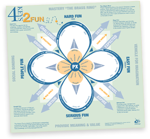

# The 4 Keys 2 Fun

Emotion and the Fun of Games  
As experts in player experiences we see a huge gap between “market research” and what players most enjoy about play. Players may check “good graphics” on a online survey, but our cross-genre contextual research reveals a more interesting story. We know how games deliver more emotions than frustration, excitement, and fear. The secret is in the gameplay.

The 4 Fun Keys create games’ four most important emotions  
1. Hard Fun: Fiero – in the moment personal triumph over adversity  
2. Easy Fun: Curiosity  
3. Serious Fun: Relaxation and excitement  
4. People Fun: Amusement

These four main reasons why people play games are how best sellers create more emotions for more captivating play. Each key unlocks a different set of play experiences. Because players alternate between them during a single play session best selling games offer at least three of the 4 Keys 2 Fun. Only XEODesign’s methods take advantage of the 4 Keys 2 Fun to heighten player emotions.

Nicole Lazzaro, President, of XEODesign,® Inc. has shared the insights and analysis from XEODesign’s independent player research with the game development and human-computer interaction communities. Now that knowledge is available to you. Follow Nicole on [Twitter](http://twitter.com/nicolelazzaro) for insights as they happen.

First presented at the [Game Developers](http://www.gdconf.com/) Conference in 2004; _Why We Play Games: 4 Keys to More Emotion_ shares one slice of what we have learned from our independent cross-genre research on gamers. Learn more about Hard Fun, Easy Fun, Serious Fun, and People Fun by contacting us or download the white paper abstract [here](http://www.xeodesign.com/whyweplaygames/xeodesign_whyweplaygames.pdf).

The 4 Fun Keys create emotion from interaction in productivity software as well as games. Usability only focuses on minimizing complexity and reducing user frustration. XEODesign’s 4 Keys 2 Fun increase user motivation by harnessing the power of play.

**Contact XEODesign:** If you would like a copy of the presentation slides and more information about the 4 Keys 2 Fun contact us at [info@xeodesign.com](mailto:info@xeodesign.com) or 510.658.8077.
