<< RETURN

XEODesign, ® Inc. 5273 College Ave. Suite 201 Oakland, CA 94618 www.xeodesign.com

## Why We Play Games: Four Keys to More Emotion in Player Experiences

Nicole Lazzaro, President XEODesign, ® Inc.

[510-658-8077, nlazzaro@xeodesign.com](mailto:nlazzaro@xeodesign.com)

'Player Experience Research and Design for Interactive Entertainment.'

## Why We Play Games - The Player Experience

Games are structured activities that create enjoyable experiences. They are easy-to-start mechanisms for fun. People play games not so much for the game itself as for the experience that the game creates: an exciting adrenaline rush, a vicarious adventure, a mental challenge; and the structure games provide for time, such as a moment of solitude or the company of friends. People play games to create moment-to-moment emotions and experiences, whether they are overcoming a difficult game challenge, seeking relief from every-day worries, or pursuing what Hal Barwood calls simply 'the joy of figuring it out.'

To create more emotion in innovative future games, XEODesign wanted to know more about the role of emotion in games and mechanisms other than story cut-scenes that evoke player emotions. Throughout eleven years of usability testing of games we have seen people get angry, excited, and on occasion even cry. These reactions made us wonder what other emotions were involved. What makes succeeding less than 20% of the time fun? Do people play to feel emotions as well as challenge? If emotions are important to play, where do they come from? Do people modify games to feel different emotions? Is it possible to build emotions into games by adding emotion-producing objects or actions to game play rather than cut scenes? To what extent are game developers already doing this?

We were curious about what could be said of all computer and video games and what, other than story, triggers emotions. What types of internal and external experiences (inside and outside a player's head) other than emotions do players appreciate and expect from games? We wanted to learn what adult players thought made good game experiences, after all, not all games with good graphics and advanced features are fun. A game's value proposition is how it makes its customers think and feel. We wanted to observe how popular games deliver these experiences, and consider how to do it better.

XEODesign conducted a research study with over 30 people: 15 hardcore gamers, 15 casual gamers, plus 15 non-players to answer these questions (see appendix for player profiles). We looked for clues in what happened before during and after play. We considered theory from pertinent psychological studies. We went off in search of emotion and found Four Keys to releasing emotions during play.

## Research Methodology

The observations were conducted by XEODesign, Inc. a player experience research and design firm with an eleven year history of improving player experiences for games and consumer software for companies such as Sony, Leap Frog, Ubisoft, Broderbund, and Mattel.

XEODesign performed a field study in which 34 adults were asked to share their thoughts and feelings while playing their favorite PC, console, handheld, or internet games. Players spent 90 to 120 minutes playing where they normally do in their homes, fraternity houses, public gaming rooms, or workplaces. Most played the games by themselves except for four console multiplayer sessions of 3-6 players, which were conducted with participants playing in the same room. We also observed two online PC multiplayer sessions over the internet. Using Contextual Inquiry methods a researcher observed participant during play and administered a questionnaire to 30 of these players at the end of the session. To collect the opinions of nonplayers about gaming, we also interviewed 15 friends and family members of participants who were nearby during the observation sessions.

We collected three types of data: video recordings of what players said and did (over 50 hours), player's questionnaire responses, and verbal and non-verbal emotional cues during play. We analyzed over 2,000 observations from video transcripts, facial expressions, questionnaire responses, and session notes that we sorted into affinity groups. XEODesign used these groupings to create nearly a dozen consolidated models of player behavior and processes that facilitated or inhibited enjoyment. The four most important pathways to emotion in games are presented here as Four Keys.

This report contains highlights from XEODesign's upcoming White Paper on 'Why We Play Games.' The models for these Four Keys draw from our research of game preferences as expressed by players using qualitative methods. Where appropriate this paper also references the research of Paul Ekman about Emotion, Mihalyi Csikszentmihalyi on Optimal Experiences (Flow), and Don Norman on Affective Computing. It is beyond the methodology and scope of this study to draw causal relationships between the biological, developmental, or cultural reasons people play or to make conclusions about any brain structure or system. Here we focus on what players enjoy about their experiences of play.

Games observed as part of this study include these titles (players refer to others as well):

| Fighting Brute Force™ Counter-Strike™ Conflict Desert Storm Tom Clancy's Ghost Recon & Splinter Cell™ Grand Theft Auto Vice City Halo:Combat Evolved Soul Calibur® II Virtua Fighter 4™   | Racing APEX™ Mario Kart® (N64) Mario Kart® Double Dash™ Need for Speed™ Underground MX2002 featuring Ricky Carmichael   | Puzzle Atomica Collapse® I Hearts & Black Jack JT Blocks MSN Crossword Pop and Drop Puzics Rampart Snood Tetris® Word Whomp   | Sports & Strategy Back Yard Baseball™ NBA Street Top Spin™ Tennis Civilization II Heroes of Might and Magic   | Other Buzz Lightyear Action Game Dark Age of Camelot™ Online Gambling   |
|-------------------------------------------------------------------------------------------------------------------------------------------------------------------------------------------|-------------------------------------------------------------------------------------------------------------------------|-------------------------------------------------------------------------------------------------------------------------------|---------------------------------------------------------------------------------------------------------------|-------------------------------------------------------------------------|

To ensure candid feedback participant names used in this report have been changed.

## Overview of Four Keys to More Emotion in Player Experiences

What players like best about games falls into four groups or Four Keys to emotion. XEODesign's research shows that each Key is a mechanism for emotion in a different aspect of the Player Experience. Both players and games vary in how important each Key is to having fun. However, analysis of best selling games such as Bejeweled, Halo, Grand Theft Auto (GTA), EverQuest, and Mario Kart Double Dash reveals that these games create emotion in at least three of the Four Keys. For these popular titles many layers of the experience stand on their own as entertainment. Combined these factors make a deeply enjoyable game for a wide market. Designing deep game experiences for each Key offers a different avenue to enhance the Player Experience as a whole and by refining them through play testing provides more opportunities for emotion in games.

## 1. The Player: The Internal Experience Key

## Generate Emotion with Perception, Thought, Behavior, and Other People

Players report that how a game makes them feel inside is one of the major reasons why they play, or 'games as therapy.' They describe enjoying changes in their internal state during and after play. The Internal Experience Key focuses on how aspects of the game external to the player create emotions inside player. This aspect of the player's experience is the way in which perception, behavior, and thought combine in a social context to produce emotions and other internal sensations most frequently those of Excitement and Relief. Players using this Key play to think or feel something different. In our study Players whose enjoyment focuses on their internal sate would say they like:

- Clearing my mind by clearing a level
- Avoiding boredom
- Feeling better about myself
- Being better at something that matters

Games with this Key stimulate the player's senses and smarts with compelling interaction. For example Mario Kart combines rich visceral graphic and audio stimuli, intriguing concepts, and behaviors to create wildly fun emotions in the player. Games from our study strong in this Key include: Collapse, Crosswords, Halo, GTA, Civilization, Tetris, and EverQuest

## 2. Hard Fun: The Challenge and Strategy Key

## Emotions from Meaningful Challenges, Strategies, and Puzzles

For other players overcoming obstacles is why they play. Hard Fun creates emotion by structuring experience towards the pursuit of a goal. The challenge focuses attention and rewards progress to create emotions such as Frustration and Fiero (an Italian word for personal triumph). [2] It inspires creativity in the development and application of strategies. It rewards the player with feedback on progress and success. Players using this Key play to test their skills, and feel accomplishment. In our study players who enjoy the Hard Fun of Challenge would say they like:

- Playing to see how good I really am
- Having multiple objectives
- Playing to beat the game
- Requiring strategy rather than luck

Games with this Key offer compelling challenges with a choice of strategies. They balance game difficulty with player skill through levels, player progress, or player controls. In Mario Kart the difficulty of the challenge matches the skill of novice and advanced players (if you can't drive, you can at least throw stuff); plus it offers emotion opportunities from cooperative and competitive gameplay. Games with this Key include Civilization, Halo, Top Spin Tennis, Crosswords, Hearts, Tetris, and Collapse . Some games offer a choice of winning conditions such as EverQuest and The Sims .

## 3. Easy Fun: The Immersion Key

## Grab Attention with Ambiguity, Incompleteness, and Detail

Another group of reasons center on sheer enjoyment of experiencing the game. Easy Fun maintains focus with player attention rather than a winning condition. The Immersion Key awakens in the player a sense of curiosity. It entices the player to consider options and find out more. Ambiguity, incompleteness, and detail combine to create a living world. The sensation of Wonder, Awe, and Mystery can be very intense. Players using this Key play to move from one mental state to another or to fill attention with something new. In our study players who enjoy the Easy Fun of immersion would say they like:

- Exploring new worlds with intriguing people
- Wanting to figure it out
- Excitement and adventure
- Seeing what happens in the story, even if I have to use a walk through
- Liking the sound of cards shuffling
- Feeling like me and my character are one
- Growing dragons

Games with this Key entice the player to linger, not necessarily in a 3D world but to become immersed in the experience. Rich stimuli and ambiguity as well as detail cause the player to pause with wonder and curiosity. Repetition and rhythm can be hypnotic. In Mario Kart the visual display, cart technology, and zany game obstacles inspire curiosity and immersion. Other games with Easy Fun mentioned by players include Myst, Splinter Cell, EverQuest, GTA III, Max Payne, Halo, Civilization, Collapse, Tetris, Dark Age of Camelot, and Hearts.

## 4. Other Players: The Social Experience Key

## Create Opportunities for Player Competition, Cooperation, Performance, and Spectacle.

Many player comments center on the enjoyment from playing with others inside or outside the game. In addition to buying multiplayer games players structure game experiences to enhance player to player interaction. Participants play games they don't like so they can spend time with their friends.  Wisecracks and rivalries run hot as players compete. Teamwork and camaraderie flourish when they pursue shared goals. Dominant emotions include Amusement, Schadenfreude, and Naches. Players using this Key see games as mechanisms for social interaction. In our study players whose enjoyment came from interaction with other people would say that:

- It's the people that are addictive not the game.
- I don't like playing games, but it's a fun way to spend time with my friends.
- I want an excuse to invite my friends over.
- I don't play, but it's fun to watch.

Multiplayer games are the best at using this Key, although many games support some social interactions through chat and online boards. Games that offer both cooperative and competitive modes offer a wider variety of emotional experiences. For example Mario Kart's multiplayer mode allows two to four players to sit and play together providing performance opportunities and plenty of spectacle for anyone watching. Other games with this Key include EverQuest, Dark Age of Camelot, Soul Calibur II, Halo, and GTA (it is fun to watch) .

## Why Some People No Longer Play

'I won't play his games, because someone has to take care of the kids!' -Wife of a Hard Core Gamer

Non-players we interviewed have several reasons why they don't play. The onset of job responsibilities and raising families reduces game play turning some hard core gamers into non-players. Many never play as adults, finding games meaningless or a waste of time. Others reject games because of their moral theme or graphic violence. Interestingly several that have tried playing games in the past actively avoid games because 'they are too addictive.' For them it is better not to play than risk developing a bad habit.

## Emotions During Play

To arrive at these Four Keys we observed many emotions from gameplay in facial gestures, body language, and verbal comments. Close observation reveals some unusual emotions in addition to those we expect such as excitement and frustration and amusement and sensory pleasure. Playing favorite games participants enjoyed many emotions such as Fear and Surprise in Halo , the combination of Disgust with Naches in Odd World, Schadenfreude and Fiero in head to head Top Spin Tennis , and Wonder in Myst's linking books.

| Emotion                 | Common Themes and Triggers                                                                                                                                                                    |
|-------------------------|-----------------------------------------------------------------------------------------------------------------------------------------------------------------------------------------------|
| Fear                    | Threat of harm, object moving quickly to hit player, sudden fall or loss of support, possibility of pain                                                                                      |
| Surprise                | Sudden change Briefest of all emotions, does not feel good or bad, after interpreting event this emotion merges into fear, relief, etc.                                                       |
| Disgust                 | Rejection as food or outside norms The strongest triggers are body products such as feces, vomit, urine, mucus, saliva, and blood.                                                            |
| Naches/ Kvell (Yiddish) | Pleasure or pride at the accomplishment of a child or mentee. (Kvell is how it feels to express this pride in one's child or mentee to others.)                                               |
| Fiero (Italian)         | Personal triumph over adversity. Overcoming difficult obstacles players raise their arms over their heads. They do not need to experience anger prior to success, but it does require effort. |
| Schadenfreude (German)  | Gloat over misfortune of a rival Competitive players enjoy beating each other especially a long-term rival. Boasts are made about player prowess and ranking.                                 |
| Wonder                  | Over whelming improbability. Curious items amaze players at their unusualness, unlikelyhood, and improbability without breaking out of realm of possibilities.                                |

Why do these circles appear to be angry, happy, or sad? Several emotions have universal facial gestures that can reveal what a player is feeling. Watching people's faces as they play makes it possible to gauge their emotional response. During our observations a surprising number of emotions come from just such facial expressions and from player comments.

Players report emotions from their perceptions as well as behaviors. We found emotions used in judgement and players reported other internal sensations that were important to them. When discussing emotions it is important to understand two roles emotions play in cognition.

'Emotions prepare us to deal with important events without our having to think about what to do.' Paul Ekman (pg. 20)

Emotions are judgements. Psychologists believe that the brain continually scans the environment and uses emotions to make decisions crucial to survival prior to conscious thought. Things that obstruct goals such as a locked door in a game or a non-cooperative NPC (non-player characters) make players angry. A situation that might case harm such as a sudden fall into boiling lava creates fear. Warm soothing sounds and smooth pleasing forms have 'positive affect' to relax the body and encourage behaviors that bring the source closer. Harsh scolding sounds and sharp angled shapes produce 'negative affect' to tense muscles and prepare the body for action. Even dogs react differently to a harsh tone of voice and a sweet one. Emotions stimulate certain areas of the brain to create body sensations and influence conscious thought including focusing attention and restricting access to memories. [3, 2]

Emotions also play an important role in decisions making. All decisions are made on an emotional level first. People whose brain injuries prevent them from feeling emotions cannot make decisions. So a player who selects a chest to open does so first on an unconscious level, then finalizes the decision through reasoning on a conscious level such as; 'The symbols on the middle chest match those on my parchment.' In turn experiences of behavior, thought, and social appraisal feedback into the emotional system creating more emotion. [3, 2] In our experience, games that create emotion prior to action players 'care' about more and are easier and more satisfying to play.

## 1. The Player: The Internal Experience Key

## Generate Emotion with Perception, Thought, Behavior, and Other People

I felt better about playing [crosswords] because it's good for me. If someone would tell me Tetris was good for me I'd feel better about playing that. - Ellen on doing crosswords to prevent Alzheimers

The First Key to unlocking more emotion during moment to moment game play involves understanding how product attributes create emotions inside a player. Players respond emotionally to what they perceive, what they think, what they do, as well as the reaction of others. In our study, players report enjoying how they feel inside while playing and afterwards. What is most salient to these players is how playing calms or excites them, creates particular emotions, increases useful knowledge and skills, or modifies other behaviors such as eating or gambling. These players enjoy the internal experiences of the game for its own sake independently of any specific process that the game enables.

To release more emotions it helps to consider how product form, thought, behavior, and other people combine to create them. For example the shape and color of Alienware's Area 51M Laptop and Nintendo's Game Cube create different emotional reactions. The laptop's green color and angry eyes echo themes in many M-rated games. The purple geometric shapes of the Game Cube sets up expectations for younger more light hearted fun.

The appearance of Alienware's Area 51M Laptop creates a hard core gamer aura. The look adds to the player experience and friends know the owner takes gaming seriouslly.

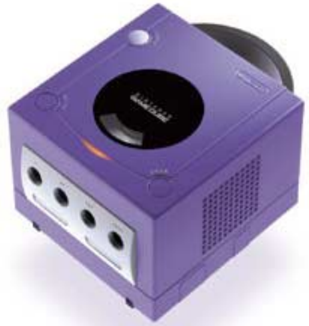

The geometric shapes and colors of Nintendo's original Game Cube create amusement. The handle on the top says, 'Pick me up and take me to a friend's house.'

There are four aspects of games that people respond to and each creates a different component of the player experience. Reactions to these aspects combine to produce different emotions such as Amusement in Mario Kart and Fear in Halo . All other Keys to player emotions use these product attributes to change how a player feels.

1. Visceral , automatic reactions to the appearance, sound and other perceptions
2. Behavioral , reactions from interacting with the product
3. Cognitive , reactions from ideas, memories, and associations with the product
4. Social , interaction with other players feeds back to all layers creating more fun

The emotional experience of the Area 51M and the Game Cube combines the emotional appraisal of their Visceral, Cognitive, and Behavioral attributes. [2] Because games frequently offer unique interaction with others we add social appraisal as a separate component.

## 1a. Emotions from the First Key: The Player: Internal Experiences

Generate Emotion with Perception, Thought, Behavior, and Other People

Those playing for internal experiences most commonly mention enjoying the emotions of Excitement and Relief. In addition to general relaxation, a quick pick up, and intellectual stimulation, some players pursue other specific emotions based on their values and moods.

| Emotion    | Common Themes and Triggers                                                                                                                                                                                                                  |
|------------|---------------------------------------------------------------------------------------------------------------------------------------------------------------------------------------------------------------------------------------------|
| Excitement | From sudden changes, novelty and challenge The unexpected catches attention. Many players enjoy the adrenaline rush. Some want to raise their state of arousal, others like how the emotional intensity makes them more relaxed afterwards. |
| Relief     | From negative emotion Gamers often start a game to experience relief from emotions and thoughts prior to playing.                                                                                                                           |

[2]

In this study player's favorite games such as Collapse or GTA coordinate the player's perceptions, behaviors, and thoughts to produce a robust internal experience. For example the game Ico uses all four of these product attributes to create rich emotions. In our experience with the game the world's artwork, music, strange languages, and the ink-blot shapes and motion of the ghosts all inspire emotions such as fear and curiosity on the visceral level. The stuttered vibrations in the left arm of the controller from holding the girl's hand creates more visceral emotion as the player pulls her along. There is fear of falling off windy ledges and joy from encountering gardens and green open spaces. Ico creates behavioral emotion from interaction with the world solving puzzles to open doors, fighting ghosts, and destroying parts of the castle. The player thinks about the identity of the girl and the owner of the castle and feels differently as events imply changes in relationships and goals.

The art and lighting in Ico create moods while solving the navigation puzzles create emotions on a Cognitive level.

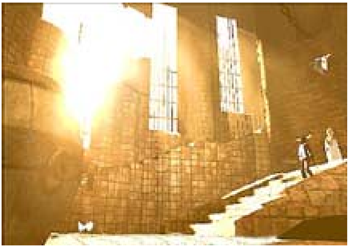

## 1b. Emotion from Visceral Experiences

Game art and audio generate visceral emotions such as the 'heart pounding' music in Tetris that many players turn off. Similarly the screech of tires taking a tight curve in Gran Tourismo and exotic fighting moves, backgrounds, and the destructible floor in Virtua Fighter 4 provide immediate emotional responses in the player. Players also respond to the motion of fabric and hair and the fear of falling over the edge in Soul Calibur II. In terms of audio water sounds from the first scene in Myst , or Halo's opening music create strong visceral emotions before the player has time to think or do anything. Falling, fire, spiders, worn surfaces, open vistas, round soft forms, angled shapes with sharp edges all produce different visceral effects.

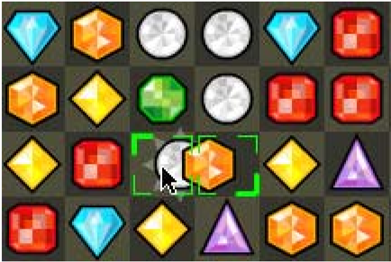

Positive Affect: Gemstone tiles in Bejeweled foster an urge to collect. The gems' appearance, the behavior of collecting them, and the cognitive appraisal of their value add several layers of emotional appeal. The game

Negative Affect: Burning letters in Bookworm increase the urgency felt by players from visceral associations with fire. The animation creates excitement and pick up the perceived pace of the game.

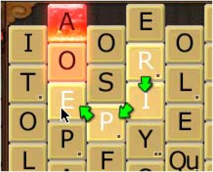

In Ico the player must guide the young girl by holding her hand. The controller vibrates creating a visceral connection between player and character.

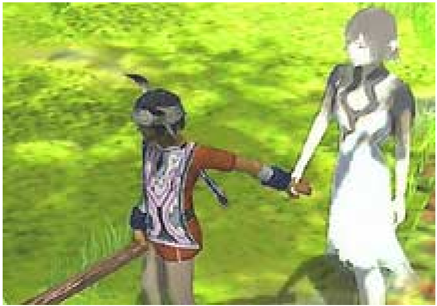

captivates with simple repetitive actions and a tight feedback loop. Matching pieces of dirty broken glass or animal feces would inspire different reactions on the visceral level.

Positive Affect from the delightful crunching sound of the worm eating correctly spelled words also encourages 'eating' more of them.

On the visceral level many adults in the study did not enjoy the sensations from graphic violence, blood, and gore. Many refuse to play games that expose them to these emotions. Increasing the variety of sensations available to the player on a visceral level will encourage greater variety of game experiences and expand the market for games.

## 1c. Emotion from Behavioral Experiences

Players respond to the experience of using a game. The feel and use of the controls both physical and in-game create pleasure such as a handheld with soft squishy 'telephone buttons' or the Snood launcher that Amy finds easier to aim. Players report enjoying how much Top Spin Tennis feels like playing real tennis. Player's vary greatly on the amount of realism they want in controlling vehicles such as in the racecars from Gran Tourismo . Some prefer a more 'arcade experience' where they point in the general direction to travel; while others like the detail of a simulation with multiple inputs requiring fine motor skills. Pleasure from use such as a pleasing rhythm or sounds in Solitaire or Collapse also affect player mood. Francine, Ellen, and Cathy sometimes do not finish a game they know they can win, because the ending requires too much repetition of the same action or moves. Some players choose games that offer challenge of fast action and reflexes. Others find turn-based games more relaxing. Some choose games that offer both.

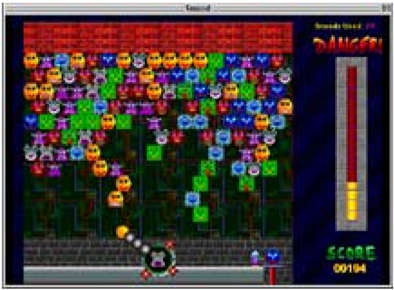

Amy prefers the firing controls in Snood to the very similar game Pop and Drop. The meter on the right counts the number of moves for each level allowing her to relax. (Also, Snood's animated smiling faces increase enjoyment on the visceral level.)

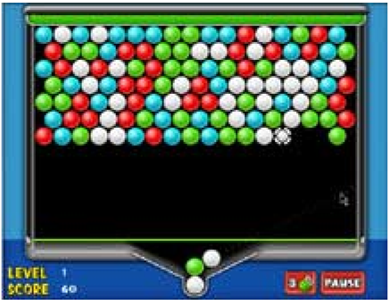

Amy enjoys Pop and Drop less because it is harder to aim and the rows advance automatically. The difference in gameplay creates different emotions in the player.

Players react to the type of interaction offered in addition to the 'feel' of them. Friendly interaction and art such as in Mario Kart encourages playful emotions. In contrast the subtle colors and stealth meter of Splinter Cell encourage different player behavior and mood. Player action through characters create emotions whether it is sneaking through doorways in Splinter Cell , driving anywhere in Grand Theft Auto , doing tricks in SSX , or throwing a racket in Top Spin Tennis . Behavior creates emotion in player and players express emotion through behavior . In our experience much of the fun in Tomb Raider comes from controlling Lara Croft . It feels fun to run, jump, tumble, and climb ledges like she can.

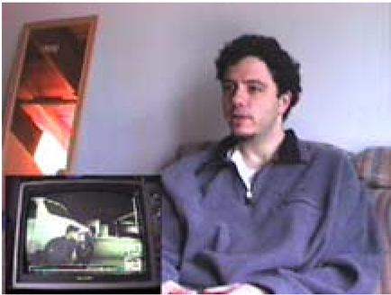

In Splinter Cell , finding cover and remaining unobtrusive changes player's body posture and creates emotions. This player enjoys sneaking around. On a visceral level special music lets him know when he needs to take cover and proceed with caution. The music's negative affect tenses the player's muscles, quickens his pulse, and focuses his attention.

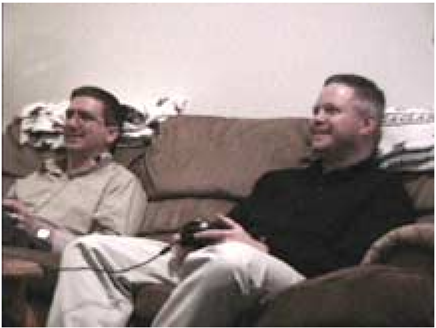

Mario Kart's interface makes it easy for a veteran (on right) to introduce and get beaten by a friend (on left). Mario Kart's jostling zany bright colored carts and obstacles produce a positive affect in the player. These create a more open free to try anything mood that assists learning. This openness makes this game more approachable and easier to enjoy for casual gamers.

In terms of behavior many adults ask for more physical activity in games. Watching people play on their own most adults move very little. The more intense the concentration the less movement there is. During co-located group play there is much more motion as players communicate. The lack of movement results in muscle strain and RPI (even in preschool children of some of the parents we interviewed). Several note the lack of physical activity as one of the top three things they like least about playing. In ranking their favorite activities some listed outdoor activities and sports above games for similar reasons. They feel better about activities that offer exercise. One player, Francine, bought Dance Dance Revolution because it was a way to have fun while staying in shape. She is disappointed that the controller is not as good as in the arcades. This player also likes things she cannot do at home such as put out burning buildings with a large fire hose such as at Dave and Busters (www.daveandbusters.com).

## 1d. Emotion from Cognitive Experiences

'We grew up playing Oregon Trail; it's about time for that game to come back.' - Bob College student and casual Top Spin Tennis Player

Ideas, memories, and learning create emotions during play and afterwards. How people think about a game changes how they feel. Thoughts about game themes, events, and about playing itself create emotions. Ellen and Amy enjoy feeling the mental stimulation word games provide more than those from playing Tetris . They think that word games give their brains more of a workout. This thought creates different emotions. Part of the appeal of GTA and The Sims comes from players thinking, 'What happens if I do this?' and then trying it. Memories and Nostalgia are another way players respond cognitively to games such as in Pacman, Oregon Trail, GTA Vice City, and Star Wars Galaxies . Similarly players enjoy the radio programs in GTA Vice City. The 80's 'greatest hits' music evokes a certain mood through associations, and for those old enough to remember, it also inspires specific memories. Part of the thrill also comes from experiencing things a player cannot do in real life. For sports titles setting up fantasy teams and comparing these against the performance of real athletes creates emotions and increases commitment to the game. Knowing, or knowing about a real athlete in college sport simulations also adds emotion especially humor.

As adults many players want mental as well as physical challenges. Players play for a sense of mental stimulation as well as a sense of accomplishment. Their 'rational side' wants to have fun while they develop and apply meaningful skills. More so than younger players, many adults say they would feel better about playing if they felt it accomplished something. Players vary in how much mental effort they want to apply during gaming. Some seek intense mental challenges while others play as a break from mental activity. Players who enjoy strategy and problem solving relish the emotions inspired by thought. Taking detailed notes is part of the fun of adventure games for Francine. Other players avoid games that require remembering a lot of facts, or they supplement their play with a strategy guide.

Francine starts her day off right by playing each of the Bicycle Card games once. While adventure games are her favorite, she plays these card games for a quick mental work out.

'I know it's addictive!' Kevin says about EverQuest. Formerly his favorite game, he stopped playing two years ago and now plays StarCraft nightly instead.

'I don't want to feel that a game just stole 2 hours of my life.' - Dan a Might and Magic player comparing movies to games

Players enjoy feeling good about playing before, during, and after a session. So some reduce play, hide passwords, or stop playing all together if they think games are too addictive. Several players found creative pursuits such as music more rewarding than games. Most adults in the study, even many that play games, feel that games are mindless or a waste of time. For some this is fine. That is the point. They are just games. For other players they want to have fun as part of a more meaningful experience.

For some players thinking about the game after playing is a big factor of their enjoyment. Some with pleasure, 'This is my prescription against Alzheimers' says Ellen on doing crosswords. While Amy responds with frustration, 'I want to be good at something that matters!' She enjoys being good at Snood, but wishes it would bring financial, educational, or social recognition. Some gamers demand a high amount of entertainment value from their game playing. Dan thinks about the return on investment (most players in our interviews feel games are too expensive). Other players are frustrated by how much they play such as Amy, 'Sometimes I feel compelled to play.' Many people, especially non-players want more meaningful experiences from games.

'Why are there no educational titles for the PS2? My kids would be just as happy playing Freddie Fish as they would a non-educational game… If I had known there weren't any on the PS2 I would never have bought it.' - A concerned non-playing mom of 3 boys

In our experience enjoyment fades more quickly if the game challenges or themes do not relate to values in player's own life or provoke thought. Players enjoy talking about what happens in a game, and so including more cognitive experiences could add emotion to such discussions. Most players were not looking for 'educational' experiences, but several did want them to apply to a greater purpose. Some games already increase their appeal by offering matters to think over, such as a kitchen fire in The Sims or the talk radio parodies in GTA . Future games could allow players to explore their own value systems, relationships to others, or solve a moral dilemma gives players something to think, talk, and feel about afterwards.

## 1e. Emotion from Social Experiences

The interaction between players, the competition, cooperation, and trash talking expand the fun from what is inside the box and creates opportunities for new emotions. Direct eye contact and friendly shoves and shouts increase the emotional impact of game events. Pacing is different in a social setting. Some players see games as foosball tables, an excuse to hang out and laugh with friends like Virtua Fighter 4 . Other players like immersive adventures they can lead their friends along like Brute Force in co-op mode.

Here we see amusement as two team members score a point over their rivals in Top Spin Tennis at this college fraternity. Special in-game moves are displayed with pride and some keep them secret. After all a teammate this match may be an opponent tomorrow.

Games can be social experiences played in the living room by the entire family. Many console game players use games as an excuse to invite friends over for a barbecue.

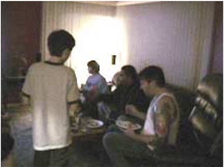

## 2. Hard Fun: The Challenge and Strategy Key

## Emotions from Meaningful Challenges, Strategies, Goals and Puzzles

'It's easy to tell what games my husband enjoys the most. If he screams 'I hate it. I hate it. I hate it.' then I know he will finish it and buy version two. If he doesn't say this, he'll put it down in an hour.' -Wife of a Hardcore PC Gamer

Challenge emotions come from participation in an activity in pursuit of a goal. Challenge is what we at XEODesign call 'Hard Fun.' Perhaps the most obvious source of player emotion in games, players in our study enjoy testing their abilities and the feeling of accomplishment. They like how the focus required removes them from their everyday concerns. They like getting better. They relish feeling good about something and spending time pursuing activities that are 'just for them.' The resulting sense of control, mastery, and completion make it a high point of their day. It is no secret that people play games to feel challenged, what is interesting is the variety of emotions and experiences they have while doing it.

'In games players think 'can I do it?' in movies it's 'will it happen?'.' - Will Wright, creator of Sim City & The Sims

Mary-Anne cannot see what to do next and experiences frustration.

'What a point!' Examples of Fiero on the right and disappointment on the left.

Challenge is the balance between player skill and difficulty of the objective. Strategy develops, tests, and applies that skill to solve problems. Players find both challenge and strategy very rewarding processes. It makes them feel good. Players like putting aside other concerns, the sense of completion, and like Ellen many play to 'put a check on the plus side of the day.' They enjoy setting goals, achieving them, and the winning feeling of putting in effort and having it pay off. This sense of completion and achievement means a lot to these players. They prefer games because it involves interaction and thinking instead of being passively entertained.

'Why play JamDat Bowling? I have to concentrate!' - A Casual Mobile Phone Gamer waiting to board a plane

Players Report Liking These Aspects of Hard Fun

- Amount of commitment required
- Adjusting the level of difficulty
- Progress and feedback
- Modifying games, custom rules and messing around
- Development of skills and feelings from growth
- Having choice between multiple strategies, skills, and goals

'The desire to experience or not experience an emotion motivates much of our behavior.'- Paul Ekman pg. 216

How players feel about goals is also important. While in the real world fitting colored blocks together may not have meaning, during play it must be emotionally rewarding enough to deserve the player's full attention. Some people get emotional when they know the stakes are high. Other players pursue a Zen-like state during intense challenge, where they ignore thoughts about winning or loosing because it pulls attention away from the game.

## 2a. Emotions from the Second Key: Hard Fun or Challenge and Strategy

## Emotions from Meaningful Challenges, Strategies, and Puzzles

Players experience many emotions while pursuing Hard Fun. Most importantly for Challenge is to balance Frustration, Fiero, and Boredom. Players must experience enough difficulty and variety to avoid boredom without encountering so much anxiety and frustration that the player quits. Ideally the difficulty is great enough to cause Fiero in the player more than just the feeling of success. The intense warm positive glow from personal accomplishment lingering long after play makes Fiero the most prized game emotion.

| Emotion             | Common Themes and Triggers                                                                                                                                                                    |
|---------------------|-----------------------------------------------------------------------------------------------------------------------------------------------------------------------------------------------|
| Anger & Frustration | Opposition to an important goal, sudden reversal, feeling of being thwarted, physical restraint (Anger prepares the body to remove an obstacle by force.)                                     |
| Fiero (Italian)     | Personal triumph over adversity. Overcoming difficult obstacles players raise their arms over their heads. They do not need to experience anger prior to success, but it does require effort. |
| Boredom*            | Repetition, dull, and tedious tasks. Lack of interest in the outcome or in playing                                                                                                            |

'I personally don't find a any great sense of satisfaction [from completing the levels] to me the enjoyment is in the playing itself.' Xavier

The most obvious difference between player comments across all genres and platforms is between those who enjoy overcoming challenges (or 'Hard Fun') and those who report liking how the process filled attention (or 'Easy Fun'). One of the biggest differences between Hard Fun and Easy Fun is the amount of mental or physical activity required to continue the experience. When challenged players forget their other concerns. During intense challenge players are so absorbed often there is little outward indication of emotion. It is not always fun while stretching but recalled as rewarding later.

## 2b. Enjoyment from Effort, Concentration, and Difficulty

Nearly all games develop a physical or mental skill. Many players select games that require effort and concentration. They enjoy achieving something they once felt impossible. Similar to Csikszentmihalyi's research on the Psychology of optimal experiences (or Flow) players report greater satisfaction from activities that require a 'high investment of psychic energy.' Activities requiring less attention such as watching a cut scene 'provide less memorable rewards.' [1] Challenge requires clear goals, accomplishable tasks, the possibility of failure, immediate feedback, player effect on outcome, and investment of mental energy. These deliberately designed obstacles to progress can create many emotions such as the 'interesting failure states' Will Wright designs for The Sims . In our experiences the feeling of success in the first ten minutes greatly improves a player's enjoyment of the game.

'I want it to be realistic and challenging vs. looking pretty.' - Jeff a handheld gamer

Skills from challenge enjoyed by players

- Skill at accomplishing objectives/interacting w/ opponent w/ game world
- Skill at mastering the basic controls (moving the character or vehicle)
- Skill at special/advanced moves
- New levels and power ups, character advancement
- Development and testing of strategies

Many players describe Flow experiences while playing. Similar to Csikszentmihalyi's interviews of thousands of people engaged in everyday activities, optimal game experiences fill player attention, offer clear goals, and achievable tasks. The experience creates enjoyment from a sense of control by responding quickly to actions and providing clear and immediate feedback on progress. During these peak experiences the sense of self diminishes, the sense of time lengthens or contracts, and unrelated thoughts and worries flee. Afterwards the sense of self returns enhanced by the experience with a feeling of increased complexity and growth. Frequently at the height of the experience there is little enjoyment, enjoyment often comes afterwards in retrospect. [1] The conditions for the mental state of flow are present in the design of most popular computer games such as Tetris, which create enjoyment from difficulty.

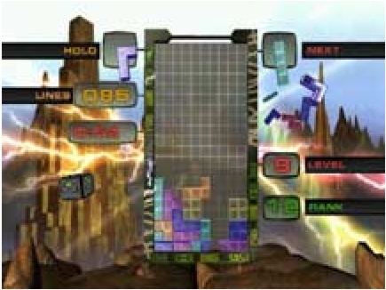

Tetris World balances difficulty with player skill to create Flow. The backgrounds for this version add visceral excitement.

## 2c. Enjoyment from Success

The greater the adversity the sweeter the triumph. As game designers know, to keep pace with player ability the game must offer more challenge. It is the combination of success and relief when they achieve the goal that makes games for some players so satisfying. Fiero is the Italian word that Emotion Psychologist Paul Ekman uses for this feeling of personal triumph over adversity is indicated with arms raised over the head. As a personal expression of excitement Fiero's unique sensations and gestures are not done for the benefit of others. For strategic thinking and puzzle solving to result in Fiero the player must apply considerable effort to overcome obstacles during play. To get to Fiero players frequently exhibit strong feelings of frustration and even anger prior to success.

From Frustration to Fiero

This player's Frustration becomes Fiero after spending several minutes trying to step onto a ledge. She and her character jump for joy. If this success were for a game objective, the emotion would be more rewarding.

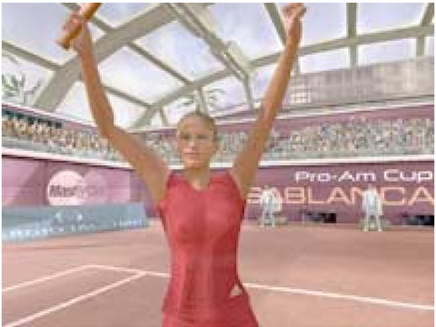

In a different game, Top Spin Tennis , a character 'expresses' Fiero by raising her arms overhead in victory after winning the match. Seeing this display encourages the player to feel the same emotion.

## Requirements for Flow

1. Clear Goals: fill the lines up with blocks.
2. Achievable Tasks: position blocks one at a time
3. Immediate Feedback: indicate effect of controls and progress
4. Sense of Control: feedback creates satisfaction from success and 'putting things in their place'

## Frustration with Interfaces Decreases Enjoyment

Psychological researchers study anger in infants by restraining their arms. Game navigation and controls create similar feelings in players. Players feel more success from achieving meaningful goals than from mastering controls. Players report abandoning games because of interface difficulties. Steep learning curves cause people to play less or not at all. The success players enjoy most comes from overcoming meaningful obstacles. In short challenge is more rewarding when the frustration comes from pursuing an important game goal.

Mary-Anne's frustration with this unnamed game changes to surprise when her character catches on geometry along a path. This surprise further reduces her sense of control and leads to additional frustration.

Continued frustration with character controls creates Anger to the point where she throws up her hands and eventually gives up. She wants to continue to play because she is interested in what is next, but feels powerless to make it happen.

## 2d. Modification of Challenge to Increase Enjoyment

'I like going back to where there are weak enemies and see how many I can kill in a single stroke.' - Dan on Heroes of Might and Magic

Players modify challenge to suit their moods or to increase their enjoyment of other activities. Ellen likes beginning a new game and the feeling of starting fresh so much that if she makes a mistake in Tetris, she starts over. Cathy never saves Civilization, because often the comfortable feeling from playing is more important to her than winning (and for games lasting more than a few days she forgets what has happened). She as well as other players like Amy, Henry, and Jeff adjust the level of challenge to fit their mood or to fill attention just enough so they are not bored while doing other things like talking on the phone or watching TV. Players such as Ellen, Cathy, Irene, and Amy often stop once they know they will win. Henry feels that playing other people is the only way to know how good he really is. Zachary creates new challenges for himself with meta-games such as using an opponent's screen to steer his car or pushing an opponent's car around the course in Need for Speed .

## 2e. Emotions from Advanced and Newbie Challenges

Favorite games balance difficulty between players as well as between player and game. When players are unevenly matched, difficulty settings such as in Soul Calibur II help balance the game. Many players report having negative online experiences of fighting and racing games, often loosing by large margins the first time they play. Many assume their opponents are 12 years old, which increases their discouragement.

Some games offer a better newbie experience by offering challenges and strategies appropriate for gross motor control. Fighting games with a strength settings or a strategy element allow less technically skilled players to experience success such as backing an opponent off the platform in Soul Caliber II . Players report enjoying group games more when a weaker team has the chance to win by strategy if they cannot win by skill. The lack of 'player controlled' level settings in MMORPGs such as EverQuest discourages newbies but keeps other players playing because they must be at similar levels to play games with their friends.

Mario Kart's simple interface makes it easy to start having fun with this racing game.

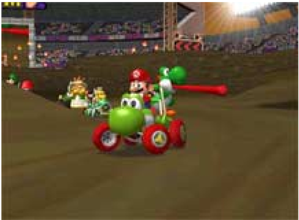

Star Wars Galaxies an MMORPG has 27 interface elements. Nine of these bring up tabbed dialogs. Only those who have played another RPG know how to have fun here.

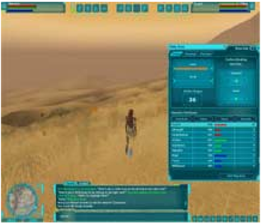

To have more fun newbies 'act out' when paired with better players. In multiplayer games beginners use gross motor control to run into, shoot at, and push over more experienced players. They often ignore agreed on game goals and do something surprising for a few moments of laughter. Quin enjoys shooting the squad leader in Brute Force 'just because he can.' Experienced players such as Rob and Zachary handicap themselves by giving a newbie a long head start or by waiting for them to catch up so it is a 'close race.' If players cannot achieve the game's main goal they will often make up their own rules or stop playing.

Too much challenge in APEX spurs a newbie to invent new gamplay to enhance her Player Experience by 'accidentally' running her car into her more experienced friend Rob. This provides laughter and a tension release.

Too little challenge in Ink Link drawing game inspires a player to start a spontaneous game of 'Who's the booter?'

Player 1: 'Everyone boot Clay he's booting everyone'

Player 2 : 'Its not me im booted too'

## 2f. Enjoyment from Multiple Strategies and Problem Solving

Players not only enjoy beating a challenge, but they also get great pleasure from figuring out how to win. Many players report strategic thinking and problem solving as what they like best about games. Players enjoy using their heads to come up with strategies and testing them out. For George, an avid Hearts player, learning new strategies in the game is the only reason why he plays online. Games that force the creation of new strategies sustain this type of enjoyment. In Collapse player emotions come from finding new ways to beat the game rather than repeating known techniques or overcoming more obstacles with less time. Some players find repetition boring, while other players like its meditative aspects.

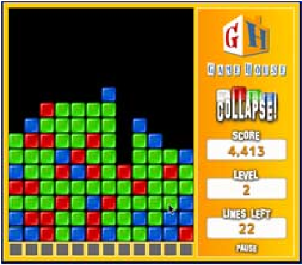

Collapse Level 2 - Color Grouping Strategy Avoiding one color and letting the rows stack up creates large grouping for extra bonus points when cleared. Here clicking a green block clears all the light colored greens.

Collapse Level 4 - Requires New Strategy With white blocks 'color grouping' is more difficult. This requires a new strategy to win.

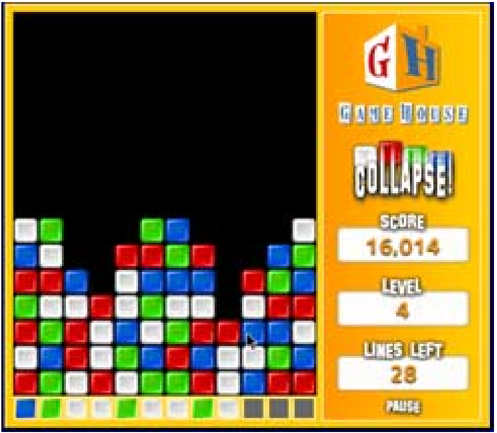

In playing Collapse Amy enjoys exploring new ways to improve her score as new obstacles suggest new strategies. The white tiles on level four are not only a fourth color, but make the other colors harder to see. Amy switches from grouping one color to clearing all the white blocks. In Collapse some players do not like having to replay several 'easy' time consuming levels for the chance to try another strategy here at level four. Similarly Francine complain about repeating the same moves at the end of a game to defeat a boss monster such as in True Crime: Streets of LA when finding a weakness would be more fun.

## 2g. Enjoyment of Negative Emotions

The appeal of many games comes from negative emotions. Enjoying things that inspire objectionable, disgusting, or shocking emotions is the main element of humor in games based on The Simpsons, South Park, and Sponge Bob Square Pants . Knowing that something inspires revulsion in others makes the enjoyment even more exciting. The ability for disgusting unpleasant emotions to entertain is made clear by the popularity of things such as fake vomit and earwax flavored jellybeans. Some of the magic of Oddworld comes from the amusement that can be derived from the unpleasant.

Players frequently do not enjoy negative emotions during play. In the photos on the left the player's mild disgust interferes with enjoying the game. In the photo on the right the players experience of disappointment makes a later success feel even better. Understanding context and direct observation of gameplay has an important role in interpreting player emotions. Also what players indicate on surveys differ from the impression games make during the moment. To properly interpret observations it is also important to work with the game designers to determine whether a player's negative emotions result from the intended game play or from the user interface getting in the way of the game.

Players react negatively to what they see and think. This player's brief sign of disgust indicates a negative impression of this unnamed game's interface. He likes the game but does not like the interface. He wants another way to play.

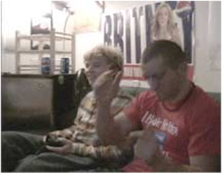

Players also react negatively to what they do. Here Bob drops his controller in disappointment from missing a shot in Top Spin Tennis . He shows some signs of sadness, that dissipates quickly as he sets up for the next serve.

## 3. Easy Fun: The Immersion Key

## Grab Attention with Ambiguity, Incompleteness, and Detail

'Felt like me and my character were one.' Kevin on EverQuest

If Challenge is about reaching goals, Immersion creates emotion by inspiring a closer look. At XEODesign we call this 'Easy Fun.' The sheer beauty, horror, or humor of a perception, behavior, or thought is immersive when it captures and fills attention. In nature a stone picked from thousands on the beach or the beauty of a sunset can suddenly stand out in a person's mind. Fascinated by its unusual shape or color we gaze at it transfixed, as it becomes our whole universe. A repetitive behavior such as collecting stones, shuffling cards, or tapping out dance steps can also become absorbing. An idea or experience that is not easy to categorize stays in attention longer as we ponder its uniqueness and meaning which delays the mind moving on to new thoughts. Some game elements capture attention and pull players in.

"The journey is the reward." - Design Philosophy at Cyan, the creators of Myst

An attention grabbing advertisement for The Matrix Computer Games provides the surreal existential aesthetic that is a compelling part of the Matrix films' appeal.

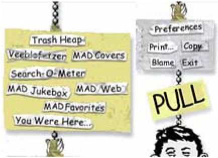

Pull down menu from Totally Mad is fun to use and labels such as 'blame' create interest.

Easy Fun creates a long 'now' where time alters its course and non-game thoughts and worries vanish. It is related to flow, but in our observations some players prefer becoming absorbed by rhythmic or sensory pleasures without being 'challenged' by them. Game designs also vary in the type of techniques they use for immersion, making it worthy of separate investigation. Like the flow of Hard Fun, the Easy Fun of immersion needs to be sustained by continued interaction between player and the game even if the 'interaction' is passive viewing. For example each time a player steals a car in GTA , a new sound track blares from the car radio. Not only does each song bring to the game a different mood, it evokes a new memory, and the juxtaposition of the song with the look of car refreshes the game. What separates Immersion from Challenge is the desire for experience without pursuing goals and goal oriented emotions. In Easy Fun players enjoy what they already know how to do.

' I'm not into keeping scores and competing with people. I like the sound of cards shuffling and the rhythm of dealing them out.' - A Casual Solitaire Player

Easy Fun maintains focus through player interest rather than pursuit of a winning condition. Based on our observations and prior experience we feel it is important to consider Immersion separate from Challenge. Many extremely popular games offer highly immersive game play with very little goal-oriented challenge such interior decorating in The Sims or driving through GTA without doing the missions . Players often ignore the challenges and play simply for the fun of the activity such as role playing a favorite character in Star Wars Galaxies . There are challenging games that also offer immersive aspects such as Halo. In addition interactive entertainment titles such as in Cosmopolitan Virtual Makeover and Totally Mad (the Mad Magazine archive) create pleasure from creating and interacting with the content rather than trying to 'beat' it. The game emotions of Easy Fun are less about the goal and more about the pleasure of experiencing, operating, and thinking about its significance. This difference between Easy Fun and Hard Fun offers emotion opportunities for both player and game designer.

In addition to perception Easy Fun also includes behavior. Child Psychologist Piaget makes a distinction between rule based and non-rule based play. He defines three stages of play: imitation and mastery, role play, and structured games with rules. Enjoyment of Easy Fun includes the first two such as taking part in the fiction like Star Wars or Camelot . Other titles such as GTA, The Sims, and Myst support all three stages of play and offer compelling experiences in each.

## Players Report Liking These Immersive Aspects of Games

- Interaction and gameplay, having choices to make
- Immersion getting away from real world concerns
- Both the act of problem solving and the sense from completing.
- Novelty and fresh start, quickness to start and start over.
- Making Choices (why many prefer games over TV)

## 3a. Emotions from The Third Key: Easy Fun or Immersion

Grab Attention with Ambiguity, Incompleteness, and Detail

'Similar to excitement and wonderment, ecstasy is an intense experience, not something on can experience in small amounts, just slightly.' - Paul Ekman pg. 195

If the emotions of Hard Fun's Challenge are Frustration and Fiero, then the emotions of Easy Fun's Immersion are Wonder, Awe, and Mystery.

| Emotion   | Common Themes and Triggers                                                                                                                                                                                |
|-----------|-----------------------------------------------------------------------------------------------------------------------------------------------------------------------------------------------------------|
| Wonder    | Over whelming improbability. Curious items amaze players at their unusualness, unlikelyhood, and improbability without breaking out of realm of possibilities.                                            |
| Awe       | Combination of wonder with a fear and dread. Such as beautiful but impossibly powerful dragon in EverQuest or the unusual sound and appearance of a weapon combined with its powerful destructive effect. |
| Mystery*  | Causes the player to ask, 'what's going on?' Inspires curiosity. 'What happens if I shoot this aquarium?'                                                                                                 |

[2] * Not technically an emotion according to Ekman but a feeling reported by players

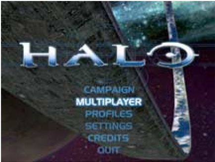

Halo's opening music, narration, and the surreal prospect of exploring a ring-world create wonder and mystery. This Immersion adds emotional depth to the shoot-em-up gameplay.

Splinter Cell small details like small puffs of dust as his character hangs from a ledge increase immersion into the game. Puzzles also increase immersion. Here the player solves a navigation puzzle with close observation and experimentation.

'Part of the enjoyment comes from the spy technology.' - Xavier using the fiber-optic camera to look under a door.

How a game represents the components of its world can make a big difference in immersion. Consider the line by Robert Frost; 'Two roads diverged in a yellow wood, and I - I took the one less traveled by, and that has made all the difference.' The use of metaphor and ambiguity gives the reader something to figure out. What difference did it make and is this good or bad? The open meaning captures the attention causing the listener to pause and consider even if it describes an actual walk by a game character. The character that says, 'I came to a fork in the road and took the narrower one.' makes a less memorable impression. Also, unlike the poem, repeat play does not reveal additional insight or inspire curiosity.

Most aspects of the Player Experience can have an immersive quality through incompleteness, ambiguity, and detail. Part of the charm of The Sims comes from their pictogram language ( Simese ). This openness to interpretation inspires curiosity and requires the player to project into what the characters are saying. The lack of specificity is also an important attribute for toys such as Barbie and even Legos . Players express their own personalities and options for more open-ended gameplay and appeal.

The opening of Myst , the most popular game of its time, woos the player with similar ambiguity in language, and later in the game surrealistic art provides a deeply immersive experience.

'I realized the moment I fell into the fissure that the book would not be destroyed as I had planned. It continued falling into that starry expanse of which I had only a fleeting glimpse.' -Opening Narration to Myst

The carefully chosen words begin the game mid-action to evoke wonder, awe, and mystery at the same time. There is curiosity about why he threw himself and the book into the fissure, why he wanted the book destroyed, and what happens next. His apprehensions transfer to the player and deepen the quality of the Player Experience by giving them more to feel and think about what they do. Moments later, the book's sound effect as it teleports the player to a new world creates goose bumps on the shoulders and back of the neck characteristic of Wonder.

## 3b. Visceral Immersion

Visceral Immersion is pleasure from the senses, often from using incomplete, illusive, hidden, or surreal details. Little surprises such as butterflies and waving grasses in StarWars Galaxies provide segments of easy fun to encourage exploration and sustain engagement during a particularly difficult challenge. Art and audio design are two of the most popular tools to increase immersion. When art or audio can be experienced for its own sake (and not interfere with gameplay) as in the Myst example above it deepens the immersion for the player. Dance Dance Revolution does this with animated backgrounds that increase in complexity with player's progress.

Some games encourage immersion with art direction such as Splinter Cell's low lighting and muted colors. These thrust the player into a world of just noticeable differences, which perfectly match the emotions and thoughts associated with a sniper. The distorted view of the next room through the fiber optic camera also increases immersion.

## 3c. Cognitive Immersion

The questions of what if, why, and how inspire players to ask questions and figure things out (i.e. answering questions and solving puzzles). There is much overlap with challenge here, but the aspects enjoyed focus more on the experience of filling attention rather than the list of obstacles overcome and the skills that are built.

Some players delight in testing the edges of a game. 'What happens if I drive the track backwards?'  'Can I launch myself to next level by standing on a grenade?'  'If I take out the pool ladders will my Sims drown?' Players know that the are playing a simulation and find fun in looking for details and exploits in cause and effect relationships. The search for these details increases immersion in the game outside of the main challenge.

In addition to figuring out where to go in Splinter Cell , Xavier explores the edges of the game by shooting the fish tank. Here he waits with curiosity as the water drains.

He is clearly pleased to see that the water will only go down to the level of the hole.

GTA and The Sims parody life as well as represent by adding humorous details. The exaggeration and campy humor encourages amusement. In GTA emotions created from the talk shows (cognitive layer) contrast with the more visceral emotions coming from the violence. Pulling the player's emotions in several directions increases the thrill of the ride. Details such as the 80's radio or a dirt-bike side challenge can be enjoyed for their own sake without the missions. The search for more humorous details is immersive Easy Fun.

## 3d. Behavioral Immersion

Particularly enjoyable behavior or interactive characteristics are often fun to do in their own right. Even after finishing all the missions in GTA Vice City , the sheer joy of moving through the environment keeps the play fresh and invigorating.  In Splinter Cell the 'spy tools' such as the fiber optic camera and lock pick increase the fun of interacting with the world. Here the game's immersive aspects and high tech novelty add emotion and as one player, Xavier, put it, 'cool spy tools are part of the Spy Experience.'

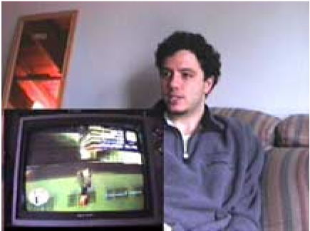

Xavier enjoys driving in GTA Vice City even after he has finished the missions. Here he focuses with concentration as he uses a ramp to jump his motorcycle up onto a roof…

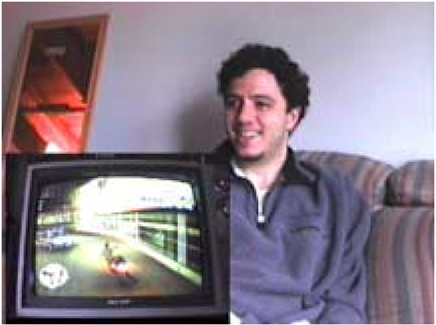

…and then jumps off it. Xavier smiles at his perfect landing. He also reports performing stunts in the game for friends such as rolling cars off freeway onramps.

Emotions also come from being able to do something the player is not able to do in real life. Such as the MX 2002 dirt bike racing game which Ulysses likes because it is something that he did not have the time and money to do. Probably the most discussed method of getting emotional responses from doing something one would not do in real life is from violating a social norm such as the graphic violence of a first person shooter or GTA III . Players enjoy the freedom and novelty and laugh at the resulting situations and consequences.

'In real life if a cop pulled me over I'd stop and hand over my driver's license. Here I can run away and see what happens.' Xavier playing GTA Vice City.

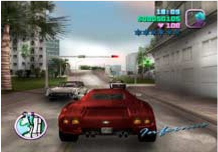

## 3e. Social Immersion

Social Immersion is engagement in interaction between people such as talking, jostling, dancing, and eating with others. Several games simulate aspects of social experiences to make the player feel more. Like the pre-recorded laugh track on television sit-coms games

Grand Theft Auto Vice City is a highly immersive game. Not only does the scoring system suggest numerous player objective such as how many wanted stars can the player get, but the side challenges and simply standing on a street corner can be entertaining.

such as SSX, QBz, and Gutterball, evoke the mood of being in a social environment through sound effects and spontaneous dialog from NPCs.

## 3f. Modifications for More Easy Fun

To increase Immersion players turn down the lights, draw the blinds, hook up the big screen TV and surround sound system to increase the immersion into the game. Players rearrange their furniture around the game system. Wireless controllers let players lean back and relax while playing or move around as they please (console cords for all three platforms are too short to use with big screen TVs). Some players role play or talk to the characters in their heads as they play to enhance the feeling of 'being there.' And as already mentioned players reduce difficulty settings when they want to relax while playing.

Jeff enjoys the excuse to curl up in his big comfy chair with a hand held game. Here he passes time while his wife gets ready, or on the weekend 'in-between' chores. For Jeff sitting at a desk is not as relaxing. Being comfortable while he plays is much more important to him than realistic graphics.

## 3g. Alternating Hard and Easy Fun

'I play for the story. If it's too hard I want to click through the puzzles or buy the Hint Book to find out what happens next.' - A Casual Adventure Gamer

Games alternate between Hard Fun and Easy Fun to extend sessions. When the challenge becomes too great, players can focus on other enjoyable aspects of the game. Most Adventure Games and First Person Shooters do this with level design. For example in Halo, the initial entry into a level allows the Easy Fun of exploring. Once the aliens appear the Hard Fun of battle occurs. Achieving the objective unlocks the next level and creates pleasure. Instead of quitting at this moment of triumph the player explores the next level for some Easy Fun 'for just a few minutes.' Soon they encounter a new Challenge and the cycle repeats.

Set on 'easy' the starting moves of Civilization are automatic for Cathy a college student. The game provides a sense of comfort and occupies her mind just enough while she talks on the phone.

## 4. Other Players: The Social Experience Key

## Create Opportunities for Player Competition, Cooperation, Performance, and Spectacle.

'It's the people that are addictive, not the game.' - Bob

The Social Experience Key is about the emotion from playing games with others. Playing with other people inspires competition, performances, and teamwork. Players enjoy rivalry and helping each other out. Certain game mechanics create nurturing feelings. This creates enjoyment outside of the game itself. When describing their favorite leisure activities many rank time with friends and family above games. In addition, participants playing as a group list competition and playing with friends is one of the top three things they like the most about playing (with only one exception). For some players spending time with friends is the only reason they play.

'Shared Experiences are Compelling Experiences.' - Walt Disney.

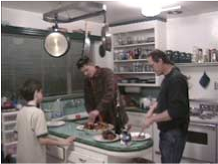

- Q : Why do people always end up in the kitchen?

A : Two pleasures at once: food and people. During a lag in on-screen action players hang

out together.

Playing games in social contexts intensifies player emotions and adds content. People playing in groups for this study demonstrate substantially more signs of emotion than those playing on their own. Emotional displays during co-located group play occur frequently between players creating a feedback loop for more emotions. Currently, * in single player experiences the game characters do not get 'emotional' in response to player emotions. Therefore the emotions do not escalate in the same way as they do in multiplayer games.

* One goal of Affective Computing is to develop computers that can sense and respond to human emotions to reduce frustration and increase enjoyment, a great opportunity for games.

On game night good food, drink, and friendships are all part of the fun. Here Sam helps himself to his brother's marinated chicken specialty they call 'meat candy.'

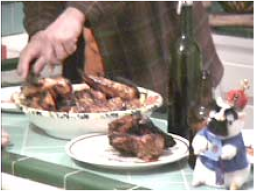

4a. Emotions from The Fourth Key: Other Players: The Social Experience Key Create Opportunities for Player Competition, Cooperation, Performance, and Spectacle.

'Emotions occur in every relationship we care about.' Paul Ekman pg. xiii.

Socially inspired emotions come from being with and interacting with others. In addition to increasing the number of opportunities for laughter, group play inspires emotions including camaraderie, rivalry, trash talking, as well as teaching and assisting fellow players. Some games inspire social emotions with NPCs. Playing with others brings out several emotions.

| Emotion                 | Common Themes and Triggers                                                                                                                                    |
|-------------------------|---------------------------------------------------------------------------------------------------------------------------------------------------------------|
| Amusement               | Something that's funny Regardless of the emotional tenor of the game, in this study people in groups laugh more than when playing alone.                      |
| Schadenfreude (German)  | Gloat over misfortune of a rival Competitive players enjoy beating each other especially a long-term rival. Boasts are made about player prowess and ranking. |
| Naches/ Kvell (Yiddish) | Pleasure or pride at the accomplishment of a child or mentee. (Kvell is how it feels to express this pride in one's child or mentee to others.)               |

[2]

In our study multiplayer gamers demonstrate more emotions, frequently engaging their whole bodies to express how they feel. In this study players in the same room demonstrate:

1. More Emotional Displays
2. More Energetic Responses
3. More Types of Interaction

As social experiences games trigger emotions through conversation and competition. Group games inspire sharing experiences, strategies, bragging rights, encouragement, and trash talk. They inspire more emotions through empathy with other players and their characters. Making and viewing facial expressions also increases player emotions. [2] During play an emotional reaction of one player frequently instigates and amplifies other emotions in the group, even without direct eye contact. Players such as Xavier report group sessions to have 'more energy and enjoyment.' This is especially visible in between challenges or when the pace lightens up. Likewise according to Wade solitary play, 'gets boring faster.' Players report emotion from competition, showing others how it is done, feeling like the expert, helping buddies, and saving the day.

## 4b. Emotions from the Presence of Others

'Since we lost half our guild to Star Wars Galaxies it's not as fun.' - A Hard Core Gamer Playing Dark Age of Camelot

Group interaction adds so many layers of emotion to the Player Experience that it is frequently much easier to see emotions in group gaming sessions. Players laugh and root for each other as well as trash talk. Opportunities for emotion expand as boundaries of the game extend beyond the display to include the bodies of the players and the room they are in. The living room becomes a new stage where house rules, player rituals, and drinking games create more fun. Players shove, tease, coordinate efforts, compete against rivals, show off, and perform victory dances. As an excuse to get together games also inspire emotion from conversations before, during and after play on even non-game topics such engine block repair and wine making. Games deepen existing friendships and start others. They amplify emotions in ways that our observations of group play via voice or text chat did not.

Playing together is more fun. Here Doug's daughter tires of playing computer games and wants a playmate.

For many players talking about the game after it is over is the best part of playing. Games provide content for conversation with friends. A group gamming session can be a spur of the moment opportunity to invite friends over, share barbeque and show off the new tattoo.

'[It's] nice to share with other. I do many other activities on my own.' - Ann

As a quick low-planning means of getting together, group play generates and strengthens social ties. Spending time together, comparing skills, and trash talk all serve to strengthen social bonds. The pleasures of enjoying each others company become part of the play experience. In group games play focuses on the people. During play and in-between matches players looked at each other and call each other names. Newbies, are encouraged to join, however, frequently experience difficulty because it is harder to do a new activity well in social situations. There is more pressure and pride on the line; mistakes and poor performance can feel worse with friends watching.

## '[Playing with others] feels less like a 'bad habit', more social, fun.' - Zachary

The presence of others changes how players react. Even negative events can take on a comic tone when experienced in context of group play. Players laugh at everything especially the mistakes. They also emote more strongly when winning if others are watching. Friends also add new content to game through trash talking and gestures frequently trying to out do each other with witty commentary. For Henry emotions from other player revive feelings about a game and their presence changes how it is played.

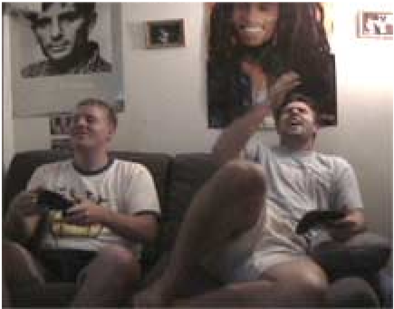

Here the player on the right experiences pain after accidentally hitting his head against the wall. His arm reaches up to touch where it hit (i.e. not Fiero). The eyes and eyebrows are drawn together and the mouth is open.

## Choice of Game: Playing Only in a Group

While several group players would never play by themselves, several single-player gamers never see the need to play with other people. Ellen prefers to play board games with her kids; 'Board games are what families are all about.' She wishes computer games were more like board games where family members face each other instead of a monitor. In one group the concept of playing a computer game alone or with others they did not know is 'too nerdy.' While one of them admits to playing movie-style games like Max Payne , the group does not think playing single player games are cool. Another player explains by saying that he likes the Lord of the Rings books because they were good stories. However, he does not like the Lord of the Rings games because they pay more attention to details like gnomes and trolls and not on what makes reading the books such a moving experience.

Moments later the expression changes as he responds to his buddy's laughter by suppressing a smile. Interaction with friends changes the experience. The mix of pain and delight is shown in his eyes and slight grin.

Playing at work Larry and his work friends take advantage of the training room, conference phones, LAN and in this case the overhead projector for a wall-sized display.

Larry text chats with friends in game, but a conference call is more fun. Dark Age of Camelot is not the type of game he prefers, but he plays it because they do.

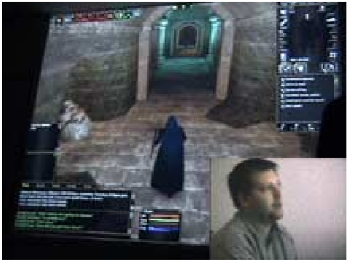

Many adult players wish they could find other people who played games. Francine's friends tease her good naturedly about her playing games made for younger boys. She wishes she had friends who enjoy playing. Years ago Dan bought two copies of Mech Warrior and has yet to find someone who likes to play. Instead he gives educational games to his friends' kids.

## In Game Social Experiences

Multiplayer games offer opportunities for socializing in game such as Dark Age of Camelot, which has text chat so players talk about the game or real life events. While this breaks the fiction, real life events open an even wider spectrum of possible emotions. Some players of online games such as Cathy use instant messaging rather than in game chat to keep her conversation with her out of town boyfriend private. Work-mates Mark, Nick, Larry, and Yvon use telephone conference calls to communicate and share emotions during play at work.

Oscar plays Counter-Strike at a St. Louis Game Parlor.

Players use text and voice in Counter-Strike to coordinate attacks and gloat over the demise of rivals.

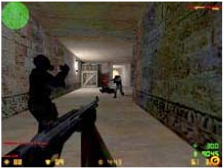

## 4c. Emotions from Competition Cooperation and Teamwork

Interaction Can Encourage Group Play

'Enjoyment when your friends blow-up.' -Pat a PS2 gamer on his favorite game emotion

The most obvious emotions emerging from group play are those from competition and team work. For multiplayer games people express a wide variety of preferences for interaction between players from cooperative to competitive interaction. People who play in groups often prefer more players to increase the excitement and combine team work with competition. Some players enjoy the feelings from cooperative play rather than competition. These players look for co-op support on the box when purchasing a title.

Offering game objectives and computer opponents for group missions increases the emotions for group game sessions. Multiple ways for players to interact changes the strategies and challenges encouraging repeat group play. While chasing each other around a level is fun for 20 minutes, players report liking multiplayer interaction, objectives, strategies, skill sharing features, bonuses for team work. Similar to how children move through Piaget's play stages players report shooting at each other becomes repetitive unless other rules and goals are involved. Group games that provide objectives are enjoyed more and for longer than those who limit multiplayer play to a game of tag around the game space.

NBA Street with two players offers offense and defensive play. It also provides enough action to interest those waiting a turn.

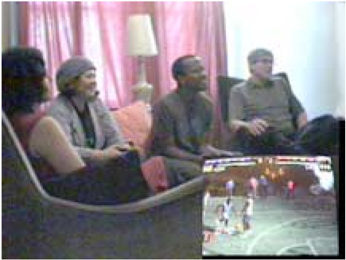

Team based play offers more emotions. Top Spin Tennis and Mario Kart offer cooperative and competitive play experiences simultaneously.

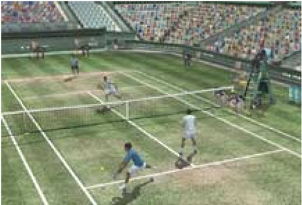

Players enjoy the benefits of cooperation. Not only do players share tips on how to play, but together as part of a group session they explore higher levels in a game at harder difficulty settings and devise new strategies. Single player games with multiplayer modes are played repeatedly in groups even after players have accomplished the main mission. Players report enjoying playing completed levels with their friends. As Henry puts it, 'It's like playing with fresh eyes.' In Brute Force , switching from a brawlish alien to a petite female sniper creates opportunities for new emotions mid-game. Not only do they have different appearance and behavior, but their dialog changes too. Likewise different professions in MMORPGs create player interdependencies and opportunities for interpersonally inspired emotions.

Playing with other people changes a game's challenges and strategies. Adding more people increases the difficulty and the variety of emotions experienced. Real people are less predictable than computer controlled characters and so a well-honed single player strategy may have surprising results in a multiplayer game. Additionally people learn from experience to develop new counter moves keeping the game challenging. Social features extend the emotional impact of a game by encouraging repeat play keeping the game fresh.

Playing with others is unpredictable. For example playing Brute Force in co-op mode encourages the development of new strategies and more emotion, as real players are less predictable than NPCs. Because Pat fires before his friends are 'in position' his team misses the final objective. Initially a source of frustration this incident later offers much amusement.

Playing Brute Force the team leader (center) leans back in amused frustration, while the player with the hair trigger (right) laughs.

## Competitions and Performance Ranking

High score boards posted for all to see increase player pride, spirited competition, and the number of game sessions. Such real world artifacts also raise the visibility and importance of the game to others who view it. In-game reputation systems for online games such as EverQuest and Star Wars Galaxies also affect player feelings about their characters and play. Players also compensate for limitations of in-game scoring systems with paper score sheets for various fantasy sports competitions.

For single player games a simple high score board can inspire emotions, competition, and initiate more play. Players have fun with phrases such as 'Mom Rules' and 'Carrie is Cool' as high score names. Beating a high score offers more pleasure if it is someone that they know such as a friend or family member. Players report that seeing someone else's new high score often triggers them to play a new game.

It feels good to help others. Here Doug helps his kids by playing to unlock a higher level in the Buzz Lightyear game.

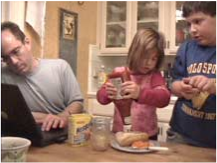

## 4d. Emotions from Helping Others or Between Players and Characters

'The character is cute and Abe can take control over other characters. There is a mission which is humane (free others from slavery) and there's a sense of accomplishment.' - Ann on why Odd World is her favorite game.

## Emotions Between Players and Characters

In addition to amusement and gloating over the misfortunes of rivals, interaction between players or NPCs offers opportunities for unique social emotions such as the pleasure at the accomplishment of another player they have trained (Naches). Naches occurs when a mentor watches a friend succeed. Some games allow players to heal teammates or help in-game characters such as the princess in Ico, which adds a similar emotion. Performing or witnessing an act of charity or kindness creates feelings of gratitude as well. Hal Barwood suggests that care taking games and people/pet simulations create feelings of attachment between the player and their 'creations' such as in the phenomenally successful Tamagotchi . Such simulations create glowing pleasure or pride, even for cities and roller coasters.

## Character Art, Audio, and Features Can Enhance Social Emotions

Diminutive or 'cute' artwork can increase these care taking feelings on a visceral level such as the character and cart art in Mario Kart Double Dash . The bright saturated colors also provoke a fun mood. In Heroes of Might and Magic Dan enjoys role-playing and commanding his allfemale army partly because he thinks they are cute. In Hack , being able to save a player character, attributes, and inventory carrying it forward into a game's sequel, increases Francine's emotional attachment and eagerness to buy the next version.

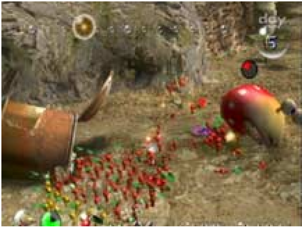

In Pikmin herding vegetable minions creates feelings of Naches when they succeed.

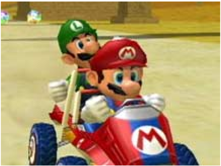

Mario Kart Double Dash offers an easy way for newbies to play and makes the game more fun by offering team work and competition.

## 4e. Emotion from Performance and Spectacle

For co-located play, games with competition, fast action, and high degrees of spectacle are more fun. Pacing changes dramatically when spectators are present. If there are more players than controllers short turns increase excitement as players take on new challengers. In addition offering a high degree of player to player interaction ( Soul Calibur II ) or a common goal ( Brute Force ) increases engagement. Spectacle, the appearance of the world and the changes a player can make to it, attract attention creating specific emotional states both for participant and spectator alike.

Games provide different levels of fun for those not playing. During a Wednesday barbecue at Rob's house, the rowdy fighting of Soul Calibur II with its exaggerated characters, exotic backgrounds and clothing offers more spectator thrills than the more realistic MX 2002 bike racing game. The spectacle and simple concept of Soul Calibur II sparks spectator participation through shouting instructions and joking commentary. In our study of this group audience participation occurs less frequently for the MX 2002 bike racing game.

Players enjoy watching the fighting in Soul Calibur II. With wild characters and lots of moment to moment action it offers entertainment for spectators in-between turns.

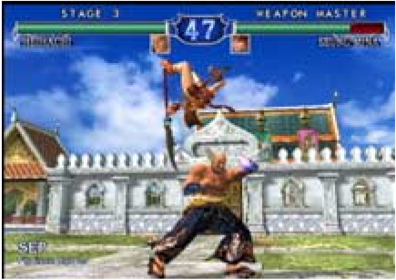

Soul Calibur II focuses on player to player combat and short turns. Strength settings match skills and keeps turns short.

While MX 2002 is fun for the players, the longer turns and less visual excitement reduces spectator interest. Waiting for a turn one participant demonstrates fatigue by resting his chin.

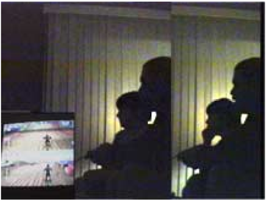

Racing games such as MX 2002 focus more on player vehicle control than on player to player interaction.

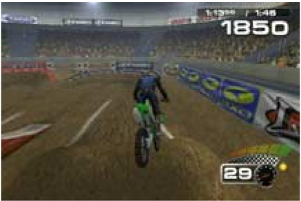

While a few people playing at Rob's house enjoy role playing games on their own (they define as 'games you play once and your done' such as Final Fantasy ) these games were not successful as shared experiences. One player emphasizes the importance of player agency and interaction in shared games by remarking,'It's like watching a cartoon.' Having little group play value, these players rent rather than purchases role playing/adventure style games.

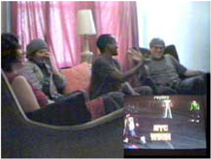

NBA Street wins out over soccer for Zachary and his friends because it is easier to start for beginners and more fun to watch. Playing also reminds them how much they like basketball. They talk about getting together next week to play the real game.

## 4f. Emotions from Modifications Group Meta Games, Rituals, House Rules, and Secrets

'Winner stays and the looser pays.' - Larry on playing arcades in his teens

## Modification of Social Game Experiences to Increase Enjoyment

Playing together is so preferable for some that they modify single player games to create a group experience. For example Doug and his two kids play a Buzz Light Year game together by assigning each player a key to make Buzz run, jump, or shoot. Another group of a dozen friends gathers at Rob's barbecue use house rules to keep excitement going and turns short. Players must 'pass the mic' (controller) if they loose sight of the lead player on their half of the screen. Instead of finishing the race, the player who 'runs the gauntlet' and beats all challengers wins, and expresses his delight with a signature victory dance.

Run, Jump, and Shoot! To make the single player Buzz Light Year game more fun, Doug modifies it by assigning each player a different key.

In addition to house rules, many group players have sayings to increase enjoyment, such as expressing the desire to play by asking, 'Are the courts open?' or after playing, 'Good game! I'm going to have to take a shower after that one.' The agreed on meaning increases the fun as well as identification with the group.

## 4g. Emotions in Social Context

Frequently real life events contain more emotions and importance than games. Play happens in social context with interruptions and other activities. In our opinion, the game Majestic failed partly because it miss-judged the way game features interacted with the player's social context. The design overestimated the appeal of the game contacting the player during work or other activities. On the other hand, players in our study frequently got cell phone calls, making pausing the game or the ability to leave while others continued a very popular feature.

Here a friend drops by with a 'Public Service Announcement' of 'unusual noises' coming from the fraternity room down the hall.

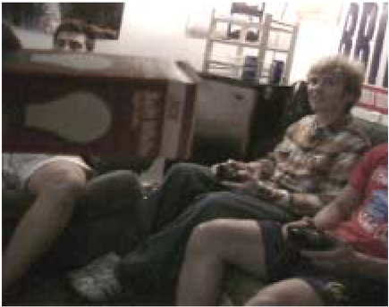

Curiosity and real-life amusement win out over Top Spin Tennis . Players abandon game and research session to check it out.

## Summary and Conclusion - Why We Play Games

People play games to change or structure their internal experiences. Adults in this study, enjoy filling their heads with thoughts and emotions unrelated to work or school, others enjoy the challenge and chance to test their abilities. Games offer an efficiency and order in playing that they may lack in life. They value the sensations from doing new things such as dirt-bike racing or flying, that they otherwise lack the skills, resources, or social permission to do. A few like to escape the real world; others enjoy escaping its social norms. Nearly all enjoy the feeling of challenge and complete absorption. The excitement and relaxing effect of games is very appealing and some apply its therapeutic benefits to 'get perspective,' calm down after a hard day, or build self-esteem.

Direct observation reveals details about player emotion. We find emotion in player's visceral, behavioral, cognitive, and social responses to games. Players play to experience these body sensations that result from and drive their actions. Some crave the increased heart rate of excitement from a race, the skin prickling sensation from wonder, or the tension of Frustration followed by feelings of Fiero. For others it is simply the exchange of worries and thought and feelings for relaxation and contentment, or a feeling of achievement knowing they did it right.

The Four Keys to emotion structure Player Experiences to improve play.

1. Players find enjoyment from their internal experiences in reaction to the visceral, behavior, cognitive, and social properties. These players play for internal sensations such as Excitement or Relief from their thoughts and feelings.
2. Players like the opportunities for challenge, strategy, and problem solving. Their comments focus on the game's challenge and strategic thinking and problem solving. This 'Hard Fun' frequently generates emotions and experiences of Frustration, and Fiero.
3. Players enjoy intrigue and curiosity. Players become immersed in games when it absorbs their complete attention, or when it takes them on an exciting adventure. These Immersive game aspects are 'Easy Fun' and generate emotions and experiences of Wonder Awe and Mystery.
4. Players use games as mechanisms for social experiences. These players enjoy the emotions of Amusement, Schadenfreude, and Naches coming from social experiences of competition, teamwork, as well as opportunity for social bonding and personal recognition that comes from playing with others.

What surprised us most was the dramatic contrast in emotional displays between one vs. several people playing together. Players in groups emote more frequently and with more intensity than those playing on their own. Group play adds new behaviors, rituals, and emotions that make games more exciting. We were also surprised at how aptly Flow describes challenge and the promise this holds for making games that can even improve the quality of life. For the game designer, the Four Keys to unlocking emotion in moment to moment game play offering new opportunities for generating emotion through player choice.

## Appendix A.

## Participant Backgrounds

Participants come from a wide variety of backgrounds and educational levels and played several genres of games. After playing we interviewed 30 of these hard core and casual gamers ages 21 to 50 (average 34 years, excluding one ten year old). Living in either San Francisco Bay Area or St. Louis Missouri participants have a variety of occupations ranging from college student, professional mediator, housewife, IT professional, city employee, salesman, musician, to truck driver. On average participants spend 9 hours a week one to two times a day playing games and have spent an average of $118 on 3 titles in the past 6 months. They like games more than most activities with slightly less than half liking them about the same as other activities.

Participants play on several platforms and have a wide range of interests: 34% prefer fighting or shooting games, 24% like adventure games, 14% like casual puzzle and card games, and 17% like arcade and family games. Participant's have many favorite games including: GTA III and Vice City, Tetris, Snood, Collapse, Hearts, Brute Force, Halo, Soul Caliber II, MX 2002, Top Spin Tennis, Dark Age of Camelot, Heroes of Might and Magic, and Civilization .

## Methodology

We asked open ended questions to capture what is most salient about player's experience in order to not constrain responses to a list of pre-determined options. Qualitative observations are more time consuming but reveal more about each player's individual reasons for playing. We also wanted to compare what they enjoyed to what they reported. It is this detail that we needed to answer our questions.

To consider all aspects related to play, observations were made of other activities occurring during the play session as well as how the surrounding environment such as lighting level and furniture position influenced enjoyment. Other family members or friends present at the time of the session were also briefly interviewed on their attitudes towards games and the player(s) playing habits. These non-player attitudes are mentioned briefly in this report.

This report includes a few images from outside the study sessions. To clearly photograph expressions of Disgust, Anger and Fiero we had individuals play an off-the-shelf PC real time 3D game for the first time. To clarify some of the principles we have also included a couple of observations based on our 11 years of experience.  Where we say 'Players' or 'Participants' we refer to the subjects interviewed in our study. Where we say 'in our experience' or 'in our opinion' this refers to observations and opinions based on XEODesign's research and design work for other games.

## Appendix B.

## Participant Profiles Selected Details

| Name        |   Age | M/F   | Hr/wk   | Favorite Game              | Why Play Games?                                                                                                                |
|-------------|-------|-------|---------|----------------------------|--------------------------------------------------------------------------------------------------------------------------------|
| 1 Amy       |    38 | F     | 12      | Collapse® I                | It's on my telephone                                                                                                           |
| 2 Bob*      |    22 | M     | 3       | Top Spin Tennis            | Competition                                                                                                                    |
| 3 Cathy     |    21 | F     | 6       | Civilization II            | They are fun and you get to think a bit                                                                                        |
| 4 Dan       |    47 | M     | 16      | Might and Magic            | Indoor Reality Escaping                                                                                                        |
| 5 Ellen     |    50 | F     | 3       | Tetris®                    | Tetris: calming Crossword puzzles: stimulating                                                                                 |
| 6 Francine  |    29 | F     | 15      | Grand Theft Auto           | It's fun, way to escape, challenging                                                                                           |
| 7 George    |    57 | M     | 5.5     | Hearts (Nova.com)          | Enjoy strategy/outcome scenario                                                                                                |
| 8 Henry*    |    37 | M     | 4       | Halo                       | Entertaining, Fun                                                                                                              |
| 9 Irene     |    40 | F     | 10      | Snood                      | Pinball (feeling vs. war games)                                                                                                |
| 10 Jeff     |    44 | M     | 3       | Rampart                    | to relax (instead of eating a muffin)                                                                                          |
| 11 Kevin    |    30 | M     | N/A     | EverQuest®                 | N/A                                                                                                                            |
| 12 Larry    |    28 | M     | 16      | Counter-Strikeâ„¢            | Inexpensive Indoor Activity                                                                                                    |
| 13 Mark     |    32 | M     | 14      | Age of Empires             | Thought provoking; enjoyment, how to handle certain things inside the game, just as in real life. Some are better than others. |
| 14 Nick     |    35 | M     | 10      | Half-Life                  | It's a fun way to relax                                                                                                        |
| 15 Oscar    |    39 | M     | 15      | Counter-Strikeâ„¢            | Great Stress Reliever                                                                                                          |
| 16 Pat*     |    32 | M     | 10      | Halo                       | For Fun                                                                                                                        |
| 17 Quin*    |    37 | M     | N/A     | Halo                       | N/A                                                                                                                            |
| 18 Rob*     |    32 | M     | 25      | Star Wars®                 | Fun (Knights of the Old Republic)                                                                                              |
| 19 Sam*     |    35 | M     | 12      | SOCOM                      | Entertainment                                                                                                                  |
| 20 Ted*     |    10 | M     | 6       | Pacman                     | Just Fun                                                                                                                       |
| 21 Ulysses* |    30 | M     | 1.5     | Soul Calibur® II           | To pass time                                                                                                                   |
| 22 Victor*  |    34 | M     | 5       | Madden NFL 2004            | Activity to kill time                                                                                                          |
| 23 Wade*    |    24 | M     | 10      | MVP Baseballâ„¢ 2003         | N/A                                                                                                                            |
| 24 Xavier   |    25 | M     | 4       | Halo                       | Entertainment                                                                                                                  |
| 25 Zachary* |    39 | M     | 4.5     | Need for Speed Underground | Entertainment, group activity                                                                                                  |
| 26 Ann*     |    31 | F     | 4       | Oddworld                   | For mental stimulation and relaxation                                                                                          |
| 27 Bill*    |    28 | M     | 2       | Tony Hawk's Proskaterâ„¢     | They're fun and it can be an escape                                                                                            |
| 28 Cindy*   |    25 | F     | 1       | Golden Eye 007             | To be intense or compete                                                                                                       |
| 29 Yvon     |    38 | M     | 30      | Thief                      | Challenge                                                                                                                      |
| 30 Doug     |    39 | M     | 2       | Medal of Honor             | N/A                                                                                                                            |

## References

1. Csikszentmihalyi, M., Flow: The Psychology of Optimal Experience. Harper & Row Publishers Inc., New York, NY, USA, 1990
2. Ekman, P., Emotions Revealed . Times Books Henry Hold and Company, LLC, New York, USA 2003
3. Norman, D. A., Emotional Design: Why We Love (or Hate) Everyday Things. New York: Basic Books 2004

## Acknowledgements

Thank you to Hal Barwood, Ann Smulka, Kathrine Isbister, Charles Harribey, and Mark Terrano for feedback and assistance. Special thanks to David Freeman for help with the title.

© 2004 XEODesign, Inc., All Rights Reserved Player Photos © 2004 XEODesign, Inc., All Rights Reserved. All Trademarks are the properties of their respective holders.