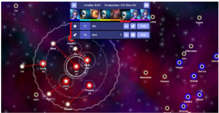

## Evaluating GameFlow in a Multiplayer Online Strategy Game Under Development

Penny Sweetser Australian National University Canberra, ACT, Australia, penny.kyburz@anu.edu.au



## ABSTRACT

Daniel Johnson QLD University of Technology Brisbane, QLD Australia, dm.johnson@qut.edu.au Jay Kyburz Iron Helmet Games Canberra, ACT, Australia, jay@ironhelmet.com

February 04-06,  2020,  Melbourne,  VIC, Australia .  ACM,  New  York,  NY, USA, 11 pages. https://doi.org/10.1145/3373017.3373068

GameFlow  is  a  widely  used  model  of  player  enjoyment,  with hundreds of applications to designing and evaluating games and game-like experiences since its first publication. Derived from a general set of heuristics for creating enjoyable player experiences,  GameFlow strives to be a general model of player enjoyment, applicable to all game genres and platforms. However, research so far has been focused on the single-player experience  and  GameFlow  elements  such  as  Challenge  and Control can vary considerably in a group situation. Therefore, it is  also  important  to  test the  GameFlow model's applicability to multiplayer  games.  In  this  article,  we  report  the  findings  of  a study that applies the GameFlow model to a multiplayer online strategy  game  under  development.  Expert  reviews,  using  the GameFlow criteria, were conducted by 12 stakeholders (developer,  players,  researchers,  and  journalists)  in  the  game Neptune's  Pride  2:  Triton.  We  reflect  on  lessons  learned  about evaluating  a  multiplayer  game  under  development,  as  well  as several  key  points  of  improvement  for  future  versions  of  the GameFlow model and criteria.

## CCS CONCEPTS

- Human-centered computing~Heuristic evaluations · Software and its engineering~Interactive games

## KEYWORDS

GameFlow,  flow,  videogames,  player  experience,  multiplayer, social interaction, immersion.

## ACM Reference format:

Penny  Sweetser,  Daniel  Johnson  and  Jay  Kyburz.  2020.  Evaluating GameFlow in a Multiplayer Online Strategy Game Under Development. In Proceedings  of  Australasian  Computer  Science  Week  (ACSW  2020),

Permission to make digital or hard copies of all or part of this work for personal or classroom  use  is  granted  without  fee  provided  that  copies  are  not  made  or distributed for profit or commercial advantage and that copies bear this notice and the full citation on the first page. Copyrights for components of this work owned by others than the author(s) must be honored. Abstracting with credit is permitted. To  copy  otherwise,  or  republish,  to  post  on  servers  or  to  redistribute  to  lists, requires prior specific permission and/or a fee. Request permissions from permissions@acm.org.

ACSW 2020, February 04-06, 2020, Melbourne, VIC, Australia

© 2020 Copyright held by the owner/author(s). Publication rights licensed to ACM.

ACM ISBN 978-1-4503-7697-6/20/02...$15.00

## 1 Introduction

GameFlow [32] is a model of player enjoyment, consisting of 38 criteria derived  from  games  user  experience  literature  and structured into eight elements that conceptually map to Csikszentmihalyi's [7] concept of flow. Since the original publication  of  the  GameFlow  model  [32],  it  has  seen  extensive use throughout the games research and development communities, as well as a number of related areas. The elements and  criteria  of  the  GameFlow  model  have  been  used  in  the design and evaluation of a wide range  of games and non-game applications,  including  games  for  older  people  [21],  disabled people [23],  and  children  [9,  25];  games  for  education  [18,  19], training [2, 11] and rehabilitation [1, 20]; and  games  for environment [24]  and  art  [14].  The  GameFlow  model  has  been used  to  design  and  evaluate  games  for  a  variety  of  platforms, including console games [5, 28], mobile games [13, 20, 28], and virtual,  augmented,  and  mixed  reality  games  [10,  14,  17,  31]. Several  new  models  have  also  been  derived  from  the  original GameFlow model, including EGameFlow [12], Pervasive GameFlow [16], and MIU-GameFlow [33]. The GameFlow model has also been extensively evaluated in the literature. Researchers have discussed and examined the inclusion of the Social Interaction element [6], the relationship between Social Interaction  and  Immersion  [15],  and  the  GameFlow  model's connection to flow [6, 22].

Despite  the  many  uses  and  applications  of  the  GameFlow model,  there  is  little  research  that  attempts  inquiry  into  the model  or  seeks  to  assess  its  applicability  in  varying  contexts. Previous  research  has  tested  the  applicability  of  the  model against  different  game  types  and  platforms  [28,  30].  However, these applications have focused on the single-player experience. Given the prevalence and popularity of multiplayer games, it is important  to also consider the multiplayer experience, the parallels  and  differences  to  single-player,  and  the  interaction between  social  play  and  immersion.  Research  to-date  has  also been limited to evaluating the model's application to completed and  shipped  games,  rather  than  games  under  development. Finally, previous applications of the GameFlow model via expert reviews have been limited to the perspective of researchers with expertise in game design and play.

The research  reported  in  this  paper  elaborates  on  our  work reported in [26] and [27] and applies the GameFlow model to an online multiplayer game under development in order to address the three areas for exploration identified above. Our aims were to  investigate  the  applicability  of  the  GameFlow  model  to  a multiplayer  game  under  development;  to  expose  weaknesses, ambiguities, and issues when applying GameFlow to multiplayer games;  to  gain  insight  into  how  online  multiplayer  strategy games can be designed to facilitate player enjoyment, as well as how GameFlow can effectively be integrated into the development  process.  Expert  reviews  were  conducted  by  12 different stakeholders, including researchers, journalists, players, and  the  game's  developer.  Each  reviewer  was  also  asked  to provide feedback on the GameFlow criteria. A set of recommendations were provided to the developer, based on the reviews,  and  their  feedback  was  sought  on  the  usefulness  and applicability of the recommendations.

## 2 GameFlow

In the original GameFlow paper [32], the key elements of player enjoyment  in  video  games  were  identified  by  conducting  a comprehensive  review  of  the  literature  on  usability  and  user experience in games.  The  result  was  the  identification  of  eight core  elements  of  player  enjoyment  in  games  -  concentration, challenge,  skills,  control,  clear  goals,  feedback,  immersion,  and social interaction. These core elements were observed to overlap closely with, and were subsequently mapped to, the elements of flow [7]. This structure formed the foundation of a new model of player enjoyment in games, called GameFlow.

The  GameFlow  elements  are  all  closely  interrelated  and interdependent.  In  summary,  games  must  hold  the  player's attention through a high workload, with tasks that are sufficiently  challenging  to  be  enjoyable.  The  player  must  be skilled enough to undertake the challenging tasks, the tasks must have clear goals so that the player  can complete the tasks, and the player must receive feedback on progress towards completing the tasks. If the player is sufficiently skilled and the tasks have clear goals and feedback, then the player will feel a sense  of  control  over  the  task.  The  resulting  feeling  for  the player  is  total  immersion  or  absorption  in  the  game,  which causes the player to lose awareness of everyday life, concern for themselves, and alters their sense of time. The final element of player enjoyment,  social interaction, does not map  to  the elements of flow, but features strongly in the player experience literature  [3,  8,  32].  Each  element  of  the  GameFlow  model consists of an overall goal and a set of criteria that can be used to design and evaluate games with respect to player enjoyment (see Tables 2 to 9).

## 2.1 GameFlow

Social  interaction is  central  to  player  enjoyment  [3,  8].  Players will engage in, and enjoy games socially, even if they would not play or enjoy the same games as a solo experience [32]. A recent survey of 1210 Australian households and 3228 people living in them  revealed  that  only  17%  of  players  always  play  alone  [4].

The GameFlow model is designed to model an individual player's enjoyment and focuses on the individual experience, as opposed to  the  group  experience.  However,  it  is  intended  that  the majority  of  the  criteria  should  be  flexible  enough  to  support individual  or  multiplayer  games.  Previous  research  reinforced the  importance  of  social  interaction  as  an  element  of  player enjoyment [29].  It  was  shown  that  it  is  important  in  real-time strategy games for the game to facilitate and support players in joining,  interacting,  cooperating,  and  competing  in  multiplayer games, as well as creating, sharing, and recounting content and experiences. It was  also revealed that  gameplay  can  vary substantially between single-player and multiplayer modes of a game, particularly in first person shooter games, which can have robust  multiplayer  offerings  [28].  It  was  concluded  that  the application of the GameFlow  model  to multiplayer  games requires further investigation.

## 3 Method

In previous studies [28, 32], expert reviews have been conducted using  the  GameFlow  criteria.  In  [32],  expert  reviews  were conducted of four real-time strategy games, two high-rating and two  low-rating.  Following  this,  [28]  reviewed  four  first-person shooter  games  on  PlayStation  3  and  four  adventure  games  on iPhone,  to  test  the  GameFlow  model's  applicability  to  different game types and platforms. This work found that the GameFlow model  is  suitable  as  a  set  of  heuristics  for  conducting  expert reviews  [32]  and  that  it  is  a  useful  tool  for  conducting  expert reviews of various types of games, as well as a good predictor of professional review scores of a game [28].

Previous  GameFlow  research  has  been  limited  to  completed and shipped games, as opposed to games under development. In addition, expert reviews have only been conducted by researchers  who  were experts in the areas of game design and player experience. In [28], it was noted that future work should incorporate  a  range  of  reviewers  to  allow  assessment  of  the reliability  of  the  criteria.  In  our  current  study,  we  applied  the GameFlow criteria in its original form, as in [32]. However, we worked  with  a  video  game  developer,  Iron  Helmet  Games,  to apply the GameFlow model to an online multiplayer game under development, Neptune's Pride 2: Triton. We also sourced expert reviews  from  a  range  of  stakeholders,  including  researchers, experienced players, game journalists, and the game's developer.

## 3.1 Neptune's Pride 2: Triton

Neptune's Pride (NP) is an abstract science fiction strategy game, belonging to the 4x (explore, expand, exploit, exterminate) genre of  games.  The  term  4x  was  coined  for  the  original  Master  of Orion  game  in  1993.  In  NP,  players  lead  a  galactic  civilisation and expand through the galaxy by building spaceships, conquering stars,  and  upgrading  technology.  The  winner is  the player to first control 50% of all stars. Most games involve 8 to 16 players, though games can range from 2 to 32 players. NP is a game with relatively simple mechanics and the real crux of the game  lies  in  diplomacy  with  other  players.  NP  encourages players to form alliances and trade technology and resources as they  expand.  Players  must  choose  who  they  will  befriend  and who they will  betray  as  they  expand  their  empire.  Players  are also encouraged to re-evaluate alliances as the game progresses. The result is  that  trusting  allies  is  essential,  but  there  is  also  a constant  fear  of  being  betrayed  by  the  players  you  trust  the most.

NP was originally released in 2010 and despite being a niche independent  game,  won  a  number  of  awards  and  garnered critical acclaim. NP  won  honourable  mention  in  the  2011 Independent Games  Festival Seamus McNally Grand Prize category  at  the  Game  Developers'  Conference.  It  was  also awarded PC Gamer UK's Webgame of the Year in 2011. In 2013, Iron  Helmet  Games  won  a  grant  from  Screen  Australia  to develop a new version of NP. Neptune's Pride 2: Triton (NP2) is an update and expansion to the original game (see Figure 1). The main changes were technology based, moving from Adobe Flash to  native  browser  technologies  (HTML  and  Javascript),  so  that the  game would accommodate mobile devices. There were also changes  to  mechanics,  art,  and  tuning  to  improve  the  overall game  experience.  NP2  is  a  browser-based  game  and  can  be played  online  at  np.ironhelmet.com.  NP2  was  selected  for  this study due the centrality of the multiplayer experience and social interaction and our ability to access the developer and players of a game under development.

Figure 1: Neptune's Pride 2: Triton (np.ironhelmet.com) is a browser-based 4x space conquest game.

## 3.2 Expert Reviews

Our  expert  reviewers  were  sourced  based  on  their  familiarity with  the  game,  NP,  and  their  expertise  in  their  relevant  area, including journalists who had reviewed the original game, expert NP players, and researchers with expertise in games design and player experience. Most of the expert players (71%) had completed over 20 games of NP and all had completed at least one game each of NP and the beta version of NP2. All reviewers completed  at  least  one  game  of  NP2  beta  prior  to  performing their review. It is important to note that a single game of NP/2 often takes weeks to play out.

The reviewers completed the GameFlow review via a Google Form.  For  each  GameFlow  criterion,  each  reviewer  assigned  a numerical value between one and five, indicating the extent to which the game supports that criterion. Values from one to five indicate 'not at all,' 'below average,' 'average,' 'above average,' and 'well done,' respectively. These values were combined into mean scores for each GameFlow element, as well as an overall GameFlow score (the mean of all GameFlow element scores) for the  game.  The  reviewers  were  also  asked  to  provide  written qualitative  comments  to  explain  their  given  rating  for  each criterion. At the completion of each GameFlow element (e.g., set of criteria relating to Concentration), the reviewers were asked if they  have  any  comments  on  the  GameFlow  criteria  itself  (i.e., issues in understanding or evaluating certain criteria, disagreement  with  certain  criteria,  suggestions  for  additional criteria).

Following the review process,  we aggregated and presented the results to the game's developer, Iron Helmet Games, including a comparison of the developer's own ratings to the rest of  the  ratings.  We  interviewed  the  developer  to  gain  their insights into the usefulness and applicability of both their own review  process  and  the  results  garnered  from  the  broader process.  Results  of  the  reviews,  reviewer  commentary  on  the GameFlow  model,  and  the  developer's  insights  on  the  process are presented in the following sections.

## 4 GameFlow Review Results

In order to present the results to the developer, we summarised the  results  in  terms  of  the  mean  rating  (provided  by  the developer  and  others)  for  each  element  and  criteria,  as  well  as the developer's rating (referred to as 'Dev' in Tables 1 to 9) and the  mean  ratings  for  the  other  reviewers  (i.e.,  non-developers, referred  to  as  'Oth'),  and  the  difference  (referred  to  as  'Diff') between the developer and non-developer ratings. We presented the  developer  with  this  breakdown  of  ratings,  along  with  a summary of feedback and recommendations for each GameFlow element,  based  on  the  open-ended  answers  provided  by  the reviewers to each criterion.

Table 1: Overall GameFlow element ratings.

| GameFlow Element   |   Mean |   Dev |   Oth |   Diff |
|--------------------|--------|-------|-------|--------|
| Concentration      |    4.0 |   4.5 |   3.9 |   -0.6 |
| Challenge          |    2.6 |   1.5 |   2.7 |    1.2 |
| Player Skills      |    3.4 |   3.4 |   3.4 |    0.0 |
| Control            |    4.0 |   4.2 |   4.0 |   -0.2 |
| Clear Goals        |    4.1 |   3.0 |   4.2 |    1.2 |
| Feedback           |    3.8 |   5.0 |   3.8 |   -1.2 |
| Immersion          |    3.4 |   3.8 |   3.4 |   -0.4 |
| Social Interaction |    4.1 |   4.3 |   4.1 |   -0.2 |
| Overall            |    3.7 |   3.7 |   3.7 |    0.0 |

## 4.1 Concentration

NP2  rated  'above  average'  (here  referring  to  the  label  on  the scale point presented to reviewers) or higher in four out of the six  GameFlow  criteria  for  Concentration  (see  Table  2).  The developer rated higher than the group's mean rating in five out of six of the criteria. As a 2D game with minimal graphics and no sound, there is minimal stimuli with few sources in NP2. The few stimuli  that  are  provided  are  not  central  to  the  game,  they  are more 'window-dressing' for the UI. The game requires substantial thought and attention from the beginning and throughout, in the form of attending to all players' stars, fleets, research,  and  so  on.  However,  there  is  an  initial  hurdle  in understanding what is happening in the game that can make it difficult to know what to attend to and what everything means.

NP2 is  mechanically  a  very  simple  game  and  there  are  few tasks for the players to perform. The tasks that can be performed are  critical  to  the  game.  There  is  a  fairly  minimal  workload  in terms  of  perception.  The  game  requires  intensive  thought  at times.  In  terms  of  memory,  players  mostly  need  to  remember their  goals  and  strategies  (e.g.,  where  are  they  moving  their fleets, how were they planning to spend their money). Having a long,  drawn  out  game  that  is  played  intermittently  makes  it challenging  in  terms  of  cognitive  and  memory  load,  but  it's mostly up to the player to set these requirements through their strategy and frequency of play.

Table 2: GameFlow ratings for Concentration criteria.

| Concentration Criteria                                                                                                        |   Mean |   Dev |   Oth |   Diff |
|-------------------------------------------------------------------------------------------------------------------------------|--------|-------|-------|--------|
| 1. Games should provide a lot of stimuli from different sources                                                               |    3.6 |     5 |   3.5 |   -1.5 |
| 2. Games must provide stimuli that are worth attending to                                                                     |    4.3 |     5 |   4.2 |   -0.8 |
| 3. Games should quickly grab the players' attention and maintain their focus throughout the game                              |    4.1 |     5 |     4 |   -1.0 |
| 4. Players shouldn't be burdened with tasks that don't feel important                                                         |    4.2 |     3 |   4.3 |    1.3 |
| 5. Games should have a high workload, while still being appropriate for the players' perceptual, cognitive, and memory limits |    3.3 |     4 |   3.3 |   -0.7 |
| 6. Players should not be distracted from tasks that they want or need to concentrate on                                       |    4.3 |     5 |   4.2 |   -0.8 |

There is  nothing  in  the  game  that  distracts  the  player  from their essential tasks. There are no pop-ups or events, and nothing usually  changes  within  a  single  play  sitting.  The  player  just checks  in  with  the  game  and  carries  out  the  tasks  associated with 'having their turn' (e.g., building ships, selecting destinations, replying to messages).

## 4.2 Challenge

NP2  rated  'average'  or  lower  in  each  of  the  four  GameFlow criteria  for  Challenge  (see  Table  3).  The  developer  rated  lower than the group's mean rating in three out of four of the criteria. Challenge in NP2 is provided by other players. There are games specifically for new players, but no in-game support for players to  find  games  with  other  players  of  similar  skill  levels  beyond beginner games. Whether the game matches the player's skill or provides different levels of challenge for different players, depends on who the game is played against. The NP2 feature of allowing  Premium  (paid)  players  to  create  custom  games  and invite people to play allows them to control this to some extent.

The  level  of  challenge  increases  as  the  player  progresses through the game in the sense that all players increase their skill as they play and thus develop new strategies, providing increased challenge for other players. During a single game, the game mechanics help to shape how the game will play out, but most  of  the  challenge  inherent  in  the  game  comes  down  to individual players.

No specific challenges or content are delivered to the players during the course of the game. Challenges arise throughout the game based on the actions of other players and the player's own goals and actions. For the most part, the players are in control of the pace of the game. The game mechanics help to constrain and shape the pacing.

Table 3: GameFlow ratings for Challenge criteria.

| Challenge Criteria                                                                                                  |   Mean |   Dev |   Oth |   Diff |
|---------------------------------------------------------------------------------------------------------------------|--------|-------|-------|--------|
| 1. Challenges in games must match the players' skill levels                                                         |    2.7 |     3 |   2.6 |   -0.4 |
| 2. Games should provide different levels of challenge for different players                                         |    2.1 |     1 |   2.2 |    1.2 |
| 3. The level of challenge should increase as the player progresses through the game and increases their skill level |    2.8 |     1 |   3.0 |    2.0 |
| 4. Games should provide new challenges at an appropriate pace                                                       |    2.7 |     1 |   2.8 |    1.8 |

## 4.3 Player Skills

NP2 rated 'average' or higher in five out of the seven GameFlow criteria for Player Skills (see Table 4). The developer rated higher than the group's mean rating in four out of seven of the criteria. The game is simple in design, but initially the interface and game are  quite  complex.  The  interface  is  not  clearly  explained  (e.g., with tool tips) and the player needs to experiment to work out what  everything  does  and/or  means.  There  are  a  number  of buttons that provide useful shortcuts for more advanced players that are unclear and confusing to new players. Due to the game's simplicity, players are generally able to ascertain what everything  does  and  means  relatively  quickly.  However,  the game can also be confronting and confusing for new players.

There is no interactive tutorial in NP2. There is a help system that  can  be  read  for  information  on  parts  of  the  game  and tutorial  videos  that  can  be  watched,  but  the  learning  is  not integrated with the game. There are no set lessons, it's up to the player  to  learn  by  playing.  Most  of  the  learning  is  about determining  your  own  strategies.  As  the  game  plays  out  very slowly,  there  is  plenty  of  opportunity  for  players  to  plan  and strategise at their own pace.

There are no specific rewards structured into the game. The player  is  rewarded  by  capturing  more  stars,  making  more money, successfully  negotiating  with  other  players,  and  so  on. Players  can  also  directly  reward  other  players  with  "Renown" points if they enjoy playing with them.

Table 4: GameFlow ratings for Player Skills criteria.

| Player Skills Criteria                                                                                           |   Mean |   Dev |   Oth |   Diff |
|------------------------------------------------------------------------------------------------------------------|--------|-------|-------|--------|
| 1. Players should be able to start playing the game without reading the manual                                   |    2.5 |     3 |   2.5 |   -0.5 |
| 2. Learning the game should not be boring, but be part of the fun                                                |    3.5 |     4 |   3.4 |   -0.6 |
| 3. Games should include online help so players don't need to exit the game                                       |    4.3 |     4 |   4.3 |    0.3 |
| 4. Players should be taught to play the game through tutorials or initial levels that feel like playing the game |    2.2 |     1 |   2.3 |    1.3 |
| 5. Games should increase the players' skills at an appropriate pace as they progress through the game            |    3.4 |     4 |   3.3 |   -0.7 |
| 6. Players should be rewarded appropriately for their effort and skill development                               |    3.8 |     4 |   3.8 |   -0.2 |
| 7. Game interfaces and mechanics should be easy to learn and use                                                 |    4.1 |     4 |   4.1 |    0.1 |

## 4.4 Control

NP2 rated 'average' or higher in all of the GameFlow criteria for Control and 'above average' or higher in half of the criteria (see Table 5). The developer rated lower than the group's mean rating in four out of six of the criteria. In NP2, the player is always in control of their fleets and stars and controlling them is straight forward.  The  interfaces  and  controls  are  also  fairly  straight forward to control.

The criteria  related  to  the  game  shell  is  not  relevant  to  this game. As it is a continuous online game, the player has no need to control starting, stopping, saving, and so on. Due to the nature of the game, there are also no issues with interfering with story, quests, or other scripted events.

Table 5: GameFlow ratings for Control criteria.

| Control Criteria                                                                                                                                                          |   Mean |   Dev |   Oth |   Diff |
|---------------------------------------------------------------------------------------------------------------------------------------------------------------------------|--------|-------|-------|--------|
| 1. Players should feel a sense of control over their characters or units and their movements and interactions in the game world                                           |    4.5 |     5 |   4.5 |   -0.5 |
| 2. Players should feel a sense of control over the game interface and input devices                                                                                       |    3.9 |     5 |   3.8 |   -1.2 |
| 3. Players should feel a sense of control over the game shell (starting, stopping, saving, etc.)                                                                          |    3.8 |     5 |   4.0 |   -1.0 |
| 4. Players should not be able to make errors that are detrimental to the game and should be supported in recovering from errors                                           |    3.0 |     2 |   3.1 |    1.1 |
| 5. Players should feel a sense of control and impact onto the game world (like their actions matter and they are shaping the game world)                                  |    4.5 |     5 |   4.4 |   -0.6 |
| 6. Players should feel a sense of control over the actions that they take and the strategies that they use and that they are free to play the game the way that they want |    4.2 |     3 |   4.3 |    1.3 |

NP2 is a very player centric game, everything hinges on the players'  strategies,  actions,  interactions  with  each  other,  and decisions.  The  player  is  totally  in  control  of  the  game.  It  is  an open  game  and  there  are  no  planned  actions  or  strategies. Consequently, the player should always feel in control and that they  are  having  a  substantial  impact  on  the  game,  relative  to their skills and performance.

## 4.5 Clear Goals

NP2 rated 'average' or higher in both of the GameFlow criteria for Clear Goals and 'well done' in the first criterion (see Table 6).  The  developer  rated  lower  than  the  group's  mean  rating  in the  second  criterion.  The  overriding  goal  of  NP2  is  to  control more than 50% of the galaxy, which is presented at the start and clear. There are no intermediate goals set by the game, these are up to the player.

Table 6: GameFlow ratings for Clear Goals criteria.

| Clear Goals Criteria                                                     |   Mean |   Dev |   Oth |   Diff |
|--------------------------------------------------------------------------|--------|-------|-------|--------|
| 1. Overriding goals should be clear and presented early                  |    4.9 |     5 |   4.9 |   -0.1 |
| 2. Intermediate goals should be clear and presented at appropriate times |    3.3 |     1 |   3.5 |    2.5 |

## 4.6 Feedback

NP2 rated 'average' or higher in all of the GameFlow criteria for Feedback  (see  Table  7).  The  developer  rated  higher  than  the group's mean rating in all of the criteria.  In  NP2,  the  player  is sent  a  daily  email  with  the  Leaderboard  for  the  game.  Players don't receive any in-game feedback alerting them to how close they  are  getting  to  winning  or  losing.  The  player  immediately receives feedback on selecting stars and fleets, launching fleets, spending money, and other actions. The player can very easily access the Leaderboard to see how they are going against other players.

Table 7: GameFlow ratings for Feedback criteria.

| Feedback Criteria                                                 |   Mean |   Dev |   Oth |   Diff |
|-------------------------------------------------------------------|--------|-------|-------|--------|
| 1. Players should receive feedback on progress toward their goals |    3.7 |     5 |   3.6 |   -1.5 |
| 2. Players should receive immediate feedback on their actions     |    3.7 |     5 |   3.6 |   -1.4 |
| 3. Players should always know their status or score               |    4.1 |     5 |   4.2 |   -0.8 |

## 4.7 Immersion

NP2 rated 'average' or higher in three out of the five GameFlow criteria for Immersion (see Table 8). The developer rated higher than the group's mean rating in four out of five of the criteria. NP2 is very absorbing due to the required concentration and the long-term investment of the players. The game is designed to be played  in  short  bursts,  rather  than  spending  hours  at  a  time playing.  Therefore,  it  is  unlikely  that  players  will  lose  track  of time while playing.

Players become very invested in the game due to playing one game, intermittently, over long periods of time and spending a lot of time, even when not playing, thinking about the game and strategies.  Interactions  and  relationships  formed  with  other players  also  draw  the  player  into  the  game  emotionally.  The game  play  and  environment  does  not  lend  itself  to  visceral reactions.

Table 8: GameFlow ratings for Immersion criteria.

| Immersion Criteria                                                                    |   Mean |   Dev |   Oth |   Diff |
|---------------------------------------------------------------------------------------|--------|-------|-------|--------|
| 1. Players should become less aware of their surroundings                             |    3.5 |     5 |   3.3 |   -1.7 |
| 2. Players should become less self-aware and less worried about everyday life or self |    3.6 |     5 |   3.5 |   -1.5 |
| 3. Players should experience an altered sense of time                                 |    2.6 |     3 |   2.6 |   -0.4 |
| 4. Players should feel emotionally involved in the game                               |    4.6 |     5 |   4.6 |   -0.4 |
| 5. Players should feel viscerally involved in the game                                |    2.6 |     1 |   2.8 |    1.8 |

Table 9: GameFlow ratings for Social Interaction criteria.

| Social Interaction Criteria                                             |   Mean |   Dev |   Oth |   Diff |
|-------------------------------------------------------------------------|--------|-------|-------|--------|
| 1. Games should support competition and cooperation between players     |    4.7 |     5 |   4.7 |   -0.3 |
| 2. Games should support social interaction between players (chat, etc.) |    4.4 |     5 |   4.3 |   -0.7 |
| 3. Games should support social communities inside and outside the game  |    3.2 |     3 |   3.2 |    0.2 |

## 4.8 Social Interaction

NP2  rated  'above  average'  or  higher  in  two  out  of  the  three GameFlow  criteria  for  Social  Interaction  (see  Table  9).  The developer rated higher than the group's mean rating in two out of three of the criteria. NP2 is built around competition between players,  and  players  are  strongly  encouraged  to  reach  out  and make alliances with other players. Players can send messages to each  other,  as  well  as  sending  technology  and  money.  The developer  encourages  players  to  discuss  the  game  via  external chat groups and social media. There is no integrated way within the game to connect with other players.

## 5 Feedback to Developer

The summary of GameFlow ratings as presented in Tables 2 to 9 were  presented  to  the  developer,  along  with  a  summary  of feedback  and  recommendations  for  each  GameFlow  element, based on the open-ended answers provided by the reviewers to each criterion. A sample of the feedback and recommendations presented to the developer can be seen in Table 10.

## Table 10: Sample GameFlow feedback and recommendations to developer.

## Challenge

- ï‚· Challenge  is  determined  by  the  other  players.  It  can  be incredibly taxing or not at all.
- ï‚· Apart from beginners, there is no separation of players based on experience.
- ï‚· Players  could  be  aided  in  choosing  games  with  players  of similar skill.
- ï‚· Challenge increases automatically within each game, due to the rate at which the game's scope increases.
- ï‚· The game does not provide new challenges, the mechanics at the start are the same as at the end.

## Social Interaction

- ï‚· Cooperation  is  recommended  but  not  compulsory.  You  can really choose how cooperative you want to be, whether not at all, border agreements, or a full-blown alliance. Competition both direct and indirect is important, everyone competes for the  same  set  of  stars  and  eventually  you  cannot  progress unless you engage in conflict with another player.

## 5.1 Interview with Developer

After presenting the report of results to the game's developer, an interview was conducted to assess the usefulness of the process and feedback, and to gather any feedback from the developer to improve  the  model  and  process  in  future.  The  developer's feedback  was  a  mixture  of  reflection  on  how  to  action  the recommendations, difficulties in using the GameFlow model, and the gap between the developer and reviewer results.

- ï‚· Overall: The developer noted that rating against the heuristic-style  statements  of  the  GameFlow  criteria  was confusing and that the questions should be rewritten in the format  of  a  statement  about  whether  the  game  being reviewed meets the criteria. Otherwise, the reviewer might be inclined to rate their agreement with the heuristic, rather than assess how the game meets with criteria.
- ï‚· Concentration:  The  developer  commented  that  there  was nothing in the Concentration feedback they disagreed with, but  nothing  that  they  hadn't  heard  before.  However,  they noted that each time they hear the same feedback, it adds weight to that issue in their mind. They found the reviewers wanting  more  to  do  at  the  start of  the  game  to  be particularly useful feedback.
- ï‚· Challenge:  The  developer  rated  several  of  the  Challenge criteria substantially lower than the reviewers. They noted that  their  low  ratings  were  due  to  Challenge  not  being explicitly met through game  design, but rather being provided by other players. They also noted that they would like to include matchmaking, but that it isn't a high priority. They commented that they didn't strongly agree with all the points  raised  by  the  reviewers and  that  they  don't believe that player skill plays a big role in NP2.
- ï‚· Player Skills: Player Skills was the only element where the developer rating matched the non-developer rating overall. Although ratings for individual criteria varied slightly. The developer  noted  that  they  agreed  with  all  of  the  feedback related to Player Skills, but that it wasn't 'the' problem they were trying to solve at the time.
- ï‚· Control:  The  developer  noted  that  they  found  the  term 'error'  used  in  the  Control  criteria  to  be  confusing,  as  it wasn't clear what kind of error was being referred to (e.g., a player  mistake  versus  a  game  bug).  They  suggested  that they could add an undo button to help players in recovering from unintended actions.
- ï‚· Clear  Goals:  The  developer rated  the  Clear  Goals  criterion related  to  intermediate  goals  as  'not  at  all',  although  the reviewers rated it slightly above 'average'. The discrepancy relates again to NP2 not directly achieving this criterion via game design, as it doesn't present the player with intermediate goals, though  it  does  provide  them  with enough information to set their own goals.
- ï‚· Feedback: The developer disagreed with feedback related to players  wanting  less  information  about  other  players  to create more mystery. The developer's perspective was that the more information provided, the more informed decisions that can be made by players.
- ï‚· Immersion: The developer reflected that they hadn't thought deeply about immersion and that it doesn't play a role in their design processes for NP2. They found it difficult to  understand immersion in the context of games that are 'non-immersive' games.
- ï‚· Social Interaction: The developer noted that the support of social  communities  was  rated  lower  by  the  reviewers. However,  they  didn't  consider  it  to  be  something  that  is beneficial to the game developer. They suggested that it is preferable for the players to go out to their own communities  and  bring  new  players  back  into  the  game, rather than keeping players within the game's own community.

## 6 Evaluating the GameFlow Model

Reviewers were also asked to provide feedback on the GameFlow model  itself.  For  each  element,  they  were  asked  whether  they had any comments on the criteria (e.g., issues in understanding or evaluating certain criteria, disagreement with certain criteria, suggestions  for  additional  criteria).  The  feedback  provided  by reviewers on the GameFlow model is presented in this section.

- ï‚· Concentration: One reviewer noted that the word 'stimuli' is  ambiguous  in  Concentration  criteria  (1)  and  (2),  as  in Table  2.  Another  reviewer  commented  that  they  weren't sure that they understood criteria (1) and (6).

- ï‚· Challenge:  One  reviewer  commented  that  the  Challenge criteria are 'more geared towards' single-player games and that new criteria could be included for competitive multiplayer games, or that the criteria could be adapted to be  suitable  for  either  single-player  or  multiplayer  games. Another reviewer agreed that the criteria didn't quite fit a multiplayer game where the challenge is set by an external factor (i.e., the other players).
- ï‚· Player Skills: One reviewer noted that the word 'manual' in Player Skills criterion (1), as in Table 4, is not an appropriate  word  for  all  games  and  that  most  games  no longer have a 'manual'. Another reviewer commented that the  criteria  are  slanted  towards  a  game  model  that  isn't always appropriate, citing criteria (1) and (6) as examples of statements that aren't always true. They noted that NP2 is no worse off for scoring low on some of the criteria. One reviewer was unsure of the meaning of criterion (5), asking if it means that the player has the ability to do better in the game. Another reviewer suggested that criterion (7) should be split into two separate criteria for each of interface and mechanics
- ï‚· Control:  One  reviewer  stated  that  they  didn't  understand Control criterion (3), as in Table 5. They didn't know how 'starting, stopping, saving' relate to NP2. Another reviewer noted  that  this  criterion  should  be  made  more  general purpose  and  that  'shell'  is  not  the  best  word  to  use.  One reviewer  commented  that  they  didn't  agree  with  criterion (4),  as  being  able  to  make  mistakes  that  actually  affect  the game can make for excellent gameplay.
- ï‚· Clear Goals: There was no feedback from reviewers related to the Clear Goals criteria.
- ï‚· Feedback: One reviewer noted that Feedback criteria (1) and (3), as in Table 7, are very similar. They were also unsure if criterion  (2)  was  referring  to  feedback  for  clicking  on  the interface or feedback for attacking other ships.
- ï‚· Immersion: One reviewer commented that Immersion criteria (1) and (2), as in Table 8, are difficult to evaluate as part of  an  expert  review,  when  you  are  not 'in the moment'.  Another  reviewer  (a  journalist)  noted  that  the word 'visceral' is on their 'word watch list when editing', as it is very rare that a game is actually visceral
- ï‚· Social Interaction:  One  reviewer suggested that Social Interaction criterion (1), as in  Table 9, should be split into separate criteria for competition and cooperation. They also suggested  that  criterion  (3)  should  be  split  into  separate criteria for 'inside' and 'outside' the game.

## 7 Discussion

In  the  study  reported  in  this  paper,  we  applied  the  GameFlow model  to  an  online  multiplayer  game  under  development.  12 different stakeholders (players, journalists, researchers, developer)  completed  expert  reviews  of  the  game  Neptune's Pride 2: Triton using the GameFlow criteria, as well as providing feedback on the GameFlow model itself. We presented a report on the completed GameFlow reviews to the game developer and sought their feedback on the report and the process. The aim of our study was to investigate the applicability of the GameFlow model to a multiplayer game under development, as  well  as  to  expose  weaknesses,  ambiguities,  and  issues  when

- applying GameFlow to multiplayer games. We also aimed to gain insight  into  how  online  multiplayer  strategy  games  can  be designed to facilitate player enjoyment and how GameFlow can

effectively be integrated into the development process.

We  found that the GameFlow criteria is manifest in Neptune's Pride 2 in the following ways:

- ï‚· Concentration: there is minimal 'stimuli' as it is a 2D game with minimal graphics and no sound, but the player must attend to an  increasing  number  of  tasks,  objects,  and interactions as the game progresses.
- ï‚· Challenge:  challenge  is  provided  by  the  other  players, rather than explicitly by the game itself, although competition  and  cooperation  between  player  is  supported through the game mechanics.
- ï‚· Player Skills: there is online help and instructional videos, but  no  interactive  tutorial,  which  would  help  new  players learn to play.
- ï‚· Control: as a simple mechanics-driven  game with no scripted components, the player is always in control of their empire, strategies, and interactions.
- ï‚· Clear Goals: the end goal is a simple victory condition and there are no explicitly set intermediate goals, these are up to the player to decide.
- ï‚· Feedback: the player is  provided  with  immediate  feedback on  actions  taken  in  the  game  and  daily  feedback  on  their progress towards victory.
- ï‚· Immersion:  although  a  'non-immersive'  style  game  that players play in short bursts, the game draws players in and has substantial emotional impact and investment due to its slow-play, long-term games where players are often thinking about the game while they're not playing.
- ï‚· Social interaction: the game is built around competition and cooperation between players and the difficult choices related to how to engage with other players, while ultimately trying to be the winner in a zero-sum game.

Additionally,  our  study  provided  the  following insights into the GameFlow model and criteria:

- ï‚· Some  of  the  language  used  in  the  GameFlow  criteria  is ambiguous  and  unclear  (e.g.,  'error'  and  'stimuli')  and some  of  the  criteria  are  unclear  and  are  open  to  different interpretations.
- ï‚· Some  of  the  language  used  in  the  GameFlow  criteria  is outdated  or  doesn't  fit  all  kinds  of  modern  games  (e.g., 'manual', 'game shell', 'starting, stopping, saving').
- ï‚· The  format  of  the  criteria  can  be  confusing  for  reviewers who aren't  familiar  with  heuristics  and  the  expert  review process,  who  wanted  the  statements  to  be  in  the  form  of questions or statements about the game.
- ï‚· Some  GameFlow  criteria  cover  multiple  different  game aspects in a single criterion, which might not lend them to being given the same rating (e.g., supporting 'cooperation' and 'competition').
- ï‚· The Immersion criteria are difficult to evaluate via an expert review  and  while  not  'in  the  moment'  and  the  word 'visceral' is likely to apply to very few games.

- ï‚· There  was  confusion  around  what  Immersion  means  in  a 'non-immersive'  game  (e.g.,  games  with  a  limited  audiovisual experience).
- ï‚· Some of the criteria are difficult for the game's developer to assess  objectively  or  from  the  player's  perspective  (e.g., Feedback), as they are likely to have developed the game to meet their own requirements.
- ï‚· There was confusion around whether the criteria need to be explicitly  met  via  the  game's  design,  or  merely  achieved through the game experience overall, including the role of other players.
- ï‚· Some  of  the  criteria  (e.g.,  Challenge)  don't  specifically  or clearly extend to multiplayer games, which stems from the criteria being worded around what the game 'provides' as opposed to what the game 'affords'.
- ï‚· The game developer's interests and intentions don't always line up with the player's, as the developer is often trying to create a particular experience, rather than a player's preferred experience. This can lead to differences in ratings or  priorities  between  developers  and  players.  Developers also have other goals (e.g., generating revenue or building a community), which can drive design decisions.

Our analysis of the GameFlow model has allowed us to make the  following  concrete  recommendations  for  changes  to  the criteria:

- ï‚· For  evaluation  purposes,  the  criteria  should  be  written  as statements about the game against which the reviewer can rate their agreement, rather than heuristic-style statements of what games should provide.
- ï‚· Unclear  words  should  be  removed  or  made  clear  in  the context of the statement (i.e., 'stimuli' in Concentration 1,2 and 'errors' in Control 4).
- ï‚· Each  criterion  should  be  simplified  to  contain  a  single statement  that  can  be  given  a  rating,  which  will  involve splitting some criteria (e.g., Concentration 3, Player Skills 7, Social Interaction 1,3).
- ï‚· Criteria  should  be  revised  to  remove  language  that  is outdated  or  game-type-specific  (e.g.,  'manual'  in  Player Skills  1,  'shell'  and  'starting,  stopping,  saving'  in  Control 3).
- ï‚· The inclusion of the Immersion  element  needs  to be reconsidered,  with  the  likely  removal  of  this  element  or, otherwise, significant reconceptualisation.
- ï‚· The criteria should be unified in whether they are referring to the game, the player, the player experience, or what the game  provides  or  affords.  We  recommend  that  future research  assess  which  reference  point  is  most  effective  in specific contexts.

The  findings  reported  in  this  paper  confirm  and  extend previous  GameFlow  research.  Previous  work  has  consistently found  that  the  Immersion  criteria  are  difficult  to  assess  via expert review and that they don't necessarily apply to all types of  games  [30,  32].  It  has  also  been  previously  noted  that  some GameFlow elements relate to  the  game  and  some  relate  to  the player  experience  [28].  In  this  study,  we  found  that  there  are points of confusion around describing what the game 'provides' versus what the game experience as a whole 'affords'. There are broader concepts that need to be reconsidered in relation to the GameFlow model around whether it models aspects of the game, the  player  experience,  the  player  experience  that  the  game affords, or ways in which the game can afford an enjoyable game experience.

Furthermore, we found that the game developer's concept of what  constitutes  'the  game'  and  where  the  boundaries  of  the game lie can be different than that of a player. For example, in our study, we found that the developer didn't consider challenge provided by other players to be part of 'the game', even though the game afforded the competition between players. In contrast, the players considered the challenges created by other players to be part of the game. As the developer had built the game, they had a very concrete conception of where the game ended, that is, with the code that they had written. Whereas, to the players, the game  encompasses  a  broader  experience  that  incorporates  the other players. This conceptual difference led to discrepancies for the developer in rating criteria about what 'the game' provided.

Our study also revealed barriers for the use of the GameFlow model in its  current  form  by  people  who  are not  familiar  with heuristics  or  performing  expert  reviews.  In  the  past,  reviews have  been  performed  by  researchers  with  knowledge  of  the model and experience  with the process.  Expanding  to  a  larger, more diverse group of reviewers revealed the need to consider the language and format for more widespread and general use of the model. It is likely we will need to have a base version of the model in heuristic form, a form for use as tool in expert or other reviews, and then ultimately a format that can be rolled out as a questionnaire for players to evaluate a game.

## 8 Conclusions

The GameFlow model has been widely used in its current form. However,  there  is  still  work  that  needs  to  be  done  for  it  to achieve  its  goal  of  becoming  a  general  model  of  enjoyment  in games that can be used for design and evaluation of games and game-like  experiences. The  research  reported in this study confirmed previous findings, as well as adding new insights into how the model can be improved for future and more general use. Our ongoing work will continue to improve and test the model, working towards a robust and validated model, measure, and set of heuristics for designing and evaluating enjoyment in games.

## REFERENCES

- [1] Per Backlund, Anna-Sofia Alklind Taylor, Henrik Engström, Mikael Johannesson, Mikael Lebram,  Angelique  Slijper, Karin Svensson, Jesper Poucette, and Katharina Stibrant Sunnerhagen. 2013. Games on prescription! Evaluation  of  the  Elinor  console  for  home-based  stroke  rehabilitation.  In Transactions on edutainment  IX , 49-64. https://doi.org/10.1007/978-3-64237042-7\_3
- [2] Sayli  Bhide.  2017. Fire Safety and Emergency Evacuation Training for Occupants of  Building  Using  3D  Virtual  Simulation .  Ph.D.  Dissertation.  University  of Central Florida, Orlando, FL.
- [4] Jeffrey  E.  Brand,  Jan  Jervis,  Patrice  M.  Huggins,  and  Tyler  W.  Wilson.  2019. Digital Australia 2020. IGEA, Eveleigh, NSW, Australia.
- [3] Matthew  Bond  and  Russell  Beale.  2009.  What  makes  a  good  game?:  using reviews  to  inform  design.  In Proceedings of the 23rd British HCI Group Annual Conference on People and Computers: Celebrating People and Technology (BCSHCI '09), 418-422.

- [5] Shaw  Bronner,  Russell  Pinsker,  and  J.  Adam  Noah.  2013.  Energy  cost  and game  flow  of  5  exer-games  in  trained  players. American journal of health behavior 37, 3: 369-380. https://doi.org/10.5993/AJHB.37.3.10
- [6] Ben Cowley, Darryl Charles, Michaela Black, and Ray Hickey. 2008. Toward an  understanding  of  flow  in  video  games. Comput. Entertain . 6,  2,  Article  20 (July 2008), 27 pages. https://doi.org/10.1145/1371216.1371223
- [8] Yvonne A. W. De Kort and Wijnand A. Ijsselsteijn. 2008. People, places, and play:  player  experience  in  a  socio-spatial  context. Comput.  Entertain . 6, 2, Article 18 (July 2008), 11 pages. https://doi.org/10.1145/1371216.1371221
- [7] Mihaly  Csikszentmihalyi.  1991. Flow:  The  Psychology  of  Optimal  Experience . Harper Perennial, New York.
- [9] Iván  Durango,  Alicia  Carrascosa,  Jose  A.  Gallud,  and  Victor  MR  Penichet. 2018.  Interactive  fruit  panel  (IFP):  a  tangible  serious  game  for  children  with special  needs  to  learn  an  alternative  communication  system. Universal Access in the Information Society 17,  1:  51-65.  https://doi.org/10.1007/s10209-016-05175
- [11]  Nicolai  Foldager,  Hans  Hansen,  Mikkel  Skovsmose  Tewes,  and  Thomas Bjørner. 2016 Designing an Engaging and Informative Application About First Aid:  Gamification  and  Humor  as  Design  Elements  in  a  Serious  Game.  In International Conference on Smart Objects and Technologies for Social Good ,  7887. https://doi.org/10.1007/978-3-319-61949-1\_9
- [10]  Samantha Finkelstein, Andrea Nickel, Zachary Lipps, Tiffany Barnes, Zachary Wartell, and Evan A. Suma. 2011. Astrojumper: Motivating exercise with an immersive virtual reality exergame. Presence: Teleoperators and  Virtual Environments 2011 20, 1: 78-9 2 . http://dx.doi.org/10.1162/pres\_a\_00036
- [12]  Fong-Ling Fu, Rong-Chang Su, and Sheng-Chin Yu. 2009. EGameFlow: A scale to  measure  learners'  enjoyment  of  e-learning  games. Comput. Educ. 52,  1 (January 2009), 101-112. http://dx.doi.org/10.1016/j.compedu.2008.07.004
- [13]  Andreas Gustafsson and Jesper Vallett. 2018. Context-Aware  Procedural Content Generation with Player Modelling in Mobile Action Role Playing Game . Bachelor thesis, Malmö University, Malmö, Sweden.
- [14]  Meng-Hsuan Huang  and Saiau-Yue Tsau. 2018. A Flow Experience Analysis on  the  Virtual  Reality  Artwork:  La  Camera  Insabbiata.  In Proceedings of the International Conference on Machine Vision and Applications , 51-55.
- [16]  Kalle  Jegers.  2009.  Elaborating  eight  elements  of  fun:  Supporting  design  of pervasive player enjoyment. Comput. Entertain . 7,  2,  Article 25 (June 2009), 22 pages. https://doi.org/10.1145/1541895.1541905
- [15]  Sarah  Hudson,  Sheila  Matson-Barkat,  Nico  Pallamin,  and  Guillaume  Jegou. 2018.  With  or  without  you?  Interaction  and  immersion  in  a  virtual  reality experience. Journal of Business Research . https://doi.org/10.1016/j.jbusres.2018.10.062
- [17]  Eng  Tat  Khoo,  Adrian  David  Cheok,  Ta  Huynh  Nguyen,  and  Zhigeng  Pan. 2008. Age invaders: social and physical inter-generational mixed reality family entertainment. Virtual Real . 12, 1 (March 2008), 3-16. https://doi.org/10.1007/s10055-008-0083-0
- [18]  Herbert  Lange  and  Peter  Ljunglöf.  2018.  MULLE:  A  grammar-based  Latin language learning tool to supplement the classroom setting. In Proceedings of the  5th  Workshop  on  Natural  Language  Processing  Techniques  for  Educational Applications , 108-112.
- [19]  Richard WC Lui and Cheuk Hang Au. 2017. Designing simulation games for information systems education-A case study in teaching for digital marketing.  In 2017 IEEE 6th International Conference on Teaching, Assessment, and Learning for Engineering (TALE) , 290-295. https://doi.org/10.1109/TALE.2017.8252349
- [20]  Charlotte  Magnusson,  Kirsten  Rassmus-Gröhn,  Bitte  Rydeman,  and  Héctor Caltenco. 2018. Walk after stroke: initial development of a step counting game for stroke survivors. In 20th  International  Conference  on  Human-Computer Interaction  with  Mobile  Devices  and  Services  Adjunct  (MobileHCI'18) ,  237-237. https://doi.org/10.1145/3236112.3236145
- [21]  Wytske Meekes and Emma Kate Stanmore. 2017. Motivational determinants of exergame  participation  for  older  people  in  assisted  living  facilities:  mixedmethods study. Journal of medical Internet research 19, 7: e238. http://doi.org/10.2196/jmir.6841
- [22]  Karolien Poels, Yvonne de Kort, and Wijnand Ijsselsteijn. 2007. "It is always a lot  of  fun!":  exploring  dimensions  of  digital  game  experience  using  focus group methodology. In Proceedings of the 2007 conference on Future Play (Future Play '07). ACM, New York, NY, USA, 83-89. http://dx.doi.org/10.1145/1328202.1328218
- [23]  Kyle  Rector,  Roger  Vilardaga,  Leo  Lansky,  Kellie  Lu,  Cynthia  L.  Bennett, Richard E. Ladner, and Julie A. Kientz. 2017. Design and Real-World Evaluation  of  Eyes-Free  Yoga:  An  Exergame  for  Blind  and  Low-Vision Exercise. ACM Trans. Access. Comput . 9,  4,  Article  12  (April  2017),  25  pages. https://doi.org/10.1145/3022729
- [24]  Sonja  Schaal,  Siegmar  Otto,  Steffen  Schaal,  and  Armin  Lude.  2018.  Gamerelated enjoyment or personal pre-requisites-which is the crucial factor when using geogames to encourage adolescents to value local biodiversity. International Journal of Science Education, Part B 8, 3: 213-226.
- [25]  Marijn Speelman and Ben Kröse. 2008. Virtual mirror gaming in libraries. In ECAG 2008 Workshop Facial and Bodily Expressions for Control and Adaptation of Games , 37.
- [26]  Penny  Sweetser  and  Daniel  Johnson.  2019.  Evaluating  the  GameFlow  Model with  Different  Stakeholders.  In Proceedings of the 2019 Annual Symposium on Computer-Human  Interaction  in  Play  Companion  Extended  Abstracts (CHI PLAY '19 Extended Abstracts). https://doi.org/10.1145/3341215.3356286
- [27]  Penny Sweetser and Daniel Johnson. 2019. GameFlow and Player Experience Measures: An Initial Comparison of Conceptual Constructs. In Proceedings of 31  st Australian Conference on Human-Computer-Interaction (OZCHI'19). ACM, New York, NY, USA, 5 pages. https://doi.org/10.1145/3369457.3369486
- [28]  Penelope  Sweetser,  Daniel  Johnson,  Peta  Wyeth,  Aiman  Anwar,  Yan  Meng, and Anne  Ozdowska.  2017. GameFlow  in  Different  Game  Genres  and Platforms. Comput.  Entertain . 15, 3, Article 1 (April 2017), 24 pages. https://doi.org/10.1145/3034780
- [29]  Penelope Sweetser, Daniel M. Johnson, and Peta Wyeth. 2012. Revisiting the GameFlow model with detailed heuristics. Journal: Creative Technologies 2012, 3.
- [30]  Penelope Sweetser, Daniel Johnson, Peta  Wyeth, and Anne Ozdowska. 2012. GameFlow heuristics for  designing  and  evaluating  real-time  strategy  games. In Proceedings of The 8th Australasian Conference on Interactive Entertainment: Playing the System (IE '12) .  ACM,  New  York,  NY,  USA,  Article  1,  10  pages. http://dx.doi.org/10.1145/2336727.2336728
- [31]  Penny  Sweetser,  Zane  Rogalewicz  and  Qingyang  Li.  2019.  Understanding Enjoyment  in  VR  Games  with  GameFlow.  In Proceedings of VRST '19: 25th ACM  Symposium  on  Virtual  Reality  Software  and  Technology  (VRST  '19), 2 pages. https://doi.org/10.1145/3359996.3364800
- [32]  Penelope Sweetser and Peta Wyeth. 2005. GameFlow: a model for evaluating player enjoyment in games. Comput.  Entertain . 3, 3 (July 2005), 3-3. https://doi.org/10.1145/1077246.1077253
- [33]  Nurul Hidayah Mat Zain, Azizah Jaafar, and Fariza Hanis Abdul Razak. 2016. Enjoyable game design: validation of motor-impaired user GameFlow model. International Journal of Computer Theory and Engineering 8, 2: 116.