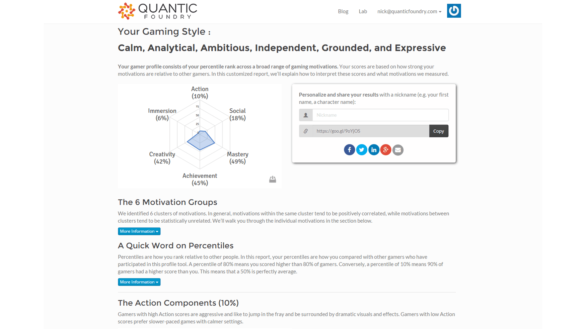
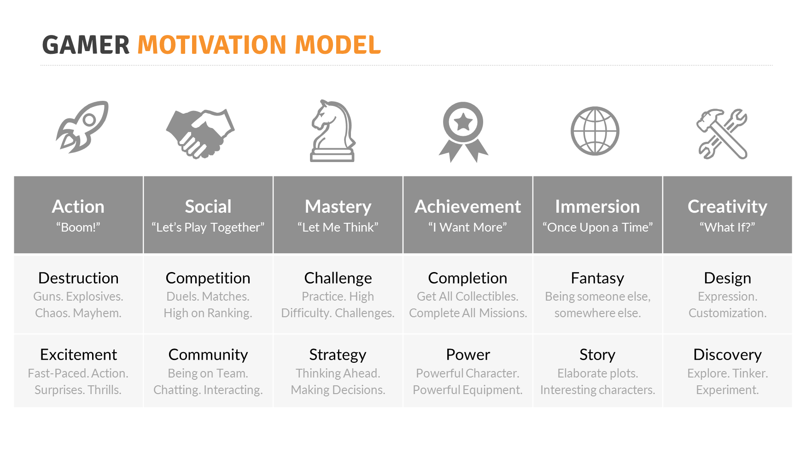
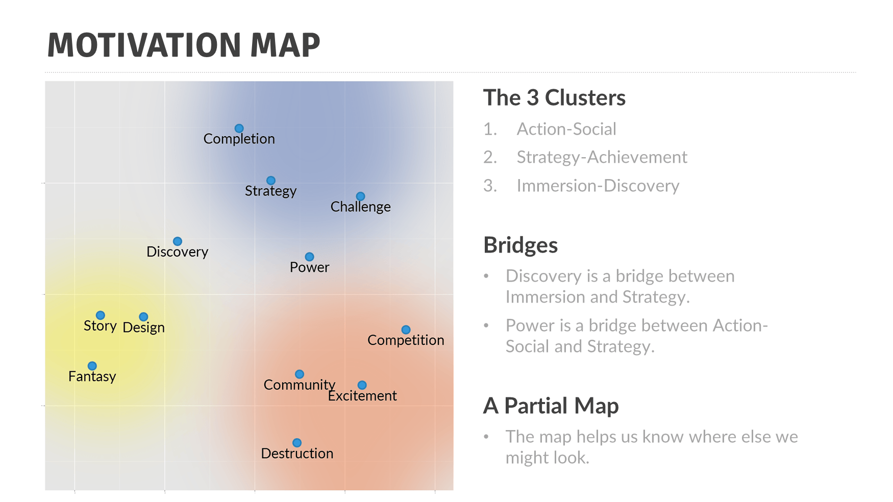
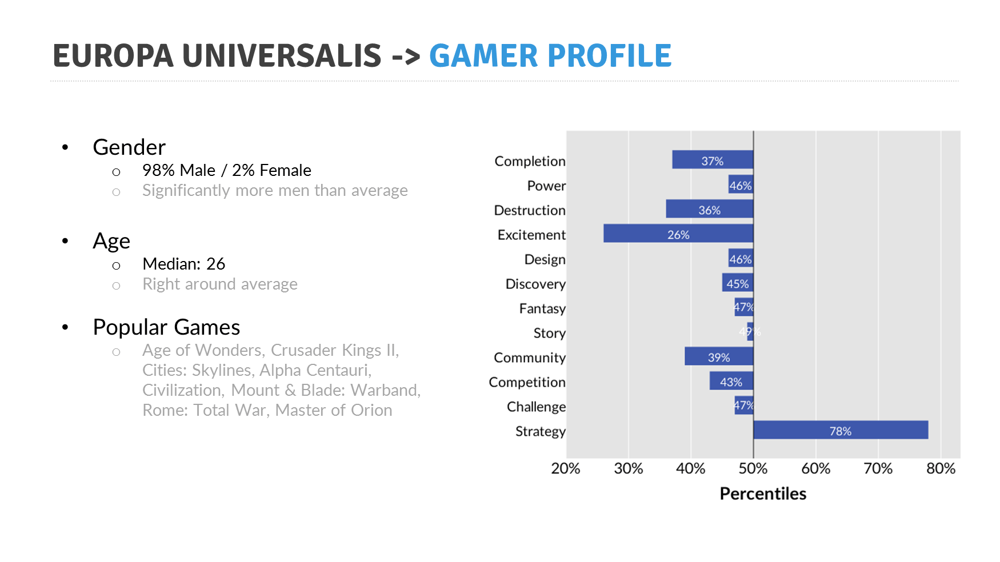

> Local source capture — Nick Yee / Quantic Foundry. Source: https://quanticfoundry.com/gamer-motivation-model/
> Captured 2026-10-21 with local Crawl4AI (robots enabled). Main page prose retained verbatim; navigation/comments removed. Source typos preserved. Figures retained as PNG, not OCR/transcription. Copyright 2015–2025 Quantic Foundry, LLC; no open license established. LOCAL ONLY / NOT PUBLICATION CLEARED.

# Gamer Motivation Model[Nick Yee](https://quanticfoundry.com/author/nickyee/)2016-10-17T20:02:26-07:00

## Take the Gamer Motivation Profile
See a [sample profile report](https://apps.quanticfoundry.com/gamerprofile/10/99bd0af713da4d39a7027542dbc57e). You’ll also find a link on the page to get your own profile. Fill out a 5-minute survey and get your personalized gaming motivation report.

## An Overview of the Motivation Clusters
Using a factor analysis on data collected from over 140,000 gamers, we identified how these motivations clustered together. Motivations in the same column are more highly related than motivations in different columns. [Read more](https://quanticfoundry.com/2015/07/20/how-we-developed-the-gamer-motivation-profile-v2/) about how we developed the model.

## The Bigger Picture
We can visualize the relationships between all these motivations at the same time. Across all the geographic regions we had data for, the same high-level motivation structure emerged, revealing 3 clusters of motivations.

## Game Audience Profiles
When gamers complete the motivation profile tool, we also ask them to list their favorite games. This means we can pivot between gamers, games, and motivations. For every game we have in our data set, we can identify its [demographic and motivation profile](https://quanticfoundry.com/audience-profiles/).
