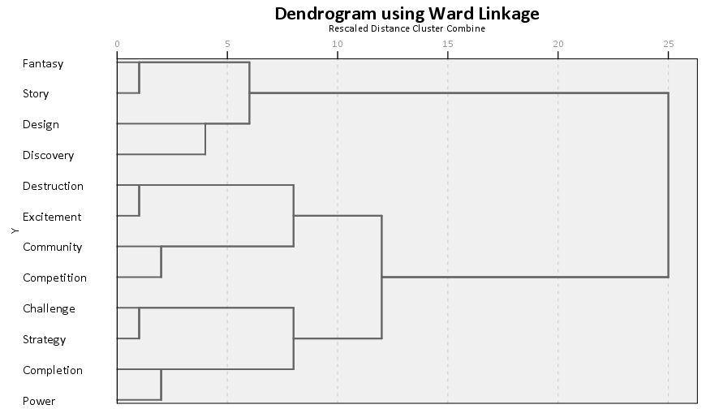

> Local source capture — Nick Yee / Quantic Foundry. Source: https://quanticfoundry.com/2015/07/20/how-we-developed-the-gamer-motivation-profile-v2/
> Captured 2026-10-21 with local Crawl4AI (robots enabled). Main page prose retained verbatim; navigation/comments removed. Source typos preserved. Figures retained as PNG, not OCR/transcription. Copyright 2015–2025 Quantic Foundry, LLC; no open license established. LOCAL ONLY / NOT PUBLICATION CLEARED.

# How We Developed The Gamer Motivation Profile v2
By [Nick Yee](https://quanticfoundry.com/author/nickyee/)|2016-10-17T20:02:35-07:00July 20th, 2015|[Analytics](https://quanticfoundry.com/category/analytics/), [Video Games](https://quanticfoundry.com/category/video-games/)|[19 Comments](https://quanticfoundry.com/2015/07/20/how-we-developed-the-gamer-motivation-profile-v2/#comments)
> **The super short version** : We validated and refined our motivations model based on data from 30,000 gamers around the world.
> If you’re a gamer and haven’t taken the [Gamer Motivation Profile](http://apps.quanticfoundry.com/lab/10) yet, consider doing so before reading about the model.
We developed the Gamer Motivation Profile such that data collected over time could be used to test new motivations, try out new features, and refine the backend algorithms. Since we launched the profile tool, [over 30,000 gamers](https://quanticfoundry.com/2015/07/20/over-30000-gamers-have-taken-our-gamer-motivation-profile) around the world have taken it. The size and geographic scope of this data has allowed us to validate and refine our motivation model.
The initial version of the Gamer Motivation Profile allowed us to collect large samples of English-speaking gamers from many geographic regions ([see detailed sample notes](https://quanticfoundry.com/notes-on-phase-2-motivation-profile-sample/)):
  * US + Canada: 6,222
  * Brazil: 6,044
  * Indonesia: 6,000
  * Philippines: 3,198
  * Singapore: 2,316
  * EU: 2,004
  * Australia: 660
  * East Asia: 510
  * (long tail of other countries)

We are continually testing out new items in the profile tool. Thus, interspersed within the survey inventory are additional items being tested to improve existing scales or to explore factors that are suggested by theory or gamer input. As we did in developing the [original model](https://quanticfoundry.com/2015/06/18/how-we-created-the-gamer-motivation-profile/), we conducted a factor analysis of the inventory items. We conducted a factor analysis separately on the US + Canada, Indonesia, and EU data. The number of factors that emerged and the factor composition across these 3 regions were identical. The same results also emerged when a factor analysis was applied to the full data set.
> The number of factors that emerged and the factor composition across these 3 regions were identical.
To be clear, this doesn’t mean that there were no geographical differences in motivations, only that the factor structure was the same across regions. Or put another way, everyone recognizes that there is a set of cooked dishes which are spicy even though preference and tolerance for spicy foods vary a great deal from person to person.
### Visualizing How The Factors are Related
We identified 12 motivation factors. To understand and visualize how these factors cluster and relate to each other, we used hierarchical clustering. In brief, this clustering method starts every variable on its own, and then merges the most similar variables together into clusters; the algorithm continues merging clusters until everything is in one cluster. The visual output is called a dendrogram and graphically shows how our motivation factors are related: the earlier that two variables merge, the more closely related they are.

The dendrogram reveals an interesting hierarchical pattern among the 12 motivations. First, there are 6 pairs of motivations that are closely related. These are largely the same clusters as in the [earlier version of the model](https://quanticfoundry.com/2015/06/18/how-we-created-the-gamer-motivation-profile/), with the addition of the Discovery factor. And then these clusters fall into 3 high-level groups.
### Our Gamer Motivations Framework
First, we’ll describe the 12 motivation factors and how they cluster together.
**Immersion:** Gamers with high Immersion scores want games with interesting narratives, settings, and customization options so they can be deeply immersed in the alternate worlds created by games. Gamers with low Immersion scores are more grounded in the gameplay mechanics and care less about the narrative experiences that games offer. Immersion is composed of 3 underlying motivations:
  * Fantasy: The desire to become someone else, somewhere else.
  * Story: The importance of an elaborate storyline and interesting characters.

**Creativity:** Gamers with high Creativity scores are constantly experimenting with their game worlds and tailoring them with their own designs and customizations. Gamers with low Creativity scores are more practical in their gaming style and accept their game worlds as they are.
  * Design: The appeal of expression and deep customization.
  * Discovery: The desire to explore, tinker, and experiment with the game world.

**Action:** Gamers with high Action scores are aggressive and like to jump in the fray and be surrounded by dramatic visuals and effects. Gamers with low Action scores prefer slower-paced games with calmer settings. Action is composed of two underlying motivations:
  * Destruction: The enjoyment of chaos, mayhem, guns, and explosives.
  * Excitement: The enjoyment of games that are fast-paced, intense, and provide an adrenaline rush.

**Social:** Gamers with high Social scores enjoy interacting with other players, often regardless of whether they are collaborating or competing with them. Gamers with low Social scores prefer solo gaming experiences where they can be independent. Social is composed of two underlying motivations:
  * Competition: The enjoyment of competition with other players (duels or matches).
  * Community: The enjoyment of interacting and collaborating with other players.

**Mastery:** Gamers with high Mastery scores like challenging gaming experiences with strategic depth and complexity. Gamers with low Mastery scores enjoy being spontaneous when gaming and prefer games that are accessible and forgiving when mistakes are made. Mastery is composed of two underlying motivations:
  * Challenge: The preference for games of skill and enjoyment of overcoming difficult challenges.
  * Strategy: The enjoyment of games that require careful decision-making and strategic thinking.

**Achievement:** Gamers with high Achievement scores are driven to accrue power, rare items, and collectibles, even if this means grinding for a while. Gamers with low Achievement scores have a relaxed attitude towards in-game achievements and don’t worry too much about their scores or progress in the game. Achievement is composed of two underlying motivations:
  * Completion: The desire to complete every mission, get every collectible, and discover hidden things.
  * Power: The importance of becoming powerful within the context of the game world.

### What’s Changed from Version 1.0
There are two main changes from the earlier motivation framework:
  * We tested and found inventory items for a Discovery factor—experimenting with the game world in different ways and constantly asking “what if?” This Discovery factory was most closely related to the existing Design factor (originally named Customization) and together form the Creativity cluster.
  * Based on user feedback to the profile reporting, we’ve renamed the “Strategy” cluster. The problem was that gamers reacted negatively to seeing low/average scores on “Strategy” when it was dragged down by the importance of challenging gameplay. We’ve relabeled the factors to clarify their underlying meaning. So the cluster label is now “Mastery”, which includes the “Strategy” and “Challenge” factors.

### Revisiting The Hierarchy
The factor analysis and hierarchical clustering results not only enumerate gamer motivations, they also show how the motivations are related to each other. One key challenge in studying gaming motivations is that it’s relatively easy to brainstorm and list potential motivations, but understanding the structure underlying those motivations, how they relate to each other, and how to reliably measure them require large amounts of data.
> The factor analysis and hierarchical clustering results not only enumerate gamer motivations, they also show how the motivations are related to each other.
The hierarchical clustering suggests that the 12 motivation factors fall into 3 high-level groupings:
  * The Immersion-Exploration branch covers different ways of relating to the story and design of the game world, whether via the narrative, the characters, or exploring and customizing the game world.
  * The Achievement-Mastery branch covers different ways or progressing through and attaining power within the construct of the game world, whether this is leveling up, completing all its missions, or gaining mastery through practice.
  * The Action-Social branch covers more energetic and gregarious modes of gameplay, seeking out arousing gaming experiences whether this is from playing with other people, intense gameplay, or dramatic destruction.

The first two of these high-level groupings make intuitive sense. The Action-Social branch may be the least intuitive branch, but in hindsight, it is predicted by the [Big Five personality model](https://en.wikipedia.org/wiki/Big_Five_personality_traits). The Big Five model is the current gold standard in describing and measuring personality in academic psychology. In this personality framework, studies have found that [Extraversion](https://en.wikipedia.org/wiki/Big_Five_personality_traits#Extraversion) bundles together traits related to gregariousness, excitement-seeking, assertiveness, and cheerfulness—an interesting mix of traits that is broader than the popular science description of Extraversion. The Action-Social branch seems to reflect this combination of Extraversion traits.
### The Updated Profile
We’ve updated the [profile tool](https://apps.quanticfoundry.com/lab/) to reflect these changes. In addition to adding the Discovery factor and revising the clusters, we’ve revised the inventory item weights and overall norms based on the larger sample of data.
Gamers who have previously completed the original version of the tool will have a link to their legacy profile and will also see a link to take the updated profile tool. All new users will simply see a link to the current version of the tool (whether they land on the Quantic Lab page directly or via a shared profile report).
