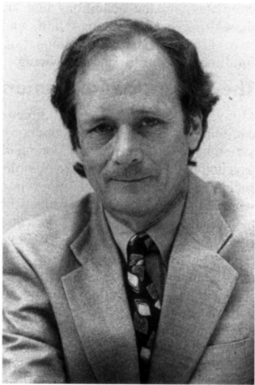
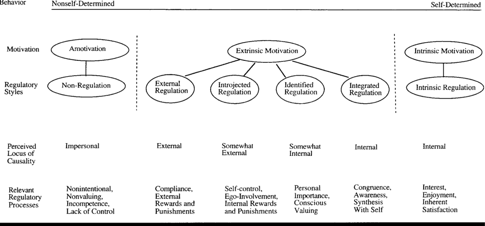

## Self-Determination Theory  and  the Facilitation of Intrinsic Motivation, Social  Development, and  Well-Being

Richard  M.  Ryan  and  Edward  L.  Deci University of Rochester

Human  beings  can  be proactive  and  engaged  or,  alternatively,  passive  and  alienated, largely  as  a function  of the social  conditions  in  which  they develop and function.  Accordingly, research guided  by  self-determination  theo~ has focused on the social-contextual  conditions that facilitate  versus forestall  the  natural  processes  of self-motivation  and  healthy  psychological  development.  Specifically, factors  have been examined that enhance versus undermine intrinsic  motivation,  self-regulation, and  well-being.  The findings  have  led  to  the postulate  of three  innate  psychological  needs--competence,  autonomy,  and  relatedness-which  when  satisfied  yield  enhanced  self-motivation  and mental  health  and  when  thwarted  lead  to  diminished motivation and well-being. Also considered  is the significance of these psychological needs and processes  within domains such  as  health  care, education,  work,  sport,  religion,  and psychotherapy.

T he  fullest  representations  of humanity  show  people to be curious, vital, and self-motivated. At their best, they  are  agentic  and  inspired,  striving  to  learn;  extend themselves; master new  skills;  and  apply their talents responsibly.  That  most  people  show  considerable  effort, agency,  and  commitment in  their  lives  appears,  in  fact,  to be more normative than exceptional, suggesting  some very positive  and  persistent  features  of human  nature.

Yet, it is also  clear  that  the  human  spirit  can  be diminished  or  crushed  and  that  individuals  sometimes  reject  growth  and  responsibility.  Regardless  of  social  strata or  cultural  origin,  examples  of  both  children  and  adults who  are  apathetic,  alienated,  and  irresponsible  are  abundant.  Such non-optimal human functioning can be observed not  only  in  our  psychological  clinics  but  also  among  the millions  who,  for  hours  a  day,  sit  passively  before  their televisions,  stare blankly from the back of their classrooms, or  wait  listlessly  for  the  weekend  as  they  go  about  their jobs.  The  persistent,  proactive,  and  positive  tendencies  of human  nature  are  clearly  not  invariantly  apparent.

The fact that human nature, phenotypically expressed, can  be  either  active  or  passive,  constructive  or  indolent, suggests  more than mere dispositional  differences and  is a function  of more  than just  biological  endowments.  It also bespeaks  a  wide range  of reactions  to  social environments that  is  worthy  of our  most intense  scientific  investigation. Specifically,  social  contexts  catalyze both  within-  and  between-person differences in motivation and personal growth,  resulting in  people  being  more  self-motivated, energized,  and integrated in  some situations,  domains,  and cultures  than  in  others.  Research  on  the  conditions  that foster versus undermine positive human potentials has both theoretical  import and practical  significance because it can contribute  not  only  to  formal  knowledge  of the  causes  of human  behavior but  also  to  the  design  of  social  environments  that  optimize  people's development,  performance, and well-being. Research guided by self-determination theory (SDT) has had an ongoing concern with precisely these issues  (Deci  &amp;  Ryan,  1985,  1991;  Ryan,  1995).

## Self-Determination Theory

SDT  is  an  approach  to  human  motivation  and  personality that uses traditional empirical methods while employing an organismic  metatheory  that  highlights  the  importance  of humans' evolved inner  resources  for  personality  development  and  behavioral  self-regulation  (Ryan,  Kuhl,  &amp;  Deci, 1997). Thus, its arena  is the investigation  of  people's inherent growth tendencies  and innate psychological needs that  are  the  basis  for  their  self-motivation and  personality integration,  as  well  as  for  the  conditions  that  foster  those positive  processes.  Inductively,  using  the  empirical  process,  we  have  identified  three  such  needs--the  needs  for competence (Harter, 1978; White, 1963), relatedness (Baumeister  &amp;  Leary,  1995;  Reis,  1994),  and  autonomy (deCharms,  1968;  Deci,  1975)--that  appear to be essential for  facilitating  optimal  functioning  of the  natural  propensities for growth and integration, as well as for constructive social  development  and  personal  well-being.

This  work  was  supported  in part by research Grant MH-53385  from  the National Institute of Mental Health. We  thank all of the members of the Human  Motivation Research  Group  at the University of Rochester who have contributed to these ideas and research, and to Jennifer LaGuardia, Charles Couchman, and Phyllis Joe for their specific help with this article.

Correspondence concerning this article should be addressed to either Richard M.  Ryan or Edward L.  Deci, Department of Clinical and Social Sciences in Psychology, University of Rochester, Rochester, NY  14627. Electronic  mail  may  be sent  to  either  ryan@psych.rochester.edu  or deci@psych.rochester.edu.

Richard  M. Ryan Photo  by  Joe  Gawlowicz, University  of Rochester

Much of the research  guided by SDT has also examined  environmental  factors  that  hinder  or  undermine  selfmotivation,  social  functioning,  and  personal  well-being. Although many  specific  deleterious  effects  have  been  explored,  the  research  suggests  that  these  detriments  can  be most  parsimoniously  described  in  terms  of  thwarting  the three  basic  psychological needs.  Thus,  SDT  is  concerned not only with the specific nature of positive developmental tendencies,  but  it  also  examines  social  environments  that are  antagonistic  toward these  tendencies.

The  empirical  methods  used  in  much  of  the  SDT research have been in the Baconian tradition,  in that social contextual  variables  have  been  directly  manipulated to examine their effects on both internal processes and behavioral  manifestations.  The  use  of  experimental  paradigms has  allowed  us to specify the  conditions under which people's natural  activity and constructiveness  will  flourish,  as well  as  those  that  promote  a  lack  of  self-motivation  and social integration.  In this  way,  we  have  used experimental methods  without  accepting  the  mechanistic  or  efficient causal  meta-theories  that  have  typically  been  associated with  those  methods.

In  this  article  we  review  work  guided  by  SDT,  addressing its  implications for three important outcomes. We begin  with  an  examination  of  intrinsic motivation,  the prototypic  manifestation  of  the  human  tendency  toward learning  and  creativity,  and  we  consider research  specifying  conditions  that  facilitate  versus  forestall  this  special type  of  motivation. Second,  we  present  an  analysis  of self-regulation,  which  concerns how people  take  in  social values and extrinsic contingencies and progressively transform  them  into  personal  values  and  self-motivations.  In that  discussion,  we  outline  different  forms  of internalized motivation,  addressing  their  behavioral  and  experiential correlates  and  the  conditions  that  ale  likely  to  promote these different motivations. Third,  we focus on studies that have  directly  examined  the  impact  of psychological need fulfillment  on health  and  well-being.

## The Nature  of  Motivation

Motivation  concerns  energy,  direction, persistence and equifinality--all  aspects  of activation  and intention.  Motivation has been a central and perennial  issue in the field  of psychology, for it is at the core of biological, cognitive, and social regulation. Perhaps more  important, in the real world,  motivation  is  highly  valued  because  of  its  consequences: Motivation produces. It is therefore of preeminent concern  to  those  in  roles  such  as  manager,  teacher,  religious  leader,  coach,  health  care  provider,  and  parent  that involve mobilizing others  to  act.

Although  motivation  is  often  treated  as  a  singular construct,  even  superficial  reflection  suggests  that  people are  moved  to  act  by  very  different  types  of factors,  with highly varied experiences and consequences. People can be motivated because they value an activity or because there is strong external  coercion. They can be urged into action by an  abiding  interest  or by  a bribe.  They can  behave  from  a sense  of  personal  commitment  to  excel  or  from  fear  of being  surveilled.  These  contrasts  between  cases  of having internal  motivation  versus  being  externally  pressured  are surely  familiar  to  everyone.  The  issue  of whether  people stand behind a behavior out of their interests  and values, or do it  for reasons  external  to the  self,  is  a  matter  of significance in every culture (e.g.,  Johnson,  1993)  and represents a basic dimension by which people make sense of their own and others' behavior (deCharms,  1968; Heider,  1958; Ryan &amp; Connell,  1989).

Comparisons between people whose motivation is authentic  (literally,  self-authored or endorsed) and those who are  merely  externally  controlled  for  an  action  typically reveal  that  the  former,  relative  to  the  latter, have  more interest,  excitement,  and confidence, which in turn is manifest  both  as  enhanced  performance,  persistence,  and  creativity (Deci &amp; Ryan, 1991; Sheldon, Ryan, Rawsthorne, &amp; Ilardi,  1997)  and as heightened vitality (Nix, Ryan, Manly, &amp;  Deci, 1999), self-esteem  (Deci  &amp;  Ryan, 1995), and general well-being (Ryan, Deci, &amp; Grolnick,  1995).  This is so even when the people have the same level of perceived competence or self-efficacy for the  activity.

Because of the functional and experiential  differences between  self-motivation  and  external  regulation,  a  major focus  of  SDT  has  been  to  supply  a  more  differentiated approach to motivation, by asking what kind of motivation is  being  exhibited  at  any  given  time.  By  considering  the perceived forces that  move a person  to act,  SDT has  been able to identify several distinct types of motivation, each of which  has  specifiable  consequences  for  learning,  performance,  personal  experience,  and  well-being.  Also,  by  articulating  a  set  of principles  concerning how  each type  of motivation  is  developed  and  sustained,  or  forestalled  and undermined,  SDT  at  once  recognizes  a  positive  thrust  to human nature  and provides  an  account of passivity,  alienation,  and  psychopathology.

Edward L. Deci Photo by Joe Gawlowicz, University of Rochester

## Intrinsic Motivation

Perhaps  no  single phenomenon reflects the  positive potential  of  human  nature  as  much  as  intrinsic  motivation,  the inherent  tendency  to  seek  out  novelty  and  challenges,  to extend  and  exercise  one's  capacities,  to  explore,  and  to learn.  Developmentalists  acknowledge  that  from  the  time of  birth, children, in their healthiest states, are active, inquisitive,  curious,  and  playful,  even  in  the  absence  of specific  rewards  (e.g.,  Harter,  1978).  The  construct  of intrinsic  motivation describes  this  natural  inclination  toward assimilation,  mastery,  spontaneous  interest,  and  exploration that is so essential to cognitive and social development and  that  represents  a  principal  source  of  enjoyment  and vitality  throughout life  (Csikszentmihalyi &amp;  Rathunde, 1993;  Ryan,  1995).

Yet, despite  the  fact  that  humans  are  liberally  endowed with intrinsic  motivational tendencies,  the evidence is  now  clear that the  maintenance  and enhancement of this inherent propensity requires supportive conditions, as it can be  fairly  readily  disrupted  by  various  nonsupportive  conditions.  Thus,  our  theory  of  intrinsic  motivation  does  not concern  what  causes  intrinsic  motivation  (which  we  view as  an  evolved  propensity;  Ryan  et  al., 1997);  rather,  it examines the conditions  that elicit and  sustain,  versus  subdue  and  diminish,  this  innate  propensity.

Cognitive  evaluation  theory  (CET)  was  presented  by Deci and Ryan  (1985)  as a  subtheory  within  SDT that had the  aim  of  specifying  factors  that  explain  variability  in intrinsic  motivation.  CET  is  framed  in  terms  of social  and environmental  factors  that  facilitate  versus  undermine  intrinsic  motivation, using language that reflects the assumption  that  intrinsic  motivation,  being  inherent,  will  be  catalyzed  when  individuals are in conditions that  conduce toward  its  expression.  In  other  words,  it  will  flourish  if circumstances permit.  Put  in  this  way,  the  study  of conditions that facilitate versus undermine intrinsic motivation is an  important  first  step  in  understanding sources  of  both alienation  and  liberation  of the  positive  aspects  of human nature.

CET,  which  focuses  on  the  fundamental  needs for competence  and  autonomy,  was  formulated  to  integrate results from initial laboratory experiments on the effects of rewards,  feedback,  and  other  external  events  on  intrinsic motivation,  and  was  subsequently  tested  and  extended  by field  studies  in  various  settings.  The  theory  argues,  first, that  social-contextual  events  (e.g.,  feedback,  communications, rewards) that conduce toward feelings of competence during action  can  enhance  intrinsic motivation  for  that action.  Accordingly,  optimal  challenges,  effectance-prorooting feedback, and freedom from demeaning evaluations were all  found  to facilitate  intrinsic  motivation.  For example,  early  studies  showed  that  positive  performance  feedback enhanced  intrinsic  motivation,  whereas  negative performance  feedback  diminished  it  (Deci, 1975), and res e a r c h by  Vallerand  and  Reid  (1984)  showed  that  these effects  were  mediated  by perceived competence.

CET further specifies, and studies have shown (Fisher, 1978;  Ryan,  1982), that  feelings  of  competence  will  not enhance intrinsic motivation unless accompanied  by  a sense of autonomy or, in attributional terms, by an internal perceived  locus  of  causality  (deCharms,  1968).  Thus,  according  to  CET,  people  must  not  only  experience  competence  or efficacy, they  must also experience their behavior as  self-determined  for  intrinsic  motivation  to  be  in  evidence. This requires either immediate  contextual supports  for  autonomy  and  competence  or  abiding  inner res o u r c e s (Reeve,  1996)  that  are  typically the result  of prior developmental supports for perceived autonomy and competence.

In fact,  most of the research on the effects of environmental  events  in  intrinsic  motivation  has  focused  on  the issue  of autonomy  versus  control  rather  than  that  of competence. Research on this issue has been considerably more controversial. It began with the repeated demonstration that extrinsic rewards can undermine intrinsic  motivation. Deci (1975)  interpreted  these  results  in  terms  of rewards  facilitating  a  more  external  perceived  locus  of  causality  (i.e., diminished  autonomy).  Although  the  issue  of  reward  effects has been  hotly  debated, a  recent,  comprehensive meta-analysis  (Deci,  Koestner,  &amp;  Ryan,  1999)  confirmed, in spite of  claims to  the  contrary  by  Eisenberger  and Cameron  (1996),  that  all  expected  tangible  rewards  made contingent  on  task  performance  do  reliably  undermine  intrinsic  motivation.

Also,  research revealed that not only tangible rewards but  also  threats,  deadlines, directives,  pressured  evaluations,  and  imposed  goals  diminish  intrinsic  motivation because,  like  tangible  rewards,  they  conduce  toward  an  external perceived  locus  of  causality.  In  contrast, choice, acknowledgment  of  feelings,  and  opportunities  for  selfdirection  were  found  to  enhance  intrinsic  motivation  because  they  allow  people  a  greater  feeling  of  autonomy (Deci &amp; Ryan,  1985).  Field  studies have further shown that teachers  who  are  autonomy  supportive  (in  contrast  to controlling)  catalyze  in  their  students  greater  intrinsic  motivation,  curiosity,  and  desire  for challenge  (e.g.,  Deci,  Nezlek, &amp; Sheinman, 1981;  Flink, Boggiano,  &amp;  Barrett, 1990; Ryan  &amp;  Grolnick, 1986). Students taught with a  more controlling  approach  not  only  lose  initiative  but  learn  less effectively,  especially  when  learning  requires  conceptual, creative  processing (Amabile, 1996;  Grolnick  &amp; Ryan, 1987;  Utman,  1997).  Similarly,  studies  showed that  autonomy-supportive  parents, relative to controlling parents, have children who are more intrinsically motivated (Grolnick,  Deci,  &amp;  Ryan,  1997).  Such findings  generalized to other domains  such as sport and music in which supports for  autonomy  and  competence  by  parents and  mentors incite  more  intrinsic  motivation  (e.g.,  Frederick  &amp;  Ryan, 1995).

Although autonomy  and competence supports are highly  salient  for producing  variability  in  intrinsic  motivation,  a third factor, relatedness,  also bears  on its expression. In  infancy,  intrinsic motivation  is  readily  observable  as exploratory  behavior  and,  as  suggested  by  attachment  theorists  (e.g.,  Bowlby,  1979),  it  is  more  evident  when  the infant  is  securely  attached  to  a  parent.  Studies  of mothers and  infants have,  indeed, shown  that  both  security  and maternal  autonomy  support  predict  more  exploratory  behavior  in  the infants (e.g., Frodi, Bridges, &amp;  Grolnick, 1985).  SDT  hypothesizes  that  a  similar  dynamic  occurs  in interpersonal settings over  the life span, with intrinsic motivation more likely to flourish in contexts characterized by a sense of security and relatedness.  For example,  Anderson,  Manoogian, and  Reznick  (1976) found  that  when children  worked on an interesting  task in the presence  of an adult  stranger  who  ignored  them  and  failed  to  respond  to their  initiations, a  very  low  level  of  intrinsic  motivation resulted, and  Ryan  and  Grolnick  (1986)  observed  lower intrinsic motivation in students who experienced their teachers as cold and uncaring.  Of course, many intrinsically motivated  behaviors  are  happily  performed  in  isolation, suggesting  that  proximal  relational supports  may  not  be necessary  for  intrinsic  motivation,  but  a  secure  relational base does seem  to  be important  for  the  expression of intrinsic  motivation  to  be  in  evidence.

To  summarize,  the  CET  framework  suggests  that  social  environments  can  facilitate  or  forestall  intrinsic  motivation by supporting  versus  thwarting  people's innate  psychological needs.  Strong links between  intrinsic  motivation and satisfaction of the needs for autonomy and competence have  been  clearly  demonstrated,  and  some  work  suggests that  satisfaction  of  the  need  for  relatedness, at  least  in  a distal  sense,  may also be important for intrinsic  motivation. It  is  critical  to  remember,  however,  that  people  will  be intrinsically  motivated only for activities  that hold intrinsic interest  for them,  activities  that  have the  appeal  of novelty, challenge,  or aesthetic  value.  For activities  that do not hold such  appeal,  the  principles  of CET  do  not  apply,  because the  activities  will  not  be  experienced  as  intrinsically  motivated to begin with. To understand  the motivation for those activities,  we need  to look more  deeply  into the  nature  and dynamics  of extrinsic  motivation.

## Self-Regulation of  Extrinsic Motivation

Although  intrinsic  motivation  is  an  important  type  of motivation,  it  is  not  the  only  type  or  even  the  only  type  of self-determined  motivation  (Deci  &amp;  Ryan,  1985).  Indeed, much  of what  people  do  is  not,  strictly  speaking,  intrinsically  motivated,  especially  after  early  childhood  when  the fi'eedom to  be  intrinsically  motivated  is  increasingly  curtailed by social pressures to  do activities that are not interesting  and  to  assume  a  variety  of new  responsibilities (Ryan  &amp;  La  Guardia,  in  press).

The  real  question  concerning  nonintrinsically  motivated practices is how individuals  acquire the motivation to carry  them  out  and  how  this  motivation  affects  ongoing persistence,  behavioral  quality,  and  well-being.  Whenever a  person  (be  it  a  parent,  teacher,  boss,  coach,  or  therapist) attempts  to  foster  certain  behaviors  in  others,  the  others' motivation  for the  behavior can  range  from amotivation  or unwillingness, to  passive  compliance,  to  active  personal commitment.  According  to  SDT,  these  different  motivations  reflect  differing  degrees  to  which  the  value  and  regulation  of  the  requested  behavior  have  been  internalized and integrated.  Internalization refers to people's "taking in" a  value  or  regulation,  and  integration  refers  to  the  further transformation  of  that  regulation  into  their  own  so  that, subsequently,  it  will  emanate  from  their  sense  of  self.

Internalization  and  integration  are  clearly  central  issues  in  childhood  socialization,  but  they  are  also  continually  re]evant  for  the  regulation  of behavior  across  the  life span.  In nearly every setting people enter,  certain behaviors and  va]ues are prescribed,  behaviors that are not interesting and  values  that  are  not  spontaneously  adopted.  Accordingly,  SDT  has  addressed  the  issues  of  (a)  the  processes through  which  such  nonintrinsically  motivated  behaviors can  become  truly self-determined, and  (b) the  ways  in which  the  social  environment  influences  those  processes.

The  lerm extrinsic  motivation refers to  the  performance  of  an  activity  in  order  to  attain  some  separable outcome  and, thus, contrasts with intrinsic motivation, which  refers  to  doing  an  activity  for  the  inherent  satisfaction  of  the  activity  itself.  Unlike  some  perspectives  that view  extrinsically  motivated  behavior  as  invariantly  nonautonomous,  SDT  proposes  that  extrinsic  motivation  can vary  greatly  in  its  relative  autonomy  (Ryan  &amp;  Connell, 1989; Vallerand,  1997). For example,  students  who do their homework because they personally  grasp its value for their chosen career are extrinsically  motivated,  as  are  those  who do the work only because they are adhering to their parents' control. Both  examples involve instrumentalities rather than  enjoyment  of  the  work  itself,  yet  the  former  case  of extrinsic motivation  entails  personal  endorsement  and  a feeling  of  choice,  whereas  the  latter  involves  compliance with  an  external  regulation.  Both  represent  intentional  behavior  (Heider, 1958),  but  they  vary  in  their  relative  autonomy.  The  former,  of  course,  is  the  type  of  extrinsic motivation  that  is  sought  by  astute  socializing  agents  regardless  o1: the  applied  domain.

## Figure 1

The Self-Determination Continuum Showing Types  of Motivation  With  Their Regulatory Styles, Loci of Causality, and Corresponding Processes

Within SDT, Deci and Ryan  (1985) introduced a second subtheory, called organismic integration theory (OIT),  to  detail  the  different  forms  of extrinsic  motivation and  the  contextual  factors  that  either  promote  or  hinder internalization  and  integration  of  the  regulation  for  these behaviors.  Figure  1 illustrates  the  OIT  taxonomy  of motivational  types,  arranged  from  left  to  fight  in  terms  of the degree to which the motivations emanate from the self (i.e., are  self-determined).

At  the  far  left  of  the  self-determination  continuum  is amotivation,  the  state  of lacking  the  intention  to act.  When amotivated,  people  either  do  not  act  at  all  or  act  without intent--they  just  go  through  the  motions.  Amotivation  results  from not valuing  an activity  (Ryan,  1995),  not feeling competent  to  do  it  (Bandura, 1986),  or  not  expecting  it  to yield  a  desired  outcome  (Seligman,  1975).  To  the  right  of amotivation  in Figure  1 are five classifications  of motivated behavior.  Although many theorists  have treated  motivation as a unitary concept, each of  the categories identified within OIT describes theoretically, experientially, and functionally distinct  types of motivation.  At the far right of the  continuum  is  the  classic  state  of  intrinsic  motivation, the  doing  of  an  activity  for  its  inherent  satisfactions.  It  is highly  autonomous  and  represents  the  prototypic  instance of  self-determination. Extrinsically motivated  behaviors, by contrast,  cover the  continuum between  amotivation  and intrinsic  motivation,  varying  in  the  extent  to  which  their regulation  is  autonomous.

The  extrinsically  motivated  behaviors  that  are  least autonomous  are  referred  to  as externally  regulated. Such behaviors  are  performed  to  satisfy  an  external  demand  or reward  contingency.  Individuals  typically  experience  externally  regulated  behavior  as  controlled  or  alienated,  and their  actions  have  an  external  perceived  locus  of causality (deCharms,  1968).  External  regulation  is  the  type  of motivation focused on by operant theorists (e.g., Skinner, 1953),  and  it  is  external  regulation  that  was  typically  contrasted with  intrinsic motivation  in  early  laboratory  and field  studies.

A  second  type  of  extrinsic  motivation  is  labeled introjected  regulation. Introjection  involves  taking  in  a  regulation but  not  fully  accepting  it  as  one's  own.  It  is  a relatively  controlled  form of regulation  in which behaviors are  performed  to  avoid  guilt  or  anxiety  or  to  attain  ego enhancements  such  as  pride.  Put  differently,  introjection represents regulation  by  contingent  self-esteem  (Deci  &amp; Ryan,  1995).  A  classic  form of introjection  is ego involvement  (deCharms, 1968;  Nicholls, 1984;  Ryan, 1982),  in which people are motivated to demonstrate ability (or avoid failure)  in  order  to  maintain  feelings  of  worth.  Although internally  driven,  introjected  behaviors  still  have  an  external  perceived  locus  of causality  and  are  not  really  experienced  as  part  of  the  self.  Thus,  in  some  studies,  external regulation (being interpersonally controlled) and introjected  regulation  (being  intrapersonally  controlled)  have been  combined to  form  a  controlled  motivation  composite (e.g.,  Williams,  Grow,  Freedman,  Ryan,  &amp;  Deci,  1996).

A  more  autonomous,  or  self-determined,  form  of extrinsic motivation is regulation through identification. Identification  reflects  a  conscious  valuing  of  a  behavioral goal or  regulation, such  that the action is accepted  or owned  as  personally  important.  Finally,  the  most  autonomous form of extrinsic motivation is integrated regulation. Integration  occurs  when  identified  regulations  are  fully assimilated  to  the  self,  which  means  they have been  evaluated and brought into congruence with one's other values and needs.  Actions characterized by integrated  motivation share  many  qualities  with  intrinsic  motivation,  although they are still  considered extrinsic because they are done to attain separable  outcomes  rather  than  for  their  inherent enjoyment.  In  some  studies,  identified, integrated,  and  intrinsic forms of regulation have been combined to form an autonomous motivation composite.

As people internalize regulations  and  assimilate  them to  the  self,  they  experience  greater  autonomy  in  action. This process may occur in stages, over time, but we are not suggesting  that  it  is  a  developmental  continuum  in  the sense  that  people  must  progress  through  each  stage  of internalization with respect to a particular regulation. Rather, they can relatively readily internalize a new behavioral  regulation  at any point along this  continuum depending on both prior experiences and current situational factors (Ryan,  1995).  Nonetheless,  the range of behaviors that can be assimilated to the self increases over time with increased cognitive  capacities  and  ego  development  (Loevinger  &amp; Blasi,  1991),  and  there  is  evidence  that  children's general regulatory style does tend  to become more internalized  or self-regulated over time  (e.g.,  Chandler  &amp;  Connell,  1987).

Ryan and  Connell  (1989)  tested  the  formulation  that these different types of motivation, with their distinct properties, lie  along  a  continuum  of  relative  autonomy.  They investigated achievement behaviors among school children and found that external,  introjected, identified,  and intrinsic regulatory styles were intercorrelated  according to a quasisimplex pattern,  thus providing evidence for an underlying continuum. Furthermore,  differences  in  the  type of extrinsic  motivation  were  associated  with  different  experiences and outcomes. For example, the more students  were externally  regulated  the  less  they  showed  interest, value,  and effort  toward  achievement  and  the  more  they  tended  to disown responsibility for negative outcomes, blaming others  such  as  the  teacher.  Introjected  regulation  was  positively  related  to  expending  more  effort,  but  it  was  also related  to  feeling  more  anxiety  and  coping  more  poorly with failures.  In contrast,  identified regulation  was  associated  with  more  interest  and enjoyment of school and with more  positive  coping  styles,  as  well as  with  expending more effort.

Other  studies  in  education  extended  these  findings, showing  that  more  autonomous  extrinsic  motivation  was associated  with  more  engagement  (Connell  &amp;  Wellborn, 1991), better performance (Miserandino, 1996), lower dropout  (Vallerand  &amp;  Bissonnette, 1992),  higher  quality learning  (Grolnick  &amp;  Ryan,  1987),  and  better  teacher  ratings  (Hayamizu,  1997),  among other outcomes.

In the realm of health care,  greater internalization  has been  associated  with greater  adherence  to  medications among  people  with  chronic  illnesses (Williams, Rodin, Ryan,  Grolnick,  &amp;  Deci,  1998),  better  long-term  maintenance of weight loss among morbidly obese patients  (Williams  et  al.,  1996),  improved glucose  control  among  diabetics  (Williams,  Freedman,  &amp;  Deci,  1998),  and  greater attendance and involvement in an addiction-treatment program  (Ryan,  Plant,  &amp;  O'Malley,  1995).

Demonstrations of positive outcomes being associated with  more  internalized  motivation  have  also  emerged  in other diverse domains, including religion (Ryan, Rigby, &amp; King,  1993),  physical  exercise  (Chatzisarantis,  Biddle,  &amp; Meek,  1997),  political  activity  (Koestner,  Losier,  Vallerand,  &amp;  Carducci,  1996),  environmental  activism  (GreenDemers, Pelletier, &amp; Menard,  1997),  and intimate relationships (Blais, Sabourin, Boucher, &amp; Vallerand, 1990), among others.

The advantages of greater internalization appear, then, to be manifold (Ryan et al.,  1997),  including more behavioral effectiveness, greater volitional persistence,  enhanced subjective  well-being,  and  better  assimilation  of the  individual  within  his  or  her  social  group.

## Facilitating Integration of  Extrinsic Motivation

Given the significance of internalization for personal experience and behavioral outcomes, the critical issue becomes how  to  promote  autonomous  regulation  for  extrinsically motiwtted behaviors. That is, what are the social conditions that  nurture  versus  inhibit  internalization  and  integration?

Because extrinsically motivated behaviors are not typically  interesting,  the  primary  reason  people  initially  perform  such  actions  is  because  the  behaviors  are  prompted, modeled, or valued by significant others to whom they feel (or  want  to  feel)  attached  or  related. This  suggests  that relatedness,  the  need  to  feel  belongingess  and  connectedness  with  others,  is  centrally  important  for internalization. Thus, OIT proposes that internalization is more likely to be in evidence when there are ambient supports for feelings of relatedness.  For example,  Ryan,  Stiller,  and  Lynch (1994) showed that  the  children  who  had  more fully internalized the  regulation  for  positive  school-related  behaviors  were those who felt securely connected to, and cared for by, their parents  and  teachers.

The relative  internalization  of extrinsically  motivated activities  is  also  a  function of perceived competence. People  are  more  likely  to  adopt  activities  that  relevant  social groups  value  when  they  feel  efficacious  with  respect  to those  activities.  As  is  the  case  with  all  intentional  action, OIT suggests that supports for competence should facilitate intermdization  (Vallerand,  1997).  Thus,  for example,  children who are directed to perform behaviors before they are developmentally ready to master them or understand  their rationale would  be  predicted, at  best, only  to  partially intern~tlize the regulations, remaining either externally regulated  or introjected.

Finally,  the  experience  of autonomy facilitates  internalization  and, in  particular, is  a  critical  element  for  a regulation  to  be  integrated. Contexts  can  yield  external regulation  if  there  are  salient  rewards  or  threats  and  the person  feels  competent  enough  to  comply;  contexts  can yield  introjected  regulation  if  a  relevant  reference  group endorses  the  activity  and  the  person  feels  competent  and related;  but contexts can yield autonomous regulation only if they  are  autonomy supportive,  thus  allowing the person to feel competent, related,  and autonomous. To integrate  a regulation,  people  must  grasp  its  meaning  and  synthesize that  meaning  with  respect  to  their  other  goals  and  values. Such deep, holistic processing (Kuhl &amp; Fuhrmann,  1998) is facilitated by a sense of choice, volition, and freedom from excessive external  pressure  toward behaving or thinking  a certain  way.  In  this sense, support  lor  autonomy  allows individuals  to  actively transform  values  into  their  own.

Again, research results have supported this reasoning. For  example,  Deci,  Eghrari,  Patrick,  and  Leone  (1994) demonstrated  in  a  laboratory  experiment  that  providing  a meaningful  rationale  for  an  uninteresting  behavior,  along with supports  for  autonomy  and  relatedness, promoted its internalization and integration. Controlling  contexts yielded less  overall  internalization,  and  the  internalization that  did  occur  in  those  contexts  tended  to  be  only  introjected. Using  parent interviews, Grolnick  and  Ryan (1989)  found greater  internalization  of school-related  values among children whose parents were more supportive of autonomy  and relatedness. Strahan (1995) found that parents  who  were  more  autonomy-supportive  promoted greater  religious  identification,  as  opposed to  introjection, in  their  offspring.  Williams  and Deci  (1996),  using  a  longitudinal  design,  demonstrated  greater  internalization  of biopsychosocial  values  and  practices  among  medical  students  whose  instructors  were  more  autonomy-supportive. These  are  but  a  few  of the  many  findings  suggesting  that supports for relatedness  and competence facilitate  internalization  and  that  supports  for autonomy also  facilitate  integration of behavioral regulations. When that occurs, people feel not only competent and related but also autonomous as they carry out culturally valued  activities.

One  further  point  needs  to  be  made  regarding  the controversial  issue  of  human  autonomy.  The  concept  of autonomy has often been portrayed as being antagonistic to relatedness  or  community,  in  fact,  some  theories  equate autonomy with  concepts  such  as  individualism  and  independence  (e.g.,  Steinberg  &amp;  Silverberg,  1986),  which  do indeed imply low relatedness.  But,  within  SDT, autonomy refers  not  to  being  independent,  detached,  or  selfish  but rather to the feeling of volition that can accompany any act, whether dependent  or independent,  collectivist or individualist,  in  fact,  recent research  in  Korean and  U.S.  samples has  found a  more positive  relation  between  autonomy and collectivistic attitudes  than between autonomy and individualistic  attitudes  (Kim,  Butzel,  &amp;  Ryan,  1998).  Furthermore,  research  has  shown  positive,  rather  than  negative, links between relatedness to parents  and autonomy in teenagers  (Ryan  &amp;  Lynch,  1989;  Ryan  et  al.,  1994).  Clearly, then,  we  do  not  equate  autonomy  with  independence  or individualism.

## Alienation and  Its  Prevention

SDT aims to specify factors that nurture  the  innate human potentials  entailed  in  growth,  integration,  and  well-being, and to explore  the processes and conditions that foster the healthy development and effective functioning of individuals, groups,  and  communities.  But  a  positive  approach cannot  ignore patholog2(  or close its  eyes to the  alienation and  inauthenticity  that  are  prevalent  in  our  society  and  in others.  Accordingly, we investigate nonoptimal (as  well as optimal) developmental trajectories, much as is done in the field  of  developmental  psychopathology  (e.g., Cicchetti, 1991).  We  now turn  to  a brief consideration  of that  issue.

By  definition, intrinsically  motivated  behaviors,  the prototype  of  self-determined  actions,  stem  from  the  self. They are  unalienated  and  authentic  in  the  fullest  sense  of those  terms.  But,  as  already  noted,  SDT  recognizes  that extrinsically  motivated actions can also become self-determined as individuals identify with and fully assimilate their regulation.  Thus,  it  is  through  internalization  and  integration that individuals can be extrinsically motivated and still be  committed  and  authentic.  Accumulated  research  now suggests that  the commitment and authenticity reflected in intrinsic  motivation and integrated extrinsic motivation are most  likely  to  be  evident  when  individuals  experience supports  for competence, autonomy, and relatedness.

It  is  the  flip  side  of  this  coin,  however,  that  speaks directly to the issues  of alienation  and inauthenticity and is relevant  to  such  questions  as  why  employees  show  no initiative, why  teenagers  reject  their  schools' values,  and why  patients  adhere  so  poorly  to  treatment.  SDT  understands  such  occurrences  in  terms  of  the  undermining  of intrinsic  motivation  and,  perhaps  even  more  typically, the failure  of  internalization.  To  explain  the  causes  of  such diminished functioning, SDT suggests turning first to individuals' immediate  social contexts and then to their developmental  environments  to  examine  the  degree  to  which their  needs  for competence, autonomy, and relatedness  are being or have been thwarted. We maintain that by failing to provide  supports  for  competence,  autonomy,  and  relatedness,  not only of children  but  also of students,  employees, patients,  and  athletes,  socializing agents  and organizations contribute to alienation and ill-being. The fact that psychological-need deprivation appears to be a principal source of human distress  suggests that assessments  and interventions would do well to target these primary foundations of mental  health.

## Psychologic.a! Needs  and Mental  Health

As we have seen,  both the cognitive evaluation and organismic integration  components of SDT have led us to posit a parsimonious  list  of three basic psychological needs as a means  of organizing and  interpreting  a  wide  array  of empirical  results, results  that  seemed  not  to  be  readily  and satisfactorily  interpretable  without  the  concept  of  needs. Much  of  our  more  recent  work  has  used  the  concept  of three basic psychological needs to address new phenomena and,  more particularly,  to evaluate  the  postulate  that  these three  needs  are  innate,  essential,  and  universal.

By our definition,  a basic  need,  whether  it be  a physiological need  (Hull, 1943)  or  a  psychological need,  is  an energizing  state  that,  if  satisfied,  conduces  toward  health and well-being but, if not satisfied,  contributes to pathology and  ill-being.  We have thus  proposed that the basic  needs for competence,  autonomy, and  relatedness  must be  satisfled  across the  life span  for an individual  to experience an ongoing sense of integrity  and well-being or "eudaimonia" (Ryan &amp;  Frederick,  1997;  Waterman,  1993).  Accordingly, much  of  our  research  now  focuses  on  the  link  between satisfaction  of the  basic psychological  needs  and the  experience  of well-being.

Specifying psychological  needs as essential nutriments  implies  that individuals  cannot  thrive  without  satisfying  all  of  them,  any  more  than  people  can  thrive  with water  but  not  food.  Thus,  for  example,  a  social  environment  that  affords  competence  but  fails  to  nurture  relatedness is expected to result in some impoverishment of wellbeing.  Worse  yet,  social  contexts  that  engender  conflicts between basic needs set up the conditions for alienation and psychopathology  (Ryan  et  al., 1995),  as  when  a  child  is required  by  parents  to  give  up  autonomy  in  order  to  feel loved.

To  suggest  that  the  three  needs are  universal  and developmentally persistent  does  not  imply that  their  relative salience and their avenues for satisfaction are unchanging across the life span or that their modes of expression are the same in all cultures. The very fact that need satisfaction is  facilitated  by  the  internalization  and  integration  of culturally  endorsed  values  and  behaviors  suggests  that  individuals  are  likely  to  express  their  competence,  autonomy, and relatedness  differently within  cultures  that hold different  values.  Indeed,  the  mode  and  degree  of people's psychological-need  satisfaction  is  theorized  to  be  influenced not only by their own competencies but, even more important, by the ambient demands, obstacles, and affordances in their  sociocultural  contexts.  Thus,  to  posit  universal  psychological needs does not diminish the importance of variability in  goals  and  orientations  at different developmental epochs or in different cultures,  but it does  suggest similarities  in  underlying  processes  that  lead  to  the  development and  expression  of those  differences.

Our  recent  investigations  of  the  importance  of  basic psychological  needs  have  addressed  three  questions:  Are the  pursuit  and  attainment  of all culturally  congruent  aspirations and  life  values  associated  with  well-being?  Do need-related  processes  operate  similarly  within  different cultural circumstances? Is within-person variability in basic need  satisfaction  related  to  variability  in  well-being  indicators?  We  briefly consider  some  of this  work.

First, we  discuss  the  relation  of  personal goals  to well-being.  We  have  hypothesized  that  the  pursuit  and attainment of some life goals  will  provide relatively direct satisfaction  of the  basic  needs,  thus  enhancing  well-being (Ryan,  Sheldon,  Kasser,  &amp;  Deci,  1996),  whereas  the  pursuit and attainment of other goals does not contribute to and may even detract from basic  need  satisfactions,  leading  to ill-being. In accord with this reasoning, T. Kasser and Ryan (1993, 1996)  examined  individual  differences  in  the  emphasis  people place  on  intrinsic  aspirations  (goals  such  as affiliation,  personal  growth,  and  community  that  directly satisfy  basic  needs)  compared  with  extrinsic  aspirations (goals  such  as  wealth,  fame,  and  image  that  at  best  indirectly  satisfy  the  needs). They  found,  first,  that  placing strong relative importance on intrinsic  aspirations was positively  associated  with  well-being  indicators  such  as  selfesteem,  self-actualization,  and  the  inverse  of  depression and anxiety, whereas placing strong relative importance on extrinsic aspirations was negatively related to these well-being indicators. Ryan, Chirkov, Little, Sheldon, Timoshina,  and  Deci  (1999)  replicated  these  findings  in  a Russian  sample,  attesting  to  the  potential  generalizability of the  findings  across  cultures.

These  findings  go  beyond  goal  importance  per  se. Both  Ryan,  Chirkov,  et  al.  and  T.  Kasser  and  Ryan  (in press)  have  found  that  whereas  self-reported attainment  of intrinsic  aspirations  was  positively  associated  with  wellbeing,  attainment  of extrinsic  aspirations  was  not.  Further, Sheldon  and  Kasser  (1998)  found  in  a  longitudinal  study that  well-being  was  enhanced  by  attainment  of  intrinsic goals,  'whereas  success  at  extrinsic  goals  provided  little benefit.  Together,  these  results  suggest  that  even  highly efficacious people may experience  less  than  optimal wellbeing  if  they  pursue  and  successfully  attain  goals  that  do not  fulfill  basic  psychological  needs.  We  hasten  to  add, however,  that  the  meaning  of  specific  goals  is  culturally influenced,  so that  how  specific  goals  relate  to  well-being can  vary  across  cultures,  although  the  relation  between underlying  need  satisfaction  and  well-being is theorized  to be  invariant.

Clearly,  there  are  many  factors  that  lead  people  to emphasize certain life goals that may not be need fulfilling. For example, exposure to the commercial  media  can prompt  a  locus  on  materialism  (Richins, 1987),  which provides  only  fleeting  satisfactions  and  could  actually  detract  from  basic  need fulfillment  and, thus, well-being. Prior  deficits  in  need  fulfillment  (e.g.,  from poor  caregiving) might also lead individuals  to yearn for more extrinsic goals  as  a  substitute  or  compensatory mechanism.  In  fact, T. Kasser, Ryan, Zax, and Sameroff (1995) found that teens who  had  been  exposed  to  cold,  controlling  maternal  care (as assessed with ratings by the teens, mothers, and observers)  were  more likely to develop materialistic orientations, compared  with  better  nurtured  teens  who  more  strongly valued the intrinsic  goals of personal growth, relationships, and  community.  In  short,  cultural  and  developmental  influences produce  variations in the importance of goals, the pursuit  of  which,  in  turn,  yields  different  satisfaction  of basic  needs  and  different  levels  of well-being.

In  other  research,  we  have  examined  the  relations  of people's reports  of need  satisfaction  to  indicators  of wellbeing in various settings. For example, V. Kasser and Ryan (in press) found that supports for autonomy and relatedness predicted  greater  well-being  among  nursing  home  residents.  Baard,  Deci,  and  Ryan  (1998)  showed that employees' experiences of satisfaction of the needs  for autonomy, competence,  and  relatedness  in  the  workplace  predicted their  performance  and  well-being  at  work.  Such  research shows that within specific domains, especially those central to  the  lives  of  individuals,  need  satisfaction  is  correlated with  improved well-being.

A more compelling way of demonstrating the essential relations  between  need  fulfillments  and  mental  health  has been  the  examination  of  role-to-role  and  day-to-day  fluctuations in basic need satisfaction and their direct effects on variability  in  well-being,  while  controlling  for  individual differences  and  various  confounding  variables.  For  example,  Sheldon  et  al.  (1997)  demonstrated  that  satisfaction in each  of several  life roles  (e.g.,  student,  employee,  friend), relative  to the i n d i v i d u a l ' s   o wn mean  satisfaction,  was attributable  to  the  degree  to  which  that  role  supports  authenticity  and  autonomous functioning. Similarly,  in a study  that  examined  daily  variations  in  well-being,  Sheldon,  Reis,  and  Ryan  (1996)  used  hierarchical  linear  modeling  to  show  that  within-person  daily  fluctuations  in  the satisfaction  of  autonomy  and  competence  needs  predicted within-person  fluctuations  in  outcomes  such  as  mood,  vitality,  physical  symptoms,  and  self-esteem.  In  a  more  recent  study,  Reis,  Sheldon,  Gable,  Roscoe,  and  Ryan  (in press) found that variations in the fulfillment of each of the three  needs  (i.e.,  competence,  autonomy,  and  relatedness) independently  predicted  variability  in daily  well-being. These  studies  support  the  view  that  basic  psychological needs  are  determinative  with  regard  to  optimal  experience and  well-being in  daily  life.

## Conclusions

Debates concerning  the  activity or passivity, responsibility or indolence,  of human  beings have  been  perennial  (Kohn, 1990).  As psychology has become  more  advanced, both  in terms  of our  understanding  of evolution  and  neurobiology and  of social  behavior  and  its causation,  ample  support for both  perspectives  could  be  garnered.  SDT  addresses  this issue by attempting  to account  for both  the activity and the passivity, the  responsibility and  the  indolence.  To  do  this, we  have  assumed  that  humans  have  an  inclination  toward activity  and  integration,  but  also  have  a  vulnerability  to passivity.  Our  focus,  accordingly,  has  been  to  specify  the conditions  that  tend  to  support  people's  natural  activity versus  elicit or  exploit their  vulnerability.

Our  early  investigations  focused  on  the  social  conditions  that  enhance  versus  diminish  a  very  positive  feature of human  nature,  namely, the  natural  activity and  curiosity referred  to  as  intrinsic  motivation.  We  found  that  conditions  supportive  of autonomy  and  competence  reliably facilitated  this  vital  expression  of  the  human growth  tendency, whereas  conditions  that  controlled  behavior  and hindered  perceived  effectance  undermined  its  expression. Subsequently,  we  investigated  the  acquisition  and  regulation  of nonintrinsically motivated behaviors  and,  here  too, we found evidence of the dramatic power of social contexts to  enhance  or  hinder  the  organismic  tendency  to  integrate ambient  social  values  and  responsibilities.  Contexts  supportive  of  autonomy,  competence,  and  relatedness  were found  to  foster  greater  internalization and  integration  than contexts  that  thwart  satisfaction of these  needs.  This  latter finding,  we  argue,  is  of  great  significance  for  individuals who  wish  to motivate  others  in a way  that  engenders commitment,  effort,  and  high-quality performance.

Yet,  our  primary  concern  throughout  this  program  of research  has  been  the  well-being  of  individuals,  whether they  are  students  in  classrooms, patients  in clinics, athletes on  the  playing  field,  or  employees  in  the  workplace.  As formulated  by  SDT,  if  the  social  contexts  in  which  such individuals are  embedded  are  responsive  to  basic  psychological needs,  they  provide  the  appropriate  developmental lattice  upon  which  an  active,  assimilative,  and  integrated nature can ascend. Excessive  control,  nonoptimal  challenges, and lack  of  connectedness, on the other  hand, disrupt  the  inherent  actualizing  and  organizational tendencies  endowed  by  nature,  and  thus  such  factors  result  not only  in  the  lack  of  initiative  and  responsibility but  also  in distress  and  psychopathology.

Knowledge  concerning  the  nutriments  essential  for positive  motivation  and  experience  and,  in  turn,  for  enhanced performance and well-being has broad significance. It  is  relevant  to parents and  educators  concerned with cognitive and personality development because it speaks to the  conditions  that  promote  the  assimilation of both  information  and  behavioral  regulations.  It  is  also  relevant  to managers  who  want  to  facilitate  motivation  and  commitment  on  the job,  and  it is  relevant  to  psychotherapists  and health professionals because motivation is perhaps the critical  variable  in  producing  maintained  change.  Thus,  by attending to the relative presence or deprivation of supports for  basic  psychological needs,  practitioners  are  better  able to diagnose sources of alienation versus engagement, and facilitate  both enhanced human achievements and well-being.

## REFERENCES

- Amabile,  T. M. (1996). Creativity in context. New York: Westview Press. Anderson, R., Manoogian, S. T., &amp; Reznick, J. S. (1976). The undermining and enhancing  of intrinsic  motivation  in preschool  children. Journal oJ Personalitv  and  Social Psychology, 34, 915-922.
- Baard, P. P., Deci, E. L., &amp; Ryan, R. M. (1998). Intrinsic  need satisfaction."  A  motivational  basis  of performance and  well-being  in  work settings. Unpublished manuscript, Fordham University.
- Bandura, A. (1986). Social foundations  of thought and  action:  A social cognitive theory. Englewood Cliffs, NJ: Prentice-Hall.
- Baumeister, R., &amp; Leary, M. R. (1995). The need to belong: Desire for inte~qpersonal  attachments  as a fundamental  human motivation. Psychological Bulletin,  117, 497-529.
- Blais, M. R., Sabourin,  S., Boucher,  C. &amp; Vallerand,  R. J. (1990). Toward a motivational model of couple happiness. Journal  of Personality  and Social Psychology, 59, 1021-1031.
- Bowlby, J.  (1979). The making and  breaking  of affectional  bonds. London: Tavistock.
- Chandler,  C. L., &amp; Connell,  J. P. (1987).  Children's  intrinsic,  extrinsic  and internalized motivation: A developmental study of children's reasons for  liked and  disliked behaviours. British  Journal  of Developmental Psychology, 5, 357-365.
- Chatzisarantis, N.  L.  D.,  Biddle,  S.  J.  H.,  &amp;  Meek, G.  A.  (1997). A self-determination  theory approach to the study of intentions and the intention-behaviour relationship in children's physical activity. British Journal  of Health  Psychology, 2, 343-360.
- Cicchetti, D. (1991). Fractures in the crystal: Developmental psychopathology and the emergence of self. Developmental  Review, 11, 271287.
- Connell, J.  P.,  &amp;  Wellborn, J.  G.  (1991). Competence, autonomy and relatedness: A motivational  analysis of self-system  processes. In M. R. Gunnar &amp; L. A. Sroufe (Eds.), Minnesota  Symposium on  Child Psychology (Vol. 22, pp. 43-77).  Hillsdale, NJ: Erlbaum.
- Csikszentmihalyi,  M., &amp; Rathunde, K. (1993). The measurement of flow in  everyday life: Toward a  theory of emergent motivation. In J.  E. Jacobs (Ed.), Developmental perspectives  on  motivation (pp. 57-97). Lincoln: University of Nebraska Press.
- deCharms, R. (1968). Personal  causation. New York: Academic Press.

- Deci, E. L.  (1975). Intrinsic motivation. New York:  Plenum.
- Deci, E. L., Eghrari, H., Patrick, B. C., &amp; Leone, D. R. (1994).  Facilitating internalization:  The  self-determination theory  perspective. Journal  of Personality, 62, 119-142.
- Deci, E. L., Koestner, R., &amp; Ryan, R. M.  (1999).  A  meta-analytic review of experiments examining the effects of extrinsic rewards on intrinsic motivation. Psychological Bulletin,  125, 627-668.
- Deci,  E.  L.,  Nezlek,  J.,  &amp;  Sheinman,  L.  (1981). Characteristics  of  the rewarder and intrinsic motivation of the rewardee. Journal  of Personality and Social Psychology,  40, 1-10.
- Deci,  E.  L.,  &amp;  Ryan,  R.  M.  (1985). Intrinsic  motivation and  self-determination in human behavior. New York: Plenum.
- Deci,  E.  L.,  &amp;  Ryan,  R.  M.  (1991). A  motivational  approach  to  self: Integration in personality. In R. Dienstbier (Ed.), Nebraska Symposium on  Motivation:  Vol. 38.  Perspectives  on  motivation (pp.  237-288). Lincoln:  University of Nebraska Press.
- Deci, E. L., &amp;  Ryan, R. M.  (1995).  Human autonomy: The basis for true self-esteem. In M.  Kemis (Ed.), Efficacy, agency,  and self-esteem (pp. 31-49).  New  York:  Plenum.
- Eisenberger,  R.,  &amp;  Cameron,  J.  (1996). Detrimental  effects of reward: Reality  of myth? American Psychologist,  51, 1153-1166.
- Fisher,  C.  D.  (1978). The  effects of personal  control,  competence, and extrinsic  reward  systems  on  intrinsic  motivation. Organizational Behavior and Human Performance, 21, 273-288.
- Flink,  C.,  Boggiano,  A.  K.,  &amp;  Barrett,  M.  (1990).  Controlling  teaching strategies: Undermining children's  self-determination and performance. Journal  of Personality  and Social Psychology,  59, 916-924.
- Frederick, C.  M.,  &amp;  Ryan,  R.  M.  (1995). Self-determination in  sport:  A review  using  cognitive  evaluation  theory. International  Journal of Sport Psychology,  26, 5-23.
- Frodi, A., Bridges, L.,  &amp;  Grolnick, W.  S.  (1985).  Correlates of masteryrelated  behavior:  A  short-term  longitudinal  study  of  infants  in  their second year. Child Development,  56, 1291-1298.
- Green-Demers, I.,  Pelletier, L.  G.,  &amp;  Menard,  S.  (1997).  The  impact of behavioural difficulty on the saliency of the association between selfdetermined motivation and environmental behaviours. Canadian  Journal of Behavioural Science,  29, 157-166.
- Grolnick, W. S., Deci, E. L., &amp; Ryan, R. M. (1997),  Internalization within the  family.  In  J,  E.  Grusec  &amp;  L.  Kuczynski  (Eds.), Parenting  and children's internalization of values:  A handbook of contemporary theory (pp.  135-161).  New York:  Wiley.
- Grolnick, W. S., &amp; Ryan, R. M. (1987).  Autonomy in children's  learning: An  experimental  and  individual  difference  investigation. Journal  of Personality  and Social Psychology,  52, 890-898.
- Grolnick,  W,  S.,  &amp;  Ryan,  R.  M.  (1989). Parent  styles  associated  with children's self-regulation and  competence in  school. Journal  of Educational  Psychology,  81, 143-154.
- Harter,  S.  (1978).  Effectance motivation reconsidered: Toward  a  developmental model. Human Development,  1, 661-669.
- Hayamizu,  T.  (1997).  Between intrinsic and  extrinsic motivation. Japanese Psychological Research,  39, 98-108.
- Heider, F. (1958). The psychology of interpersonal relations. New York: Wiley.
- Hull,  C.  L.  (1943). Principles  of behavior:  An introduction to  behavior theory. New York:  Appleton-Century-Crofts.
- Johnson,  F.  A.  (1993). Dependency  and  Japanese socialization. New York:  NYU Press.
- Kasser, T.,  &amp;  Ryan,  R.  M.  (1993).  A  dark  side of the American dream: Correlates of financial success as a  life aspiration. Journal  of Personality and Social Psychology,  65, 410-422.
- Kasser,  T.,  &amp;  Ryan,  R.  M.  (1996). Further  examining  the  American dream:  Differential correlates of intrinsic and extrinsic goals. Personality and  Social Psychology Bulletin,  22, 80-87.
- Kasser,  T.,  &amp;  Ryan,  R.  M.  (in  press).  Be  careful  what  you  wish  for: Optimal functioning and the relative attainment of intrinsic and extrinsic  goals.  In  P.  Schmuck  &amp;  K.  M.  Sheldon  (Eds.), Life  goals  and well-being. Lengerich, Germany:  Pabst Science.
- Kasser, T., Ryan, R. M., Zax, M., &amp; Sameroff, A. J. (1995).  The relations of maternal  and  social  environments to  late  adolescents' materialistic and prosocial values. Developmental Psychology,  31, 907-914.
- Kasser, V., &amp; Ryan, R. M. (in press). The relation of psychological needs
- for autonomy and relatedness to vitality, well-being, and mortality in a nursing home. Journal  of Applied Social Psychology.
- Kim, Y.., Butzel, J. S., &amp;  Ryan, R. M.  (1998,  June). Interdependence and well-being: A function  of culture and  relatedness needs. Paper  presented at The International Society for the Study of Personal Relationships,  Saratoga  Spring, NY.
- Koestner,  R.,  Losier,  G.  F.,  Vallerand,  R.  J.,  &amp;  Carducci,  D.  (1996). Identified and  introjected forms of political internalization:  Extending self-detemfination theory. Journal  of Personality  and  Social Psychology,  7'0, 1025-1036.
- Kohn, A.  (1990). The brighter  side of human  nature. New York:  Basic Books.
- Kuhl, J.,  &amp;  Fuhrmann, A. (1998).  Decomposing self-regulation and selfcontrol.  In  J.  Heckhausen  &amp;  C.  Dweck  (Eds.), Motivation and  selfregulation across  the  life-span (pp.  15-49),  New  York:  Cambridge University Press.
- Loevinger, J,  &amp;  Blasi,  A.  (1991).  Development of the self as  subject.  In J.  Stranss &amp; G. Goethals (Eds.), The self" Interdisciplinary approaches (pp.  150-167).  New  York:  Springer-Verlag.
- Miserandino,  M.  (1996). Children  who  do  well  in  school:  Individual differences in  perceived competence and  autonomy  in  above-average children. Journal  of Educational  Psychology,  88, 203-214.
- Nicholls, J.  G.  (1984).  Achievement motivation: Conceptions of ability, subjective  experience,  task  choice,  and  performance. Psychological Review, 91, 328-346.
- Nix, G.,  Ryan, R.  M., Manly, J.  B.,  &amp;  Deci, E.  L.  (1999).  Revitalization through self-regulation: The effects of autonomous and controlled motivation  on  happiness  and  vitality. Journal of  Experimental  Social Psychology,  35, 266-284.
- Reeve,  J.  (1996). Motivating others. Needham  Heights,  MA:  Allyn  &amp; Bacon.
- Reis,  H.  T.  (1994). Domains  of  experience:  Investigating  relationship processes from three  perspectives. In  R.  Erber  &amp;  R.  Gilmour  (Eds.), Theoretical fromeworks  for personal  relationships (pp. 87-110).  Hillsdale,  NJ:  Erlbaum.
- Reis, H. T.,  Sheldon, K. M.,  Gable,  S. L.,  Roscoe, J., &amp;  Ryan, R. M.  (in press).  Daily  well-being: The  role  of autonomy,  competence, and  relatedness. Personali O' and Social Psychology Bulletin.
- Richins, M.  (1987).  Media,  materialism and human  happiness. Advances in  Consumer Research,  I4, 352-356.
- Ryan, R. M. (1982).  Control and information in the intrapersonal sphere: An extension of cognitive evaluation theory. Journal  of  Personality  and Social Psychology,  43, 450-461.
- Ryan, R. M. (1995).  Psychological needs and the facilitation of integrative processes. Journal  of Personality, 63, 397-427.
- Ryan, R. M., Chirkov, V. I., Little, T.  D., Sheldon, K. M., Timoshina, E., &amp;  Deci, E.  L.  (1999).  The  American dream in Russia:  Extrinsic aspirations and well-being in two cultures. Personality and Social Psychology Bulletin,  25, 1509-1524.
- Ryan,  R. M.,  &amp; Connell,  J.  P.  (1989). Perceived locus  of causality  and internalization. Journal  of  Personality and Social Psychology,  57, 749761.
- Ryan, R. M., Deci, E. L.,  &amp;  Grolnick, W.  S. (1995).  Autonomy, relatedness, and the self: Their relation to development and psychopathology. In D. Cicchetti &amp; D, J. Cohen (Eds.), Developmental psychopathology: Theoo' and methods (pp.  618-655).  New  York:  Wiley.
- Ryan,  R.  M.,  &amp;  Frederick,  C.  M.  (1997). On  energy,  personality,  and health:  Subjective vitality as a dynamic reflection of well-being. Journal of Personality, 65, 529-565.
- Ryan,  R.  /Vl., &amp; Grolnick,  W.  S.  (1986). Origins  and  pawns  in  the classroom: Self-report and projective assessments of individual differences  in  children's  perceptions. Journal ¢)f Personality  and  Social Psychology,  5(2. 550-558.
- Ryan,  R.  M.,  Kuhl,  J.,  &amp;  Deci,  E.  L.  (1997). Nature  and  autonomy: Organizational  view  of  social  and  neurobiological  aspects  of  selfregulation  in behavior and development. Development and Psychopathology,  9, 701-728.
- Ryan, R. M., &amp; La Guardia. J. G. (in press). What is being optimized over development?: A  self-determination theory  perspective on  basic  psychological needs across the life span. In S. Quails &amp;  R.  Abeles (Eds.), Dialogues  on psychology and aging. Washington, DC:  American Psychological Association.

- Ryan, R. M., &amp; Lynch, J. (1989). Emotional autonomy versus detachment: Revisiting the vicissitudes of adolescence and young adulthood. Child Development,  60, 340-356.
- Ryan, R. M., Plant, R. W., &amp;  O'Malley, S.  (1995).  Initial motivations for alcohol  treatment:  Relations  with  patient  characteristics,  treatment involvement and dropout. Addictive Behaviors,  20, 279-297.
- Ryan,  R.  M.,  Rigby,  S.,  &amp; King,  K.  (1993).  Two  types  of  religious internalization  and  their  relations  to  religious  orientations  and  mental health. Journal  of Personality  and Social Psychology,  65, 586-596.
- Ryan, R. M.,  Sheldon,  K. M.,  Kasser, T., &amp;  Deci, E. L.  (1996).  All goals are not created equal: An organismic perspective on the nature of goals and  their  regulation.  In  P.  M.  Gollwitzer  &amp;  J.  A.  Bargh  (Eds.), The psychology of  action:  Linking  cognition  and motivation  to behavior (pp. 7-26).  New  York:  Guilford Press.
- Ryan,  R.  M., Stiller, J., &amp;  Lynch,  J.  H. (1994). Representations  of relationships to teachers, parents, and friends as predictors of academic motivation  and  self-esteem. Journal  of Early  Adolescence, 14, 226249.
- Seligman, M.  E.  P.  (1975). Helplessness. San Francisco:  Freeman.
- Sheldon,  K.  M.,  &amp;  Kasser,  T.  (1998).  Pursuing  personal  goals:  Skills enable  progress,  but  not  all  progress  is  beneficial. Personality  and Social Psychology Bulletin,  24, 1319-1331.
- Sheldon,  K. M.,  Reis, H. T.,  &amp;  Ryan, R.  (1996).  What makes for a  good day? Competence and autonomy in the day and in the person. Personality and  Social Psychology Bulletin,  22, 1270-1279.
- Sheldon,  K.  M.,  Ryan, R.  M.,  Rawsthorne, L.,  &amp;  Ilardi,  B.  (1997).  Trait self  and  true  self:  Cross-role  variation  in  the  Big  Five  traits  and  its relations  with  authenticity  and  subjective well-being. Journal  of Personality and Social Psychology,  73, 1380-1393.
- Skinner, B. F.  (1953). Science and human  behavior. New York:  Macmillan.
- Steinberg,  L.,  &amp;  Silverberg,  S.  (1986).  The  vicissitudes of autonomy in adolescence. Child Development,  57, 841-851.
- Strahan,  B.  J.  (1995). Marriage,  family and  religion. Sydney, Australia: Adventist Institute.
- Utman, C. H.  (1997).  Performance effects of motivational  state: A  metaanalysis. Personality  and Social Psychology Review, 1, 170-182.
- Vallerand,  R.  J.  (1997).  Toward  a  hierarchical  model  of  intrinsic  and extrinsic  motivation.  In  M.  P.  Zanna  (Ed.), Advances in  experimental social psychology (Vol.  29,  pp.  271-360).  San  Diego,  CA:  Academic Press.
- Vallerand,  R.  J.,  &amp;  Bissonnette, R.  (1992).  Intrinsic,  extrinsic,  and  amotiwltional  styles as predictors of behavior: A  prospective study. Journal of Personalio', 60, 599-620.
- Vatlerand,  R.  J.,  &amp;  Reid,  G.  (1984).  On  the  causal  effects  of perceived competence  on  intrinsic  motivation:  A  test  of  cognitive  evaluation theory. Journal  of Sport Psychology,  6, 94-102.
- Waterman,  A.  S.  (1993).  Two  conceptions  of  happiness:  Contrasts  of personal expressiveness and hedonic enjoyment. Journal  of  Personality and Social Psychology,  64, 678- 691.
- White,  R.  W.  (1963). Ego  and  reality  in  psychoanalytic  theory. New York:  International  Universities Press.
- Williams, G. C.,  &amp;  Deci,  E. L.  (1996).  Internalization of biopsychosocial values by medical students. Journal  of Personality and Social Psychology,  70, 767-779.
- Williams,  G.  C.,  Freedman,  Z.  R.,  &amp;  Deci,  E.  L.  (1998).  Supporting autonomy to  motivate  glucose control  in  patients  with  diabetes. Diabetes  Care,  21, 1644-1651.
- Williams, G. C., Grow,  V. M., Freedman, Z., Ryan, R. M., &amp;  Deci, E. L. (1996).  Motivational predictors  of weight loss and weight-loss maintenance. Journal  of Personality  and Social Psychology,  70, 115-126.
- Williams, G. C., Rodin, G. C., Ryan, R. M., Grolnick, W. S., &amp; Deci, E. L. (1998).  Autonomous regulation and long-term medication adherence in adult outpatients. Health  Psychology, 17,  269-276.