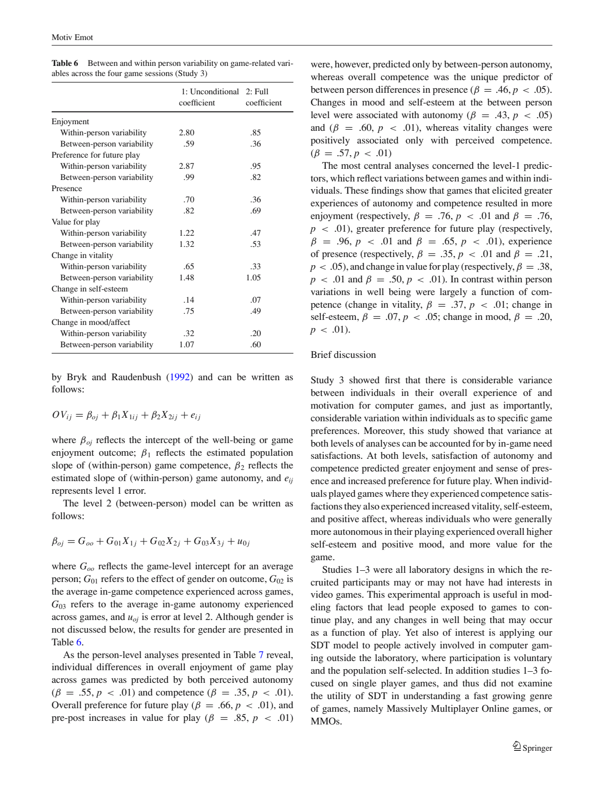

## ORIGINAL PAPER

## The Motivational Pull of Video Games: A Self-Determination Theory Approach

Richard M. Ryan · C. Scott Rigby · Andrew Przybylski

C © Springer Science + Business Media, LLC 2006

Abstract Four studies apply self-determination theory (SDT; Ryan &amp; Deci, 2000) in investigating motivation for computer game play, and the effects of game play on wellbeing. Studies 1-3 examine individuals playing 1, 2 and 4 games, respectively and show that perceived in-game autonomy and competence are associated with game enjoyment, preferences, and changes in well-being pre- to post-play. Competenceandautonomyperceptions are also related to the intuitive nature of game controls, and the sense of presence or immersion in participants' game play experiences. Study 4 surveys an on-line community with experience in multiplayer games. Results show that SDT's theorized needs for autonomy, competence, and relatedness independently predict enjoyment and future game play. The SDT model is also compared with Yee's (2005) motivation taxonomy of game play motivations. Results are discussed in terms of the relatively unexplored landscape of human motivation within virtual worlds.

Keywords Computer games . Motivation . Self-determination theory

Over the last decade, technology has made possible increasingly sophisticated simulated environments and the ability to use these environments for entertainment, education, and social interaction. The exponential increase in computing

R. M. Ryan ( envelopeback ) · A. Przybylski Clinical and Social Sciences in Psychology, University of Rochester, 355 Meliora Hall, Rochester, NY 14627-0266, USA e-mail: ryan@psych.rochster.edu

C. S. Rigby Immersyve Inc., Celebration, FL, USA

power, coupled with the integration of the Internet into mainstream society, has given birth to numerous gaming environments and 'virtual worlds,' that are increasingly complex, immersive, engaging, and enabling of a wide range of activities, goals, and social behavior.

Of particular relevance to the research we present in this article are those computer environments associated with gaming . Participation in video games has become the fastest growing form of human recreation. Attesting to this, annual revenues from video games have surpassed those of Hollywood (Yi, 2004), making them the world's largest entertainment medium. Moreover, participation in gaming is commonplace across a variety of demographic groups, capturing an ever-increasing proportion of both youth and adult leisure time. Whether they take the form of traditional video games, online communities, or 'massively multiplayer online' (MMO) adventures, computer games comprise a large and growing share of people's time and energy.

This increased participation in games is not, however, occurring without controversy (Kirsch, 2006). Some scholars have argued that participation in computer games may foster a number of negative effects, including increased tendencies toward violence, lower psychological and physical well-being, lower achievement and productivity, and more impoverished personal and familial relationships (e.g., Anderson &amp; Bushman, 2001; Healy, 1990; Gentile &amp; Anderson, 2003; Setzer &amp; Duckett, 2000). In contrast, other scholars have argued that psychological benefits can be derived from game experiences, including a sense of efficacy and power over one's environment (e.g., Jones, 2002), as well as improvements in learning (Gee, 2003; Johnson, 2005). Given the variety and complexity of computer game activities, it seems evident that games have the potential to yield both psychological harms and benefits to players.

Regardless of such debates, it is clear that gaming environments have tremendous appeal, and players are highly motivated to engage in them. Outside of laboratory settings, involvement in gaming environments is largely voluntary, and as game developer Bartle (2004) points out, 'the players must expect to get something out of their experience' (p. 128). It would thus seem that, whatever the concerns of critics, players themselves find games gratifying and pleasurable. Interestingly, although several scholars have discussed the motivational 'pull' of video games, few formal theories of motivation have been applied to games, the motivations of players, and the well-being outcomes of play. Yet, as emerging games are increasingly providing deeper and more long-lasting experiences for players, their potential for psychological impact is increasing proportionately. This has prompted game developers themselves to opine that game designs 'need(s) to integrate more variables . . . such as human psychology' (Koster, 2005).

Our purpose in the current article is twofold. First, we investigate the question of how well an existing theory of human motivation, namely self-determination theory (SDT; Deci &amp; Ryan, 1985; Ryan &amp; Deci, 2000b) applies to and accounts for player motivation in gaming contexts. Secondly, we investigate the short-term impact of game play on psychological well being, as a function of the basic psychological needs wepresume games satisfy. More specifically, we hypothesize that games are primarily motivating to the extent that players experience autonomy, competence and relatedness while playing. Need satisfactions should thus predict subsequent motivation to play, whereas need frustration should predict a lack of persistence. We further hypothesize that any short-term well-being players may experience within these virtual worlds will be a function of these need-related experiences. Finally we look at other motives that have been used to account for game play, and the outcomes they predict.

To explicate these hypotheses and introduce this programmatic research we begin with a brief introduction to the surprisingly scant literature on gaming motivation, and a brief review of the SDT framework that we will apply to an analysis of varied gaming environments. We then present four studies examining properties of gaming environments and their associations with psychological need satisfactions and short-term well-being outcomes that, for some players, result from participation. In our view it is these immediate psychological satisfactions that provide the proximal psychological determinants of game play, and perhaps point to a more differentiated understanding of what makes games 'fun.'

## Gaming motivation

As we noted above, the thrust of psychological research on computer gaming has focused on its potential ill effects, especially the potential impact of games on human aggression. Yet to date there has been little basic research on game motivation per se , and those theories that do exist have largely been launched from outside the mainstream empirical literature, instead based, perhaps appropriately, on the ideas of game developers and advocates.

Several writers have specifically looked at multiplayer games and approached the question of motivation by classifying patterns of player behavior. Bartle, a pioneer developer of multiplayer computer games, proposed a widelydiscussed typology of player types in his paper Hearts, Clubs, Diamonds, Spades: Players Who Suit MUDs (1996), which he revisited in his more recent book Designing Virtual Worlds (2004). Originally, Bartle extrapolated from discussions amongst experienced players, postulating that players are of four types: Killers, Achievers, Socializers and Explorers. He subsequently placed these player types into each of four quadrants defined by two dimensions of player behavior: (a) acting (on) versus interacting (with) the game elements, and (b) focusing on other players versus the virtual world itself in one's actions. Thus: Killers wish to act on (i.e. kill) players; Socializers wish to interact with players; Achievers wish to act on (i.e. achieve within) the virtual world; and Explorers wish to interact with (i.e. explore and manipulate) the virtual world. Bartle (1996, 2004) theorizes that highly commercially successful games must provide gratifications for all four player types.

Building on Bartle's theoretical model of player types, Yee (2005; in press) has presented several studies of players' behavior, focusing on Massively Multiplayer Online (MMO) games, which involve multiple players interacting within a virtual environment through their on-line characters or avatars . Most recently, Yee (in press) sought to identify different player motivations via factor analysis. He identified three overarching, non-exclusive, motives. Players focused on achievement seek game mastery, competition and gaining power within the game. Social players want to interact with others and develop in-game relationships. Immersion players desire to escape real life problems, engage in role-play and 'be part of the story.' Yee's work is among the first to bring a statistical methodology to the exploration of how players may differentially value virtual worlds.

As a starting point for empirical work on player motivation, both Bartle and Yee have provided a descriptive foundation that highlights varied goals players may have in gaming contexts. Nonetheless, in a conceptual paper on motivation in virtual environments that supplied the inspiration for our current research program, Rigby (2004) suggested that, as largely individual difference frameworks, these categories or typologies largely reflect the structure and content of current games, rather than the fundamental or underlying motives and satisfactions that can spark and sustain participation across all potential players and game types. As we are merely in the beginning stages of virtual world designs, new kinds of behavior and player types will undoubtedly emerge that correspond to newly designed opportunities. By contrast, Rigby argued that a true theory of motivation should not focus on behavioral classification constrained by the structure of a particular games, but instead address the factors associated with enjoyment and persistence across players and genres, and how games that differ in controllability, structure, and content might appeal to basic human motivational propensities and psychological needs.

Following that suggestion, our intent in this set of studies is both to articulate and empirically test a theory-grounded approach to gaming involvement, based on the idea that players of all types seek to satisfy psychological needs in the context of play. To do so we employ a new measure of need satisfaction in play, the Player Experience of Need Satisfaction (PENS), elaborated from self-determination theory (SDT), a widely researched theory of motivation that addresses both intrinsic and extrinsic motives for acting, and the relation of motivation to growth and well-being (Deci &amp; Ryan, 1985; 2000). SDT seems particularly apt for investigating gaming motivation as the theory has been applied to other recreational contexts such as sport (e.g. Frederick &amp; Ryan, 1995; Hagger, Chatzisarantis, Culverhouse, &amp; Biddle, 2003) and puzzle play (Deci, 1975), as well as studies of how any activity relates to well-being as a function of psychological need satisfactions (e.g. Ryan &amp; Deci, 2001). Moreover, SDT can be used to investigate both the player's motivation to play a game, as well as factors that may motivate the player's character, or avatar, who acts within the game. That is, SDT has specific hypotheses that can be applied both at the level of the player making choices between gaming products, and the motivation of a player while 'in character' within a particular gaming context.

## Self-determination theory

Self-determination theory addresses factors that either facilitate or undermine motivation, both intrinsic and extrinsic. In its early development the focus of SDT was on intrinsic motivation , or motivation based in the inherent satisfactions derived from action (Ryan &amp; Deci, 2000a). According to SDT, intrinsic motivation is the core type of motivation underlying play and sport (Frederick &amp; Ryan, 1993, 1995), and clearly it is a type of motivation relevant to computer game participation for which, like sport, most players do not derive extra-game rewards or approval. Indeed, most computer game players pay to be involved, and some even face disapproval for participating. Thus we suggest that people typically play these games because they are intrinsically satisfying (Malone &amp; Lepper, 1987) or, as Bartle (2004) puts it, because they are seeking 'fun.'

## Autonomy and competence

One mini-theory of SDT, cognitive evaluation theory (CET; Deci &amp; Ryan, 1980; 1985; Ryan &amp; Deci, 2000a), is specifically concerned with contextual factors that support or thwart intrinsic motivation. CET proposes that events and conditions that enhance a person's sense of autonomy and competence support intrinsic motivation, whereas factors that diminish perceived autonomy or competence undermine intrinsic motivation.

Autonomy within SDT concerns a sense of volition or willingness when doing a task (Deci &amp; Ryan, 1980; 2000). When activities are done for interest or personal value, perceived autonomy is high. Provisions for choice, use of rewards as informational feedback (rather than to control behavior), and non-controlling instructions have all been shown to enhance autonomy and, in turn, intrinsic motivation. Conversely, events or conditions that diminish a sense of choice, control or freedom for either the means or ends of action interfere with perceived autonomy, and can undermine intrinsic motivation (Deci, Koestner, &amp; Ryan, 1999). That is, when one feels controlled either in pursuing an activity or in how one accomplishes it, one's sense of autonomy is diminished and subsequent motivation wanes.

Because participation in games outside experimental settings is nearly always voluntary (Bartle, 2004), player autonomy for play would typically be high. Nonetheless, people's willingness to play any particular game will vary as a function of its personal appeal, design and content. Game designs also differ in the autonomy afforded within the game, such as the degree of choice one has over the sequence of actions, or the tasks and goals undertaken. Specifically, we expect autonomy to be enhanced by game designs that provide considerable flexibility over movement and strategies, choice over tasks and goals, and those where rewards are structured so as to provide feedback rather than to control the player's behavior. In the gaming industry, this is reflected in the more recent movement towards a 'procedural' structure, which is championed by a leading game developer, Will Wright, and is defined by a game's ability to respond dynamically to an individual's choices without constraining or anticipating them.

A second psychological need discussed within CET is that for competence , a need for challenge and feelings of effectance (White, 1959; Deci, 1975). CET proposes that factors that enhance the experience of competence, such as opportunities to acquire new skills or abilities, to be optimally challenged, or to receive positive feedback enhance perceived competence, and, in turn, intrinsic motivation. Perceived competence would thus be enhanced in gaming contexts where game controls are intuitive and readily mastered, and tasks within the game provide ongoing optimal challenges and opportunities for positive feedback. Indeed, we hypothesize that perceived competence is among the most important satisfactions provided by games, as they represent arenas in which a person can feel accomplishment and control.

CET has been tested in well over a hundred experimental studies (see, e.g., Deci et al., 1999), and it has been applied to domains such as school and sport (Ryan &amp; Brown, 2005; Vallerand &amp; Reid, 1984). In the contexts of computer games, we similarly expect variables associated with autonomy and competence to influence motivation for game play and its effects, and have developed subscales specific to gaming based upon CET as part of our PENS measures.

## Presence

In addition to autonomy and competence factors we believe intrinsic motivation in gaming contexts is associated with presence (Lombard &amp; Ditton, 1997; Rigby, 2004), or the sense that one is within the game world, as opposed to experiencing oneself as a person outside the game, manipulating controls or characters. Concepts of presence are widely discussed by game designers, who attempt to make the experience of virtual worlds feel real and authentic, both by creating a compelling story line and graphic environment, and by making controls as 'intuitive' or user-friendly as possible. Accordingly, Lombard and Ditton (2000) defined presence as the illusion of non-mediation, meaning that a person perceives and responds to the content of a particular medium as if the medium were not there. Lombard and Ditton related the experience of presence to Csikszentmihalyi's (1990) concept of fl ow , an experience that is associated with intrinsic motivation, but as Rigby (2004) noted, they stopped short of specifying either the psychological components or facilitators of presence. In the present studies we develop an assessment of presence, and we expect presence to be fostered by perceived autonomy and competence, and the nature of computer controls that mediate in-game activities.

## Intuitive controls

Another variable of interest to us in assessing need satisfaction in game play is the degree to which game controls are 'intuitive;' that is, whether they make sense, are easily mastered, and do not interfere with once sense of being in the game. We thus develop a measure of intuitive controls (IC) as a subscale of the PENS that assesses the interface between the player and the action taking place within the game. Intuitive controls can contribute to game motivation because they are associated with a greater sense of freedom and control, and they enhance a sense of competence. Therefore, insofar as IC predicts motivational outcomes of games we expect it to be mediated by perceived autonomy and competence.

Gaming and well-being: The impact of basic psychological need satisfaction

Beyond predicting motivation and persistence, SDT addresses factors associated with the enhancement of wellbeing. Specifically, another mini-theory within SDT, basic psychological need theory (BPN; Deci &amp; Ryan, 2000; Ryan, 1995), specifies that the impact of any activity on well-being is a function of the person's experience of need satisfaction. SDT further argues that there are three primary or basic needs underlying psychological wellness, namely autonomy, competence, and relatedness. Put differently, to the extent any activity affords experiences of volition, effectiveness, and social connection, it should yield enhancements in wellbeing. It is our contention that the psychological 'pull' of games is largely due to their capacity to engender feelings of autonomy, competence and relatedness, and that to the extent they do so they not only motivate further play, but also can be experienced as enhancing psychological wellness (e.g., subjective vitality, self-esteem, positive affect), at least short-term.

We previously described factors that conduce to the satisfaction of needs for autonomy and competence during game experiences. Within SDT, however, relatedness represents a third psychological need that enhances motivation and wellness. Relatedness is experienced when a person feels connected with others (La Guardia, Ryan, Couchman, &amp; Deci, 2000; Ryan &amp; Deci, 2001). Although we are intrigued by how needs for relatedness may be met by 'computer generated' personalities and artificial intelligence, within today's gaming environments it is particularly within multiplayer games, which allow for interactions between real players, that we expect feelings of relatedness to be relevant. In study 4, we therefore look at the extent to which games allow for social interaction can produce feelings of relatedness, and the motivational and well-being enhancements associated with it.

## Summary and overview

Video games provide virtual environments in which opportunities for action are manifold. The growth of participation in these environments suggests that they can be highly motivating, though little empirical research has explained this phenomenon, or accounted for why some games are more popular than others. In the current studies, we apply a newly developed measure of need satisfaction in play based upon SDT(and particularly the mini-theories of CET and BPN) to the understanding of gaming motivation, both in general and comparatively across different gaming contexts. We specifically predict that game features that conduce to increased perceptions of autonomy, competence, and relatedness enhance motivation to play. Moreover, the experience of these psychological need satisfactions is expected, in turn, to be associated with feelings of presence while playing, and shortterm changes in well-being.

We present four studies concerning these hypotheses. In study 1, using a simple 'platform' computer game (a game involving jumping to and from suspended platforms), we apply CET to examine how experiences of autonomy and competence predict game experience and subsequent motivation to play. Study 2 supplies a comparative test of two games, specifically chosen because of their presumed differences in popularity, to show how SDT-based variables can account for differential preferences. Study 3 uses multilevel modeling to look at between- and within-person variation in psychological need satisfaction in accounting for game preferences and motivation across four distinct games. Finally, study 4 surveys an on-line community of MMO game players concerning motivational factors, including relatedness, as they relate to persistence. We conclude with a discussion of future directions for the study of gaming and of involvement in virtual worlds.

## Study 1

Study 1 investigates propositions derived from CET concerning the relations of perceived autonomy and competence to game characteristics, players' enjoyment and preference for future play, and any changes in well-being associated with game play.

Several hypotheses are tested using specific subscales of the PENS. We hypothesize first that the experience of userfriendly tools for play, or intuitive controls (IC), will facilitate experiences of autonomy and competence in game play. Rigby (2004) suggested that learning the controls of a game constituted the game's 'price of admission,' and here, in this 20-minute game play we expect that greater IC will be particularly associated with an enhanced sense of competence. We also develop a measure of presence , or a sense of immersion in the gaming world, which we expect to be associated with perceived in-game autonomy and competence. We further suggest that it is the in-game satisfactions of autonomy and competence that facilitate players' motivation for play, as assessed by preferences for future play and rated enjoyment. Moreover, we assess changes in well being from before to after game play, expecting that those who find need satisfactions of autonomy and competence in play will show enhanced wellness.

This initial study employs a simple yet popular platform game, Mario 64, which affords relatively limited choices over actions and environments compared to more elaborate MMOformats, and that focuses mainly on progressive challenges within a linear format. Thus, we expect the principle satisfaction of game play to be that of competence, and to a lesser extent autonomy. The game does not afford interactions between players, ruling out in-game relatedness as a relevant variable. As we proceed with different game formats, we expect these other psychological needs to be more predictive of outcomes.

## Methods

## Participants and procedure

Undergraduates (23 male; 66 female) from a private northeastern university received extra course credit for participating. They reported to a video laboratory where they completed questionnaires administered through a hypertext markup language form on a computer before and after a 20-minute play session.

Target Game. In this study we used a commercially available 'platform' game from Nintendo 64 titled Super Mario 64 . In the game, the character (avatar) is activated through game-pad controls to pursue point-related goals and to avoid various obstacles and dangers.

## Measures

Survey measures were delivered in a hypertext format titled 'Game Play Questionnaire' (GPQ) that was administered both pre- and post-play. Post-play assessment included our PENS variables containing subscales for in-game autonomy, in-game competence, presence, and the intuitiveness of controls. Both pre- and post-GPQs also assessed wellbeing variables so that change scores could be calculated. The questionnaire employed a uniform 7-point Likert-type scale, with anchors appropriate to each question. Specific subscales are described below.

PENS: In-Game Competence. A5-item competence scale measured participants' perception that the game provided a challenging but not overwhelmingly difficult experience and enhanced efficacy. Items included: 'I felt very capable and effective' and 'The game kept me on my toes but did not overwhelm me.' Items were averaged to create a total score (alpha = .79).

PENS: Presence. This scale was developed to assess a sense of immersion in the gaming environment. Three items each assessed physical presence (e.g., When moving through the game world I feel as if I am actually there); emotional presence (e.g., I experience feelings as deeply in the game as I have in real life); and narrative presence (e.g., When

PENS: In-Game Autonomy. This 5-item scale assessed the degree to which participants felt free, and perceived opportunities to do activities that interest them. Sample items included: 'I did things in the game because they interested me' and 'I felt controlled and pressured to be a certain way' (reversed). Items were averaged to create an in-game autonomy score (alpha = .66).

playing the game I feel as if I am an important participant in the story). For present purposes we combined across these subscales by averaging the 9 items (alpha = .85).

Subjective Vitality. This 'state' measure, developed by Ryan and Frederick (1997) to assess the experiences of energy and aliveness, was assessed both pre- and post-play. We used the six items identified by Bostic, Rubio, and Hood (2000) as the best fitting (e.g., 'I feel energized right now'). The alpha, averaged across the pre- and post-assessments, was .85.

PENS: Intuitive Controls (IC). Three items assessed how participants experienced the interface that controlled their character's actions in the virtual environment. Items included: 'When I wanted to do something in the game it was easy to remember the corresponding control.' Items were averaged to create the IC score (alpha = .85).

Self-Esteem. The 10-item general subscale of the Multidimensional Self-esteem Inventory (MSEI; O-Brien &amp; Epstein, 1988) was modified to assess state self-esteem pre- and postplay. Items were reworded to reflect how participants felt at that moment (e.g., 'You feel very good about yourself') on a 1 to 7 rating scale (average alpha = .82).

Game enjoyment was assessed with 4-items adapted from the Intrinsic Motivation Inventory (IMI; Ryan, Mims, &amp; Koestner, 1983) for example, 'I enjoyed playing the game very much' and 'I thought the game was boring (reversed)' with a high alpha of .95.

Mood Rating Scale (Diener &amp; Emmons, 1984) is a widely used 9-item adjective checklist, used herein to assess mood state pre- and post-play. Adjectives include: 'worried/blue' and 'depressed/anxious' (negative affect); 'joyful' and 'pleased' (positive affect). After reverse scoring negative items, items were averaged to create an overall mood score (alpha = .89).

Preference for future play was assessed with 4 items, for example, 'Given the chance I would play this game in my free time,' with an alpha of .94.

Continued Play Behavior. This was assessed with a dichotomous behavioral choice variable. Following the experimental play period, participants were given a choice to continue in a free choice format with either the target game, or an alternative popular game for which they were given the Amazon.com product description. Of the 88 participants, 54 chose the alternate game, 31 the target game, 2 withdrew from play, and 1 participant's data was not recorded.

## Results

## Preliminary analyses

We first explored for main and interactive effects of gender on the primary study variables. Results revealed a significant difference only for intuitive controls ( F (1, 87) = 5.60, p &lt; .05), with women scoring lower than men. Gender did not interact with IC in the prediction of other variables. Accordingly, we collapsed across gender in subsequent analyses.

Next, correlations between the dependent measures were examined (see Table 1). To assess well being changes preto post-play we calculated residual scores by regressing time 2 onto time 1 assessments for state self-esteem, mood and vitality. Paired sample t-tests also examined the direction of change across the sample by comparing pre- to post-play scores. Participants felt, on average, less vitality after the play session than at baseline ( t = 3.13, p &lt; .01), but there were no pre- to post-play differences evident in either mood or state self-esteem.

## Primary analyses

Our primary hypotheses was that both in-game autonomy and in-game competence would be associated with a) heightened feelings of presence and the sense that controls are intuitive; and b) greater enjoyment and preference for future play. In addition we expected that those who experienced competence and autonomy while playing would show more positive difference scores on the well being outcomes of vitality, mood and state self-esteem. Table 2 presents the regression model in which each of these outcomes was regressed onto in-game autonomy and competence simultaneously. As the table reveals, both autonomy and competence were each uniquely associated with IC, whereas only competence related to presence. In terms of motivation, both game enjoyment and preference for future play were associated significantly with both autonomy and competence, but only competence predicted whether people chose to continue with the target versus alternate game. Finally, although on average participants had neither increased nor decreased well-being after exposure to play, those who experienced competence showed higher state self-esteem and more positive mood preto post-play.

We specifically expected that intuitive controls would facilitate feelings of competence and autonomy, as they would relate to a sense of control and effectiveness. In turn, autonomy and competence were expected to predict the behavioral measure of continued motivation, rated game preference, game enjoyment and presence. We tested this mediation model in a series of regressions as outlined by Baron and Kenny (1986). These four regression models are depicted in Table 3. Specifically, in step 1 we regressed each DV onto IC. In step 2 we regressed competence and autonomy (the proposed mediators) onto IC. In step 3 when autonomy and competence (both significantly associated with outcomes) were entered into the predictive model, the relations between outcomes and intuitive controls was reduced to non-significance.

Table 1 Zero-order correlations of dependent variables (Study 1)

|                                  | Presence   | Free choice continued play   | Preference for future play   | Enjoyment   | Delta1 Vitality   | Delta1 Self-esteem   | Delta1 Mood/affect   |
|----------------------------------|------------|------------------------------|------------------------------|-------------|-------------------|----------------------|----------------------|
| Presence                         | -          |                              |                              |             |                   |                      |                      |
| Free choice continued play       | .25 ∗      | -                            |                              |             |                   |                      |                      |
| Preference for future play       | .60 ∗∗     | .41 ∗∗                       | -                            |             |                   |                      |                      |
| Enjoyment                        | .62 ∗∗     | .46 ∗∗                       | .85 ∗∗                       | -           |                   |                      |                      |
| Delta1 Vitality                  | .34 ∗∗     | .24 ∗∗                       | .30 ∗∗                       | .35 ∗∗      | -                 |                      |                      |
| Delta1 Self-Esteem               | .28 ∗∗     | .30 ∗∗                       | .23 ∗∗                       | .34 ∗∗      | .30 ∗∗            | -                    |                      |
| Delta1 Mood/Affect M = 0; SD = 1 | .34 ∗∗     | .37 ∗∗                       | .44 ∗∗                       | .50 ∗∗      | .53 ∗∗            | .41 ∗∗               | -                    |

Note. n = 89.

∗ p &lt; .05, ∗∗ p &lt; 01.

In an experimental setting not all participants represent 'players' in the sense usually observed in the real world ecology of gaming-namely persons who self-select and play on a voluntary basis. Similarly, on our behavioral measure of motivation, only a subset of participants chose to continue with the target task. To further examine how volitional motivation to play is associated with well being we ran a MANOVA in which those who chose to continue the target game ( n = 31) were contrasted with those who chose the alternative ( n = 54). The overall MANOVA was significant ( F (10, 74) = 3.04, p &lt; .01). Follow-up univariate results revealed that persons who continued play had higher scores on IC ( F (1, 83) = 6.42, p &lt; .05), in-game autonomy ( F (1, 83) = 4.77, p &lt; .05) and in-game competence ( F (1, 83) = 10.58, p &lt; .001). Further, players who continued also experienced more positive pre- to post-play differences in affect ( F (1, 83) = 12.38, p &lt; .001), vitality ( F (1, 83) = 4.32, p &lt; .05), and state self-esteem ( F (1, 83) = 7.32, p &lt; .01).

Table 2 Standardized beta weights from simultaneous multiple regression of game variables, motivation outcomes and well-being change scores onto in-game autonomy and competence

|                               | Autonomy   | Competence   |
|-------------------------------|------------|--------------|
| Game variables                |            |              |
| Intuitive controls            | . 37 ∗∗    | .40 ∗∗       |
| Presence                      | . 19       | .39 ∗        |
| Motivation                    |            |              |
| Enjoyment                     | . 49 ∗∗    | .34 ∗∗       |
| Preference for continued play | . 38 ∗∗    | .39 ∗∗       |
| Free choice continued play    | - . 04     | .41 ∗        |
| Change in well-being          |            |              |
| Vitality                      | . 14       | .30          |
| Self-esteem                   | - . 12     | .52 ∗∗       |
| Mood/affect                   | . 26 ∗     | .25 ∗        |

Note. n = 89.

∗ p &lt; .05. ∗∗ p &lt; 01.

This result underscores that those who find a game motivating may do so because game play satisfies needs for them, and enhances feelings of well-being.

## Brief discussion

This initial study used a single 'platform game' to test the CET model as applied to motivation for a video game. Results confirmed our principle hypotheses that gaming motivation and enjoyment can be accounted for by experiences of competence and autonomy while playing.

In this experimental setting persons were 'assigned' to play a game, and not all participants preferred the target game

Table 3 Analyses showing the relations between intuitive controls and motivational outcomes as mediated by in-game experiences of autonomy and competence (Study 1)

| Dependent variables           |               | Independent variables                   | β       |
|-------------------------------|---------------|-----------------------------------------|---------|
| Preference for continued play | Step 1        | Intuitive controls                      | . 57 ∗∗ |
|                               | Step 2        | In-game autonomy                        | . 66 ∗∗ |
|                               |               | In-game competence                      | . 67 ∗∗ |
|                               | Step 3        | Intuitive controls                      | . 13    |
|                               |               | In-game autonomy                        | . 33 ∗∗ |
|                               |               | In-game competence                      | . 33 ∗∗ |
| Enjoyment                     | Step 1        | Intuitive controls                      | . 64 ∗∗ |
|                               | Step 2 Step 3 | Same as step 2 above Intuitive controls | . 18    |
|                               |               | In-game autonomy                        | . 38 ∗∗ |
|                               |               | In-game competence                      | . 31 ∗∗ |
| Free choice continued play    | Step 1        | Intuitive controls                      | . 27 ∗  |
|                               | Step 2 Step 3 | Same as step 2 above Intuitive controls | . 12    |
|                               |               | In-game autonomy                        | - . 08  |
|                               |               | In-game competence                      | . 36 ∗  |

Note. n 89. n 83 for Free Choice Continued Play.

or found it satisfying. Results showed, however, that those who chose to continue this game following this mandatory exposure were those who experienced a sense of competence, and these players also evidenced more positive difference scores on well-being. Indeed, examination of pre- and postplay scores showed that on an absolute level, mood, vitality and state self-esteem dropped for non-continuers, whereas both mood and self-esteem rose for those who continued. It seems clear that, at least for a subset of those exposed to this game, the play experience had a positive effect on their well-being, at least short-term.

The study also explored two widely discussed aspects of game play, namely intuitive controls and immersion or presence. Intuitive controls were related to both competence and autonomy, which mediated the relations of IC to outcomes. In this platform game, it was mainly competence that predicted presence.

Amongthelimitations of this study is the single, relatively linear, platform genre game used. Thus in study 2 we expand to a design in which participants play two different games to better test the general model and the extent to which it can predict differential game preferences.

## Study 2

In study 2 we selected two commercial games from the same genre-3D adventure games. These games were specifically selected because one appeared near the top of popularity in game ranking surveys, whereas the second fell in the bottom end of rankings. We thus anticipated that participants would find the games differentially engaging, a difference we hypothesized could be explained by the experiences of autonomy and competence each game afforded.

## Methods

## Participants and procedure

Participants were 50 undergraduates (36 female, 14 male) who reported to a video lab setting in return for extra course credit. All participants came on two occasions, 2 to 7 days apart, playing a different game on each visit, except for one participant who missed session two. Based on a randomized assignment, half of the participants played Zelda: The Ocarina of Time (1998) first, the other half played A Bug's Life (1999). Zelda had received a top rating in its genre on gamerankings.com of 97.8% favorability; A Bug's life received a rating of 56.6%. Questionnaires were again administered through hypertext markup language form on a computer before and after a 40-minute play session on the Nintendo 64.

## Measures

As in study 1, all subscales of the PENS, including in-gameautonomy, in-game competence, intuitive controls, preference for future play, game enjoyment, and presence were administered, as well as well-being outcomes of vitality, state self-esteem and mood. As in study 1, well-being measures were taken pre-and post-play, and all other measures were taken post-play. Alphas, calculated separately for each game, ranged from .68 to .94, and were comparable to those obtained in study 1.

## Results

## Preliminary analyses

We examined for gender effects and found only one main effect on IC, which was in evidence for only one of the games. Females found the controls for Zelda less intuitive than did males [ F (1, 48) = 6.22, p &lt; .05]. Subsequent analyses thus collapse across gender.

## Primary analyses

To test our expectation that Zelda would, on average, be preferred to ABugsLife , we ran a repeated measures ANOVA with the Greenhouse-Geiser adjustment on game enjoyment [Zelda M = 4.56, Bugs M = 3.60; F (1, 48) = 25.11, p &lt; .001], preference for future play [Zelda M = 3.21, Bugs M = 2. 24; F (1, 48) = 24.75, p &lt; .001], and presence [Zelda M = 2.82; Bugs = 2.40; F (1, 48) = 6.96, p &lt; .05]. As expected, these differences all indicated that participants enjoyed, were more motivated for, and were more immersed in Zelda relative to A Bugs Life . However, IC did not differ [ F (1, 48) = 0.32, ns]. This null finding makes sense in retrospect due to the simple controls involved in both games.

Asecond repeated measure ANOVA tested the hypothesis that these games would differ in perceived in-game competence and autonomy. In line with CET, results were significant for both autonomy [ F (1, 48) = 8.89, p &lt; .01] and competence [ F (1, 48) = 8.52, p &lt; .01].

As a further analysis we calculated a difference score by subtracting game 1 ( A Bug's Life ) from Game 2 ( Zelda ) scores on preference for future play, enjoyment and presence. We then regressed each of these difference scores onto autonomyandcompetenceratings simultaneously. For future play both autonomy (standardized B = .41, p &lt; . 01) and competence B = .54, p &lt; .01) were significant predictors of this difference score. Similar results occurred for enjoyment and presence, with both autonomy ( B = .35 and .45, respectively) and competence ( B = .54 and .40, respectively) retaining significant ( p &lt; .01) relations.

Table 4 Multiple regressions of game variables, motivation outcomes and well-being change scores onto in-game autonomy and competence, separately by game (Study 2)

|                      | Zelda    | Zelda      | A Bug's Life   | A Bug's Life   |
|----------------------|----------|------------|----------------|----------------|
|                      | Autonomy | Competence | Autonomy       | Competence     |
| Game variables       |          |            |                |                |
| Intuitive controls   | . 20     | . 52 ∗∗    | - . 02         | .43 ∗∗         |
| Presence             | . 23     | . 29 ∗     | . 09           | .53 ∗∗         |
| Motivation           |          |            |                |                |
| Enjoyment            | . 27     | . 46 ∗∗    | . 22           | .33 ∗∗         |
| Preference for       | . 07     | . 63 ∗∗    | . 28 ∗         | .35 ∗∗         |
| future play          |          |            |                |                |
| Change in well-being |          |            |                |                |
| Vitality             | . 17     | . 30 ∗∗    | - . 07         | .49 ∗∗         |
| Self-esteem          | - . 11   | . 43 ∗     | . 05           | .24            |
| Mood/affect          | . 02     | . 69 ∗∗    | . 42 ∗∗        | .33 ∗∗         |

Note. n = 49.

∗ p &lt; .05, ∗∗ p &lt; 01.

Although the differences between games in terms of preference for future play, enjoyment and presence can be accounted for in terms the experience of in-game autonomy and competence, a further question was how, within each game considered separately, these factors account for outcomes. Table 3 displays regressions of both enjoyment and preference for future play variables onto in-game autonomy and competence. As the table reveals, there were moderate to strong relations between autonomy and competence and the dependent measures.

Interestingly, correlations revealed that our 'price of admission' variable, intuitive controls, was positively related to motivation only in the preferred game, Zelda . This supports our earlier suggestion of game controls as 'the gatekeeper to experience, and not the experience itself' (Rigby, 2004). That is, our findings indicate that even when controls are clear, they only facilitate motivation in a context where autonomy and competence are potentially experienced. Indeed, a mediation analysis similar to that applied in study 1 revealed that the impact relations of IC to preference for future play and enjoyment within Zelda was fully mediated by the inclusion of perceived autonomy and competence, with the variance largely accounted for by competence (see Table 4). No parallel analysis was run regarding A Bug's Life because presence was not significantly associated with IC within that game experience (Table 5).

Paired sample t -tests showed that, on average, people's vitality dropped from baseline to post-game assessments for both games ( t = -2.33, p &lt; .05; and t = -4.96, p &lt; .01 for Zelda and A Bugs Life , respectively). Yet, there was also an average increase in state self-esteem when participants played Zelda ( t = 2.69, p &lt; .01). There was no average change in mood associated with play of either game. Further, the regression analyses reported in Table 3 show positive associations of competence satisfaction with all three well being change scores within Zelda , and for both vitality and mood within A Bug's Life . Autonomy was also significantly associated with mood change while playing A Bug's Life .

## Brief discussion

Study 2 provided a comparative analysis of two games from the 3D adventure genre pre-selected for differences in their attractiveness to participants. Results showed that perceived in-game competence and autonomy accounted for differences in preference for future play, enjoyment and presence. In addition, for the more interesting game, intuitive controls (IC) were associated with these outcomes, a relation mediated by in-game experiences of competence. The fact that IC did not predict outcomes in the less preferred game suggests that merely having a low 'price of admission' or ease of control is not enough to motivate players or provide enjoyment, supporting the idea that motivational models of the game experience distinguish between game mechanics and game

Table 5 Analyses showing the relations between IC and motivational outcomes as mediated by in-game experiences of autonomy and competence for Zelda (Study 2)

| Dependent variables        | Independent variables   | Independent variables   | Independent variables   |
|----------------------------|-------------------------|-------------------------|-------------------------|
| Preference for future play | Step 1                  | Intuitive controls      | . 50 ∗∗                 |
| Preference for future play | Step 2                  | Intuitive controls      | . 12                    |
| Preference for future play |                         | In-game autonomy        | . 05                    |
| Preference for future play |                         | In-game competence      | . 57 ∗∗                 |
| Enjoyment                  | Step 1                  | Intuitive controls      | . 42 ∗∗                 |
| Enjoyment                  | Step 2                  | Intuitive controls      | - . 01                  |
| Enjoyment                  |                         | In-game autonomy        | . 27                    |
| Enjoyment                  |                         | In-game competence      | . 46 ∗∗                 |

Note. n = 49 (Legend of Zelda).

∗ p &lt; .05, ∗∗ p &lt; 01.

play (Rigby, 2004). It appears that game play must afford opportunities for need satisfaction in order for controls to be associated with positive effects.

## Study 3

The experimental design of study 2 allowed us to compare two games thought a priori to differ in the motivation they would inspire. However, in the real world of consumers, people differ in their game choices, presumably because they find certain games more fitting with their personal interests and competences. Thus, in study 3 we expanded our experimental design to have participants sample four different games so that we could examine both the main effects of individual differences in game autonomy and competence on game motivation generally, and how within-person variations in game preferences could be explained by our SDT-based model. In short, we moved to a multi-level model in which different game experiences are nested with persons, to assess the motivation model at both a between- and within-persons levels of analysis.

## Method

## Participants and procedures

Fifty-eight undergraduates (46 female, 12 male) reported to a lab setting in return for extra course credit on four occasions, 2 to 7 days apart, playing a different game on each visit. Forty-one came in for all sessions, four came in three times, nine came in twice and five came for only one visit. Which game participants played on each visit was based on a randomized assignment. Questionnaires were administered through a hypertext markup language form presented before and after a 40-minute play session on a Nintendo 64 game console.

Target Games. The four games in study 3 were selected because they all received high favorability ratings in their respective genres for the Nintendo 64 console as recorded on gamerankings.com . A 'platform' title, Super Mario 64 (98.5%, 1996) was the same game used in study one. A 'fighting' game, Super Smash Brothers (79.0%, 1999) puts the player into a series of one-on-one brawls that increase in difficulty, using animated Nintendo avatars. The third game, a 'rail-shooter' title: Star Fox 64 (89.9%, 1997) requires participants to pilot a space ship around obstacles and combat computer controlled fighters in terrestrial and space environments. A fourth title: San Francisco Rush (82.8%, 1997) is an 'arcade-racing' game that places the player in a succession of challenges against computer controlled cars, with an explicit goal to win increasingly fast cars and enter more challenging race courses.

## Measures

Assessmentsofin-game-autonomy,in-gamecompetence,intuitive controls, preference for future play, game enjoyment, presence and the well-being outcomes of vitality, state selfesteem and mood were all the same as in study 1 and 2. Similar to study 1 and 2 well-being measures were taken both pre-and post-play, and all other measures were taken postplay. Alphas, calculated separately for each game, ranged from .65 to .94, and were comparable to those obtained in study 1 and 2.

Value for Play. A short ad-hoc 5-item scale was administered after each play period to assess the value the participant ascribed to play of the target game (e.g., 'I will play this game because it could be of some value to me'). The 5 items were averaged (alpha = .89).

## Results

## Preliminary analyses

Gender and age effects were examined at a randomly selected session, session 2. Females found the controls for the games played less intuitive than did males ( F (1, 50) = 4.40, p &lt; .05); no other effects were significant ( p 's &gt; .05). Subsequent analyses collapse across gender and age.

Paired sample t-tests, run separately for each game, compared pre- and post-game scores on the three well being variables. As in the prior studies, across participants there were drops in vitality for three of the four games. Interestingly, in this study effects on self-esteem were also negative, with significant decreases in state self-esteem across all four games (all p &lt; .001). There were no changes in mood. Our subsequent primary analyses concerning vitality, selfesteem, and mood use change scores from before to after playing.

## Primary analyses

The primary hypotheses were tested using Hierarchical Linear Modeling (HLM) analyses (Bryk &amp; Raudenbush, 1992; Raudenbush, 2000). HLM applies well given the nested nature of our data, and allowed us to simultaneously assess the effects of different games as well as individual differences on outcomes.

We first conducted unconditional models to examine the within and between-person variability in game experience, motivation, and well-being outcomes. Results are reported in Table 6, and support the premise that there is sufficient variability in outcomes to warrant the nested analyses. We thus conducted 2-level models to examine the game and individual predictors of interest. The level 1 withinperson model used group-level centering recommended by Bryk and Raudenbush (1992) and can be written as follows:

Table 6 Between and within person variability on game-related variables across the four game sessions (Study 3)

|                            | 1: Unconditional coefficient   | 2: Full coefficient   |
|----------------------------|--------------------------------|-----------------------|
| Enjoyment                  |                                |                       |
| Within-person variability  | 2 . 80                         | . 85                  |
| Between-person variability | . 59                           | . 36                  |
| Preference for future play |                                |                       |
| Within-person variability  | 2 . 87                         | . 95                  |
| Between-person variability | . 99                           | . 82                  |
| Presence                   |                                |                       |
| Within-person variability  | . 70                           | . 36                  |
| Between-person variability | . 82                           | . 69                  |
| Value for play             |                                |                       |
| Within-person variability  | 1 . 22                         | . 47                  |
| Between-person variability | 1 . 32                         | . 53                  |
| Change in vitality         |                                |                       |
| Within-person variability  | . 65                           | . 33                  |
| Between-person variability | 1 . 48                         | 1 . 05                |
| Change in self-esteem      |                                |                       |
| Within-person variability  | . 14                           | . 07                  |
| Between-person variability | . 75                           | . 49                  |
| Change in mood/affect      |                                |                       |
| Within-person variability  | . 32                           | . 20                  |
| Between-person variability | 1 . 07                         | . 60                  |

<!-- Docling did not decode this formula. Original page 11 retained below, including both model equations. -->

where β oj reflects the intercept of the well-being or game enjoyment outcome; β 1 reflects the estimated population slope of (within-person) game competence, β 2 reflects the estimated slope of (within-person) game autonomy, and eij represents level 1 error.

The level 2 (between-person) model can be written as follows:

<!-- Docling did not decode this formula. See original page 11 image above for level 2 equation. -->

[Original PDF page 11, level 2 equation](images/source-page-11.png)

where Goo reflects the game-level intercept for an average person; G 01 refers to the effect of gender on outcome, G 02 is the average in-game competence experienced across games, G 03 refers to the average in-game autonomy experienced across games, and uoj is error at level 2. Although gender is not discussed below, the results for gender are presented in Table 6.

As the person-level analyses presented in Table 7 reveal, individual differences in overall enjoyment of game play across games was predicted by both perceived autonomy ( β = .55, p &lt; .01) and competence ( β = .35, p &lt; .01). Overall preference for future play ( β = .66, p &lt; .01), and pre-post increases in value for play ( β = .85, p &lt; .01)

were, however, predicted only by between-person autonomy, whereas overall competence was the unique predictor of between person differences in presence ( β = .46, p &lt; .05). Changes in mood and self-esteem at the between person level were associated with autonomy ( β = .43, p &lt; .05) and ( β = .60, p &lt; .01), whereas vitality changes were positively associated only with perceived competence. ( β = .57, p &lt; .01)

The most central analyses concerned the level-1 predictors, which reflect variations between games and within individuals. These findings show that games that elicited greater experiences of autonomy and competence resulted in more enjoyment (respectively, β = .76, p &lt; .01 and β = .76, p &lt; .01), greater preference for future play (respectively, β = .96, p &lt; .01 and β = .65, p &lt; .01), experience of presence (respectively, β = .35, p &lt; .01 and β = .21, p &lt; .05), and change in value for play (respectively, β = .38, p &lt; .01 and β = .50, p &lt; .01). In contrast within person variations in well being were largely a function of competence (change in vitality, β = .37, p &lt; .01; change in self-esteem, β = .07, p &lt; .05; change in mood, β = .20, p &lt; .01).

## Brief discussion

Study 3 showed first that there is considerable variance between individuals in their overall experience of and motivation for computer games, and just as importantly, considerable variation within individuals as to specific game preferences. Moreover, this study showed that variance at both levels of analyses can be accounted for by in-game need satisfactions. At both levels, satisfaction of autonomy and competence predicted greater enjoyment and sense of presence and increased preference for future play. When individuals played games where they experienced competence satisfactions they also experienced increased vitality, self-esteem, and positive affect, whereas individuals who were generally more autonomous in their playing experienced overall higher self-esteem and positive mood, and more value for the game.

Studies 1-3 were all laboratory designs in which the recruited participants may or may not have had interests in video games. This experimental approach is useful in modeling factors that lead people exposed to games to continue play, and any changes in well being that may occur as a function of play. Yet also of interest is applying our SDT model to people actively involved in computer gaming outside the laboratory, where participation is voluntary and the population self-selected. In addition studies 1-3 focused on single player games, and thus did not examine the utility of SDT in understanding a fast growing genre of games, namely Massively Multiplayer Online games, or MMOs.

Table 7 Within-person (L1) and between-person (L2) effects of in-game perceived autonomy and competence and gender on game-related outcomes (Study 3)

|                    | L1 competence   | L1 competence   | L1 autonomy   | L1 autonomy   | Gender   | Gender   | L2 competence   | L2 competence   | L2 autonomy   | L2 autonomy   |
|--------------------|-----------------|-----------------|---------------|---------------|----------|----------|-----------------|-----------------|---------------|---------------|
| ( DV )             | β               | SE              | β             | SE            | β        | SE       | β               | SE              | β             | SE            |
| Enjoyment          | .76 ∗∗          | .18             | . 76 ∗∗       | .17           | . 04     | .27      | . 35 ∗∗         | .13             | . 55 ∗∗       | .14           |
| Future play pref.  | .65 ∗∗          | .13             | . 96 ∗∗       | .13           | . 66     | .43      | . 05            | .19             | . 66 ∗∗       | .13           |
| Presence           | .21 ∗           | .09             | . 35 ∗∗       | .07           | - . 16   | .22      | . 46 ∗          | .20             | - . 04        | .19           |
| Value for play     | .50 ∗∗          | .11             | . 38 ∗∗       | .12           | . 26     | .24      | . 16            | .20             | . 85 ∗∗       | .18           |
| Delta1 Vitality    | .37 ∗∗          | .10             | - . 02        | .08           | - . 33   | .21      | . 57 ∗∗         | .21             | . 23          | .22           |
| Delta1 Self-Esteem | .07 ∗           | .04             | . 01          | .04           | . 43 ∗∗  | .19      | - . 16          | .13             | . 60 ∗∗       | .12           |
| Delta1 Mood/Affect | .20 ∗∗          | .08             | . 05          | .06           | . 08     | .28      | . 28            | .21             | . 43 ∗        | .21           |

Note. ∗ p &lt; .05, ∗∗ p &lt; 01.

## Study 4

A major purpose of study 4 was to assess persons actively involved in MMO gaming, the fastest growing segment of the computer gaming industry. Because MMO's typically involve interactions between players within a rich virtual environment, they bring with them consideration of SDT's third basic psychological need, the need for relatedness . We hypothesized that in addition to in-game feelings of autonomy and competence, motivation to play MMO's would be associated with relatedness. In addition, the MMO context also allowed us to meaningfully apply the most well known of existing measures of player motivation, namely Yee's (in press) assessments of social, immersion and achievement motives, both to explore its descriptive utility, and to provide some comparisons with the SDT framework.

## Method

## Participants and procedure

The sample consisted of 730 members (51 females; 679 males) of an online community selected because it actively discusses games and other Internet-based activities. They ranged in age from 16 to 44, with a mean of 22.1 years. Members were invited to complete a survey intended for persons who had any past experience in MMO environments. Asincentive, those who completed surveys were entered into a raffle to win a 6-month subscription to an online game of their choosing (approximately a $75 value). Surveys were linked to the community's online forum, and were available over a 2-week period. We checked for duplicate responders by examining IP addresses in completed forms, but no such duplicates were identified.

## Measures

A shortened version of the 'Game Play Questionnaire' (GPQ) was administered to participants. As in study 1, 2 and

3 the GPQ employed a uniform 7-point Likert-type scale, with anchors appropriate to each type of question, but due to the survey format of this study the competence and autonomy scales are three instead of five items in length. The specific measures and PENS subscales contained in this version of the GPQ are described below.

PENS: In-Game Competence and Autonomy. Three item versions of the competence and autonomy scales measured participants' perception that the game was optimally challenging and that players experienced choice, freedom and activities that interested them. Items were averaged to create autonomy and competence scores (alphas = .63 and .71).

PENS: Intuitive Controls (IC). As in the previous studies, three items assessed the interface that controlled participants' actions in the game (alpha = .63).

PENS: In-Game Relatedness. Three items assessed how connected participants felt to other players in the game (e.g., 'I find the relationships I form in the game fulfilling'). The three items were averaged to create an in-game relatedness score (alpha = .72).

Game Enjoyment. This variable was assessed with 4items adapted from the Intrinsic Motivation Inventory (Ryan, Mims, &amp; Koestner, 1983), for example, 'I thought the game was boring (reversed)' with an alpha of .86.

Game Play Behavior. We assessed this with two open ended items. Intended future play was measured by asking 'How many months do plan on playing this game in the future?' Similarly, the item: 'How many hours on average do you play this game each week?' assessed weekly hours of play. Participants reported an average of 9.22 ( SD = 9.71) planned future months of play of their target game and an average of 19.2 hours ( SD = 14.38) of play per week.

Post Play Mood. This was measured using an ad-hoc 8-item measure based on the Mood Rating Scale (Diener &amp; Emmons, 1984). Participants rated how frequently they had experienced different moods following play. Items included both positive (e.g., 'joyful,' 'pleased') and negative (e.g., 'angry' 'unhappy worried') adjectives. The items were averaged, and reversed appropriately, to create a summary post-play mood score (alpha = .67).

Motivation Components Measure (Yee, 2005, in press). This measure was administered to assess additional game play motives and for comparative purposes. The Achievement Component consisted of 14 items measuring participants' desire to gain power, compete against others and master the mechanics of the game. Items included: 'I like to feel powerful in the game.' The items were averaged to create a score (alpha = .84). The Social Component was made up of 11-items assessing participants' desires to be part of a group effort, chat with other players, and form relationships with others in the game. Items included: 'I have made some good friends in the game' (alpha = .66). The Immersion Component entailed 14-items tapping the desire to escape real life, discover virtual locales, role-play, and become involved in the game narrative. Items included: 'I like feeling like part of a story' (alpha = .81).

PENS: Physical/Emotional/Narrative Presence Scale. This method was implemented to assess a sense of immersion in the gaming environment. As in studies one, two and three we combined across these subscales by averaging the 9 items (alpha = .83).

## Results

## Preliminary analyses

There were no significant effects of age on study variables with one exception, namely Yee's achievement motive ( r = -.15, p &lt; .01). Given the small magnitude of this one result, we collapsed across age in subsequent analyses. We tested for gender using ANOVA. There were no gender effects on the SDT-related variables of in-game autonomy, competence or relatedness. Consistent with Yee's (in press) findings, however, men were higher in achievement ( F (1,729) = 16.53) and lower in social motives ( F (1,729) = 7.19), all p &lt; .01. Men were also higher in immersion ( F (1,729) = 16.25). In any analyses using these variables we control for gender.

## Primary analyses

First we examined the relations between all of the predictor variables in this study, namely our PENS measures of in-game autonomy, competence and relatedness, intuitive controls and presence, and Yee's assessments of player motivational types (Table 8). Of note here are the generally modest correlations between these measures, with the exceptions of the strong relations between the SDT-derived relatedness construct and Yee's social motive ( r = .66), relations that support the construct validity of each. Similarly there is a strong relation between Yee's immersion construct and our new measure of presence ( r = .57). Noteworthy too is the absence of any relation between autonomy satisfaction and Yee's achievement motive.

Next we related these six predictor variables to our primary dependent or target variables of intentions for future play, game enjoyment, hours per week of play, the experience of presence and perceived post play mood (see Table 8). Specifically, the table presents the regression of each DV onto the six predictors simultaneously. As the table reveals, for game enjoyment , autonomy, competence and relatedness all accounted for significant independent variance, whereas achievement, social and immersion did not reach significance. P ost-play mood was positively associated with autonomy and competence, negatively associated with Yee's achievement and immersion, and other variables did not contribute. For intended future play , autonomy, competence and relatedness all showed independent positive contributions, whereas none of the Yee variables related significantly. Finally, for hours per week , competence and relatedness, as well as Yee's achievement construct all accounted for unique variance (Table 9).

## Brief discussion

The survey of MMO players extends some of the observations made in our three experimental to the MMO gaming context. Specifically autonomy and competence continue to provide significant accounts of player motivation and enjoyment. In addition, because MMOs tend to be rich in content and provide opportunities for interaction between players, the psychological need for relatedness also emerges as an important satisfaction that promotes a sense of presence, game enjoyment, and an intention for future play.

Regression analyses provided support for the incremental validity of our SDT framework as specifically assessed by the PENS. In most cases the need-related variables contributed unique variance to outcomes even when controlling for Yee's (in press) motives, especially concerning future play and enjoyment outcomes. Interestingly Yee's achievement variable added variance by negatively predicting postplay mood, which suggests that the competitive tendency this construct taps may engender some pressure and stress. At the same time, it does positively predict hours per week, but not intentions for future play, suggesting that the achievement motive exerts a psychological pull on players high on this variable. Competence and relatedness motives also are associated with more hours per week played.

## General discussion

The four studies presented in this paper represent an empirical application of self-determination theory to computer Note. n = 730.

Table 8 Zero-order correlations of SDT-based variables and Yee's three motive factors (Study 4)

|                    | Autonomy   | Competence   | Relatedness   | Yee achievement   | Yee social   | Yee immersion   | Intuitive controls   | Presence   |
|--------------------|------------|--------------|---------------|-------------------|--------------|-----------------|----------------------|------------|
|                    | M = 5.28   | M = 5.16     | M = 4.27      | M = 4.21          | M = 4.27     | M = 3.83        | M = 5.64             | M = 3.16   |
|                    | SD = 1.01  | SD = .99     | SD = 1.38     | SD = 1.06         | SD = .73     | SD = .96        | SD = .99             | SD = 1.0   |
| Autonomy           | -          |              |               |                   |              |                 |                      |            |
| Competence         | .45 ∗∗     | -            |               |                   |              |                 |                      |            |
| Relatedness        | .25 ∗∗     | .45 ∗∗       | -             |                   |              |                 |                      |            |
| Yee achievement    | .03        | .20 ∗∗       | .37 ∗∗        | -                 |              |                 |                      |            |
| Yee social         | .21 ∗∗     | .27 ∗∗       | .66 ∗∗        | .21 ∗∗            | -            |                 |                      |            |
| Yee immersion      | .24 ∗∗     | .20 ∗∗       | .24 ∗∗        | .10 ∗∗            | .40 ∗∗       | -               |                      |            |
| Intuitive controls | .23 ∗∗     | .28 ∗∗       | .12 ∗∗        | .12 ∗∗            | .06          | .10 ∗∗          | -                    |            |
| Presence           | .26 ∗∗     | .36 ∗∗       | .45 ∗∗        | .20 ∗∗            | .37 ∗∗       | .57 ∗∗          | .11 ∗∗               | -          |

∗ p &lt; .05, ∗∗ p &lt; 01.

games, the fastest growing form of human recreation. Our intent was to move beyond prior research that has been primarily focused on potential negative effects of gaming (see Kirsch, 2006), to instead focus on what motivates game play, how that varies from game to game, and how in-game satisfactions can impact positively or negatively people's short term well-being. In addition, given that the arena of electronic entertainment is a creative, quickly evolving, and

Table 9 Multiple regression of motivation outcomes and post-play mood scores onto the six motivation variables derived from both the SDT and Yee models, controlling for gender

Note. n = 730.

∗ p &lt; . 05, ∗∗ = p &lt; .01.

widely variable area, we believe that the most practical motivational models (from an applied standpoint) will be those that address fundamental psychological and motivational dynamics rather than deconstructing specific instances of games or genres. To this end, we applied SDT by assessing player need satisfaction , specifically focusing on psychological needs for autonomy, competence and relatedness, which we assumed might, in part, account for the psychological attractiveness or 'pull' of games, regardless of specific genre or individual preferences.

| Dependent variables                        |        | Independent variables   | β         |
|--------------------------------------------|--------|-------------------------|-----------|
| Future play ( F = 10.91, R 2 = .10)        | Step 1 | Gender                  | - . 06    |
| Future play ( F = 10.91, R 2 = .10)        | Step 2 | Competence              | . 14 ∗∗   |
| Future play ( F = 10.91, R 2 = .10)        |        | Autonomy                | . 15 ∗∗   |
| Future play ( F = 10.91, R 2 = .10)        |        | Relatedness             | . 12 ∗∗   |
| Future play ( F = 10.91, R 2 = .10)        |        | Yee - ACH               | - . 05    |
| Future play ( F = 10.91, R 2 = .10)        |        | Yee - Social            | . 01      |
| Future play ( F = 10.91, R 2 = .10)        |        | Yee - IMM               | - . 14    |
| Hours per week ( F = 15.06 ∗∗ , R 2 = .11) | Step 1 | Gender                  | . 06      |
| Hours per week ( F = 15.06 ∗∗ , R 2 = .11) | Step2  | Competence              | . 09 ∗    |
| Hours per week ( F = 15.06 ∗∗ , R 2 = .11) |        | Autonomy                | - . 03    |
| Hours per week ( F = 15.06 ∗∗ , R 2 = .11) |        | Relatedness             | . 18 ∗∗   |
| Hours per week ( F = 15.06 ∗∗ , R 2 = .11) |        | Yee - ACH               | . 19 ∗∗   |
| Hours per week ( F = 15.06 ∗∗ , R 2 = .11) |        | Yee - Social            | - . 02    |
| Hours per week ( F = 15.06 ∗∗ , R 2 = .11) |        | Yee - IMM               | . 02      |
| Enjoyment ( F = 97.37 ∗∗ , R 2 = .45)      | Step 1 | Gender                  | - . 04    |
| Enjoyment ( F = 97.37 ∗∗ , R 2 = .45)      | Step2  | Competence              | . 24 ∗∗   |
| Enjoyment ( F = 97.37 ∗∗ , R 2 = .45)      |        | Autonomy                | . 49 ∗∗   |
| Enjoyment ( F = 97.37 ∗∗ , R 2 = .45)      |        | Relatedness             | . 12 ∗∗   |
| Enjoyment ( F = 97.37 ∗∗ , R 2 = .45)      |        | Yee - ACH               | - . 06    |
| Enjoyment ( F = 97.37 ∗∗ , R 2 = .45)      |        | Yee - Social            | - . 07    |
| Enjoyment ( F = 97.37 ∗∗ , R 2 = .45)      |        | Yee - IMM               | . 01      |
| Mood ( F = 32.06 ∗∗ , R 2 = .21)           | Step 1 | Gender                  | . 01      |
| Mood ( F = 32.06 ∗∗ , R 2 = .21)           | Step2  | Competence              | . 12 ∗∗   |
| Mood ( F = 32.06 ∗∗ , R 2 = .21)           |        | Autonomy                | . 36 ∗∗   |
| Mood ( F = 32.06 ∗∗ , R 2 = .21)           |        | Relatedness             | . 03      |
| Mood ( F = 32.06 ∗∗ , R 2 = .21)           |        | Yee - ACH               | - . 21 ∗∗ |
| Mood ( F = 32.06 ∗∗ , R 2 = .21)           |        | Yee - Social            | . 08      |
| Mood ( F = 32.06 ∗∗ , R 2 = .21)           |        | Yee - IMM               | - . 08 ∗  |

Results largely supported our hypotheses concerning the relations between autonomy and competence satisfactions in solitary game play, and of all three needs in multi-player environments. In experimental contexts, using participants who may or may not have been experienced computer game players, we found that both game enjoyment and preference for future play were significantly accounted for by psychological need satisfactions. Moreover, intuitive controls appear to enhance game enjoyment and preferences by facilitating players' experiences of in-game competence, and in some game contexts, in-game autonomy.

Study 4, which focused on MMO contexts, was the only one of our four studies that examined the motives of regular game players. In it we applied both the SDT framework, and Yee's three-factor measure of game motivation. When all of the motive measures competed for variance, game enjoyment and intentions for future play were both significantly related to the SDT-derived measures of autonomy, competence, and relatedness need satisfactions, suggesting the unique relevance of each within MMO gaming contexts. Autonomy and competence satisfactions also were positively related to post-play mood. In contrast, Yee's achievement motive was negatively related to mood, suggesting that the desire for power and mastery in a game can be associated with negative aftereffects. Another interesting finding concerned hours per week, which was positively associated with achievement and relatedness, suggesting that these factors might lead to more intense involvement among those high in these motives.

Many authors have been concerned with the impact of computer game play on people's well being. This study did not attempt to address this question broadly, but instead focused only on short-term effects, particularly pre- to postgame changes in vitality, state self-esteem and mood. In our experimental studies, in which we exposed people who may or may not already be game consumers to specific games, the short-term effects on well-being were mixed. Thre was little or no positive or negative mood changes due to exposure, but we did identify some mixed effects for state self-esteem. Game exposure also appeared on average to be somewhat draining or fatiguing, as evidenced by the largely negative effects on vitality. Yet these effects were qualified by need satisfaction: People who experienced autonomy and competence in playing showed more positive outcomes, helping again to explain why, for some people, games may provide a source of pleasure and perhaps restoration. Again, we only examined short-term outcomes and not long-term effects or the effects of issues such as aggression or game 'addiction.' But these results suggest that it may be premature to conclude that computer gaming is negatively related to well being, and instead that short-term effects concern whether or not the individual player can satisfy psychological needs when engaged in the game. Thus frameworks such as ours may be useful in understanding in more precise detail when and how games impact well being, both positively and negatively.

A widely valued and discussed construct in the gaming industry is that of presence, or providing the player with a sense of non-mediated 'immersion' in a game environment. Yet, to date little theoretical or empirical work had been done to describe the psychological components of this valued construct. Through SDT and our PENS measures, we sought to explore this issue both theoretically and empirically, with several notable results. We found a positive association between our measures of intuitive controls and the experience of presence. Moreover, presence was associated with need satisfaction, such that in games where people felt greater autonomy to pursue in-game goals and interests and the competence to carry out effective actions, feelings of presence were heightened. Simply put, our results suggest that presence is experienced when games achieve two goals. First, games must allow players to focus their energy on game play rather than game mechanics (i.e. intuitive controls). But perhaps more importantly, presence is directly related to how game play itself satisfies psychological needs.

There were many limitations to these studies. Most notably, the work presented here is largely experimental (i.e., studies 1-3 involved participants who were assigned to various game play conditions). In contrast, outside the laboratory game play is self-selected, and involvement voluntary. Although experimental studies artificially induce people to engage in games, this does have the advantage of helping to ascertain what features of games pull people into play, and keep them engaged. Future studies might focus more on regular game players and the satisfactions they derive, while still applying a rigorous experimental framework. Such studies might also more fully assess prior video game experience as a potential influence on results. Second, our PENS and Presence measures are new, and could benefit from further refinement and more extensive construct validation. Third, although the models and measurements described herein were designed to be broadly applicable, more work is needed to apply this approach beyond the games and genres sampled here. We drew from several genres to show the generality of the model, but we assume different genres, game contents and interfaces will have different effects on, and relate differently to, the motivational variables we assessed and the needs that players can satisfy. For instance, a life-simulation game like ' The Sims ,' which allows people to build houses and to design and nurture in-game families without adopting an in-game avatar no doubt satisfies different needs than 'first-person shooter' games such as ' Halo ,' puzzle games such as ' Tetris ,' or action games such as ' Grand Theft Auto. '

Also needed is more research on individual differences in the appeal of games that differ in theme, content, and styles of play. Thus although we have described a model that we believe may have broad theoretical and practical value for those who either study or develop games and virtual worlds, it represents merely a starting point for our understanding of these environments and the psychological needs that can be satisfied within them.

## References

- Anderson, C. A., &amp; Bushman, B. J. (2001). Effects of violent video games on aggressive behavior, aggressive cognition, aggressive affect, physiological arousal and prosocial behavior: A meta-analytic review of the scientific literature. Psychological Science , 12, 353359.
- Baron, R. M., &amp; Kenny, D. A. (1986). The moderator-mediator variable distinction in social psychological research: Conceptual, strategic, and statistical considerations. Journal of Personality and Social Psychology , 51, 1173-1182.
- Bartle, R. (1996). Hearts, clubs, diamonds, spades: Players who suit MUDs. Journal of MUD Research , 1 (1). Retrieved October 3, 2006, from http://www.mud.co.uk/richard/hcds.htm
- Bartle, R. A. (2004). Designing virtual worlds . Berkeley, CA: New Riders.
- Bostic, T. J., Rubio, D. M., &amp; Hood, M. (2000). A validation of the subjective vitality scale using structural equation modeling. Social Indicators Research , 52, 313-324.
- Bryk, A. S., &amp; Raudenbush, S. W. (1992). Hierarchical linear models: Applications and data analysis methods . Newbury Park, CA: Sage.
- Csikszentmihalyi, M. (1990). Flow . New York: Harper.
- Deci, E. L. (1975). Intrinsic motivation . New York: Plenum.
- Deci, E. L., Koestner, R., &amp; Ryan, R. M. (1999). A Meta-analytic review of experiments examining the effects of extrinsic rewards on intrinsic motivation. Psychological Bulletin , 125, 627668.
- Deci, E. L., &amp; Ryan, R. M. (1980). The Empirical exploration of intrinsic motivational processes. In L. Berkowitz (Ed.), Advances in experimental social psychology (vol. 13, pp. 39-80). New York: Academic Press.
- Deci, E. L., &amp; Ryan, R. M. (1985). Intrinsic motivation and selfdetermination in human behavior . New York: Plenum.
- Deci, E. L., &amp; Ryan, R. M. (2000). The 'what' and 'why' of goal pursuits: Human needs and the self-determination of behavior. Psychological Inquiry , 11, 227-268.
- Diener, E. &amp; Emmons, R. A. (1984) The independence of positive and negative affect. Journal of Personality and Social Psychology , 47, 1105-1117.
- Frederick, C., &amp; Ryan, R. M. (1993). Differences in motivation for sport and exercise and their relations with participation and mental health. Journal of Sport Behavior , 16, 124-146.
- Frederick, C. M., &amp; Ryan, R. M. (1995). Self-determination in sport: Areview using cognitive evaluation theory. International Journal of Sport Psychology , 26, 5-23.
- Gee, J. P. (2003). What video games have to teach us about learning and literacy . New York: Palgrave Macmillian.
- Gentile, D. A., &amp; Anderson, C. A. (2003). Violent video games: The newest media violence hazard. In D. Gentile (Ed.), Media violence and children (pp. 131-152). Westport, CT: Praeger.
- Hagger, M. S., Chatzisarantis, N. L. D., Culverhouse, T., &amp; Biddle, S. J. H. (2003). The process by which perceived autonomy sup-
- port in physical education promotes leisure-time physical activity intentions and behavior: A trans-contextual model. Journal of Educational Psychology , 95, 784-795.
- Healy, J. M. (1990). Endangered minds . New York: Simon and Schuster.
- Johnson, S. (2005). Everything bad is good for you . New York: Riverhead Books.
- Jones, G. (2002). Killing monsters: Why children need fantasy, super heroes, and make-believe violence . New York: Basic Books.
- Kirsch, S. J. (2006). Children, adolescents, and media violence . Thousand Oaks, CA: Sage.
- Koster, R. (2005). A theory of fun for game design . Scottsdale, AZ: Paraglyph Press.
- La Guardia, J. G., Ryan, R. M., Couchman, C. E., &amp; Deci, E. L. (2000). Within-person variation in security of attachment: A Selfdetermination theory perspective on attachment, need fulfillment, and well-being. Journal of Personality and Social Psychology , 79, 367-384.
- Lombard, M., &amp; Ditton, T. (1997). At the heart of it all: The concept of presence. Journal of Computer-Mediated Communication , 3 (2). Retrieved October 3, 2006, from http://jcmc.indiana.edu/vol3/issue2/lombard.html
- Lombard, M., Ditton, T. B., Crane, D., Davis, B., Gil-Egui, G., Horvath, K., Rossman, J., &amp; Park, S. (2000). Measuring presence: A literature-based approach to the development of a standardized paper-and-pencil instrument . Presented at the Third International Workshop on Presence, Delft, The Netherlands.
- Malone, T. &amp; Lepper, M. (1987). Making learning fun: A taxonomy of intrinsic motivations in learning. In R. E. Snow &amp; M. J. Farr (Eds.) Aptitude, learning and instruction: vol. 3. Conative and affective process analyses (pp. 223-253). Hillsdale, NJ: Lawrence Erlbaum.
- O'Brien, E. J., &amp; Epstein, S. (1988). The Multidimensional self-esteem inventory: Professional manual . Odessa, FL: Psychological Assessment Resources.
- Raudenbush, R. W., Bryk, A., Cheong, Y. F., &amp; Congdon, R. (2000). HLM5:Hierarchicallinear and nonlinear modeling . Chicago: Scientific Software International.
- Rigby, S. (2004). Player Motivational Analysis: A model for applied research into the motivational dynamics of virtual worlds . Presented to the Motivation Research Group, University of Rochester, Rochester, NY.
- Ryan, R. M. (1995). Psychological needs and the facilitation of integrative processes. Journal of Personality , 63, 397427.
- Ryan, R. M. &amp; Brown, K. W. (2005). Legislating competence: The motivational impact of high stakes testing as an educational reform. In C. Dweck &amp; A. E. Elliot (Eds.), Handbook of Competence (pp. 354-374) New York: Guilford Press
- Ryan, R. M., &amp; Deci, E. L. (2000a). Intrinsic and extrinsic motivations: Classic definitions and new directions. Contemporary Educational Psychology , 25, 54-67.
- Ryan, R. M., &amp; Deci, E. L. (2000b). Self-determination theory and the facilitation of intrinsic motivation, social development, and well-being. American Psychologist , 55, 68-78.
- Ryan, R. M., &amp; Deci, E. L. (2001). On happiness and human potentials: A Review of research on hedonic and eudaimonic well-being. In S. Fiske (Ed.), Annual Review of Psychology (vol. 52, pp. 141166). Palo Alto, CA: Annual Reviews, Inc.
- Ryan, R. M., &amp; Frederick, C. M. (1997). On energy, personality, and health: Subjective vitality as a dynamic reflection of well-being. Journal of Personality , 65, 529-565.
- Ryan, R. M., Mims, V., &amp; Koestner, R. (1983). Relation of reward contingency and interpersonal context to intrinsic motivation: A Review and test using cognitive evaluation theory. Journal of Personality and Social Psychology , 45, 736-750.

- Setzer, V. W., &amp; Duckett, G. E. (2000). The risks to children using electronic games. Retrieved October 3, 2006, from http://www. ime.usp.br/ ∼ vwsetzer/video-g-risks.html
- Vallerand, R. J., &amp; Reid, G. (1984). On the causal effects of perceived competence on intrinsic motivation: A test of cognitive evaluation theory. Journal of Sport Psychology , 6, 94-102.
- White, R. W. (1959). Motivation reconsidered: The Concept of competence. Psychological Review , 66, 297-333.
- Yee, N. (2005, March 15). A model of player motivations. Retrieved October 3, 2006, from http://www.nickyee.com/ daedalus/archives/001298.php?page = 1
- Yee, N. (in press). Motivations of play in online games. CyperberPsychology and Behavior .
- Yi, M. (2004, December 18). They got game: Stacks of new releases for hungry video enthusiasts mean its boom time for an industry now even bigger than Hollywood. San Francisco Chronicle , p. A1.

