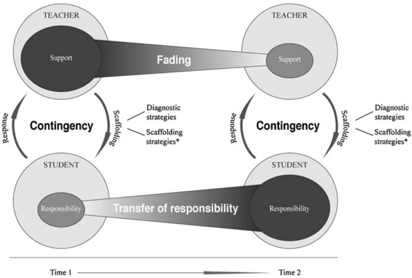

# Local source capture: van de Pol, Volman and Beishuizen (2010)

- Source: Janneke van de Pol, Monique Volman and Jos Beishuizen, *Scaffolding in Teacher–Student Interaction: A Decade of Research*, *Educational Psychology Review* 22, 271–296. Published online 29 April 2010.
- DOI: https://doi.org/10.1007/s10648-010-9127-6
- Public publisher PDF: https://link.springer.com/content/pdf/10.1007/s10648-010-9127-6.pdf
- Capture date: 2026-10-21.
- Rights: © The Author(s) 2010. PDF's Open Access notice states **Creative Commons Attribution Noncommercial License**. Exact license version not specified in extracted notice; do not infer one. Attribution retained. **Local-only retention; not publication-cleared** for any planned redistribution without checking full applicable terms.
- Method: static built-in HTML fetch omitted beginning, so downloaded complete publisher born-digital PDF with curl; existing local Docling Serve v1.30.0, OCR disabled, table structure enabled, images exported without image OCR, no remote enrichment. Async task `2f6d86f2-10e2-4d36-aaf8-a513ea968108`, slow curl polling, status `success`, errors `[]`. Original response in `conversion.json`; submission and final status retained alongside.
- Coverage: full available article text from title/abstract/introduction through method, results, discussion, appendices and references ending with Yelland and Masters. Beginning/middle/end and appendix tables checked. Figure 1 retained as `images/van-de-pol-2010-004.png` and visually checked; 23 small publisher decorations also exported. All image links local. No image OCR or added interpretation.
- Limits: reading order can put affiliations in body; complex appendix tables have flattened/repeated headings and imperfect alignment. Mathematical symbols, hyphenation, spacing and bibliography typography may be damaged. Consult original online PDF for exact layout/numerical details. Not a word-for-word proofread edition.
- Changes: automatic PDF-to-Markdown conversion plus this provenance header. Temporary PDF not retained. Independent [review notes](../../van-de-pol-2010-scaffolding-review-source-notes.md) remain separate.

---

## REVIEW ARTICLE

## Scaffolding in Teacher -Student Interaction: A Decade of Research

Janneke van de Pol &amp; Monique Volman &amp; Jos Beishuizen

Published online: 29 April 2010 #

The Author(s) 2010. This article is published with open access at Springerlink.com

Abstract Although scaffolding is an important and frequently studied concept, much discussion exists with regard to its conceptualizations, appearances, and effectiveness. Departing from the last decade ' s scaffolding literature, this review scrutinizes these three areas of scaffolding. First, contingency, fading, and transfer of responsibility are discerned in this review as the three key characteristics of scaffolding. Second, an overview is presented of the numerous descriptive studies that provided narratives on the appearances of scaffolding and classifications of scaffolding strategies. These strategies are synthesized into a framework for analysis, distinguishing between scaffolding means and intentions . Third, the small number of effectiveness studies available is discussed and the results suggest that scaffolding is effective. However, more research is needed. The main challenge in scaffolding research appears to be its measurement. Based on the encountered and described measurement problems, suggestions for future research are made.

Keywords Scaffolding . Teacher -student interaction . Review . Primary and secondary education

The concept of scaffolding has received a great deal of attention in educational research over the past few decades. An abundance of research on scaffolding in different contexts is thus the result. Scaffolding highlights one of the key aspects of children ' s learning, namely that it is often ' guided by others ' (Stone 1998a, p. 351).

Scaffolding is typically associated with the socio-cultural theory of Vygotsky. Wood et al . (1976) adopted the scaffolding metaphor to explain the role that adults can play in joint problem-solving activities with children. Borrowed from the field of construction, where a scaffold is a temporary structure erected to help with the building or modification of another structure, the use of scaffolding as a metaphor within the domain of learning refers to the

J. van de Pol ( * ) : M. Volman

Research Institute of Child Development and Education, University of Amsterdam,

Nieuwe Prinsengracht 130, 1018 VZ Amsterdam, The Netherlands

e-mail: j.e.vandepol@uva.nl

M. Volman e-mail: m.l.l.volman@uva.nl

J. Beishuizen

Centre for Educational Training, Assessment and Research, VU University Amsterdam,

De Boelelaan 1105, 1081 HV Amsterdam, The Netherlands temporary support provided for the completion of a task that learners otherwise might not be able to complete. This support can be provided in a variety of manners that for example includes modeling and the posing of questions for different subjects (e.g., science, social studies) at different ages.

Stone (1993) described a Vygotskian-inspired analysis of scaffolding. According to Vygotsky, learning first takes place on a social (intermental) level before it takes place on an individual (intramental) level. In Stone ' s view, the student is not a passive participant in teacher -student interaction but scaffolding is seen as a fluid, interpersonal process in which both participants are active participants. Both participants actively build common understanding or intersubjectivity through communicative exchanges in which the student learns from the perspective of the more knowledgeable other.

Because scaffolding is such a dynamic intervention finely tuned to the learner ' s ongoing progress, the support given by the teacher during scaffolding strongly depends upon the characteristics of the situation like the type of task (e.g., well-structured versus ill-structured) and the responses of the student. Therefore, scaffolding does never look the same in different situations and it is not a technique that can be applied in every situation in the same way.

Cazden (1979) related Vygotsky ' s Zone of Proximal Development (ZPD) early on to scaffolding and suggested that the metaphor be expanded from the domain of parent -child interactions to teacher -student interactions. The ZPD is characterized by Vygotsky (1978) as: ' the distance between the actual developmental level as determined by independent problem solving and the level of potential development as determined through problem solving under adult guidance or in collaboration with more capable peers ' (p. 86).

More recently, some authors have argued that the concept of scaffolding has been applied too broadly in educational and psychological research. Pea (2004) even claimed that ' the concept of scaffolding has become so broad in its meanings in the field of educational research and the learning sciences that it has become unclear in its significance. ' Puntambekar and Hübscher (2005) similarly contend that ' the scaffolding construct is increasingly being used synonymously with support. ' (p. 1). In the frequently cited work of Stone (1998a, b), the utility of the scaffolding metaphor is critically considered. Stone concludes that, in many studies, the metaphor has been removed from its original theoretical context and that this has led to the use of scaffolding as a teacherinitiated, directive instructional strategy that is actually in conflict with the more responsive socio-historical background for the metaphor. Nevertheless, Stone argues in favor of salvaging the scaffolding metaphor without losing sight of its theoretical background in which the student is seen as an active participant. To stay close to this idea of scaffolding, the focus of this review lies on scaffolding in face-to-face interactions (and in particular teacher -student interactions).

Stone (1998a) discussed several studies on scaffolding on teacher -child interactions in which scaffolding was found to be effective. However, these studies were largely observational (e.g., Cazden 1979; Langer and Applebee 1986; Englert 1992; Fleer 1992). Virtually no (quasi-) experimental studies were found, and different definitions of scaffolding were used across the several studies. An exception is the work of Palincsar and Brown (1984) and Palincsar (1986, 1991) in which scaffolding is systematically examined via both single-subject and comparative group designs and found to be effective in the context of Reciprocal Teaching. Although scaffolding has continued to be a frequently studied concept since 1998, no systematic review of the literature on scaffolding in teacher -student interaction has been performed since then. The goal of this review is therefore to provide an overview of research on scaffolding in the classroom of the last decade, particularly with regard to its conceptualization, appearances, and effectiveness.

After characterizing the concept of scaffolding and its appearances, a guiding framework will be presented that serves the purpose of analyzing scaffolding but is also an organizing device for the remainder of the review. Thereafter, the descriptive studies are described, since this constituted the majority of the encountered studies. Next, studies on the effectiveness of scaffolding are examined. Finally, the major problem related to scaffolding research -its measurement -is explored and suggestions are made for future scaffolding research.

## Method

The literature search for the present review was performed in October 2009. The following databases were searched: Social Sciences Citation Index (SSCI), Educational Resources Information Centre, and PsycINFO. Articles were included when they were (a) SSCI listed; (b) written in English; (c) published between 1998 and 2009; (d) provided a definition or description of scaffolding in the theoretical, methodological, or results sections of the article or refers to Wood et al . (1976); (e) concerned primary or secondary education; and (f) concerned ' human ' scaffolding in face-to-face contact. ' Scaffold* ' was the main search term, and all articles that were found to include this term in the title or in the abstract and met the aforementioned criteria were selected for inclusion in the review. That is, what the authors of the reviewed articles considered scaffolding was used for the conduct of the search and inclusion in the present review and not the characterizations presented later in this article. The articles were analyzed using the following categories: domain, measurement of scaffolding, the dependent variable (only for the effectiveness studies), the type of task, and the goals and means of scaffolding studied. Because scaffolding is so situation specific, the context of each empirical study (i.e., the descriptive and effectiveness studies that use empirical data) in this review will be made explicit by summarizing the aforementioned information in the appendices.

This search resulted in 66 articles of which 27 were theoretical, 26 descriptive, eight effectiveness studies, four editorial introductions of thematic issues, and one metaanalytical. The vast interest in scaffolding in educational research in the last decade is clearly indicated by the finding of four thematic issues on scaffolding: Journal of the Learning Disabilities , 31(4), 1998; Journal of the Learning Sciences , 13 (3), 2004; Instructional Science , 33(5/6) 2005; and New Ideas in Psychology , 23(3), 2005.

## Results

Profile of the research

The majority of the theoretical studies focuses on the conceptualization or the metaphor of scaffolding. Scaffolding appears to be most fully developed in the field of literacy (Clark and Graves 2005; Pardo 2004; Smith 2006). Clark and Graves (2005) provide an overview of several instructional frameworks on literacy (text comprehension) that includes the idea of scaffolding such as Reciprocal Teaching, the Scaffolded Reading Experience, and Direct Explanation of Comprehension Strategies. Clark and Graves (2005) and Pardo (2004) also implemented the useful Gradual Release of Responsibility Model (Pearson and Gallagher 1983) that involves three phases, namely: (1) teacher responsibility, (2) joint responsibility, and (3) student responsibility. Some authors describe the application of the concept of scaffolding to other areas such as moral development education (Turner and Berkowitz 2005) and the value aspects of motivation in education (Brophy 1999).

Most empirical studies are small-scaled, descriptive studies with or without an intervention. The majority of these studies focus again on literacy, followed by math and science. One-to-one interactions are studied the least, whole-class and small-group interactions to a greater but similar extent. A small amount of studies investigate the effectiveness of scaffolding.

## Characterizations of scaffolding

No consensus exists with respect to the definition of scaffolding, and some authors even criticize the metaphor of scaffolding as a whole (e.g., Aukerman 2007; Butler 1998; Donahue and Lopez-Reyna 1998; Scruggs and Mastropieri 1998). These authors contend that the metaphor implies a predefined building and a more student-centered perspective on learning was then pleaded for: Each student ' s ' building ' is different. Following Stone (1998a, b), scaffolding is viewed in this review as an interactive process that occurs between teacher and student who must both participate actively in the process.

Despite the many different definitions of scaffolding encountered, some clearly common characteristics can be distinguished as summarized below. These common characteristics are summarized in a conceptual model, depicted in Fig. 1. In general, scaffolding is construed as support given by a teacher to a student when performing a task that the student might otherwise not be able to accomplish.

The first common characteristic in the various definitions of scaffolding is contingency often referred to as responsiveness, tailored, adjusted, differentiated, titrated, or calibrated support. The teacher ' s support must be adapted to the current level of the student ' s performance and should either be at the same or a slightly higher level. A teacher acts contingently when he/she adapts the support in one way or another to a (group of) student(s). A tool for contingency is diagnostic strategies. To provide contingent support, that is, one must first determine the student ' s current level of competence. Only with such knowledge can the support to be provided be adapted to the student ' s level of learning (i.e., made contingent). Many authors have acknowledged the importance of diagnosis in relation to scaffolding and was referred to as: dynamic assessment (Lajoie 2005; Macrine and Sabbatino 2008; Pea 2004; Swanson and Lussier 2001), formative assessment (Shepard 2005), online diagnosis (Palincsar and Brown 1984), or monitoring and checking students ' understanding (Garza 2009).

Fig. 1 Conceptual model of scaffolding

The second common characteristic is fading or the gradual withdrawal of the scaffolding. The rate of fading depends upon the child ' s level of development and competence. A teacher is fading when the level and/or the amount of support is decreased over time.

Fading of the scaffolding is strongly related to the third common characteristic, namely the transfer of responsibility . Via contingent fading, that is, responsibility for the performance of a task is gradually transferred to the learner. Responsibility is interpreted in this review in a broad sense: it can refer to students ' cognitive or metacognitive activities or to students ' affect. The responsibility for learning is transferred when a student takes increasing learner control.

Thus, in contrast to some authors (e.g., Valsiner and van der Veer 1993) who criticize the scaffolding metaphor for focusing only on completing the task, we think of scaffolding as a teaching method that can focus on the development of the child in all its different facets. If a student, for example, works on a series of tasks and the teacher adapts the support responsively to the understanding of the student, the teacher is teaching contingently. If the student gains understanding, the teacher can fade the support over time. While fading the support, the teacher can also transfer the responsibility to the student so that the learner will take more and more control over his/her learning.

Many of the reviewed articles propose specific scaffolding means such as modeling or questioning. However, the use of such strategies does not automatically imply the occurrence of scaffolding, since an interaction in which one of the aforementioned strategies occurs can only be considered scaffolding when the interaction is also characterized by the three key characteristics of scaffolding, namely: contingency, fading, and transfer of responsibility. That is, for scaffolding to occur, the teacher must apply scaffolding strategies that are clearly contingent (i.e., based upon student responses). This support must be faded over time with, as a result, increased student responsibility for the task at hand, as is depicted in Fig. 1.

While Stone (1998a) has noted that little attention has been paid to the processes by which scaffolding works, quite some authors focused on this subject in the last decade. Certain authors have suggested, for example, that the learner ' s cognitive load is reduced with the aid of scaffolding and that this thus allows the learner to perform parts of a task that he or she would otherwise not be able to perform (e.g., Myhill and Warren 2005; Turner et al . 1998; Van Merriënboer et al . 2003). According to Goodwin (2001; cited in Myhill &amp; Warren, p. 68), teachers ' lend their mental capacities to learners in order to support and shape learning. '

Another scaffolding process, which is sometimes mentioned, is internalization of the support provided (e.g., Stone 1998a). The learner internalizes the support structure associated with the scaffolding and, in the end, teacher scaffolding is no longer needed as the learner can provide his or her own support. According to Stone (1998a), the learner does not literally internalize a support structure or scaffolding interchange but, rather, appropriates the essence of a support structure or scaffolding interchange. While van Geert and Steenbeek (2005) espoused an internalization viewpoint that they refer to as interiorization, they also called for a more detailed model of the relevant processes. Other authors emphasized the importance of a common understanding or so-called intersubjectivity (e.g., Biemiller and Meichenbaum 1998; Granott 2005; Mascolo 2005; Palincsar 1998; Puntambekar and Hübscher 2005; Rasmussen 2001; Vacca 2008) or shared meaning (Tabak and Baumgartner 2004).

Finally, Mertzman (2008), Oh (2005), Meskill (2005), and Reigosa and JimenezAleixandre (2007) included the successfulness of scaffolding in their definition of scaffolding, that is, scaffolding that does not work cannot -according to these authors -be termed scaffolding.

## Towards a framework for the analysis of scaffolding

While scaffolding strategies are only a part of the cyclic scaffolding process, as can be seen in Fig. 1, the focus of many articles is on these scaffolding strategies. Although there is a widespread interest in scaffolding strategies as opposed to -for instance -diagnostic strategies, and many valuable classifications have already been made in the last decade, no generally accepted framework for the analysis of these strategies is yet available. To get a grip on the appearances that scaffolding took in the last decades ' research and to seek to organize these appearances, it was decided to develop such a framework for analyzing scaffolding strategies that synthesizes the existing strategies and classifications (see Table 1).

Twoimportant scaffolding classifications were taken as the starting point for the framework, namely those of Tharp and Gallimore (1988) and Wood et al . (1976). Tharp and Gallimore speak of six means of ' assisting performance ' : modeling, contingency management, feeding back, instructing, questioning, and cognitive structuring. Wood et al . speak of six scaffolding functions: recruitment, reduction of degrees of freedom, direction maintenance, marking critical features, frustration control, and demonstration. In the last decade, some authors started to see the value of a further distinction in scaffolding strategies, namely the distinction between tools or means for scaffolding ( how is scaffolding taking place) and the goals or intentions ( what is scaffolded) of scaffolding (e.g., Many 2002; Silliman et al . 2000). This distinction into means and intentions enables us to look more precisely at interactions and results in more nuanced descriptions of teacher -student interactions.

Both the valuable classifications of Wood et al . (1976) and Tharp and Gallimore (1988), and the distinction between means and intentions are espoused to arrive at an integrative framework for analysis of scaffolding strategies that distinguishes five scaffolding intentions and six scaffolding means. This framework is useful both for organizing this review and for the future analysis of scaffolding strategies. For all empirical studies discussed in this review, the intentions (metacognitive, cognitive, or affect) and means (feeding back, hints, instructing, explaining, modeling, and questioning) that are studied are presented in the appendices.

Six scaffolding intentions are distinguished. Direction maintenance (A) refers to keeping the learning on target and maintaining the learner ' s pursuit of a particular objective. This intention is of a largely metacognitive nature. When the scaffolding intention is cognitive structuring (B), the teacher provides ' explanatory and belief structures that organize and justify ' (Tharp and Gallimore 1988, p. 63). Reduction of the degrees of freedom (C) entails taking over those parts of a task that the student is not yet able to perform and thereby simplification of the task for the student. Cognitive structuring and reduction of the degrees of freedom are mainly undertaken to aid the cognitive activities of learners. Finally, two scaffolding intentions concerned with learner affect can be distinguished: recruitment and contingency management/frustration control. Recruitment (D) refers to getting students interested in a task and helping them adhere to the requirements of the task. Contingency management/frustration control (E) concerns the facilitation of student performance via a system of rewards and punishments as well as keeping students motivated via the prevention or minimalization of frustration.

Six scaffolding means to support the learning activities of the student are further distinguished. Feeding back (1) involves the provision of information regarding the student ' s performance to the student him/herself. The giving of hints (2) entails the provision of clues or suggestions by the teacher to help the student go forward. The teacher deliberately does not supply the entire solution or detailed instructions under such circumstances. Instructing (3) involves the teacher telling the students what to do or explanation of how something must be done and why. Explaining (4) refers to the provision of more detailed information or clarification by the teacher. Modeling (5) (i.e., Wood et al . ' s (1976) demonstration category) is ' the process of offering behavior for imitation ' (Tharp and Gallimore 1988, p. 47). This can include the demonstration of particular skills. Finally, questioning (6) involves asking students questions that require an active linguistic and cognitive answer. Whether a teaching strategy qualifies as scaffolding generally depends upon its enactment in actual practice and more specifically upon whether the strategy is applied contingently and whether it is also part of a process of fading and transfer of responsibility.

Any combination of a scaffolding means with scaffolding intention can be construed as a scaffolding strategy. The number of scaffolding strategies mentioned in the reviewed articles is enormous and, in fact, too great to summarize fully here. However, some examples may be illustrative. Modeling is a frequently mentioned means of scaffolding (e.g., Hmelo-Silver et al . 2007; Hung 1999; Lee 2001; Silliman et al . 2000; Smith 2006; Yelland and Masters 2007). Brophy (1999) describes the use of modeling to scaffold several types of student activities. First, the modeling of strategies for the learning of key ideas is mentioned as a means to scaffold the metacognitive activities of students together with the intention of direction maintenance. Second, the modeling of key ideas is described as a means to scaffold the cognitive activities of students together with the intentions of cognitive structuring or reduction of the degrees of freedom. Finally, the modeling or presentation of the reasons for why something is worth learning is mentioned as a means to scaffold student affect together with the intentions of recruitment or frustration control. In other words, certain scaffolding means can be used to support different scaffolding intentions.

It should be noted that classification of the strategy utilized by the teacher under a particular set of circumstances largely depends upon the responses of the students as also depicted in the conceptual model of scaffolding presented in Fig. 1. A question, for instance, can only be considered a question when the student responds to it as such.

Both the presented conceptual model of scaffolding and framework for the analysis of scaffolding strategies (Fig. 1 and Table 1) can be used to study scaffolding in future research. In discussing respectively the descriptive and effectiveness studies, the three key characteristics of scaffolding (i.e., contingency, fading, and transfer of responsibility) and the different means and intentions (on a general level -metacognitive, cognitive, and affective) studied will be referred to.

## Outcomes of descriptive studies

The goal of most of the descriptive studies was to explore, describe, examine, analyze, and identify types of, or develop an understanding of scaffolding, mainly in the domain of literacy (e.g., Cole 2006; Lee 2001; McIntyre 2007; Meskill 2005). Though most studies focused on subject-matter learning, some studies focused on other matters such as engagement (Lutz et al . 2006) or identity formation (Tabak and Baumgartner 2004). In Appendix 1, more detailed

Table 1 Framework for Analysis of Scaffolding Strategies

| Scaffolding intentions                                                  |                                                                   |                                      |                                   |                                                       |
|-------------------------------------------------------------------------|-------------------------------------------------------------------|--------------------------------------|-----------------------------------|-------------------------------------------------------|
| Support of students ' metacognitive activities A. Direction maintenance | Support of students cognitive activities B. Cognitive structuring | ' C. Reduction of degrees of freedom | Support of student D. Recruitment | affect E. Contingency management/ frustration control |

## Means 1. Feeding back

2. Hints
3. Instructing
4. Explaining
5. Modeling
6. Questioning

information on the characteristics of the empirical descriptive studies discussed in this section (domain, measurement of scaffolding, the type of task, and the intentions and means studied as derived from Table 1) can be found. Most studies used a Grounded Theory approach (Glaser and Strauss 1967) to analyze the data and resulted in numerous rich descriptions of scaffolding in the classroom (e.g., Garza 2009; Rueda et al . 2004). Sometimes, scaffolding was described within a broader framework such as Reciprocal Teaching (Hacker and Tenent 2002).

Besides rich descriptions of scaffolding in the classroom, lists of scaffolding strategies or techniques that were used by ' ordinary ' teachers (e.g., Mertzman 2008), or ' effective ' or ' high scope ' teachers (Pressley et al . 2001; Wharton-McDonald et al . 1998), were another common result of the descriptive studies. Mertzman (2008), for example, examined the ways in which four elementary school teachers scaffolded the literacy of their pupils (5 -8 years old) and reported the following scaffolding techniques: modeling, scolds, praise, repetition, explanations of the answer, convergent questions, focus on meaning, and focus on word recognition and phonics. As mentioned in the previous section, some other authors discerned explicitly or implicitly between the focus of scaffolding; what is scaffolded and the means or tools for scaffolding; how scaffolding is performed (e.g., Maloch 2002; Many 2002; Postholm 2006; Rodgers 2004; Silliman et al . 2000; Wu and Krajcik 2006; Yelland and Masters 2007). Many (2002), for example, described what was scaffolded by two literacy teachers in third, fourth, and fifth grade (conceptual understanding and strategy use) and how it was scaffolded (e.g., modeling, supplying information, clarifying, assisting, questioning, prompting).

Scaffolding researchers in the last decade mainly sought to observe and describe the classroom practices of teachers in order to get a grip on the process and appearances of scaffolding. This frequent use of such a bottom-up approach, which is most common in the scaffolding research of the last decade, indicates that this descriptive stage is the current stage of scaffolding research. Because of the many useful descriptions and classifications, we now have come to a point that we can study scaffolding in a more top-down manner by using the existing scaffolding literature.

An example of one of the few studies that has used a predefined coding scheme to analyze scaffolding is the study of Meyer and Turner (2002). They discerned between scaffolding and non-scaffolding and within scaffolding between supportive/non-supportive. Although the teachers taught the same lessons, very dissimilar patterns in the teaching of the nine elementary school math teachers were found ranging from many supportive and few non-supportive patterns to almost as many supportive as non-supportive patterns. The fact that not so many authors have used a predefined coding scheme seems to indicate that researchers were mainly searching to observe and describe the classroom practices in order to get a grip on the process and appearance of scaffolding.

Although scaffolding was in many studies equated with (almost) any support given by the teacher, the key characteristics of scaffolding are starting to get more emphasis in the scaffolding research. The first key characteristic, i.e., contingency , was operationalized by for example Maloch (2008), Myhill and Warren (2005), Nathan and Kim (2009), Oh (2005), and Rodgers (2004). They focused on the adaptation of the teacher ' s support to (a group of) student(s). Oh, for example, used the relatively strict definition of scaffolding adopted from Maybin et al . (1992) to focus on contingency. This definition clearly dictated which interactions were qualified as scaffolding and which were not: There had to be evidence that the mentor ' s support was tuned in to the learner ' s present state of understanding, that the learner accomplished the task with the mentor ' s situated help, and that the learner performed the task independently. Nathan and Kim (2009) found that the teacher did not adapt the cognitive complexity level of his elicitations to the nature of the students ' answers (correct/incorrect/partially correct). In Oh and Myhill and Warren, scaffolding was found to be scarce. Myhill and Warren point at the fact that teaching in a contingent manner is so difficult because a teacher has to attend to 30 pupils at the same time.

The second key characteristic of scaffolding, i.e., fading, was operationalized by for example Maloch (2002). She examined the role of the teacher in literature discussions and found that gradual handover of responsibility was one of the features of scaffolding. This refers both to fading and to transfer of responsibility.

The third key characteristic of scaffolding, transfer of responsibility, was operationalized, for example, by Reigosa and Jimenez-Aleixandre (2007). They focused on transfer of responsibility in science small-group work (10th grade). The level of autonomous competence dictated whether scaffolding took place or not; the students had to be able to progress independently after they were supported by the teacher. This hardly occurred, due to excessive task difficulty, a school culture that was not related to scaffolding and small-group communication difficulties. Some studies gave a more descriptive account of this aspect of scaffolding, such as Aukerman (2007).

The variety of descriptive studies offers rich narratives of scaffolding in the classroom. It shows the appearances that scaffolding can take in many different contexts and informs us on the many strategies that can be used. Contingency of support was operationalized relatively often compared to fading and transfer of responsibility. Some studies found indications of the effectiveness of scaffolding in specific contexts but to learn more about the effectiveness of scaffolding, (quasi-) experimental studies and correlational studies are considered in the next section.

## Effectiveness of scaffolding

Scaffolding is often presented as an effective instructional method (e.g., Cole 2006; Hogan and Pressley 1997; Pawan 2008). In this section, those studies that took up the challenge of studying the effectiveness of scaffolding, will be discussed. In Appendix 2, information on several characteristics of the studies (domain, measurement of scaffolding, the dependent variable, type of task, and the intentions and means studied as derived from Table 1) can be found. Following Shavelson and Towne (2002), experimental (random assignment to conditions, all but the independent variables are kept equal between conditions), quasiexperimental (when no random assignment is possible, all but the independent variables are kept equal between conditions), and certain correlational studies (regressions) are included here in this discussion on effectiveness because these allow for causal conclusions. Although other types of studies such as descriptive studies can inform us very well on the processes of scaffolding, they do not allow for causal conclusions. To evaluate the effectiveness of scaffolding, the focus should obviously be upon student outcomes. Nonetheless, just how the effectiveness of scaffolding is evaluated also depends upon -among other things -the objectives set by the authors. These objectives mainly relate to the metacognitive or cognitive activities of students or their affect, as also distinguished in Table 1. In discussing the studies, the scaffolding strategies (Table 1) and the key characteristics of scaffolding, i.e., contingency, fading, and transfer of responsibility (Fig. 1), will be referred to if examined.

Effectiveness with respect to metacognitive activities of students Mercer et al . (2004) showed the effectiveness of the ' Thinking Together ' program in which teachers promote ' Exploratory Talk ' in teacher-led and group-based interactions in science class. In this program, the students learned strategies for reasoning together in small groups such as that all relevant information should be shared and everyone should make his/her opinion clear. The teachers scaffolded the students by asking constructive questions and modeling problem-solving skills during 12 lessons. Each lesson contained a specific talk skill and targeted a specific concept in science such as the topics light and sound. The students in the experimental condition ( N =109), in which the teachers were trained to use this program, were better able to use talk for reasoning as measured with coding the transcripts of group work than student in the control condition ( N =121) in which teachers received no such training. Furthermore, the students in the experimental condition made greater gains both on group and individual measurements (non-verbal reasoning measured with the Raven Progressive Matrices) than students in the control condition.

Azevedo et al . (2005) found that the learning activities of seventh and 10th grade students who received adaptive human scaffolding ( N =38), which consisted of support of the selfregulated learning of the student, were associated significantly more with shifts in their mental models than students who received fixed (10 domain-specific written questions) scaffolding ( N =34) or no (only a learning goal and instructions) scaffolding ( N =37) while working individually in a hypermedia learning environment on the circulatory system. Especially the students in the adaptive scaffolding condition (in which students had access to a human tutor who provided support) showed self-regulating behaviors, as concluded from coded thinkingaloud data. Students who received adaptive scaffolding or fixed scaffolding had significantly more gains in their knowledge on the human circulatory system (measured with a matching of definitions to descriptions task, labeling of parts of the circulatory system task, and an essay task) than students who received no scaffolding.

The cognitive apprenticeship model was used in Lajoie et al . (2001) when they exploratively compared the effects of scaffolding by a teacher (directive style), a researcher (coaching style), and no guidance on students ' performances while working in an online hospital simulation called ' BioWorld ' . Grade 9 students worked in pairs on several cases in which they had to collect evidence to confirm or reject their hypotheses about patients ' problems related to the digestive system. In each condition, two pairs of students were included (total N is thus 9). The teacher and researcher predominantly scaffolded students ' metacognitive activities such as search strategies by modeling what to look for in the assignments. No differences in the performance measurements (such as frequency of symptoms collected, evidence collected, diagnostic accuracy, and final arguments) between the groups were found, possibly due to the small sample size. However, the authors argue that differences in the way students acquire their knowledge are possible and should be explored in the future.

Effectiveness with respect to cognitive activities of students In a meta-analysis of 30 studies, Swanson and Lussier (2001) evaluated the effectiveness of three types of dynamic assessment which strongly relates to contingency: scaffolding (testing the limits; scaffolding via prompting and verbal mediation steps), coaching (training and intervening), and strategy training (modeling and general feedback) for all ages and many different tasks (categorized as visual -spatial or verbal tasks). The effect sizes were found to be higher for studies on strategy training, followed by those on scaffolding, followed by those on coaching. The results of this meta-analysis thus showed that scaffolding was not the most effective method of dynamic assessment but also not the least effective method. Although inherent to a meta-analysis, only limited descriptions of the different methods were provided. This hampers the insight into the operationalizations of scaffolding.

Four effectiveness studies investigated, the effect of teacher scaffolding on the cognitive activities of students. Both Murphy and Messer (2000) and Pratt and Savoy-Levine (1998) studied the effectiveness of scaffolding using the methodology of Wood et al . (1978). In this methodology, the degree of control is contingently adapted to the level of the learner in a oneto-one tutoring situation and in keeping with the contingent-shift principle: The tutor increases support to the extent that the learner fails and decreases support to the extent that the child succeeds. Therefore, the key characteristics of contingency and fading are included in these studies.

Murphy and Messer (2000) studied the effects of scaffolding on the performance of students aged 5 to 7 years on a balance scale test using a pre -posttest design. The children either received scaffolding in a one-to-one situation ( N =41), worked in small groups without scaffolding ( N =40), or worked alone without scaffolding ( N =41). All children first had to balance several beams on the fulcrum, and as a posttest, the children had to balance several familiar objects (such as a pen) on the fulcrum to measure the gains and the degree of transfer. The scaffolding means consisted of, among other things, the provision of explanations, instruction, modeling, hints, and questions contingent upon the level of the individual children. Overall, more children in the scaffolding condition advanced in level of representation than children working either collaboratively or alone. However, only the difference between the scaffolding condition and the small-group condition was significant. The requirement that the scaffolding supports the child with the performance of a task that he or she would otherwise not be able to perform was operationalized explicitly in this study, which meant that the tutor let the child work alone on the task for a while in order to see whether the child could perform the task alone or not. If not, the observations were used to determine the level of the child and the level of contingent support to be provided.

Pratt and Savoy-Levine (1998) compared the pretest and posttest math performances on four long-division problems of fourth and fifth grade students directly, 1 week later, and 1 month after receiving in a one-to-one setting either fully contingent support ( N =8), moderate support ( N =8), high support ( N =8), partly contingent support ( N =8), or no support ( N =8). Nine levels of support were identified and the conditions differed with regard to the levels that could be used. In the fully contingent support condition, for example, all levels of support could be used as long as it was responsive to the student, whereas in the moderate support condition, only certain levels of support could be used. In the no-support condition, students did not receive any sessions between pre- and posttest. The students in the experimental conditions participated in a tutoring session in which several longdivision problems were solved. Students receiving contingent support (mainly modeling and hints) were able to solve significantly more long-division problems than all of the students in the other conditions both at direct and follow-up measurement. This was one of the few studies in which the implementation of the intervention was checked. In this case, this meant that the audio-taped sessions were coded with regard to actual support provided.

The so-called cognitive apprenticeship model of Collins et al . (1989) includes scaffolding as an important component. Chiu et al . (2002) investigated the effectiveness of a cognitive apprenticeship (CA) learning context for the promotion of conceptual change with regard to the notion of chemical equilibrium. The mental models used by 10th grade high school students at pretest and posttest were coded. All students performed a series of hands-on experiments while tutored in a one-to-one setting. The students in the experimental condition were tutored by the researcher according to CA principles (such as scaffolding, coaching, modeling, etc.) and the students in the non-CA condition learned from a tutor (their teacher) without CA support. The students in the experimental condition ( N =20) were better capable of constructing the mental models of chemical equilibrium than the students in the control condition ( N =10). The effectiveness of the CA approach cannot be entirely attributed to the use of scaffolding as scaffolding was only one aspect of the CA.

The last of the four effectiveness studies on students ' cognitive activities used a withinsubjects design to compare the use of different teaching styles by the same teacher over time. Chi et al . (2001) examined the tutoring provided by inexperienced tutors ( N =11) for eighth grade students in a one-to-one learning situation concerned with the human circulatory system. Thereafter, the tutors were instructed to adopt a more interactive or contingent tutoring style, which involved more questioning and provision of hints for the same students with avoidance of more non-interactive means of scaffolding as explaining and feeding back ( N =11). A greater number of scaffolding episodes were subsequently observed in a check of intervention fidelity. The students in both situations learned just as effectively, but the students in the interactive tutoring sessions were more constructive. The interactive tutoring elicited more information of the students ' understanding, which allowed the tutors to diagnose the student level of ability more accurately. The students in the interactive tutoring sessions also took greater responsibility for their learning as reflected by the greater frequency of reading aloud observed for this group and significantly higher performance on transfer questions (i.e., questions regarding issues not mentioned anywhere in the tutoring session).

Effectiveness with respect to student affect Among others, Rosiek (2003) has noted that research on the scaffolding of student emotions or affect is scarce. Two studies on the effectiveness of scaffolding that met our criteria were encountered: one correlational study and one quasi-experimental study. In a correlational study, Turner et al . (1998) investigated the whole-class scaffolding of the involvement of fifth and sixth grade students ( N =42) by seven teachers. A total of 34 mathematics lessons were observed. Students ' involvement in mathematics was measured with a self-report scale. The teacher utterances were coded and a discourse coding category that reflected the use of whole-class scaffolding strategies to promote student motivation and emotion (i.e., affect) was specifically included in this study. So-called intrinsic support means (i.e., scaffolding intended to support learning goals, evoke student interest/curiosity and/or mediate frustration using questioning and feeding back) and the transfer of responsibility were found to be more often present in the high studentinvolvement classes than in the low student-involvement classes. A clear relation between the use of particular scaffolding strategies and the degree of student involvement was thus found.

Only one quasi-experimental study measuring the effect of scaffolding on student affect was encountered. Pratt and Savoy-Levine (1998) measured not only learning outcomes, as described above, but also the enjoyment of the students under the conditions of contingent support, moderate support, high support, partly contingent support, and no support. Enjoyment was measured with a student questionnaire (six items) utilizing a five-point rating scale.

Nothing is known though about the validity and reliability of this scale. No differences were found in the degree of enjoyment experienced by the students in the different experimental conditions. However, the students in the control condition with no support scored significantly lower on the affect/enjoyment questionnaire than the students in the other conditions.

In sum Despite the complexity of performing an effectiveness study on scaffolding, some authors took up this challenge and provided useful findings. The results of studies on students ' metacognitive and cognitive activities indicate that scaffolding is effective. The results of studies on students ' affect diverge a bit. With this somewhat limited body of effectiveness research on mainly one-to-one tutoring situations with mostly simple and straightforward tasks, future research might start to focus on more naturalistic classroom situations with all sorts of tasks.

One might wonder why this type of research is relatively scarce. Performing effectiveness studies in educational science is a complicated, time- and money-consuming endeavor. In addition, studying scaffolding in a rigorous and systematic way appears to be especially complex probably because of the complexity of a dynamic concept such as scaffolding. This also applies to the descriptive studies. Therefore, issues related to the complexity of measuring scaffolding will be explored in the next section.

## The measurement of scaffolding

Scaffolding is difficult to measure due to its dynamic nature and complexity (Davis and Miyake 2004; Granott 2005; Renninger and Granott 2005; Renninger et al . 2005). That is, scaffolding entails the dynamic interaction between people functioning over time. This problem is also relevant in the dynamic assessment literature. Scaffolding is often mentioned in this strand of research as an instruction form that can be used in the intervention phase of dynamic assessment (e.g., Grigorenko 2009). In 1998 already, Wong suggested that -due to the complex setting in which scaffolding occurs -the measurement of scaffolding may require more than a unidimensional coding scheme (Wong 1998). More recently, Valsiner (2005) has gone so far as to argue that rating scales are inappropriate to measure scaffolding because they relate to static states while scaffolding is a dynamic process. Presumably due to the complexity of measuring scaffolding, most of the studies in our review were small-scaled; many were case studies or exploratory studies. In the present section, several difficulties with the measurement of scaffolding will be considered -difficulties that appear, in our opinion, to hamper research on scaffolding.

Scaffolding as an intervention In all of the quasi-experimental studies discussed in the section on the effectiveness of scaffolding strategies above, scaffolding was an independent variable. In the studies by Murphy and Messer (2000), Pratt and Savoy-Levine (1998), Chiu et al . (2002), and Chi et al . (2001), the teachers or tutors were all instructed to apply certain scaffolding techniques or ideas. To be sure that an intervention has been adequately implemented and the effects of the intervention -or, in this case, scaffolding -are investigated, the behavior of the teacher or tutor should be measured. That is, a manipulation check should be performed to determine the fidelity of intervention implementation. The studies of Pratt and Savoy-Levine and Chi et al . reported such measurement. Pratt and Savoy-Levine coded the audio-taped sessions of the different conditions to check whether the tutor applied the contingent-shift principle, whereas Chi et al . checked the scaffolding behavior of the tutor with an elaborate coding system.

The unit of analysis In reviewing the methods of measuring scaffolding, many different units of analysis were encountered. Almost all of the studies had a focus on dialogue although some authors emphasized that non-verbal behavior and gestures should also be taken into account (Miller 2005). Some studies focused on teacher utterances or, alternatively, teacher interruptions (Mertzman 2008). Other studies focused more on the ongoing interaction and thus entailed the coding of teacher utterances in relation to student utterances (e.g., Lee 2001; Rodgers 2004; Pratt and Savoy-Levine 1998; Wu and Krajcik 2006). Lutz et al . (2006) undertook detailed analyses by coding both teacher and student utterances and behavior at 30-s intervals. In many of the studies examined within the context of this review and the more qualitative studies in particular, the unit of analysis was not clearly stipulated. Qualitative descriptions of the characteristics of the scaffolding used in the study were frequently presented (e.g., Hacker and Tenent 2002; McIntyre 2007).

The unit of analysis used in a study may influence the study outcomes. The unit of analysis can certainly differ depending on the characteristics of scaffolding being considered and thus for contingency versus fading versus transfer of responsibility. This distinction will require analysis on different grain sizes. As already mentioned, predefined coding schemes were used only to a certain extent because of the current stance of the research field. The elaborate coding scheme used by Chi et al . (2001), which contains several units of analysis and different grain sizes, serves as a good example for the analysis of scaffolding. To start with, both teacher and student statements were coded in order to characterize the interactive versus non-interactive nature of the dialogue between the two. Second, the teacher -student interactions were coded at the level of the conversational turn in order to establish the function of a statement in the interaction. Finally, the episodes or scaffolding dialogues were analyzed as a whole because coding at the level of the statement or the interaction might, in fact, miss the essence of the scaffolding.

Measuring all key characteristics of scaffolding, i.e., contingency, fading, and transfer of responsibility, requires an analysis that makes a systematic distinction between these features. Such an analysis requires different unit of analysis of different grain sizes.

Operationalization of scaffolding Because there is no consensus with regard to the conceptualization of scaffolding, the results of the different studies are difficult to compare. How the concept is operationalized depends obviously on the characterization that is used. Due to the many different characterizations of scaffolding, many different operationalizations were found and will be explored into greater detail here. The focus will lie on the extent to which the three key characteristics of scaffolding -namely contingency, fading, and transfer of responsibility -are included in these operationalizations. The emphasis in the empirical articles to be considered in this section was either on the behavior and performance of students, the scaffolding provided by the teacher, or sometimes both.

Some studies focused on the behavior of the teacher. In some cases, teacher behavior was coded using a predefined coding scheme or a coding scheme specifically developed for this purpose during data analysis (e.g., Maloch 2002, 2008; Rueda et al . 2004). The behaviors of the teachers were categorized as reflecting many different scaffolding strategies. The six scaffolding means of Tharp and Gallimore (1988) are, for example, distinguished in the study of Postholm (2006). However, no information is provided on the three key characteristics of scaffolding. Additional or alternative analyses in which these key characteristics are considered could be the next step in future scaffolding research. In a considerable number of the definitions of scaffolding presented in the articles, one or more of the key characteristics of scaffolding are mentioned but many of these same studies do not go on to include the key characteristics in the actual measurement of scaffolding, probably because all three key characteristics are so complex to measure.

In the dynamic assessment literature, attention has been paid to instruments that focus on the key characteristic of contingency. Feuerstein and Feuerstein (1991), for example, described the mediated learning experience (MLE) to discern the powerful factors in interaction that influence the higher mental functioning in the child. A rating scale with these factors was developed and proved to be a reliable measurement tool to assess the mediational repertory of the assessor. Like in scaffolding, one of the essential factors in MLE is ' contingent responsivity ' and this is described as

The ability to read the child ' s cues and signals related to learning, affective, and motivational needs, and then to respond in a timely and appropriate way. [The possible codes are:] (0) not in evidence, (1) infrequent, inconsistent (ill timed or not appropriate), (2) present but occasionally missing the mark either in timing or appropriateness, or (3) consistently well timed and appropriate to the child ' s cues and signals. (Lidz 1991, p. 109)

Such a rating scale of contingent responsivity could be helpful in standardizing the measurement of contingency, one of the vital components of scaffolding.

Most studies considered both teacher and student behaviors. In the effectiveness studies in which scaffolding was measured, the operationalizations were found to be quite consistent with the definitions used. For example, Chi et al . (2001) coded both the tutor and student utterances and interaction turns that occurred during one-to-one tutoring sessions on biology. They focused on the contingency and transfer of responsibility in not only their theoretical framework but also their analyses. They also distinguished interactive versus non-interactive tutor comments and elicited versus self-initiated and constructive versus non-constructive student responses.

Less consistency between the definitions presented and the operationalizations adopted characterized the more descriptive studies. In the descriptive studies where the definition and operationalization of scaffolding were consistent, characteristics of the definition were adopted as criteria to determine what qualifies as scaffolding in the data analyses (see Oh 2005, for example). The relatively strict definition of scaffolding adopted from Maybin et al . (1992) for use in the Oh study clearly dictated which interactions qualified as scaffolding and which did not: There had to be evidence that the mentor ' s support was contingent, that the learner accomplished the task with the mentor ' s situated help, and that the learner performed the task independently.

Information sources Almost all of the studies included in this review used transcriptions of video or audio observations to analyze scaffolding; only field notes were used in the only exception, namely the study of Many (2002). Some authors also analyzed video recordings of teacher reactions to their videotaped lessons (e.g., Cole 2006; Rodgers 2004). Interviews with teachers to assess their attitudes and beliefs with regard to scaffolding were also frequently undertaken. Given that scaffolding involves interaction with learners, video observation appears to be vital for its analysis.

## Conclusions and Discussion

Avast amount of rich descriptions and classifications of scaffolding strategies in different subject areas has become available in the last decade. Although no consensus exists with regard to the definition of scaffolding, contingency, fading, and transfer of responsibility are distinguished in this review as the key characteristics of scaffolding. These key characteristics deserve focus in future scaffolding analyses. An additional framework for the more precise analysis of scaffolding strategies, which can be useful for the measurement of scaffolding, is synthesized from the existing research body. A distinction between scaffolding means and intentions is made. The scaffolding of students ' cognitive and metacognitive activities is studied to the greatest extent compared to the scaffolding of students ' affect. The means of modeling and questioning are studied the most, mainly with a focus on students ' cognitive activities.

Although most researchers focused on describing and characterizing scaffolding, some effectiveness studies were performed in the last decade. The results of studies that were found on students ' metacognitive and cognitive activities and their affect point largely in the same direction, i.e., that scaffolding is effective.

The main challenge for scaffolding research appears to be its measurement. Several difficulties with regard to the measurement of scaffolding were encountered. The main impediments were no generally accepted measurement instrument and no instrument in which the three key characteristics of scaffolding are considered together. Therefore, some suggestions for the measurement of scaffolding in further research are made here.

First, scaffolding was often not measured in scaffolding research using a clearly reliable and valid measurement instrument. Thus, a need for such an instrument that can facilitate the analysis of scaffolding as a dependent variable and the check on the intervention of scaffolding as an independent variable is apparent. Many very useful (mostly descriptive) studies, which have laid the foundation of such a measurement instrument, are encountered in the search of this review. This foundation is used in this review to arrive at a framework for the analysis of scaffolding strategies.

Second, to determine the effectiveness of scaffolding in future research, student measures are needed as these measures provide a clear indication of whether the scaffolding was effective to start with or not. Third, it is suggested that both teacher and student behavior and their discourse contributions are considered in future research as scaffolding entails interaction. The coding of only teacher actions or strategies is not sufficient. In this review, a conceptual model of scaffolding including the three key characteristics of scaffolding, i.e., contingency, fading, and transfer of responsibility, and a scaffolding framework for the analysis of scaffolding strategies was presented and may prove useful in analyzing scaffolding interactions. Although the focus of the framework is on teacher actions, it was noted that these cannot be accurately coded without consideration of student responses. And in this light, the distinction between scaffolding intentions and means, which is made in the scaffolding framework in relation to student activities, may be useful for studying the process of scaffolding in the future. Only the exact nature of the implementation of a scaffolding intention into actual practice (i.e., means of scaffolding employed) and the responses of students determine whether an interaction can be categorized as scaffolding or not.

A fourth methodological point for consideration in future research is the merit of video observation for the analysis of scaffolding interactions. Fifth, because the appearance of scaffolding depends so heavily on the context, it is of great importance in future scaffolding research that the context be specified into great detail.

Finally, the key characteristics of contingency, fading, and transfer of responsibility need to be addressed in both the definition and analysis of scaffolding. This may involve the conduct of different analyses using different-sized units, but the definition and operationalization of the key characteristics of scaffolding should be clear and consistent.

Although the rich body of research on scaffolding of the last decade provided us with useful knowledge on the appearances of scaffolding, much remains unknown about the effectiveness and processes of scaffolding. Solid research and solid measurement instruments are needed for this purpose. Accurate measurement of the different characteristics of scaffolding will continue to be difficult. Whether an interaction should be characterized as contingent or non-contingent, for example, can be quite ambiguous under certain conditions. Is support only contingent when the student can actually complete the task at hand or is it also contingent when only a little progress has been made (i.e., the student is able to proceed to at least the next step in the conduct of a task)? Is support only contingent when the teacher actually intends it to be contingent? On a different front, several observations must be conducted over time to establish that fading has indeed taken place. Ideally, the observations should involve the same tasks and/or subject matter as one can imagine that the introduction of new material will lead to the scaffolding process being initiated all over again. Virtually the same holds for the transfer of responsibility.

In sum, the measurement and analysis of scaffolding still appears to be in its infancy. Such an endeavor is a time-consuming and elaborate enterprise. The conceptual model of scaffolding and framework for analysis of scaffolding strategies presented here, however, can provide a concrete starting point for the development of an agreed-upon measurement instrument.

We would like to note here that the three key characteristics of scaffolding are closely entwined. Fading, for example, may be seen as an inherent part of contingency. In the study of Pratt and Savoy-Levine (1998), for instance, the focus was on contingency in both their definition and operationalization of the notion of scaffolding. Yet, if the tutor complied with the contingent-shift principle, the support will be faded automatically because, following the contingent-shift principle, he or she decreased the level of support as the student succeeded. And in the end, when the student continues to succeed, no support is required or provided whatsoever. Contingent teaching thus appears to lead to fading that can lead , in turn, to transfer of responsibility. The three key characteristics of scaffolding are thus closely connected.

The present review has supplied several recommendations for future research. First, a challenge lies in documenting the effectiveness of the use of specific scaffolding strategies under particular circumstances empirically: Which strategies appear to work with which children in which grades and for which subject areas? And although several authors have considered the possible processes underlying scaffolding within the context of their theoretical frameworks, much more empirical research is needed on the processes of internalization and appropriation.

Second, to be able to study (the effectiveness of) scaffolding, which is generally found to be scarce, teachers could be encouraged to improve their scaffolding skills using the framework presented in this review. The scaffolding strategies reviewed here can supply the practical tools for such training. The effectiveness of such training can then be evaluated focusing upon whether trained teachers subsequently display more scaffolding in actual practice than untrained teachers can be determined, and whether or not the scaffolding behavior of teachers who have been trained truly supports the cognitive activities, metacognitive activities, and/or affect of students can be determined.

This review synthesizes the definitions and classifications of scaffolding into a conceptual model of scaffolding and a framework for the analysis of scaffolding strategies, and it scrutinizes the claim that scaffolding is effective and its methodological challenges. Scaffolding is an important and frequently studied concept, but much remains unclear with regard to the effectiveness and use of scaffolding in education. The overview of the scaffolding research and its difficulties of the last decade, which is provided in this review, will hopefully stimulate and advance scaffolding research in the future.

Acknowledgments We would like to thank the anonymous reviewers of Educational Psychology Review for their useful comments for improving this paper.

Open Access This article is distributed under the terms of the Creative Commons Attribution Noncommercial License which permits any noncommercial use, distribution, and reproduction in any medium, provided the original author(s) and source are credited.

Appendix 1

Appendix 1

Table 2 Overview and Characteristics of the Descriptive Studies

| intentions and means       | ' metacognitive activities ' cognitive activities affect   | No explicit list                         | No explicit list                                                                                                                | 3. Instructing 5. Modeling         | 5. Modeling               | 5. Modeling                                    | 5. Modeling           | 1. Feeding back 3. Instructing                                                    | 5. Modeling                                                                   |
|----------------------------|------------------------------------------------------------|------------------------------------------|---------------------------------------------------------------------------------------------------------------------------------|------------------------------------|---------------------------|------------------------------------------------|-----------------------|-----------------------------------------------------------------------------------|-------------------------------------------------------------------------------|
| Scaffolding                | A=students B/C=students D/E=students '                     | Not explicated                           | D/E                                                                                                                             | A A                                |                           | A                                              | A B/C                 | D/E                                                                               | A                                                                             |
| Type of task               | Literature                                                 | discussions Oral text reading            | Both formal and informal activities during and after class                                                                      | Text comprehension in RT groups    | Discussion                | Reading comprehension and reading strategy use | Literature discussion | Literacy events (mostly reading aloud, self-selected reading, and guided reading) | Conceptual understanding and strategy use for text meaning making and writing |
| Measurement of scaffolding | Observational/descriptive                                  | Observational/descriptive with deductive | some gestures coded, Interviews teachers, field notes teacher - student interactions, student questionnaire on teacher behavior | Teaching Observational/descriptive | Observational/descriptive | Coding scheme, inductive                       | Descriptive           | Coding scheme deductive                                                           | Thick descriptions, deductive                                                 |
| Domain                     |                                                            | Literacy Literacy                        | Culturally responsive caring, no specific domain                                                                                | Reciprocal (RT) in literacy        | Literacy                  | Literacy                                       | Literacy              | Literacy                                                                          | Literacy                                                                      |
| Authors                    | Aukerman 2007                                              | Cole 2006                                | Garza 2009                                                                                                                      | Hacker and Tenent 2002             | Lee 2001                  | Lutz et al . 2006                              | Maloch 2002           | Maloch 2008                                                                       | Many 2002                                                                     |

(continued)

Table 2

Scaffolding intentions and means

Type of task

Measurement of scaffolding

Domain

Authors a story

| 5. Modeling              | 5. Modeling 6. Questioning                                       | 4. Explaining                     | 5. Modeling   | 6. Questioning 5. Modeling 5. Modeling      | 3. Instructing 4. Explaining 5. Modeling                                                                | 6. Questioning No explicit list         |                                                                                                                      | 1. Feeding back                                  | 3. Instructing                  | 6. Questioning 3. Instructing   | 5. Modeling   | 6. Questioning 5. Modeling 5. Modeling           | 3. Instructing            |
|--------------------------|------------------------------------------------------------------|-----------------------------------|---------------|---------------------------------------------|---------------------------------------------------------------------------------------------------------|-----------------------------------------|----------------------------------------------------------------------------------------------------------------------|--------------------------------------------------|---------------------------------|---------------------------------|---------------|--------------------------------------------------|---------------------------|
| B/C                      | A Not explicated                                                 | B/C                               |               | A B/C                                       | B/C                                                                                                     | B/C                                     | Not explicated                                                                                                       | A                                                |                                 | B/C                             |               | B/C D/E                                          | A                         |
| Story discussion         | Word recognition and text meaning All sorts of language tasks on | Understanding and self-regulation |               | All sorts of tasks in whole- class teaching | Beginning algebra to promote representational fluency, algebraic modeling, and problem solving          | Presentations of science investigations | Broad range of activities, all Computer supported collaborative learning (CSCL), learning how to ICT in project work | Reading and writing skills (mainly               | reading and writing strategies) |                                 |               | Problem solving and assumption of responsibility | Reading texts and writing |
| Coding scheme, inductive | Coding scheme, deductive Coding scheme, inductive                | Coding scheme, inductive          |               | Observational, descriptive                  | Relation between coded cognitive complexity of teacher elicitation and accuracy of student ' s response | Categorization, deductive               | Observational, descriptive                                                                                           | List of effective teacher behaviors, under which | scaffolding                     |                                 |               | Observational, descriptive                       | Coding scheme, deductive  |
| Literacy                 | Literacy Literacy                                                | Turner Mathematics                |               | Literacy and numeracy                       | Mathematics                                                                                             | Science                                 | 2006 ICT projects in different domains                                                                               | 2001 Literacy                                    |                                 |                                 |               | Physics and chemistry                            | Literacy                  |
| McIntyre 2007            | Mertzman 2008 Meskill 2005                                       | Meyer and 2002                    | and Warren    | Myhill 2005                                 | Nathan and Kim 2009                                                                                     | Oh 2005                                 | Postholm                                                                                                             | Pressley et al .                                 |                                 |                                 |               | Reigosa and Jimenez-Aleixandre                   | Rodgers 2004              |

(continued)

Table 2

| Scaffolding intentions and means   | 4. Explaining 3. Instructing      | 5. Modeling 6. Questioning        | 4. Explaining 5. Modeling         | 6. Questioning 4. Explaining      | 6. Questioning 3. Instructing 5. Modeling   | 6. Questioning 4. Explaining      | 5. Modeling 4. Explaining         | 5. Modeling 1. Feeding back                      | 3. Instructing                    | 4. Explaining                     | 5. Modeling                       | 6. Questioning 6. Questioning     |                                   |                                   |                                   |                                   |                                   |
|------------------------------------|-----------------------------------|-----------------------------------|-----------------------------------|-----------------------------------|---------------------------------------------|-----------------------------------|-----------------------------------|--------------------------------------------------|-----------------------------------|-----------------------------------|-----------------------------------|-----------------------------------|-----------------------------------|-----------------------------------|-----------------------------------|-----------------------------------|-----------------------------------|
|                                    | B/C B/C B/C A B/C B/C D/E B/C B/C | B/C B/C B/C A B/C B/C D/E B/C B/C | B/C B/C B/C A B/C B/C D/E B/C B/C | B/C B/C B/C A B/C B/C D/E B/C B/C | B/C B/C B/C A B/C B/C D/E B/C B/C           | B/C B/C B/C A B/C B/C D/E B/C B/C | B/C B/C B/C A B/C B/C D/E B/C B/C | B/C B/C B/C A B/C B/C D/E B/C B/C                | B/C B/C B/C A B/C B/C D/E B/C B/C | B/C B/C B/C A B/C B/C D/E B/C B/C | B/C B/C B/C A B/C B/C D/E B/C B/C | B/C B/C B/C A B/C B/C D/E B/C B/C | B/C B/C B/C A B/C B/C D/E B/C B/C | B/C B/C B/C A B/C B/C D/E B/C B/C | B/C B/C B/C A B/C B/C D/E B/C B/C | B/C B/C B/C A B/C B/C D/E B/C B/C | B/C B/C B/C A B/C B/C D/E B/C B/C |
| Type of task                       |                                   |                                   | sorts of                          | All language tasks                | Phonemic awareness                          | Inquiry-based learning            |                                   | Broad range of activities in reading and writing |                                   | Scientific inquiry                |                                   | Mathematical problem solving      |                                   |                                   |                                   |                                   |                                   |
| Measurement of scaffolding         | scheme,                           |                                   | Coding inductive                  |                                   | Coding scheme, inductive                    | Focuses on participant structures |                                   | Observational/descriptive                        |                                   | Categorizing, deductive           |                                   | Deductive                         |                                   |                                   |                                   |                                   |                                   |
| Domain                             |                                   |                                   | Literacy                          |                                   | Reading                                     | Science                           |                                   | Literacy                                         |                                   | Science                           |                                   | Mathematics                       |                                   |                                   |                                   |                                   |                                   |
| Authors                            |                                   |                                   | Rueda et al . 2004                |                                   | Silliman et al . 2000                       | Tabak and Baumgartner             | 2004                              | Wharton-McDonald et al . 1998                    |                                   | Wu and Krajcik 2006               |                                   | Yelland and Masters 2007          |                                   |                                   |                                   |                                   |                                   |

Appendix 2

Appendix 2

Table 3 Overview and Characteristics of the Effectiveness Studies

| Scaffolding intentions and means              | A=students ' metacognitive activities B/C=students ' cognitive activities   | D/E=students ' affect A 5. Modeling 6. Questioning                                                         | 6. Questioning D/E 5. Modeling   | 6. Questioning B/C 1. Feeding back 2. Hints B/C                                                                                                                                                                                                                                         | 6. Questioning B/C 4. Explaining 5. Modeling 6. Questioning A 4. Explaining 5. Modeling 6. Questioning B/C 4. Explaining                                                                    |
|-----------------------------------------------|-----------------------------------------------------------------------------|------------------------------------------------------------------------------------------------------------|----------------------------------|-----------------------------------------------------------------------------------------------------------------------------------------------------------------------------------------------------------------------------------------------------------------------------------------|---------------------------------------------------------------------------------------------------------------------------------------------------------------------------------------------|
| Type of task                                  |                                                                             | Self-regulated learning                                                                                    |                                  | Text-based, reasoning, and transfer questions 10 experimental activities presenting the main characteristics of chemical equilibrium Problem-based learning; scientific reasoning and argumentation in a hospital                                                                       | computer simulation Scientific reasoning in group discussions                                                                                                                               |
| Measurement of scaffolding Dependent variable |                                                                             | conditions, manipulation check Students ' knowledge of the human circulatory system (criterion-referenced) |                                  | scheme, inductive Students ' knowledge of the human circulatory system (criterion-referenced) predefined conditions, manipulation check Students ' mental models of chemical equilibrium (criterion-referenced) scaffolding Students ' knowledge of body systems (criterion-referenced) | conditions, no manipulation Students ' non-verbal reasoning skills, knowledge and understanding of science, quality of discussion (norm- and criterion-referenced, qualitative/descriptive) |
| Domain                                        |                                                                             | Biology                                                                                                    |                                  | Biology (circulatory system) Science Biology                                                                                                                                                                                                                                            | Science                                                                                                                                                                                     |
| Authors                                       |                                                                             | Azevedo et al . 2005                                                                                       |                                  | Chi et al . 2001 Chiu et al . 2002                                                                                                                                                                                                                                                      | Lajoie et al . 2001 Mercer et al . 2004                                                                                                                                                     |

(continued)

Table 3

| 5. Modeling   | 6. Questioning 2. Hints   | 3. Instructing 6. Questioning                                                                                                                              | 2. Hints 3. Instructing 5. Modeling 2. Hints list No explicit list                                            |
|---------------|---------------------------|------------------------------------------------------------------------------------------------------------------------------------------------------------|---------------------------------------------------------------------------------------------------------------|
|               |                           | B/C B/C                                                                                                                                                    | D/E No explicit D/E                                                                                           |
|               | Hands-on balance task     | involving scientific reasoning Mathematical problem solving                                                                                                | Various All sorts of tasks occurring during whole-class activities                                            |
|               |                           | Students ' knowledge of and transfer of knowledge on the principle of balance (norm-referenced) Students ' understanding of long-division sums (criterion- | referenced) and students ' engagement (criterion-referenced) Various Students ' involvement (norm-referenced) |
|               |                           | 3 conditions (contingent scaffolding, group discussion, no scaffolding) but no manipulation check Coding scheme, inductive                                 | and domains Various Coding scheme, inductive                                                                  |
|               | Science                   | Mathematics                                                                                                                                                | (2001) Visual - spatial verbal Mathematics                                                                    |
|               | Murphy and                | Messer 2000 Pratt and Savoy-Levine 1998                                                                                                                    | Swanson and Lussier Turner et al . (1998)                                                                     |

## References

- Aukerman, M. S. (2007). When reading it wrong is getting it right: Shared evaluation pedagogy among struggling fifth grade readers. Research in the Teaching of English, 42 , 56 -103.
- Azevedo, R., Cromley, J. G., Winters, F. I., Moos, D. C., &amp; Greene, J. A. (2005). Adaptive human scaffolding facilitates adolescents ' self-regulated learning with hypermedia. Instructional Science, 33 , 381 -412.
- Biemiller, A., &amp; Meichenbaum, D. (1998). The consequences of negative scaffolding for students who learn slowly -A commentary on C. Addison Stone ' s ' The metaphor of scaffolding: Its utility for the field of learning disabilities ' . Journal of Learning Disabilities, 31 , 365 -369.
- Brophy, J. (1999). Toward a model of the value aspects of motivation in education: Developing appreciation for particular learning domains and activities. Educational Psychologist, 34 , 75 -85.
- Butler, D. L. (1998). In search of the architect of learning: A commentary on scaffolding as a metaphor for instructional interactions. Journal of Learning Disabilities, 31 , 374 -385.
- Cazden, C. 1979. Peekaboo as an instructional model: Discourse development at home and at school. Palo Alto: Stanford University Department of Linguistics.
- Chi, M. T. H., Siler, S. A., Jeong, H., Yamauchi, T., &amp; Hausmann, R. G. (2001). Learning from human tutoring. Cognitive Science, 25 , 471 -533.
- Chiu, M. H., Chou, C. C., &amp; Liu, C. J. (2002). Dynamic processes of conceptual change: Analysis of constructing mental models of chemical equilibrium. Journal of Research in Science Teaching, 39 , 688 -712.
- Clark, K. F., &amp; Graves, M. F. (2005). Scaffolding students ' comprehension of text. Reading Teacher, 58 , 570 -580.
- Cole, A. D. (2006). Scaffolding beginning readers: Micro and macro cues teachers use during student oral reading. Reading Teacher, 59 , 450 -459.
- Collins, A., Brown, J. S., &amp; Newman, S. E. (1989). Cognitive apprenticeship: Teaching the craft of reading, writing and mathematics. In L. B. Resneck (Ed.), Knowing, learning and instruction: Essays in honour of Robert Glaser (pp. 453 -494). Hillsdale: Lawrence Erlbaum and Associates.
- Davis, E. A., &amp; Miyake, N. (2004). Explorations of scaffolding in complex classroom systems. Journal of the Learning Sciences, 13 , 265 -272.
- Donahue, M. L., &amp; Lopez-Reyna, N. A. (1998). Conversational maxims and scaffolded learning in children with learning disabilities: Is the flying buttress a better metaphor? Journal of Learning Disabilities, 31 , 398 -403.
- Englert, C. S. (1992). Writing instruction from a sociocultural perspective: The holistic, dialogic, and social enterprise of writing. Journal of Learning Disabilities, 25 , 153 -172.
- Feuerstein, R., &amp; Feuerstein, S. (1991). Mediated learning experience: A theoretical review. In R. Feuerstein, P. S. Klein, &amp; A. J. Tannenbaum (Eds.), Mediated learning experience (MLE): Theoretical, psychosocial and learning implication (pp. 3 -51). London: Freund.
- Fleer, M. (1992). Identifying teacher -child interaction which scaffolds scientific thinking in young children. Science &amp; Education, 76 , 373 -397.
- Garza, R. (2009). Latino and white high school students ' perceptions of caring behaviors: Are we culturally responsive to our students? Urban Education, 44 , 297 -321.
- Glaser, B. G., &amp; Strauss, A. L. (1967). The discovery of grounded theory . New York: Aldine.
- Granott, N. (2005). Scaffolding dynamically toward change: Previous and new perspectives. New Ideas in Psychology, 23 , 140 -151.
- Grigorenko, E. L. (2009). Dynamic assessment and responses to intervention: Two sides of one coin. Journal of Learning Disabilities, 42 , 111 -132.
- Hacker, D. J., &amp; Tenent, A. (2002). Implementing reciprocal teaching in the classroom: Overcoming obstacles and making modifications. Journal of Education &amp; Psychology, 94 , 699 -718.
- Hmelo-Silver, C. E., Duncan, R. G., &amp; Chinn, C. A. (2007). Scaffolding and achievement in problem-based and inquiry learning: A response to Kirschner, Sweller, and Clark (2006). Educational Psychologist, 42 , 99 -107.
- Hogan, K., &amp; Pressley, M. (1997). Scaffolding student learning: Instructional approaches and issues . Cambridge: Brookline.
- Hung, D. W. L. (1999). Activity, apprenticeship, and epistemological appropriation: Implications from the writings of Michael Polanyi. Educational Psychologist, 34 , 193 -205.
- Lajoie, P. S., Lavigne, N. C., Guerrera, C., &amp; Munsie, S. D. (2001). Constructing knowledge in the context of BioWorld. Instructional Science, 29 , 155 -186.
- Lajoie, S. P. (2005). Extending the scaffolding metaphor. Instructional Science, 33 , 541 -557.
- Langer, J. A., &amp; Applebee, A. N. (1986). Reading and writing instruction: Toward a theory of teaching and learning. In Z. Rothkopf (Ed.), Review of research in education (pp. 171 -194). Washington DC: American Educational Research Association.

- Lee, C. D. (2001). Is October Brown Chinese? A cultural modeling activity system for underachieving students. American Educational Research Journal, 38 , 97 -141.
- Lidz, C. S. (1991). Practitioners ' guide to dynamic assessment . New York: Guilford.
- Lutz, S. L., Guthrie, J. T., &amp; Davis, M. H. (2006). Scaffolding for engagement in elementary school reading instruction. Journal of Educational Research, 100 , 3 -20.
- Macrine, S. L., &amp; Sabbatino, E. D. (2008). Dynamic assessment and remediation approach: Using the DARA approach to assist struggling readers. Reading &amp; Writing Quarterly, 24 , 52 -76.
- Maloch, B. (2002). Scaffolding student talk: One teacher ' s role in literature discussion groups. Reading Research Quarterly, 37 , 94 -112.
- Maloch, B. (2008). Beyond exposure: The uses of informational texts in a second grade classroom. Research in the Teaching of English, 42 , 315 -362.
- Many, J. E. (2002). An exhibition and analysis of verbal tapestries: Understanding how scaffolding is woven into the fabric of instructional conversations. Reading Research Quarterly, 37 , 376 -407.
- Mascolo, M. F. (2005). Change processes in development: The concept of coactive scaffolding. New Ideas in Psychology, 23 , 185 -196.
- Maybin, J., Mercer, N., &amp; Stierer, B. (1992). ' Scaffolding ' learning in the classroom. In K. Norman (Ed.), Thinking voices: The work of the national oracy project (pp. 186 -195). London: Hodder &amp; Stroughton.
- McIntyre, E. (2007). Story discussion in the primary grades: Balancing authenticity and explicit teaching. Reading Teacher, 60 , 610 -620.
- Mercer, N., Dawes, L., Wegerif, R., &amp; Sams, C. (2004). Reasoning as a scientist: Ways of helping children to use language to learn science. British Educational Research Journal, 30 , 359 -377.
- Mertzman, T. (2008). Individualising scaffolding: Teachers ' literacy interruptions of ethnic minority students and students from low socioeconomic backgrounds. Journal of Research in Reading, 31 , 183 -202.
- Meskill, C. (2005). Triadic scaffolds: Tools for teaching English language learners with computers. Language Learning &amp; Technology, 9 , 46 -59.
- Meyer, D. K., &amp; Turner, J. C. (2002). Using instructional discourse analysis to study the scaffolding of student self-regulation. Educational Psychologist, 37 , 17 -25.
- Miller, P. H. (2005). Commentary on: Scaffolding: Constructing and deconstructing development. New Ideas in Psychology, 23 , 207 -211.
- Murphy, N., &amp; Messer, D. (2000). Differential benefits from scaffolding and children working alone. Educational Psychology, 20 , 17 -31.
- Myhill, D., &amp; Warren, P. (2005). Scaffolds or straitjackets? Critical moments in classroom discourse. Educational Review, 57 , 55 -69.
- Nathan, M., &amp; Kim, S. (2009). Regulation of teacher elicitations in the mathematics classroom. Cognition and Instruction, 27 , 91 -120.
- Oh, P. S. (2005). Discursive roles of the teacher during class sessions for students presenting their science investigations. International Journal of Science Education, 27 , 1825 -1851.
- Palincsar, A. S. (1986). The role of dialogue in providing scaffolded instruction. Educational Psychologist, 21 , 261 -277.
- Palincsar, A. S. (1991). Scaffolded instruction of listening comprehension with first graders at risk for academic difficulty. In A. McKeough &amp; J. L. Lupart (Eds.), Toward the practice of theory-based instruction (pp. 50 -65). Hillsdale: Erlbaum.
- Palincsar, A. S. (1998). Keeping the metaphor of scaffolding fresh -A response to C. Addison Stone ' s ' The metaphor of scaffolding: Its utility for the field of learning disabilities ' . Journal of Learning Disabilities, 31 , 370 -373.
- Palincsar, A. S., &amp; Brown, A. L. (1984). Reciprocal teaching of comprehension-fostering and comprehension-monitoring activities. Cognition and Instruction, 1 , 117 -175.
- Pardo, L. S. (2004). What every teacher needs to know about comprehension. Reading Teacher, 58 , 272 -280.
- Pawan, F. (2008). Content-area teachers and scaffolded instruction for English language learners. Teaching and Teacher Education, 24 , 1450 -1462.
- Pea, R. D. (2004). The social and technological dimensions of scaffolding and related theoretical concepts for learning, education, and human activity. Journal of the Learning Sciences, 13 , 423 -451.
- Pearson, P. D., &amp; Gallagher, M. C. (1983). The instruction of reading comprehension. Contemporary Educational Psychology, 8 , 317 -344.
- Postholm, M. B. (2006). The teacher ' s role when pupils work on task using ICT in project work. Educational Research, 48 , 155 -175.
- Pratt, M. W., &amp; Savoy-Levine, K. M. (1998). Contingent tutoring of long-division skills in fourth and fifth graders: Experimental tests of some hypotheses about scaffolding. Journal of Applied Developmental Psychology, 19 , 287 -304.

- Pressley, M., Wharton-McDonald, R., Allington, R., Block, C. C., Morrow, L., Tracey, D., et al. (2001). A study of effective first grade literacy instruction. Scientific Studies of Reading, 15 , 35 -58.
- Puntambekar, S., &amp; Hübscher, R. (2005). Tools for scaffolding students in a complex learning environment: What have we gained and what have we missed? Educational Psychologist, 40 , 1 -12.
- Rasmussen, J. (2001). The importance of communication in teaching: A systems-theory approach to the scaffolding metaphor. Journal of Curriculum Studies, 33 , 569 -582.
- Reigosa, C., &amp; Jimenez-Aleixandre, M. P. (2007). Scaffolded problem-solving in the physics and chemistry laboratory: Difficulties hindering students ' assumption of responsibility. International Journal of Science Education, 29 , 307 -329.
- Renninger, K. A., &amp; Granott, N. (2005). The process of scaffolding in learning and development. New Ideas in Psychology, 23 , 111 -114.
- Renninger, K. A., Ray, L. S., Luft, I., &amp; Newton, E. L. (2005). Coding online content-informed scaffolding of mathematical thinking. New Ideas in Psychology, 23 , 152 -165.
- Rodgers, E. M. (2004). Interactions that scaffold reading performance. Journal of Literacy Research, 36 , 501 -532.
- Rosiek, J. (2003). Emotional scaffolding -An exploration of the teacher knowledge at the intersection of student emotion and the subject matter. Journal of Teacher Education, 54 , 399 -412.
- Rueda, R., Monzo, L. D., &amp; Higareda, I. (2004). Appropriating the sociocultural resources of Latino paraeducators for effective instruction with Latino students -Promise and problems. Urban Education, 39 , 52 -90.
- Scruggs, T. E., &amp; Mastropieri, M. A. (1998). What happens during instruction: Is any metaphor necessary? Journal of Learning Disabilities, 31 , 404 -408.
- Shavelson, R. J., &amp; Towne, L. (2002). Scientific research in education . Washington DC: National Academy Press.
- Shepard, L. A. (2005). Linking formative assessment to scaffolding. Educational Leadership, 63 , 66 -70.
- Silliman, E. R., Bahr, R., Beasman, J., &amp; Wilkinson, L. C. (2000). Scaffolds for learning to read in an inclusion classroom. Language, Speech, and Hearing Services in Schools, 31 , 265 -279.
- Smith, L. A. (2006). Think-aloud mysteries: Using structured, sentence-by-sentence text passages to teach comprehension strategies. Reading Teacher, 59 , 764 -773.
- Stone, C. A. (1993). What is missing in the metaphor of scaffolding? In E. A. Forman, N. M. Minick, &amp; C. A. Stone (Eds.), Contexts for learning. Sociocultural dynamics in children ' s development (pp. 169 -183). New York: Oxford University Press.
- Stone, C. A. (1998a). The metaphor of scaffolding: Its utility for the field of learning disabilities. Journal of Learning Disabilities, 31 , 344 -364.
- Stone, C. A. (1998b). Should we salvage the scaffolding metaphor? Journal of Learning Disabilities, 31 , 409 -413.
- Swanson, H. L., &amp; Lussier, C. M. (2001). A selective synthesis of the experimental literature on dynamic assessment. Review of Educational Research, 71 , 321 -363.
- Tabak, I., &amp; Baumgartner, E. (2004). The teacher as partner: Exploring participant structures, symmetry, and identity work in scaffolding. Cognition and Instruction, 22 , 393 -429.
- Tharp, R. G., &amp; Gallimore, R. (1988). Rousing minds to life: Teaching, learning, and schooling in social context . Cambridge: Cambridge University Press.
- Turner, J. C., Meyer, D. K., Cox, K. E., Logan, C., DiCintio, M., &amp; Thomas, C. T. (1998). Creating contexts for involvement in mathematics. Journal of Education &amp; Psychology, 90 , 730 -745.
- Turner, V. D., &amp; Berkowitz, M. W. (2005). Scaffolding morality: Positioning a socio-cultural construct. New Ideas in Psychology, 23 , 174 -184.
- Vacca, J. S. (2008). Using scaffolding techniques to teach a social studies lesson about Buddha to sixth graders. Journal of Adolescent &amp; Adult Literacy, 51 , 652 -658.
- Valsiner, J. (2005). Scaffolding within the structure of dialogical self: Hierarchical dynamics of semiotic mediation. New Ideas in Psychology, 23 , 197 -206.
- Valsiner, J., &amp; van der Veer, R. (1993). The encoding of distance: The concept of the zone of proximal development and its interpretations. In R. R. Cockney &amp; K. A. Renninger (Eds.), The development and meaning of psychological distance (pp. 35 -62). Hillsdale: Erlbaum.
- Van Geert, P., &amp; Steenbeek, H. (2005). The dynamics of scaffolding. New Ideas in Psychology, 23 , 115 -128.
- Van Merriënboer, J. G., Kirschner, P. A., &amp; Kester, L. (2003). Taking the load off a learner ' s mind: Instructional design for complex learning. Educational Psychologist, 38 , 5 -13.
- Vygotsky, L.S. 1978. In M. Cole, V. John-Steiner, S. Scribner and E. Souberman, (Eds.), Mind in society -The development of higher psychological processes . Cambridge: Harvard University Press.
- Wharton-McDonald, R., Pressley, M., &amp; Hampston, J. M. (1998). Literacy instruction in nine first-grade classrooms: Teacher characteristics and student achievement. The Elementary School Journal, 99 , 101 -128.

- Wong, B. Y. L. (1998). Analyses of intrinsic and extrinsic problems in the use of the scaffolding metaphor in learning disabilities intervention research: An introduction. Journal of Learning Disabilities, 31 , 340 -343.
- Wood, D., Bruner, J. S., &amp; Ross, G. (1976). The role of tutoring in problem-solving. Journal of Child Psychology and Psychiatry and Allied Disciplines, 17 , 89 -100.
- Wood, D., Wood, H., &amp; Middleton, D. (1978). An experimental evaluation of four face-to-face teaching strategies. International Journal of Behavioral Development, 1 , 131 -147.
- Wu, H. K., &amp; Krajcik, J. S. (2006). Exploring middle school students ' use of inscriptions in project-based science classrooms. Science &amp; Education, 90 , 852 -873.
- Yelland, N., &amp; Masters, J. (2007). Rethinking scaffolding in the information age. Computers &amp; Education, 48 , 362 -382.