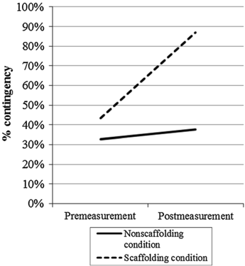
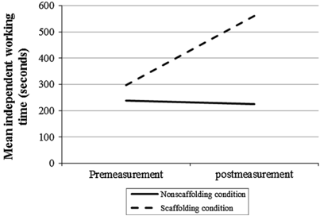
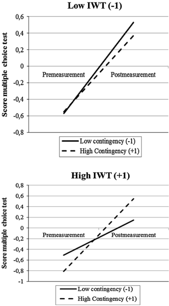
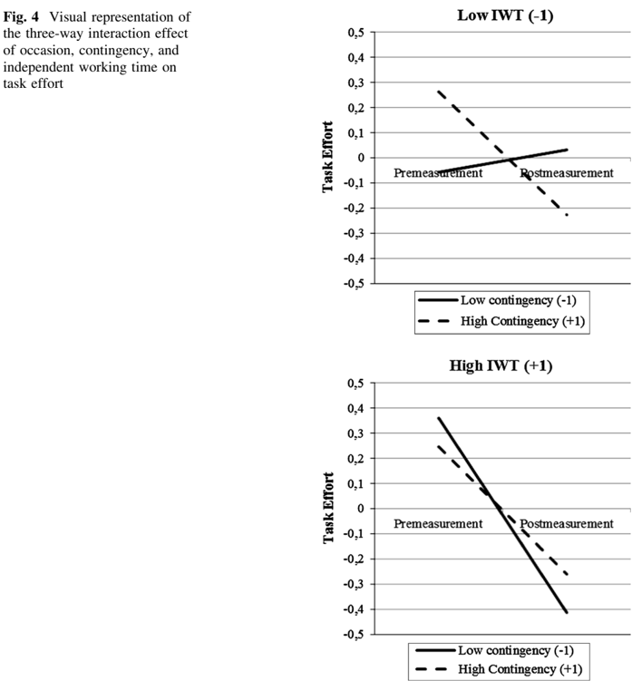

# Source conversion: The effects of scaffolding in the classroom

- Original title: *The effects of scaffolding in the classroom: support contingency and student independent working time in relation to student achievement, task effort and appreciation of support*.
- Authors: Janneke van de Pol, Monique Volman, Frans Oort, Jos Beishuizen.
- Published online: 5 June 2015. *Instructional Science* 43, 615–641.
- Original URL: https://doi.org/10.1007/s11251-015-9351-z
- PDF retrieved: https://link.springer.com/content/pdf/10.1007/s11251-015-9351-z.pdf
- Access date: 2026-10-21.
- Source type: primary empirical classroom study.
- Reuse: [CC BY 4.0](https://creativecommons.org/licenses/by/4.0/), verified in publisher article's Rights and permissions section. Attribution retained. License does not imply endorsement.
- Method: publisher PDF downloaded with curl; local Docling Serve v1.30.0, standard PDF pipeline, OCR disabled for born-digital text, table extraction enabled, embedded figure export enabled, no remote enrichment. Initial bundled client submitted task but polling failed with Windows socket exhaustion; curl recovered successful result from same task. Images extracted with bundled client's `save_images` helper.
- Changes: PDF layout converted to Markdown; this provenance added; repeated small page decorations removed. Research text not intentionally rewritten.
- Limits: full article text, tables, references and four substantive figure images retained. Reading order sometimes puts affiliations inside abstract or captions apart from figures. Extracted tables flatten grouped headings; multiplication signs, inequalities, Greek symbols and superscripts can be damaged. Consult [original PDF](../van-de-pol-et-al-2015-effects-of-scaffolding.pdf) for numerical or statistical interpretation. Figures have no image OCR or added descriptions. See [source notes](../van-de-pol-2015-source-notes.md) for independent summary and important null results.

---

## The effects of scaffolding in the classroom: support contingency and student independent working time in relation to student achievement, task effort and appreciation of support

Janneke van de Pol 1,2 · Monique Volman 1 · Frans Oort 1 · Jos Beishuizen 3

Received: 7 July 2013 / Accepted: 13 May 2015 / Published online: 5 June 2015 Ó The Author(s) 2015. This article is published with open access at Springerlink.com

Abstract Teacher scaffolding, in which teachers support students adaptively or contingently , is assumed to be effective. Yet, hardly any evidence from classroom studies exists. With the current experimental classroom study we investigated whether scaffolding affects students' achievement, task effort, and appreciation of teacher support, when students work in small groups. We investigated both the effects of support quality (i.e., contingency) and the duration of the independent working time of the groups. Thirty social studies teachers of pre-vocational education and 768 students (age 12-15) participated. All teachers taught a five-lesson project on the European Union and the teachers in the scaffolding condition additionally took part in a scaffolding intervention. Low contingent support was more effective in promoting students' achievement and task effort than high contingent support in situations where independent working time was low (i.e. help was frequent). In situations where independent working time was high (i.e., help was less frequent), high contingent support was more effective than low contingent support in fostering students' achievement (when correcting for students' task effort). In addition, higher levels of contingent support resulted in a higher appreciation of support. Scaffolding, thus, is not

&amp; Janneke van de Pol j.e.vandepol@uu.nl

Monique Volman m.l.l.volman@uva.nl

Frans Oort f.j.oort@uva.nl

Jos Beishuizen j.j.beishuizen@vu.nl unequivocally effective; its effectiveness depends, among other things, on the independent working time of the groups and students' task effort. The present study is one of the first experimental study on scaffolding in an authentic classroom context, including factors that appear to matter in such an authentic context.

1 Department of Child Development and Education, Faculty of Social and Behavioural Sciences, University of Amsterdam, Nieuwe Prinsengracht 130, 1018 VZ Amsterdam, The Netherlands

2 Department of Education, Faculty of Social Sciences, Utrecht University, PO Box 80.140, 3508 TC Utrecht, The Netherlands

3 Department of Research and Theory in Education, Faculty of Psychology and Education, VU University Amsterdam, De Boelelaan 1105, 1081 HV Amsterdam, The Netherlands

Keywords Scaffolding  Contingency  Task effort  Small group-work  Secondary education  Experimental study

## Introduction

The metaphor of scaffolding is derived from construction work where it represents a temporary structure that is used to erect a building. In education, scaffolding refers to support that is tailored to students' needs. This metaphor is alluring to practice as it appeals to teachers' imagination (Saban et al. 2007). The metaphor, moreover, also appeals to educational scientists: an abundance of research has been performed on scaffolding in the last decade (Van de Pol et al. 2010).

Scaffolding is claimed to be effective (e.g., Roehler and Cantlon 1997). However, most research on scaffolding in the classroom has been correlational until now. The main question of the current experimental study is: What is the effect of teacher scaffolding on students' achievement, task effort, and appreciation of support in a classroom setting?

## Scaffolding

Scaffolding represents high quality support (e.g., Seidel and Shavelson 2007). The metaphor of scaffolding is derived from mother-child observations and has been applied to many other contexts, such as computer environments (Azevedo and Hadwin 2005; Cuevas et al. 2002; Feyzi-Behnagh et al. 2013; Rasku-Puttonen et al. 2003; Simons and Klein 2007), tutoring settings (e.g., Chi et al. 2001) and classroom settings (e.g., Mercer and Fisher 1992; Roll et al. 2012). Scaffolding is closely related to the socio-cultural theory of Vygotsky (1978) and especially to the Zone of Proximal Development (ZPD). The ZPD is constructed through collaborative interaction, mediated by verbal interaction. Student's current or actual understanding is developed in these interactions towards their potential understanding. Scaffolding can be seen as the support a teacher offers to move the student toward his/her potential understanding (Wood et al. 1976).

More specifically, scaffolding refers to support that is contingent , faded , and aimed at the transfer of responsibility for a task or learning (Van de Pol et al. 2010). Contingent support (Wood et al. 1978) represents support that is tailored to a student's understanding. Via fading, i.e., decreasing support, the responsibility for learning can be transferred which is the aim of scaffolding. However, this transfer is probably more effective when implemented contingently. Because contingency is a necessary condition for scaffolding, we focus on this crucial aspect.

Wood et al. (1978) further specified the concept of contingency by focusing on the degree of control that support exerts. They labelled support as 'contingent' when either the tutor increased the degree of control in reaction to student failure or decreased the degree of control in reaction to student success. This is called the contingent shift principle . This specification of contingency shows that the degree of control per se does not determine whether contingent teaching or scaffolding takes place or not. It is the tailored adaptation to a student's understanding that determines contingency. Most studies on scaffolding did not use such a dynamic operationalization of scaffolding but merely focused on the teachers' behaviour only.

## Scaffolding and achievement

The way teachers interact with students affects students' achievement (Praetorius et al. 2012). Scaffolding and more specifically contingent support represents intervening in such a way that the learner can succeed at the task (Mattanah et al. 2005). Contingent support continually provides learners with problems of controlled complexity; it makes the task manageable at any time (Wood and Wood 1996).

Stone noted that it is unclear how or why contingent support may work (Stone 1998a, b). And until now the question 'What are the mechanisms of contingent support?' has still not been answered (Van de Pol et al. 2010). However, some suggestions have been made in the literature and three elements seem to play a role: (1) the level of cognitive processing; deep versus superficial processing of information, (2) making connections to existing mental models in long term memory, and (3) available cognitive resources. If the level of control is too high for a student (i.e., the support is non-contingent as too much help is given), superficial processing of the information is assumed. The student is not challenged to actively process the information and therefore does not actively make connections with existing knowledge or an existing mental model in the long term memory (e.g., Wittwer and Renkl 2008; Wittwer et al. 2010). In addition, it is assumed that attending to redundant information (information that is already known) ''might prevent learners from processing more elaborate information and, thus, from engaging in more meaningful activities that directly foster learning cf. Kalyuga 2007; McNamara and Kintsch 1996; Wittwer and Renkl 2008; Wannarka and Ruhl 2008).'' (Wittwer et al. 2010, p. 74).

If the level of control is too low for a student (i.e., the support is non-contingent as too little help is given) deep processing cannot take place. The student cannot make connections with his/her existing knowledge. The cognitive load of processing the information is too high (Wittwer et al. 2010).

If the level of control fits the students' understanding, the student has sufficient cognitive resources to actively process the information provided and is able to make connections between the new information and the existing knowledge in the long-term memory. ''If explanations are tailored to a particular learner, they are more likely to contribute to a deep understanding, because then they facilitate the construction of a coherent mental representation of the information conveyed (a so-called situation model; see, e.g., Otero and Graesser 2001)'' (Wittwer et al. 2010, p. 74). Only when support is adapted to a student's understanding, connections between new information and information already stored in long-term memory are fostered (Webb and Mastergeorge 2003).

A body of research showed that parental scaffolding was associated with success on different sorts of outcomes such as self-regulated learning (Mattanah et al. 2005), blockbuilding and puzzle construction tasks (Fidalgo and Pereira 2005; Wood and Middleton 1975) and long-division math homework (Pino-Pasternak et al. 2010). Pino-Pasternak et al. (2010) stressed that contingency was found to uniquely predict the children's performance, also when taking into account pre-test measurements and other characteristics such as parenting style.

Yet, in the current study we focused on teacher scaffolding, in contrast to parental scaffolding. An essential difference between teacher scaffolding and parental scaffolding is that in the latter case, the parent knows his/her child better than a teacher knows his/her students which might facilitate the adaptation of the support. Additionally, the studies of parental scaffolding mentioned above took place in one-to-one situations which are not comparable to classroom situations where one teacher has to deal with about 30 students at a time (Davis and Miyake 2004).

Experimental studies on the effects of teacher scaffolding in a classroom setting are rare (cf. Kim and Hannafin 2011; Van de Pol et al. 2010). The only face-to-face, nonparental scaffolding studies using an experimental design are (one-to-one) tutoring studies with structured and/or hands-on tasks (e.g., Murphy and Messer 2000). The results of these tutoring studies are similar to the results of the parental scaffolding studies; contingent support generally leads to improved student performances. A non-experimental microlevel study that investigated the relation between different patterns of contingency (e.g., increased control upon poor student understanding and decreased control upon good student understanding) in a classroom setting is the study of Van de Pol and Elbers (2013). They found that contingent support was mainly related to increased student understanding when the initial student understanding was poor. Previous research-albeit mostly in out of classroom contexts-shows contingent support is related to students' improved student achievement.

## Scaffolding, task effort and appreciation of support

Most studies on contingent support have used students' achievement as an outcome measure. Yet, other outcomes are important for students' learning and well-being as well. One important factor in students' success is task effort. Numerous studies have demonstrated that students' task effort affects their achievement (Fredricks et al. 2004). Task effort refers to students' effort, attention and persistence in the classroom (Fredricks et al. 2004; Hughes et al. 2008). Task effort is malleable and context-specific and the quality of teacher support, e.g., in terms of contingency, can affect task effort (Fredricks et al. 2004). If the contingent shift principle is applied, a tutor's support is always responsive to the student's understanding which in turn is hypothesized to stimulate student's task effort; the tutor keeps the task challenging but manageable: ' 'The child never succeeds too easily nor fails too often'' (Wood et al. 1978, p. 144). When support is contingent, the student knows which steps to take and how to proceed independently. When support is non-contingent, students often withdraw from the task as it is beyond or beneath their reach causing respectively frustration or boredom (Wertsch 1979). Hardly any empirical research exists on whether and how contingent support affects task effort. The only study that we encountered was the study of Chiu (2004) in which a positive relation was found between support in which the teacher first evaluated students' understanding (assuming that this promoted contingency) and student's task effort.

Another important factor in students' success is students' appreciation of support. Students' appreciation of support provided (e.g., because they feel that they are being taken seriously or because they feel the support was enjoyable or pleasant) may have long-term implications as support that is appreciated might encourage students to engage in further learning (Pratt and Savoy-Levine 1998). Wood (1988), using informal observations, reports that students who experienced contingent support seemed more positive towards their tutors. Pratt and Savoy-Levine (1998) were the first (and, to our knowledge, only) researchers who tested this hypothesis more systematically. They investigated the effects of contingent support on students' mathematical skills by conducting an experiment with several conditions: a full contingent (all control levels), moderate contingent (several but not all control levels) and non-contingent condition (only high-control levels) tutoring condition. Students in the full and moderate contingent conditions reported less negative feelings than students in the non-contingent condition about the tutoring session. Summarising, little is known about the effects of contingent support on students' task effort and appreciation of support.

## Support contingency and independent working time in scaffolding small-group work

Quite some research exists on small-group work but the teacher's role is still receiving relatively little attention (Webb 2009; Webb et al. 2006). Studies that focused on the teacher's role mainly studied how collaborative group work could be stimulated. Mercer and Littleton (2007) for example focused on how teachers could stimulate high-quality discussions in small groups (called exploratory talk). Little attention has been paid to how teachers can provide high quality contingent support to students-who work in groupswith regard to the subject-matter.

Some studies investigated effects of support types (e.g., process support versus content support) on students' learning (e.g., Dekker and Elshout-Mohr 2004). However, it may not be the type of support that matters, but the quality of the support (e.g., in terms of contingency). Diagnosing or evaluating students' understanding enables contingency and this is effective. Chiu (2004) for example found that when supporting small groups with the subject-matter, evaluating students' understanding before giving support was the key factor in how effective the support was. Although evaluation is not necessarily the same as contingency, it most probably facilitates contingency. To be able to be contingent, a teacher needs to evaluate or diagnose students' understanding first. The present study is one of the first study in an authentic classroom context studying small-group learning that measures the actual contingency of support.

In such an authentic classroom context, not only the support quality (here, in terms of contingency) is relevant; the duration of the groups' independent working time, should also be taken into account. It seems reasonable to assume that scaffolded or contingent support takes more time than non-scaffolded support, given that diagnosing students' understanding first before providing support is necessary to be able to give contingent support. This makes the scaffolding process time-consuming which may result in longer periods of independent small-group work. Constructivist learning theories assume that active and independent knowledge construction promotes students' learning (e.g., Duffy and Cunningham 1996). In line with this assumption some authors suggest that groups of students should be left alone working for considerable amounts of time as frequent intervention might disturb the learning process (e.g., Cohen 1994). Other studies, however, found that students benefit in classrooms with a lot of individual attention (Blatchford et al. 2007; Bru ¨hwiler and Blatchford 2007). Although it is not known to what extent students should work independently, it is now generally agreed that students at least need some support and guidance during the learning process and that minimal guidance does not work (e.g., Kirschner et al. 2006). Guidance might not only be needed to help students with the task at hand, it might also help students to stay on-task. Wannarka and Ruhl (2008) for example found that, compared to an individual seating arrangement, students who are seated in small-groups are more easily distracted. Taking both the support quality and the independent working time into account enables us to investigate the separate and joint effects of these factors. It is vital to, in addition to contingency, also include independent working time, as the positive effects of contingency might be cancelled out by (possible) negative effects of independent working time in an authentic context as ours.

## The present study

In the present study we investigated the effects of scaffolding on pre-vocational students' achievement, task effort, and appreciation of support. As opposed to previous studies, we used open-ended tasks, a real-life classroom situation and a relatively large sample size. Thirty social studies teachers and 768 students participated in this study. Seventeen teachers participated in a scaffolding intervention programme (the scaffolding condition) and 13 teachers did not (the nonscaffolding condition). We investigated the separate and joint effects of support contingency and independent working time on students' achievement, task effort and appreciation of support using a premeasurement and a postmeasurement.

In a manipulation check, we first checked whether the increase in contingency from premeasurement to postmeasurement was higher in the scaffolding condition than in the nonscaffolding condition. 1 In addition, we tested whether the increase in independent working time per group was higher in the scaffolding condition than in the nonscaffolding condition.

With regard to students' achievement , we hypothesized that: students' achievement (measured with a multiple choice test and a knowledge assignment) increases more with high levels of contingent support compared to low levels of contingent support. Because the positive effects of contingency might be ruled out by the (negative) effects of independent working time, we added the latter variable in the analyses and explored whether the effect of contingency depended on the amount of independent working time. In addition, as the relation between task effort and achievement is established (as students' task effort is known to affect achievement, Fredricks et al. 2004), we additionally investigated to what extent contingency, in combination with independent working time, affected students' achievement when controlling for task effort.

Based on the lack of previous research with regard to students' task effort and appreciation of support, we did not formulate hypotheses regarding these outcome variables. The effects of contingency and independent working time on students' task effort and appreciation of support was explored.

## Method

## Participants

The participating schools were recruited by distributing a call in the researchers' network and in online teacher communities. The teachers were informed that the study encompassed the conduction of a five-lesson project on the European Union (EU) and that the researchers would focus on students ´ learning in small groups. To arrive at random allocation to conditions, each school was alternately allocated to the scaffolding or nonscaffolding condition based on the moment of confirmation. That is, the first school that confirmed participation was allocated to the scaffolding condition, the second school to the non-scaffolding condition, the third school to the scaffolding condition etcetera. Each school only had teachers from one condition; this was to prevent teachers from different conditions to talk to each other and influence each other.

1 This was a check on the implementation fidelity only. A more elaborate investigation into the effects of the intervention on teachers' classroom practices is reported elsewhere (Van de Pol et al. 2014).

Thirty teachers from 20 Dutch schools participated in this study; 17 teachers of 11 schools were in the scaffolding condition and 13 teachers of nine schools were in the nonscaffolding condition (never more than three teachers per school). Of the participating teachers, 20 were men and 10 were women. The teachers taught social studies in the 8th grade of pre-vocational education. The average teaching experience of the teachers was 10.4 years. Each teacher participated with one class, so a total of 30 classes participated.

During the project lessons that all teachers taught during the experiment, students worked in small groups. The total number of groups was 184 and the average number of students per group was 4.15. A total of 768 students participated in this study, 455 students in the scaffolding condition and 313 students in the nonscaffolding condition. Of the 768 students, 385 were boys and 383 were girls.

T tests for independent samples showed that the schools and teachers of the scaffolding and nonscaffolding condition were comparable with regard to teachers' years of experience ( t (28): .90, p = .38), teachers' gender ( t (28): .51, p = .10), teachers' subject knowledge ( t (24): 1.16, p = .26), the degree to which the classes were used to doing small-group work ( t (23): -.87, p = .39), the track of the class ( t (28): .08, p = .94), class size ( t (28): -1.32, p = .20), duration of the lessons in minutes ( t (28): -1.18, p = .25), students' age ( t (728): -.34, p = .74), and students' gender ( t (748): -1.65, p = .10) (see Table 1).

## Research design

For this experimental study, we used a between-subjects design. In Table 2, the timeline of the study can be found.

Table 1 Comparison of conditions in terms of general characteristics of the schools, classes, teachers, groups and students

|                             | Nonscaffolding condition (0)   | Nonscaffolding condition (0)   | Nonscaffolding condition (0)   | Scaffolding condition (1)   | Scaffolding condition (1)   | Scaffolding condition (1)   |
|-----------------------------|--------------------------------|--------------------------------|--------------------------------|-----------------------------|-----------------------------|-----------------------------|
|                             | M                              | SD                             | N                              | M                           | SD                          | N                           |
| Years of experience teacher | 12.3                           | 11.75                          | 13                             | 9                           | 8.38                        | 17                          |
| Gender teacher a            | .38                            | .51                            | 13                             | .29                         | .47                         | 17                          |
| Subject knowledge teacher b | 14.58                          | 1.17                           | 12                             | 13.86                       | 1.87                        | 14                          |
| Used to group work c        | 1.27                           | .64                            | 11                             | 1.50                        | .65                         | 17                          |
| Track class d               | 1.85                           | .38                            | 13                             | 1.82                        | .95                         | 17                          |
| Class size                  | 24.00                          | 3.96                           | 13                             | 26.76                       | 6.70                        | 17                          |
| Duration lessons (min)      | 50                             | 7.90                           | 13                             | 54.12                       | 10.49                       | 17                          |
| Age students                | 13.7                           | .64                            | 296                            | 13.7                        | .65                         | 434                         |
| Gender students a           | .46                            | .50                            | 305                            | .52                         | .50                         | 445                         |

Table 2 Time line of the study

a Project lesson 2, 3 en 4 were only videotaped in the scaffolding condition as part of the intervention programme

|       |                               | Achievement            | measurement              | measurement              | measurement              | measurement              | measurement              | measurement              | measurement              | measurement              | measurement              | measurement              | measurement              | measurement              | measurement              | measurement              |
|-------|-------------------------------|------------------------|--------------------------|--------------------------|--------------------------|--------------------------|--------------------------|--------------------------|--------------------------|--------------------------|--------------------------|--------------------------|--------------------------|--------------------------|--------------------------|--------------------------|
| 8     |                               | and                    |                          |                          |                          |                          |                          |                          |                          |                          |                          |                          |                          |                          |                          |                          |
|       |                               |                        | appreciation             | appreciation             | appreciation             | appreciation             | appreciation             | appreciation             | appreciation             | appreciation             | appreciation             | appreciation             | appreciation             | appreciation             | appreciation             | appreciation             |
|       |                               | effort                 | questionnaire            | questionnaire            | questionnaire            | questionnaire            | questionnaire            | questionnaire            | questionnaire            | questionnaire            | questionnaire            | questionnaire            | questionnaire            | questionnaire            | questionnaire            | questionnaire            |
| 7     |                               | Task                   |                          |                          |                          |                          |                          |                          |                          |                          |                          |                          |                          |                          |                          |                          |
|       | lesson (videotaped)           |                        |                          |                          |                          |                          |                          |                          |                          |                          |                          |                          |                          |                          |                          |                          |
| 7     | Project Project               | lesson 4 a 5           |                          |                          |                          |                          |                          |                          |                          |                          |                          |                          |                          |                          |                          |                          |
| 4 5 6 | Project lesson Project lesson | 2 a 3 a                |                          |                          |                          |                          |                          |                          |                          |                          |                          |                          |                          |                          |                          |                          |
|       |                               | programme/ instruction |                          |                          |                          |                          |                          |                          |                          |                          |                          |                          |                          |                          |                          |                          |
| 3     | Intervention                  | project                | effort and questionnaire | effort and questionnaire | effort and questionnaire | effort and questionnaire | effort and questionnaire | effort and questionnaire | effort and questionnaire | effort and questionnaire | effort and questionnaire | effort and questionnaire | effort and questionnaire | effort and questionnaire | effort and questionnaire | effort and questionnaire |
|       | lesson (videotaped)           |                        | appreciation             | appreciation             | appreciation             | appreciation             | appreciation             | appreciation             | appreciation             | appreciation             | appreciation             | appreciation             | appreciation             | appreciation             | appreciation             | appreciation             |
|       | test -                        |                        |                          |                          |                          |                          |                          |                          |                          |                          |                          |                          |                          |                          |                          |                          |
|       | MC                            |                        |                          |                          |                          |                          |                          |                          |                          |                          |                          |                          |                          |                          |                          |                          |
| 1     |                               |                        |                          |                          |                          |                          |                          |                          |                          |                          |                          |                          |                          |                          |                          |                          |
| Week: |                               |                        |                          |                          |                          |                          |                          |                          |                          |                          |                          |                          |                          |                          |                          |                          |
|       |                               |                        | Student                  | Student                  | Student                  | Student                  | Student                  | Student                  | Student                  | Student                  | Student                  | Student                  | Student                  | Student                  | Student                  | Student                  |
|       | Teacher                       |                        |                          |                          |                          |                          |                          |                          |                          |                          |                          |                          |                          |                          |                          |                          |
| 2     |                               |                        |                          |                          |                          |                          |                          |                          |                          |                          |                          |                          |                          |                          |                          |                          |
|       | teacher                       |                        |                          |                          |                          |                          |                          |                          |                          |                          |                          |                          |                          |                          |                          |                          |
|       |                               |                        | measurement              | measurement              | measurement              | measurement              | measurement              | measurement              | measurement              | measurement              | measurement              | measurement              | measurement              | measurement              | measurement              | measurement              |
|       | 1                             |                        |                          |                          |                          |                          |                          |                          |                          |                          |                          |                          |                          |                          |                          |                          |
|       | Project                       |                        |                          |                          |                          |                          |                          |                          |                          |                          |                          |                          |                          |                          |                          |                          |
|       |                               | knowledge              |                          |                          |                          |                          |                          |                          |                          |                          |                          |                          |                          |                          |                          |                          |
|       |                               |                        |                          | Achievement              |                          |                          |                          |                          |                          |                          |                          |                          |                          |                          |                          |                          |

## Context

## Project lessons

All teachers taught the same project on the EU for which they received instructions. This project consisted of five lessons in which the students made several open-ended assignments in groups of four (e.g., a poster, a letter about (dis)advantages of the EU etcetera). The teachers taught one project lesson per week. Teachers composed groups while mixing student gender and ability. We used the first and last project lessons for analyses (respectively premeasurement and postmeasurement). In the premeasurement lesson, the students made a brochure about the meaning of the EU for young people in their everyday lives. In the postmeasurement lesson, the students worked on an assignment called 'Which Word Out' (Leat 1998). Three concepts of a list of concepts on the EU that have much in common had to be selected and thereafter, one concept had to be left out using two reasons. The students were stimulated to collaborate by the nature of the tasks (the students needed each other) and by rules for collaboration that were introduced in all classes (such as make sure everybody understands it, help each other first before you ask the teacher etcetera).

Scaffolding intervention programme

We developed and piloted the scaffolding intervention programme in a previous study (Van de Pol et al. 2012) and began after we filmed the first project lesson. The programme consisted successively of: (1) video observation of project lesson 1, (2) one two-hour theoretical session (taught per school), and (3) video observations of project lessons 2-4 each followed by a reflection session of 45 min with the first author in which video fragments of the teachers' own lessons were watched and reflected upon. Finally, all teachers taught project lesson 5 that was videotaped. This fifth lesson was not part of the scaffolding intervention programme; it served as a postmeasurement.

The first author, who was experienced, taught the programme. The reflection sessions took place individually (teacher ? 1st author) and always on the same day as the observation of the project lesson. In the theoretical session, the first author and the teachers: (a) discussed scaffolding theory and the steps of contingent teaching (Van de Pol et al. 2011), i.e., diagnostic strategies (step 1), checking the diagnosis (step 2), intervention strategies, (step 3), and checking students' learning (step 4), (b) watched and analysed video examples of scaffolding, and (c) discussed and prepared the project lessons. In the subsequent four project lessons, the teachers implemented the steps of contingent teaching cumulatively.

## Measures

Support quality: contingent teaching

We selected all interactions a teacher had with a small group of students about the subjectmatter for analyses (i.e., interaction fragments). An interaction fragment started when the teacher approached a group and ended when the teacher left. Each interaction fragment thus consisted of a variable number of teacher and student turns, 2 depending on how long the teacher stayed with a certain group. In the premeasurement and postmeasurement respectively, the teachers in the scaffolding condition had 454 and 251 fragments and the teachers in the nonscaffolding condition had 368 and 295 fragments. We used a random selection of two interaction fragments 3 of the premeasurement and two interaction fragments of the postmeasurement per teacher for analyses and we transcribed these interaction fragments. Because we selected the interaction fragments randomly, two interaction fragments of a certain teacher's lesson could, but must not be with the same group of students. This selection resulted in 108 interaction fragments consisting of 4073 turns (teacher ? student turns).

2 We use the term turn to indicate a complete utterance by a student or a teacher until another student or the teacher says something.

The unit of analyses for measuring contingency was a teacher turn, a student turn, and the subsequent teacher turn (i.e., a three-turn-sequence, for coded examples see Tables 3, 4, 5 and 6). To establish the contingency of each of unit, we used the contingent shift framework (Van de Pol et al. 2012; based on Wood et al. 1978). If a teacher used more control after a student's demonstration of poor understanding and less control after a student's demonstration of good understanding, we labelled the support contingent. To be able to apply this framework we first coded all teacher turns and all student turns as follows.

First, we coded all teacher turns in terms of the degree of control ranging from zero to five. See Tables 3, 4, 5 and 6 for coded examples. Zero represented no control (i.e., the teacher is not with the group), one represented the lowest level of control (i.e., the teacher provides no new lesson content, elicits an elaborate response, and asks a broad and open question), two represented low control (i.e., the teacher provides no new content, elicits an elaborate response, mostly an elaboration or explanation of something by asking open questions that are slightly more detailed than level one questions), three represented medium control (i.e., the teacher provides no new content and elicits a short response, e.g., yes/no), four represented a high level of control (i.e., the teacher provides new content, elicits a response, and gives a hint or asks a suggestive question), and five represented high control (e.g., providing the answer). Control refers to the degree of regulation a teacher exercises in his/her support. Two researchers coded twenty percent of the data and the interrater reliability was substantial (Krippendorff's Alpha = .71; Krippendorff 2004).

Second, we coded the student's understanding demonstrated in each turn into one of the following categories: miscellaneous, no understanding can be determined, poor/no understanding, partial understanding, and good understanding (cf. Nathan and Kim 2009; Pino-Pasternak et al. 2010; see Tables 3, 4, 5 and 6 for an example). Two researchers coded twenty percent of the data and the interrater reliability was satisfactory (Krippendorff's Alpha = .69). The contingency score was the percentage contingent three-turnsequences relative to the total number of three-turn sequences per teacher per measurement occasion. This means that each class had a certain contingency score; that is, the contingency score for all students of a particular class was the same. The first author, who knew which teacher was in which condition, coded the data. We prevented bias by coding in separate rounds: first, we coded all teacher turns with regard to the degree of control; second, we coded all student turns with regard to their understanding. And only then we applied the predetermined contingency rules to all three-turn-sequences.

3 We did not choose one but two interaction fragments per teacher get a more representative impression of the degree of contingency the teacher exhibited. Given that coding contingency is so time-consuming, it was not feasible to choose more than two interaction fragments per teacher per measurement occasion.

Table 3 Coded example of a contingent three-turn sequence with increasing control

|         |                                                    | Degree of control   | Student understanding   | Contingency                                             |
|---------|----------------------------------------------------|---------------------|-------------------------|---------------------------------------------------------|
| Teacher | What does internal market mean?                    | 1 (Low)             |                         | Contingent: increase of control upon poor understanding |
| Student | It has to do with the market on Sunday             |                     | Poor                    |                                                         |
| Teacher | Can you relate it to the European Union and trade? | 4 (High)            |                         |                                                         |

Table 4 Coded example of a contingent three-turn sequence with decreasing control

|         |                                                                                                     | Degree of control   | Student understanding   | Contingency                                             |
|---------|-----------------------------------------------------------------------------------------------------|---------------------|-------------------------|---------------------------------------------------------|
| Teacher | Does the paper article about limiting fishing quota belong to the theme 'environment' or 'welfare'? | 3 (Medium)          |                         | Contingent: decrease of control upon good understanding |
| Student | To 'environment'                                                                                    |                     | Good                    |                                                         |
| Teacher | And can you explain why?                                                                            | 1 (Lowest)          |                         |                                                         |

Table 5 Coded example of a non-contingent three-turn sequence with increasing control

|         |                                                                                                     | Degree of control   | Student understanding   | Contingency                                   |
|---------|-----------------------------------------------------------------------------------------------------|---------------------|-------------------------|-----------------------------------------------|
| Teacher | Does the paper article about limiting fishing quota belong to the theme 'environment' or 'welfare'? | 1 (Low)             |                         | Non-contingent: increase of control upon good |
| Student | To 'environment'                                                                                    |                     | Good                    | understanding                                 |
| Teacher | Yes, because otherwise certain fish will become extinct                                             | 5 (Highest)         |                         |                                               |

Table 6 Coded example of a non-contingent three-turn sequence with decreasing control

|         |                                        | Degree of control   | Student understanding   | Contingency                                                 |
|---------|----------------------------------------|---------------------|-------------------------|-------------------------------------------------------------|
| Teacher | What does internal market mean?        | 1 (Low)             |                         | Non-contingent: decrease of control upon poor understanding |
| Student | It has to do with the market on Sunday |                     | Poor                    |                                                             |
| Teacher | Okay, please continue working          | 0 (Lowest)          |                         |                                                             |

## Independent working time

We determined the average duration (in seconds) of independent working time per group per measurement occasion (T0 and T1). We did not take short whole-class instructions ( B 2 min) into account and we included this in the independent working time for each group. If the teacher provided whole-class instructions that were longer than 2 min, we started counting again after that instruction had finished and the duration of the whole-class instruction was thus not included in the independent working time for each group.

## Task effort

We measured students' task effort in class with a questionnaire consisting of 5 items (cf. Boersma et al. 2009; De Bruijn et al. 2005). We used a five-point likert scale ranging from 'I don't agree at all' to 'I totally agree'. The internal consistency was high: the value of Cronbach's a (Cronbach 1951) was .92. Kline (1999) indicated a cut-off point of .70/.80). An example item of this questionnaire is: ''I worked hard on this task''.

## Appreciation of support

We measured students' appreciation of the support received with a questionnaire consisting of 3 items (cf. Boersma et al. 2009; De Bruijn et al. 2005). We used a five-point likert scale ranging from 'I don't agree at all' to 'I totally agree'. The internal consistency was high: the value of Cronbach's a was .90. An example item of this questionnaire is: ''I liked the way the teacher helped me and my group''.

## Achievement: multiple choice test

We measured students' achievement with a test that consisted of 17 multiple choice questions (each with four possible answers). We constructed the questions. An example of a question is: ''The main reason for the collaboration between countries after World War II was: (a) to be able to compete more with other countries, (b) to be able to transport goods, people and services across borders freely, (c) to collaborate with regard to economic and trade matters, or (d) to be able to monitor the weapons industry. The item difficulty was sufficient as all p-values (i.e., the percentage of students that correctly answered the item) of the items were between .31 and .87 (Haladyna 1999). Additionally, the items were good in terms of the item discrimination (correlation between the item score and the total test score) as the mean item correlation was .33. The lowest correlation was not lower than .21; the threshold is .20 (Haladyna 1999). We used the number of questions answered correctly as a score in the analyses with a minimum score of 0 and a maximum score of 17. The internal consistency was high: the value of Cronbach's a was .79.

## Achievement: knowledge assignment

We additionally measured students' achievement with a knowledge assignment. The knowledge assignment consisted of three series of three concepts (e.g., EU, European Coal and Steel Community (ECSC), and European Economic Community (ECC)). The students were asked to leave out one concept and give one reason for leaving this concept out. We developed a coding scheme to code the accuracy and quality of the reasons. Each reason was awarded zero, one, or two points. We awarded zero points when the reason was inaccurate or based only on linguistic properties of the concepts (e.g., two of the three concepts contain the word 'European'). We awarded one point when the reason was accurate but used only peripheral characteristics of the concepts (e.g., one concept is left out because the other two concepts are each other's opposites). We awarded two points when the reason was accurate and focused on the meaning of the concepts (e.g., ECSC can be left out because they only focused on regulating the coal and steel production and the other two (EU and ECC) had broader goals that related to the economy in general). The minimum score of the knowledge assignment was 0 and the maximum score was 6. Two researchers coded over 10 % of the data and the interrater reliability was substantial (Krippendorff's Alpha = .83).

## Analyses

For our analyses, we used IBM's Statistical Package for the Social Sciences (SPSS) version 22.

## Data screening

In our predictor variables, we only found seven missing values which we handled through the expectation-maximization algorithm. For the knowledge assignment and multiple choice test we coded missing questions as zero which meant that the answer was considered false, which is the usual procedure in school as well (this was per case never more than eight percent). For the task effort and appreciation of support questionnaire, we computed the mean scores per measurement occasion and per subscale only over the number of questions that was filled out. If a student missed all measurement occasions or if a student only completed the questionnaire or one of the knowledge tests at one single measurement occasion, we removed the case (N = 18) which made the total number of students 750 (445 in the scaffolding condition; 305 in the nonscaffolding condition).

## Manipulation check

We used a repeated-measures ANOVA with condition as between groups variable, measurement occasion as within groups variable and contingency or mean independent working time as dependent variable to check the effect of the intervention on teachers' contingency and the independent working time per group. If both the level of contingency and the independent working time appear to differ systematically between conditions over measurement occasions, we will not use 'condition' as an independent variable in subsequent analyses because there is more than one systematic difference between conditions. Instead, we will use the variables 'contingency' and 'independent working time' to be able to investigate the separate effects of these variables on students' achievement, task effort, and appreciation of support.

## Effects of scaffolding

To test our hypothesis about the effect of contingency on achievement and explore the effects of contingency on students' task effort and appreciation of support, we used multilevel modelling, as the data had a nested structure (measurement occasions within students, within groups, within classes, within schools). To facilitate the interpretation of the regression coefficients, we transformed the scores of all continuous variables into z-scores (mean of zero and standard deviation of 1). We treated measurement occasions (level 1) as nested within students (level 2), students as nested within groups (level 3), groups as nested within teachers/classes (level 4) and teachers/classes as nested within schools (level 5). In comparing null models (with no predictor variables) with a variable number of levels for all dependent variables, we found that the school level (level 5) was not contributing significantly to the variance found and we therefore omitted it as a level. For the multiple choice test only, the group-level was not contributing significantly to the variance found and we therefore omitted it as a level.

We fitted four-level models fitted for each of the dependent variables separately. The independent variables in the analyses were measurement occasion (premeasurement = 0; postmeasurement = 1), contingency, and mean independent working time. We included task effort as a covariate in a separate analyses regarding achievement (multiple-choice test and knowledge assignment) as task effort is known to affect achievement (Fredricks et al. 2004). For each dependent variable, the model in which the intercept, and effects for teachers/classes and groups were considered random, with unrestricted covariance structure, gave the best fit and was thus used. We included the main effects of each of the independent variables and all interactions (i.e., the two-way interactions between measurement occasion and contingency, measurement occasion and independent working time, and contingency and independent working time and the three-way interaction between measurement occasion, contingency and independent working time). To test our hypothesis regarding achievement, we were specifically interested in the interaction between occasion and contingency. To check whether differences in independent working time played a role in whether contingency affected achievement, we were additionally interested in the three-way interaction between occasion, contingency, and independent working time. Finally, as we wanted to control for task effort, we included task effort as a covariate in a separate analysis.

To explore the effects of contingency on students' task effort and appreciation of support, we were also firstly interested in the interaction effect between occasion and contingency. Secondly, we also checked the role of independent working time by looking at the three-way interaction between occasion, contingency, and independent working time.

As an indication of effect size, we reported the partial squared eta ( g p 2 ) for the manipulation check of contingency and independent working time and the explained variance the multilevel analyses (squared correlation between the students' true scores and the estimated scores). We report only effect sizes for significant effects.

## Results

## Manipulation check

First, we verified whether the degree of the teachers' contingency increased more from premeasurement to postmeasurement in the scaffolding condition than in the nonscaffolding condition (see Table 7).

The results of the repeated-measures ANOVA showed that there was a significant interaction effect of condition and measurement occasion on teachers' contingency ( F (1,28) = 17.72, p = .00) (Fig. 1). The effect size can be considered large; g p 2 was .39 (Cohen 1992). The degree of contingency almost doubled in the scaffolding condition

(from about 50 % to about 80 %) whereas this was not the case for the nonscaffolding condition where the degree of contingency stayed between 30 and 40 %.

Second, we verified whether the intervention also resulted in longer periods of independent working time for small groups, an effect that was not necessarily aimed for with the intervention (see Table 7). The results of the repeated-measures ANOVA showed that there was a significant interaction effect of condition and measurement occasion on the average independent working time for small groups ( F (1,22) = 11.78, p = .00) (Fig. 2). The effect size can be considered large; g p 2 was .35.

The independent group working time almost doubled in the experimental condition from premeasurement to postmeasurement. In the scaffolding condition, each group worked independently for about 5 min on average at the premeasurement before the teacher came for support. At the postmeasurement, the duration increased to about 10 min. The average independent group working time stayed stable in the nonscaffolding condition, around 3.7 min on average.

## Students' achievement

## Multiple choice test

Only the main effect of occasion on students' score on the multiple choice test was significant (Table 8). Students' scores on the test were higher at the postmeasurement than at the premeasurement. The interaction between occasion and contingency was not significant. Our hypothesis could therefore not be confirmed based on the outcomes of the multiple choice test.

We additionally investigated whether differences in independent working time played a role in whether contingency affected achievement by looking at the three-way interaction between occasion, contingency and independent working time. This three-way interaction, however, was not significant (Table 8).

Finally, we additionally investigated to what extent contingency, in combination with independent working time affected students' achievement when controlling for task effort. When taking task effort into account, the three-way interaction between occasion, contingency and independent working time was significant; medium effect size of R 2 = .30; Cohen, 1992. (Table 8; Fig. 3).

When the independent working time was short, low levels of contingency resulted in an increase in scores on the multiple choice test whereas when the independent working time was long, high levels of contingency resulted in an increase in scores.

## Knowledge assignment

Again, only the main effect of occasion on students' score on the knowledge assignment was significant (Table 9). Students' scores on the knowledge assignment were higher at the postmeasurement than at the premeasurement. The interaction between occasion and contingency was not significant. Our hypothesis could therefore not be confirmed based on the outcomes of the knowledge assignment.

We additionally investigated whether differences in independent working time played a role in whether contingency affected achievement by looking at the three-way interaction between occasion, contingency and independent working time. This three-way interaction was not significant (Table 9). In addition, when adding task effort as a covariate, the threeway-interaction remained non-significant (Table 9).

Table 7 Mean contingency scores and independent working time (iwt) per measurement occasion and per condition

|                       | Nonscaffolding condition   | Nonscaffolding condition   | Nonscaffolding condition   | Nonscaffolding condition   | Scaffolding condition   | Scaffolding condition   | Scaffolding condition   | Scaffolding condition   |
|-----------------------|----------------------------|----------------------------|----------------------------|----------------------------|-------------------------|-------------------------|-------------------------|-------------------------|
|                       | Pre                        | Pre                        | Post                       | Post                       | Pre                     | Pre                     | Post                    | Post                    |
|                       | M                          | SD                         | M                          | SD                         | M                       | SD                      | M                       | SD                      |
| Contingency score (%) | .42                        | .22                        | .45                        | .15                        | .43                     | .26                     | .87                     | .08                     |
| IWT (s)               | 237.97                     | 16.30                      | 224.32                     | 32.83                      | 296.55                  | 42.86                   | 560.22                  | 61.83                   |

Fig. 1 Average percentage contingency for the teachers of each condition compared between measurement occasions

Fig. 2 Average independent working time for the groups of students of each condition compared between measurement occasions

## Students' task effort

The main effect of occasion on students' task effort was significant (Table 10); students were less on-task at the postmeasurement than at the premeasurement.

Table 8 Parameter estimates for multilevel models of students' scores on the multiple choice test predicted by occasion, independent working time, and contingency

|                               | Multiple choice test    | Multiple choice test    | Multiple choice test    | Multiple choice test   | Multiple choice test   | Multiple choice test   | Multiple choice test   | Multiple choice test   | Multiple choice test   |
|-------------------------------|-------------------------|-------------------------|-------------------------|------------------------|------------------------|------------------------|------------------------|------------------------|------------------------|
|                               | Model 0 ('empty' model) | Model 0 ('empty' model) | Model 0 ('empty' model) | Model                  | Model                  | Model                  | Model 2                | Model 2                | Model 2                |
|                               | Coeff (SE)              | Coeff (SE)              | p                       | Coeff                  | (SE)                   | p                      | Coeff (SE)             | Coeff (SE)             | p                      |
| Fixed effects                 |                         |                         |                         |                        |                        |                        |                        |                        |                        |
| Intercept                     | - .08                   | (.07)                   | .22                     | - .59                  | (.07)                  | .00*                   | - .61                  | .08                    | .00*                   |
| Occasion                      |                         |                         |                         | 1.01                   | (.06)                  | .00*                   | 1.01                   | .08                    | .00*                   |
| IWT a                         |                         |                         |                         | - .12                  | (.07)                  | .08                    | - .05                  | .09                    | .53                    |
| Contingency                   |                         |                         |                         | .00                    | (.04)                  | .91                    | - .07                  | .06                    | .22                    |
| Task effort                   |                         |                         |                         |                        |                        |                        | .05                    | .03                    | .13                    |
| Occasion 9 IWT                |                         |                         |                         | .08                    | (.10)                  | .42                    | .00                    | .11                    | .97                    |
| Occasion 9 contingency        |                         |                         |                         | .06                    | (.07)                  | .44                    | .13                    | .08                    | .11                    |
| Contingency 9 IWT             |                         |                         |                         | - .03                  | (.06)                  | .63                    | - .08                  | .07                    | .28                    |
| Occasion 9 contingency 9 IWT  |                         |                         |                         | .12                    | (.09)                  | .20                    | .22                    | .11                    | .04*                   |
| Random effects                |                         |                         |                         |                        |                        |                        |                        |                        |                        |
| Class variance                | .11                     | (.03)                   | .00*                    | .07                    | (.03)                  | .01*                   | .07                    | .03                    | .01*                   |
| Pretest variance              | .76                     | (.05)                   | .00*                    | .51                    | (.03)                  | .00*                   | .51                    | .04                    | .00*                   |
| Posttest variance             | 1.02                    | (.07)                   | .00*                    | .69                    | (.04)                  | .00*                   | .67                    | .05                    | .00*                   |
| Pretest 9 posttest covariance | - .18                   | (.04)                   | .00*                    | .08                    | (.03)                  | .01*                   | .06                    | .03                    | .06                    |

Percentages of variance explained by classes, groups, students, measurements, classes x measurements, groups 9 measurements, and students x measurements are 6, 0, 10, 43, 6, 1, 34 %, respectively. The group level was omitted as a level here because there was zero variance at this level

* p \ .05

a IWT independent working time

The two-way interaction between occasion and contingency was not significant, but the three-way interaction of occasion, contingency, and independent working time on students' task effort was significant (small effect size of R 2 = .04; Cohen 1992). The effects of contingency were found to be different for short and long periods of independent working time (see Table 10; Fig. 4).

When the independent working time was short, low levels of contingency resulted in an increase in task effort. When the independent working time was long, both high levels and low levels of contingency resulted in a decrease of task effort. In this case (i.e., high levels of independent working time), the decrease in task effort was smaller with high levels of contingency than with low levels of contingency.

## Students' appreciation of support

For students' appreciation of support, only the main effect of contingency was significant (small effect size of R 2 = .04; Cohen 1992). Regardless of the measurement occasion or the independent working time, higher levels of contingency were related to higher appreciation of support (Table 11).

Fig. 3 Visual representation of the three-way interaction effect of occasion, contingency, and independent working time (IWT) on the scores of the multiple choice test when controlling for task effort

## Discussion

With the current study, we sought to advance our understanding of the effects of scaffolding on students' achievement, task effort, and appreciation of support. We took both the support contingency and the independent working time into account to identify the effects of scaffolding in an authentic classroom situation. This study is one of few studies on classroom scaffolding with an experimental design. With this study, we made four contributions to the current knowledge base of classroom scaffolding.

First, our manipulation check showed that teachers were able to increase the degree of contingency in their support. This increase was accompanied by an increase of the independent working time for the groups.

Second, when controlling for task effort, low contingent support only resulted in improved achievement when students worked independently for short periods of time whereas high contingent support only resulted in improved achievement students worked independently for long periods of time.

Third, low contingent support resulted in an increase of task effort when students worked for short periods of time only; high contingent support never resulted in an increase of task effort but slightly prevented loss in task effort when students worked independently for long periods of time.

Table 9 Parameter estimates for multilevel models of students' scores on the knowledge assignment predicted by occasion, independent working time, and contingency

|                               | Knowledge Assignment    | Knowledge Assignment    | Knowledge Assignment    | Knowledge Assignment   | Knowledge Assignment   | Knowledge Assignment   | Knowledge Assignment   | Knowledge Assignment   | Knowledge Assignment   |
|-------------------------------|-------------------------|-------------------------|-------------------------|------------------------|------------------------|------------------------|------------------------|------------------------|------------------------|
|                               | Model 0 ('empty' model) | Model 0 ('empty' model) | Model 0 ('empty' model) | Model 1                | Model 1                | Model 1                | Model 2                | Model 2                | Model 2                |
|                               | Coeff (SE)              |                         | p                       | Coeff (SE)             | Coeff (SE)             | p                      | Coeff (SE)             | Coeff (SE)             | p                      |
| Fixed effects                 |                         |                         |                         |                        |                        |                        |                        |                        |                        |
| Intercept                     |                         |                         |                         | - .30                  | (.06)                  | .00*                   | - .38                  | (.06                   | .00*                   |
| Occasion                      |                         |                         |                         | .51                    | (.07)                  | .00*                   | .60                    | (.08)                  | .00*                   |
| IWT a                         |                         |                         |                         | - .04                  | (.07)                  | .61                    | - .06                  | (.09)                  | .51                    |
| Contingency                   |                         |                         |                         | .07                    | (.04)                  | .10                    | .07                    | (.05)                  | .17                    |
| Task effort                   |                         |                         |                         |                        |                        |                        | .05                    | (.03)                  | .14                    |
| Occasion 9 IWT                |                         |                         |                         | - .12                  | (.11)                  | .27                    | - .12                  | (.12)                  | .32                    |
| Occasion 9 contingency        |                         |                         |                         | .09                    | (.08)                  | .26                    | .07                    | (.09)                  | .44                    |
| Contingency 9 IWT             |                         |                         |                         | - .05                  | (.06)                  | .43                    | .02                    | (.07)                  | .83                    |
| Occasion 9 contingency 9 IWT  |                         |                         |                         | .19                    | (.10)                  | .06                    | .16                    | (.12)                  | .17                    |
| Random effects                |                         |                         |                         |                        |                        |                        |                        |                        |                        |
| Class variance                | .03                     | (.03)                   | .03*                    | .02                    | (.01)                  | .09                    | .02                    | (.02)                  | .31                    |
| Group variance                | .00                     | (.00)                   | .83                     | .01                    | (.02)                  | .76                    | .03                    | (.03)                  | .26                    |
| Pretest variance              | .62                     | (.04)                   | .00*                    | .56                    | (.04)                  | .00*                   | .55                    | (.05)                  | .00*                   |
| Posttest variance             | 1.37                    | (.09)                   | .00*                    | 1.09                   | (.07)                  | .00*                   | 1.06                   | (.07)                  | .00*                   |
| Pretest 9 posttest covariance | .03                     | (.04)                   | .50                     | .14                    | (.04)                  | .00*                   | .19                    | (.05)                  | .00*                   |

Percentages of variance explained by classes, groups, students, measurements, classes x measurements, groups 9 measurements, and students x measurements are 0, 0, 15, 18, 10, 0, and 57 %, respectively

* p \ .05

a IWT independent working time

Fourth, appreciation of support was related to higher levels of contingency. These four contributions are elaborated below.

First, teachers who participated in the scaffolding programme increased the contingency of their support more than teachers who did not participate in this programme. In previous research, this has not always been the case. In a study of Bliss et al. (1996) for example, teachers-who participated in a professional development programme on scaffoldingkept struggling with the application of scaffolding in their classrooms. An unintended effect of our programme (that is, we did not focus on this aspect in our programme) was that in the classrooms of teachers who learned to scaffold, the independent working time for small groups also increased. This is probably due to the fact that high contingent support-for which diagnosing students' understanding first before providing support is necessary-takes longer than low contingent support. As transferring the responsibility for a task to the learner is a main goal of scaffolding, this unintended result may actually fit well with the idea of scaffolding. However, this is only the case when responsibility for the task is gradually transferred to the students and fading of help is a gradual process. A study design with more than two time points should be used to establish whether teachers transfer responsibility and fade their help gradually and how this is related to student outcome variables.

Table 10 Parameter estimates for multilevel models of students' task effort scores predicted by occasion, independent working time, and contingency

|                               | Task Effort             | Task Effort             | Task Effort             | Task Effort   | Task Effort   | Task Effort   |
|-------------------------------|-------------------------|-------------------------|-------------------------|---------------|---------------|---------------|
|                               | Model 0 ('empty' model) | Model 0 ('empty' model) | Model 0 ('empty' model) | Model 1       | Model 1       | Model 1       |
|                               | Coeff (SE)              | Coeff (SE)              | p                       | Coeff (SE)    | Coeff (SE)    | p             |
| Fixed effects                 |                         |                         |                         |               |               |               |
| Intercept                     | .04                     | (.09)                   | .97                     | .20           | (.11)         | .07           |
| Occasion                      |                         |                         |                         | - .42         | (.07)         | .00           |
| IWT a                         |                         |                         |                         | .10           | (.10)         | .29           |
| Contingency                   |                         |                         |                         | .05           | (.06)         | .37           |
| Occasion 9 IWT                |                         |                         |                         | - .22         | (.12)         | .06           |
| Occasion 9 contingency        |                         |                         |                         | - .08         | (.08)         | .36           |
| Contingency 9 IWT             |                         |                         |                         | - .11         | (.08)         | .17           |
| Occasion 9 contingency 9 IWT  |                         |                         |                         | .21           | (.10)         | .04           |
| Random effects                |                         |                         |                         |               |               |               |
| Class variance                | .17                     | (.06)                   | .00*                    | .16           | .06           | .01*          |
| Group variance                | .13                     | (.03)                   | .00*                    | .15           | .04           | .00*          |
| Pretest variance              | .63                     | (.04)                   | .00*                    | .59           | .05           | .00*          |
| Posttest variance             | .79                     | (.05)                   | .00*                    | .73           | .05           | .00*          |
| Pretest x posttest covariance | .15                     | (.04)                   | .00*                    | .19           | .04           | .00*          |

Percentages of variance explained by classes, groups, students, measurements, classes x measurements, groups x measurements, and students x measurements are 16, 12, 20, 5, 3, 1, and 43 %, respectively

* p \ .05

a IWT independent working time

Second, when controlling for task effort, low contingent support only resulted in improved achievement when students worked independently for short periods of time whereas high contingent support only resulted in improved achievement when students worked independently for long periods of time. Different from what we expected, high contingent support was not more effective than low contingent support in all situations. Low contingent support was more effective than high contingent support when given frequently (i.e., with short independent working time). This might be explained by the fact that non-contingent support results in superficial processing and hampers constructing a coherent mental model (e.g., Wannarka and Ruhl 2008). Therefore, students do not have a deep understanding of the subject-matter and keep needing help. High contingent support was more effective than low contingent support when it was given less frequently (i.e., with long periods of independent working time). It might be the case that, as suggested by several authors, with high contingent support students have sufficient resources to actively process the information provided and can make connections between the new information and existing knowledge in the long-term memory (e.g., Wittwer et al. 2010). This leads to a deeper understanding and a more coherent mental model which might be represented by the higher increase in achievement scores.

We would like to stress that this finding was only true when students' task effort was controlled for. When task effort was not included as a covariate, the three-way-interaction

(between occasion, contingency, and independent working time) was not significant. This means that students' task effort partly determines whether contingent support is effective or not. This is supported by previous research that shows that task effort affects achievement (Fredricks et al. 2004). It might be interesting for future research to further investigate the mutual relationships between contingency, independent working time, task effort and achievement. Previous studies showed more straightforward positive effects of scaffolding on students' achievement (Murphy and Messer 2000; Pino-Pasternak et al. 2010). Yet, these studies were conducted in lab-settings in which the independent working time and task effort are less crucial. Our findings provide less straightforward but more ecologically valid effects of scaffolding. Yet, more research in authentic settings is needed to further determine the effects of scaffolding in the classroom.

Third, in most cases, students' task effort decreased from premeasurement to postmeasurement which is congruent with what is found in other studies (e.g., Gottfried et al. 2001; Stoel et al. 2003). Students' task effort, however, increased when low contingent Percentages of variance explained by classes, groups, students, measurements, classes x measurements, groups 9 measurements, and students x measurements are 17, 3, 30, 0, 2, 7, and 41 %, respectively support was given frequently. In those situations, students' task effort may have increased because of constant teacher reinforcements, which is known to foster students' task effort (Axelrod and Zank 2012; Bicard et al. 2012). Yet, it is also important that students learn to put effort in working on tasks without frequent teacher reinforcements as teachers do not always have time to constantly reinforce students. Although high contingent support generally resulted in a decrease of task effort, high contingent support resulted in a smaller loss in task effort than low contingent support, when the independent working time was long. A possible explanation for the smaller decrease in task effort with infrequent high contingent support might be that when support is contingent, students know better what steps to take in subsequent independent working. Because they know better what to do, they may be less easily distracted than students who received low contingent support. Yet, when the aim is to increase student task effort, frequent low contingent support seemed most beneficial.

Table 11 Parameter estimates for multilevel models of students' appreciation of support predicted by occasion, independent working time, and contingency

|                               | Appreciation support    | Appreciation support    | Appreciation support    | Appreciation support   | Appreciation support   | Appreciation support   |
|-------------------------------|-------------------------|-------------------------|-------------------------|------------------------|------------------------|------------------------|
|                               | Model 0 ('empty' model) | Model 0 ('empty' model) | Model 0 ('empty' model) | Model 1                | Model 1                | Model 1                |
|                               | Coeff (SE)              | Coeff (SE)              | p                       | Coeff (SE)             | Coeff (SE)             | p                      |
| Fixed effects                 |                         |                         |                         |                        |                        |                        |
| Intercept                     | .02                     | .09                     | .76                     | .12                    | .11                    | .28                    |
| Occasion                      |                         |                         |                         | - .11                  | .07                    | .12                    |
| IWT a                         |                         |                         |                         | - .07                  | .09                    | .47                    |
| Contingency                   |                         |                         |                         | .13                    | .06                    | .02*                   |
| Occasion 9 IWT                |                         |                         |                         | - .16                  | .11                    | .23                    |
| Occasion 9 Contingency        |                         |                         |                         | - .11                  | .08                    | .15                    |
| Contingency 9 IWT             |                         |                         |                         | - .03                  | .08                    | .66                    |
| Occasion 9 contingency 9 IWT  |                         |                         |                         | .15                    | .10                    | .13                    |
| Random effects                |                         |                         |                         |                        |                        |                        |
| Class variance                | .18                     | .06                     | .00*                    | .18                    | .06                    | .00*                   |
| Group variance                | .07                     | .03                     | .01*                    | .05                    | .03                    | .06                    |
| Pretest variance              | .76                     | .05                     | .00*                    | .71                    | .05                    | .00*                   |
| Posttest variance             | .76                     | .05                     | .00*                    | .70                    | .05                    | .00*                   |
| Pretest 9 posttest covariance | .26                     | .04                     | .00*                    | .24                    | .04                    | .00*                   |

* p \ .05

a IWT independent working time

Fourth, contingency was positively related to students' appreciation of support. This finding is in line with the informal observations of Wood (1988) and the findings of Pratt and Savoy-Levine (1998). Contingent support involves diagnosing students' understanding and building upon that understanding. Students might therefore appreciate contingent support more because they may feel taken seriously and feel that their ideas are respected. Yet, future, more qualitative research is needed to further explore this hypothesis.

## Limitations

A first limitation of the study is that the intervention can be considered relatively short; about 8 weeks whereas for example Slavin (2008) advised interventions to be at least 12 weeks. Both teachers and students might need more time to adjust to changes in interaction. Future research could investigate whether conducting scaffolding for a longer time span has different effects on students' behaviour, appreciation and achievement.

Furthermore, we only investigated the effects of support of the subject-matter, that is, cognitive scaffolding. Yet, metacognitive activities play an important role in group work as well and these metacognitive skills might need explicit scaffolding as well (cf. AskellWilliams et al. 2012; Molenaar et al. 2011). Future classroom research should therefore jointly investigate the scaffolding of students' cognitive and metacognitive activities.

Finally, we only investigated the linear effects of contingency and independent working time on students' achievement, task effort and appreciation of support. Yet, it would be interesting to test for non-linear effects in future research. That is, especially regarding independent working time, there might be an optimum in promoting students' achievement, task effort and perhaps appreciation of support. Very short periods of independent working might disturb the students' learning process whereas chances of getting stuck may increase with very lengthy periods of independent working time.

## Implications

The current study has several practical and scientific implications. First, the scaffolding intervention seemed to have promoted teachers' degree of contingent support; this intervention could thus facilitate future scaffolding research. Although scaffolding appeals to teachers' imagination (Saban et al. 2007), it is not something most teachers naturally do (Van de Pol et al. 2011). Therefore, finding effective ways of promoting teachers' scaffolding is crucial in order to be able to study effects of scaffolding.

Second, the scaffolding intervention programme is also useful for teacher education or professional development programs. The intervention programme provides a step by step model on how to learn to scaffold, i.e., the model of contingent teaching.

Third, this study contributed to our understanding of the circumstances in which low or high contingent support is beneficial. If teachers have the opportunity to provide frequent support, low contingent support appeared more effective in promoting students' achievement and task effort than high contingent support. Yet, if teachers do not have the opportunity to provide support often, e.g., due to a full classroom, high contingent support appeared more effective than low contingent support in fostering students' achievement (when correcting for task effort). The exact role of students' task effort in this process needs to be considered more carefully in future research.

To increase the efficiency of scaffolding support, students could for example be stimulated to, before they ask for help, think first about their own understanding. What is it they do not understand and what do they already know about the topic? When students are better able to reflect on their own understanding, they might be able to explain their understanding better to the teacher so less time needs to be spent on the diagnostic phase. Yet, a certain degree of diagnostic activities might still be crucial as it may convey a message of interest to the students. In addition, because students have difficulties at gauging their own understanding (Dunning et al. 2004), teachers' active diagnostic behaviour is needed.

## Conclusion

The current large-scaled classroom study revealed some important theoretical and practical issues. When teachers are taught how to scaffold, their degree of contingency increased but the independent working time for students increased as well. Scaffolding was not unequivocally effective; its effectiveness depends, among other things, on the independent working time and students' task effort. This study shows that such factors are important to include in scaffolding studies that take place in authentic classroom settings.

Open Access This article is distributed under the terms of the Creative Commons Attribution 4.0 International License (http://creativecommons.org/licenses/by/4.0/), which permits unrestricted use, distribution, and reproduction in any medium, provided you give appropriate credit to the original author(s) and the source, provide a link to the Creative Commons license, and indicate if changes were made.

## References

- Askell-Williams, H., Lawson, M., &amp; Skrzypiec, G. (2012). Scaffolding cognitive and metacognitive strategy instruction in regular class lessons. Instructional Science, 40 , 413-443. doi:10.1007/s11251-011-9182-5.
- Axelrod, M. I., &amp; Zank, A. J. (2012). Increasing classroom compliance: Using a high-probability command sequence with noncompliant students. Journal of Behavioural Education, 21 , 119-133.
- Azevedo, R., &amp; Hadwin, A. F. (2005). Scaffolding self-regulated learning and metacognition-Implications for the design of computer-based scaffolds. Instructional Science, 33 , 367-379. doi:10.1007/s11251005-1272-9.
- Bicard, D. F., Ervin, A., Bicard, S. C., &amp; Baylot-Casey, L. (2012). Differential effects of seating arrangements on disruptive behaviour of fifth grade students during independent seatwork. Journal of Applied Behaviour Analysis, 45 , 407-411.
- Blatchford, P., Russell, A., Bassett, P., Brown, P., &amp; Martin, C. (2007). The effect of class size on the teaching of pupils aged 7-11 years. School Effectiveness and School Improvement: An International Journal of Research, Policy and Practice, 18 , 147-172. doi:10.1080/09243450601058675.
- Bliss, J., Askew, M., &amp; Macrae, S. (1996). Effective teaching and learning: scaffolding revisited. Oxford Review of Education, 22 , 37-61. doi:10.1080/0305498960220103.
- Boersma, A. M. E., Dam, G. ten, Volman, M., &amp; Wardekker, W. (2009, April). Motivation through activity in a community of learners for vocational orientation. Paper presented at the AERA conference, San Diego
- Bru ¨hwiler, C., &amp; Blatchford, P. (2007). Effects of class size and adaptive teaching competency on classroom processes and academic outcome. Learning and Instruction, 21 , 95-108. doi:10.1016/j.learninstruc. 2009.11.004.
- Chi, M. T. H., Siler, S. A., Jeong, H., Yamauchi, T., &amp; Hausmann, R. G. (2001). Learning from human tutoring. Cognitive Science, 25 , 471-533. doi:10.1016/S0364-0213%2801%2900044-1.
- Chiu, M. M. (2004). Adapting teacher interventions to student needs during cooperative learning: How to improve student problem solving and time on-task. American Educational Research Journal, 41 , 365-399. doi:10.3102/00028312041002365.
- Cohen, J. (1992). A power primer. Psychology Bulletin, 112 , 155-159. doi:10.1037/0033-2909.112.1.155.
- Cohen, E. G. (1994). Restructuring the classroom: Conditions for productive small groups. Review of Educational Research, 64 , 1-35. doi:10.2307/1170744.
- Cronbach, L. J. (1951). Coefficient alpha and the internal structure of tests. Psychometrika, 16 , 297-334.
- Cuevas, H. M., Fiore, S. M., &amp; Oser, R. L. (2002). Scaffolding cognitive and metacognitive processes in low verbal ability learners: Use of diagrams in computer-based training environments. Instructional Science, 30 , 433-464. doi:10.1023/A:1020516301541.
- Davis, E. A., &amp; Miyake, N. (2004). Explorations of scaffolding in complex classroom systems. Journal of the Learning Sciences, 13 , 265-272. doi:10.1207/s15327809jls1303\_1.
- De Bruijn, E., Overmaat, M., Glaude ´, M., Heemskerk, I., Leeman, J., Roeleveld, J., &amp; van de Venne, J. (2005). Krachtige leeromgevingen in het middelbaar beroepsonderwijs: vormgeving en effecten [Results of powerful learning environments in vocational education] . Pedagogische Studie ¨n, 82 , 77-95.

- Dekker, R., &amp; Elshout-Mohr, M. (2004). Teacher interventions aimed at mathematical level raising during collaborative learning. Educational Studies in Mathematics, 56 , 39-65. doi:10.1023/B:EDUC. 0000028402.10122.ff.
- Duffy, T. M., &amp; Cunningham, D. J. (1996). Constructivism: Implications for the design and delivery of instruction. In D. H. Jonassen (Ed.), Educational communications and technology (pp. 170-199). New York: Simon &amp; Schuster Macmillan.
- Dunning, D., Heath, C., &amp; Suls, M. (2004). Flawed self-assessment: Implications for health, education and the workplace. Psychological Science in the Public Interest, 5 , 69-106. doi:10.1111/j.1529-1006.2004. 00018.x.
- Feyzi-Behnagh, R., Azevedo, R., Legowski, E., Reitmeyer, K., Tseytlin, E., &amp; Crowley, R. (2013). Metacognitive scaffolds improve self-judgments of accuracy in a medical intelligent tutoring system. Instructional Science, . doi:10.1007/s11251-013-9275-4.
- Fidalgo, Z., &amp; Pereira, F. (2005). Socio-cultural differences and the adjustment of mothers' speech to their children's cognitive and language comprehension skills. Learning and Instruction, 15 , 1-21. doi:10. 1016/j.learninstruc.2004.12.005.
- Fredricks, J. A., Blumenfeld, P. C., &amp; Paris, A. H. (2004). School engagement: Potential of the concept, state of the evidence. Review of Educational Research, 74 , 59-109. doi:10.3102/00346543074001059.
- Gottfried, A. E., Fleming, J. S., &amp; Gottfried, A. W. (2001). Continuity of academic intrinsic motivation from childhood through late adolescence: A longitudinal study. Journal of Educational Psychology, 93 , 3-13. doi:10.1037//0022-0663.93.1.3.
- Haladyna, T. M. (1999). Developing and validating multiple-choice test items (2nd ed.). Mahwah, NJ: Lawrence Erlbaum Associates.
- Hughes, J. N., Luo, W., Kwok, O., &amp; Loyd, L. K. (2008). Teacher-student support, effortful engagement, and achievement: A 3-year longitudinal study. Journal of Educational Psychology, 100 , 1-14. doi:10. 1037/0022-0663.100.1.1.
- Kalyuga, S. (2007). Expertise reversal effect and its implications for learner-tailored instruction. Educational Psychology Review, 19, 509-539.
- Kim, M. C., &amp; Hannafin, M. J. (2011). Scaffolding 6th graders' problem solving in technology-enhanced science classrooms: A qualitative case study. Instructional Science, 39 , 255-282. doi:10.1007/s11251010-9127-4.
- Kirschner, P. A., Sweller, J., &amp; Clark, R. E. (2006). Why minimal guidance during instruction does not work: An analysis of the failure of constructivist, discovery, problem-based, experiential, and inquirybased teaching. Educational Psychologist, 41 , 75-86. doi:10.1207/s15326985ep4102\_1.
- Kline, P. (1999). The handbook of psychological testing (2nd ed.). London: Routeledge.
- Krippendorff, K. (2004). Reliability in content analysis: Some common misconceptions and recommendations. Human Communication Research., 30 , 411-433. doi:10.1111/j.1468-2958.2004.tb00738.x.
- Leat, D. (1998). Thinking through geography . Cambridge: Chris Kington Publishing.
- Mattanah, J. F., Pratt, M. W., Cowan, P. A., &amp; Cowan, C. P. (2005). Authoritative parenting, parental scaffolding of long-division mathematics, and children's academic competence in fourth grade. Journal of Applied Developmental Psychology, 26 , 85-106. doi:10.1016/j.appdev.2004.10.007.
- McNamara, D. S., &amp; Kintsch, W. (1996). Learning from texts: Effects of prior knowledge and text coherence. Discourse Processes, 22 , 247-288.
- Mercer, N., &amp; Fisher, E. (1992). How do teachers help children to learn? An analysis of teachers' interventions in computer-based activities. Learning and Instruction, 2 , 339-355. doi:10.1016/09594752(92)90022-E.
- Mercer, N., &amp; Littleton, K. (2007). Dialogue and the development of children's thinking. A sociocultural approach . New York: Routledge.
- Molenaar, I., van Boxtel, C., &amp; Sleegers, P. (2011). Metacognitive scaffolding in an innovative learning arrangement. Instructional Science, 39 , 785-803. doi:10.1007/s11251-010-9154-1.
- Murphy, N., &amp; Messer, D. (2000). Differential benefits from scaffolding and children working alone. Educational Psychology, 20 , 17-31. doi:10.1080/014434100110353.
- Nathan, M. J., &amp; Kim, S. (2009). Regulation of teacher elicitations in the mathematics classroom. Cognition and Instruction, 27 , 91-120. doi:10.1080/07370000902797304.
- Otero, J., &amp; Graesser, A. C. (2001). PREG: Elements of a model of question asking. Cognition and Instruction, 19, 143-175.
- Pino-Pasternak, D., Whitebread, D., &amp; Tolmie, A. (2010). A multidimensional analysis of parent-child interactions during academic tasks and their relationships with children's self-regulated learning. Cognition and Instruction, 28 , 219-272. doi:10.1080/07370008.2010.490494.
- Praetorius, A. K., Lenske, G., &amp; Helmke, A. (2012). Observer ratings of instructional quality: Do they fulfill what they promise? Learning and Instruction, 6 , 387-400. doi:10.1016/j.learninstruc.2012.03.002.

- Pratt, M. W., &amp; Savoy-Levine, K. M. (1998). Contingent tutoring of long-division skills in fourth and fifth graders: Experimental tests of some hypotheses about scaffolding. Journal of Applied Developmental Psychology, 19, 287-304. doi:10.1016/S0193-3973(99)80041-0.
- Rasku-Puttonen, H., Etala ¨pelto, A., Arvaja, M., &amp; Ha ¨kkinen, P. (2003). Is successful scaffolding an illusion?-Shifting patterns of responsibility and control in teacher-student interaction during a long-term learning project. Instructional Science, 31 , 377-393. doi:10.1023/A:1025700810376.
- Roehler, L. R., &amp; Cantlon, D. J. (1997). Scaffolding: A powerful tool in social constructivist classrooms. In K. Hogan &amp; M. Pressley (Eds.), Scaffolding student learning: Instructional approaches and issues (pp. 6-42). Cambridge: Brookline Books.
- Roll, I., Holmes, N. G., Day, J., &amp; Bonn, D. (2012). Evaluating metacognitive scaffolding in guided invention activities. Instructional Science, 40 , 691-710. doi:10.1007/s11251-012-9208-7.
- Saban, A., Kocbeker, B. N., &amp; Saban, A. (2007). Prospective teachers' conceptions of teaching and learning revealed through metaphor analysis. Learning and Instruction, 17 , 123-139. doi:10.1016/j.learninstruc. 2007.01.003.
- Seidel, T., &amp; Shavelson, R. J. (2007). Teaching effectiveness research in the past decade: The role of theory and research design in disentangling metaanalytic results. Review of Educational Research , 77 , 454-499. doi:10.3102/0034654307310317.
- Simons, C., &amp; Klein, J. (2007). The impact of scaffolding and student achievement levels in a problembased learning environment. Instructional Science, 35 , 41-72. doi:10.1007/s11251-006-9002-5.
- Slavin, R. E. (2008). What works? Issues in synthesizing educational programme evaluations. Educational Researcher, 37, 5-14. doi; 10.3102/0013189X08314117
- Stoel, R. D., Peetsma, T. T. D., &amp; Roeleveld, J. (2003). Relations between the development of school investment, self-confidence, and language achievement in elementary education: a multivariate latent growth curve approach. Learning and Individual Differences, 13 , 313-333. doi:10.1016/S10416080(03)00017-7.
- Stone, C. A. (1998a). The metaphor of scaffolding: Its utility for the field of learning disabilities. Journal of Learning Disabilities , 31 , 344-364. doi:10.1177/002221949803100404.
- Stone, C. A. (1998b). Should we salvage the scaffolding metaphor? Journal of Learning Disabilities, 31 , 409-413. doi:10.1177/002221949803100411.
- Van de Pol, J., &amp; Elbers, E. (2013). Scaffolding student learning: A microanalysis of teacher-student interaction. Learning, Culture, and Social Interaction, 2 , 32-41. doi:10.1016/j.lcsi.2012.12.001.
- Van de Pol, J., Volman, M., &amp; Beishuizen, J. (2010). Scaffolding in teacher-student interaction: A decade of research. Educational Psychology Review, 22 , 271-297. doi:10.1007/s10648-010-9127-6.
- Van de Pol, J., Volman, M., &amp; Beishuizen, J. (2011). Patterns of contingent teaching in teacher-student interaction. Learning and Instruction, 21 , 46-57. doi:10.1016/j.learninstruc.2009.10.004.
- Van de Pol, J., Volman, M., Elbers, E., &amp; Beishuizen, J. (2012). Measuring scaffolding in teacher-smallgroup interactions. In R. M. Gillies (Ed.), Pedagogy: New developments in the learning sciences (pp. 151-188). Hauppage: Nova Science Publishers.
- Van de Pol, J., Volman, M., Oort, F., &amp; Beishuizen, J. (2014). Teacher scaffolding in small- group work An intervention study. Journal of the Learning Sciences , 23 (4), 600-650. doi:10.1080/10508406. 2013.805300.
- Vygotsky, L. S. (1978). Mind in society-the development of higher psychological processes . Cambridge: Harvard University Press.
- Wannarka, R., &amp; Ruhl, K. (2008). Seating arrangements that promote positive academic and behavioural outcomes: a review of empirical research. Support for Learning, 23 (2), 89-93.
- Webb, N. M. (2009). The teacher's role in promoting collaborative dialogue in the classroom. British Journal of Educational Psychology, 79 , 1-28. doi:10.1348/000709908X380772.
- Webb, N. M., &amp; Mastergeorge, A. M. (2003). The development of students' learning in peer-directed small groups. Cognition and Instruction, 21 , 361-428. doi:10.1207/s1532690xci2104\_2.
- Webb, N. M., Nemer, K. M., &amp; Ing, M. (2006). Small-group reflections: Parallels between teacher discourse and student behavior in peer-directed groups. Journal of the Learning Sciences, 15 , 63-119. doi:10. 1207/s15327809jls1501\_8.
- Wertsch, J. V. (1979). From social interaction to higher psychological process: A clarification and application of Vygotsky's theory. Human Development, 22 , 1-22. doi:10.1159/000272425.
- Wittwer, J., Nu ¨ckles, M., &amp; Renkl, A. (2010). Using a diagnosis-based approach to individualize instructional explanations in computer-mediated communication. Educational Psychology Review, 22 , 9-23. doi:10.1007/s10648-010-9118-7.
- Wittwer, J., &amp; Renkl, A. (2008). Why instructional explanations often do not work: A framework for understanding the effectiveness of instruction explanations. Educational Psychologist, 43 , 49-64. doi:10.1080/00461520701756420.

- Wood, D. (1988). How children think and learn . Oxford, UK: Blackwell.
- Wood, D., Bruner, J. S., &amp; Ross, G. (1976). The role of tutoring in problem-solving. Journal of Child Psychology and Psychiatry and Allied Disciplines, 17 , 89-100. doi:10.1111/j.1469-7610.1976. tb00381.x.
- Wood, D., &amp; Middleton, D. (1975). A study of assisted problem-solving. British Journal of Psychology, 66 , 181-191. doi:10.1111/j.2044-8295.1975.tb01454.x.
- Wood, D., &amp; Wood, H. (1996). Commentary: Contingency in tutoring and learning. Learning and Instruction, 6 , 391-397. doi:10.1016/0959-4752(96)00023-0.
- Wood, D., Wood, H., &amp; Middleton, D. (1978). An experimental evaluation of four face- to-face teaching strategies. International Journal of Behavioral Development, 1 , 131-147. doi:10.1177/016502547 800100203.

